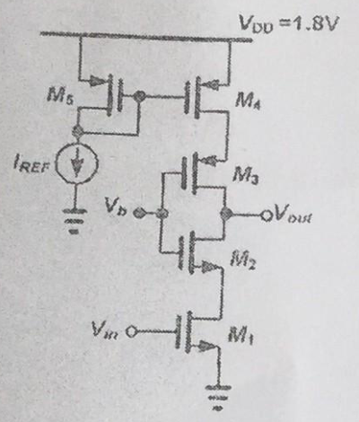

# 기출 2013-1 중간 1 — M5–M4 전류 거울로 바이어스한 pmos 캐스코드 전류원 부하의 MOS 캐스코드 증폭기

## 원문
다음 회로에 대해 다음 조건을 이용하여 질문에 답하시오.

$(W/L)_{1,2} = 500$, $(W/L)_{3,4} = 1000$, $I_{REF} = 100\ \mu\text{A}$,

$\mu_n C_{ox} = 100\ \mu\text{A/V}^2$, $\mu_p C_{ox} = 50\ \mu\text{A/V}^2$, $V_{TH,N} = 0.4\ \text{V}$, $\lambda_n = 0.1\ \text{V}^{-1}$, $\lambda_p = 0.2\ \text{V}^{-1}$

(1) $M_4 = 10 \times M_5$ 일 때, 입력(Vin)의 DC 바이어스 전압을 구하시오.

(2) $M_1$이 saturation 영역에서 동작하기 위한 DC 바이어스 전압 $V_b$의 최소값을 구하시오.

(3) 출력 저항을 구하시오.

(4) 전압이득 ($v_{out}/v_{in}$)을 구하시오.

## 조건
- 회로: 그림의 MOS 캐스코드 증폭기 ($M_5$–$M_4$ 전류 거울, $M_4$–$M_3$ pmos 캐스코드 전류원 부하) (괄호 안은 원문에 없음)
- $V_{DD} = 1.8\ \text{V}$ (문장에는 없고 그림의 $V_{DD}$ 라벨에 인쇄됨)
- $(W/L)_{1,2} = 500$, $(W/L)_{3,4} = 1000$
- $I_{REF} = 100\ \mu\text{A}$
- $\mu_n C_{ox} = 100\ \mu\text{A/V}^2$, $\mu_p C_{ox} = 50\ \mu\text{A/V}^2$
- $V_{TH,N} = 0.4\ \text{V}$
- $\lambda_n = 0.1\ \text{V}^{-1}$, $\lambda_p = 0.2\ \text{V}^{-1}$
- 답안지에는 인쇄된 $\lambda_p$ 값 0.2에 손글씨로 줄을 긋고 위에 0.1을 적었다. 정정인지는 원문으로 확인할 수 없음 (원문에 없음)
- (1) 전용: $M_4 = 10 \times M_5$
- $M_4 = 10 \times M_5$는 크기($W/L$) 비로 보임 (원문에 없음)
- $M_3$, $M_2$ 게이트는 같은 바이어스 $V_b$에 이어짐. $V_{TH,P}$와 $M_5$의 $W/L$ 값은 주어지지 않음 (원문에 없음)

## 구할 것
- (1) $M_4 = 10 \times M_5$일 때 입력 $V_{in}$의 DC 바이어스 전압
- (2) $M_1$이 saturation 영역에서 동작하기 위한 DC 바이어스 전압 $V_b$의 최소값
- (3) 출력 저항
- (4) 전압 이득 $v_{out}/v_{in}$

## 회로 — Fig Q1
```spice
IREF  n1    0     {I_REF}
M5    n1    n1    VDD  pmos   ; 좌우 반전 (게이트 오른쪽), 다이오드 연결
M4    n2    n1    VDD  pmos
M3    Vout  Vb    n2   pmos
M2    Vout  Vb    n3   nmos
M1    n3    Vin   0    nmos
* n1 = M5 드레인·게이트와 M4 게이트 노드, 라벨 없음
* n2, n3 라벨 없음
* (W/L)_1,2 = 500, (W/L)_3,4 = 1000 은 문제 문장에만 인쇄됨 (그림에는 없음)
```
- 단자: VDD = 1.8 V 전원 (가로 레일) / Vb = DC 바이어스, 값은 (2)에서 최소값을 구함 (점 단자) / Vin = 입력 (개방 원) / Vout = 출력 (개방 원)
- 표시: 노드 라벨 V_DD =1.8V (레일 오른쪽 끝 위), V_b (점 단자 왼쪽), V_out (출력 원 오른쪽), V_in (입력 원 왼쪽) / 소자 라벨 M_5 (M5 왼쪽), M_4, M_3, M_2, M_1 (각 트랜지스터 오른쪽), I_REF (전류원 왼쪽) / 부호 없음 / 화살표 없음 / 수치·면적 라벨 없음 (V_DD 라벨 안의 "=1.8V"만 있음)
- 배치: 맨 위 굵은 가로 레일 V_DD / 왼쪽 세로줄 위→아래 M5, n1 접속점, I_REF 전류원(화살표 아래), 접지 / M5 pmos 좌우 반전(게이트 막대 오른쪽, 소스 왼쪽 위·화살표가 채널 쪽으로 들어감, 드레인 왼쪽 아래), 소스에서 세로선이 위로 레일 / n1 접속점에서 가로선이 오른쪽으로 나가 위로 꺾여 게이트 접속점 (다이오드 연결) / 게이트 접속점에서 게이트 높이의 가로선이 왼쪽 M5 게이트, 오른쪽 M4 게이트로 / 오른쪽 세로줄 위→아래 M4, M3, Vout 접속점, M2, M1, 접지 / M4, M3 pmos 보통 방향(게이트 왼쪽, 소스 오른쪽 위·화살표가 채널 쪽으로 들어감, 드레인 오른쪽 아래), M4 소스에서 세로선이 위로 레일 / M4 드레인에서 세로선이 M3 소스로 (n2) / M2, M1 nmos 보통 방향(게이트 왼쪽, 드레인 오른쪽 위, 소스 오른쪽 아래·화살표 바깥) / M2 소스에서 세로선이 M1 드레인으로 (n3) / M3 게이트에서 가로선이 왼쪽으로 나가 아래로 꺾여 Vb 접속점을 지나 M2 게이트 높이에서 오른쪽으로 꺾여 M2 게이트 / V_b 점 단자 → 짧은 가로선 → Vb 접속점 / Vout 접속점에서 가로선이 오른쪽 V_out 원 / V_in 원 → 가로선 → M1 게이트, M1 소스 아래 접지 / 접속점 (세 갈래 이상, 4곳): ① n1 = 위 M5 드레인 + 아래 I_REF + 오른쪽 다이오드 연결선 (점) ② 게이트 접속점 = 왼쪽 M5 게이트 + 오른쪽 M4 게이트 + 아래 다이오드 연결선 (점) ③ Vb = 왼쪽 V_b 단자선 + 위 M3 게이트선 + 아래 M2 게이트선 (점) ④ Vout = 위 M3 드레인 + 아래 M2 드레인 + 오른쪽 V_out 선 (점) / 교차: 없음


> 참고: 크롭 안에는 손글씨가 없음
