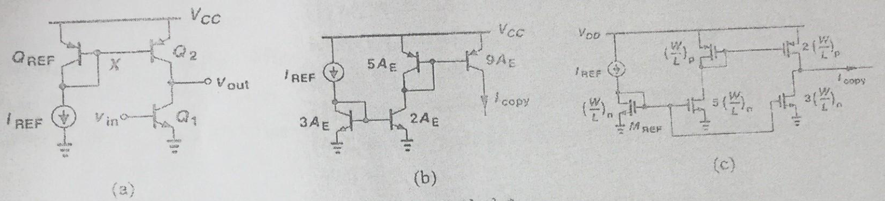

# 기출 2013-1 중간 2 — pnp 전류 거울 부하 CE 단의 이득과 이미터 면적비·W/L 배수 전류 거울의 I_copy

## 원문
다음 회로에 대해 질문에 답하시오.

이 때, $V_{A,npn} = 5\ \text{V}$, $V_{A,pnp} = 5\ \text{V}$, $V_T = 25\ \text{mV}$, $I_{REF} = 100\ \mu\text{A}$, $V_{CC} = 2.5\ \text{V}$ 로 가정한다. 그리고, BJT의 베이스 전류는 무시한다

(1) 그림(a) 회로에서 전압이득($v_{out}/v_{in}$)의 식을 구하시오.

(2) 그림(a) 회로에서 $Q_2 = 5 \times Q_{REF}$ 일 때, 전압이득($v_{out}/v_{in}$)의 값을 구하시오.

(3) 그림(b) 회로에서 $I_{copy}$ 를 $I_{REF}$ 에 관한 식으로 구하시오.

(4) 그림(c) 회로에서 $I_{copy}$ 를 $I_{REF}$ 에 관한 식으로 구하시오.

## 조건
- 회로: 그림 (a), (b), (c)
- $V_{A,npn} = 5\ \text{V}$, $V_{A,pnp} = 5\ \text{V}$, $V_T = 25\ \text{mV}$
- $I_{REF} = 100\ \mu\text{A}$, $V_{CC} = 2.5\ \text{V}$
- BJT의 베이스 전류는 무시
- (2) 전용 (회로 (a)): $Q_2 = 5 \times Q_{REF}$
- $Q_2 = 5 \times Q_{REF}$는 이미터 면적 비로 보임 (원문에 없음)
- (b) 전용: 이미터 면적 왼쪽 아래 npn $3A_E$, 가운데 아래 npn $2A_E$, 가운데 위 pnp $5A_E$, 오른쪽 pnp $9A_E$ (그림에 인쇄된 라벨)
- (c) 전용: 크기 $M_{REF} = (W/L)_n$, 가운데 NMOS $= 5(W/L)_n$, 오른쪽 NMOS $= 3(W/L)_n$, 왼쪽 PMOS $= (W/L)_p$, 오른쪽 PMOS $= 2(W/L)_p$ (그림에 인쇄된 라벨)
- (c)의 $V_{DD}$ 값은 주어지지 않음. $\beta$ 값도 주어지지 않음 (원문에 없음)

## 구할 것
- (1) 그림 (a) 회로의 전압 이득 $v_{out}/v_{in}$의 식
- (2) 그림 (a) 회로에서 $Q_2 = 5 \times Q_{REF}$일 때 전압 이득 $v_{out}/v_{in}$의 값
- (3) 그림 (b) 회로의 $I_{copy}$를 $I_{REF}$에 관한 식으로
- (4) 그림 (c) 회로의 $I_{copy}$를 $I_{REF}$에 관한 식으로

## 회로 — Fig Q2(a)
```spice
QREF  X     X     VCC  pnp    ; 좌우 반전 (베이스 오른쪽), 다이오드 연결
IREF  X     0     {I_REF}
Q2    Vout  X     VCC  pnp
Q1    Vout  vin   0    npn
* X = Q_REF 컬렉터·베이스와 Q2 베이스 노드 (X 라벨은 베이스 공통선 아래)
```
- 단자: VCC = 2.5 V 전원 (가로 레일) / vin = 소신호 입력 (개방 원) / Vout = 출력 (개방 원)
- 표시: 노드 라벨 V_CC (레일 오른쪽 끝), X (베이스 공통선 아래, X 접속점 오른쪽), v_in (입력 원 왼쪽), V_out (출력 원 오른쪽) / 소자 라벨 Q_REF (Q_REF 왼쪽), Q_2 (Q2 오른쪽), Q_1 (Q1 오른쪽), I_REF (전류원 왼쪽) / 부호 없음 / 화살표 없음 / 수치·면적 라벨 없음
- 배치: 맨 위 굵은 가로 레일 V_CC / 왼쪽 세로줄 위→아래 Q_REF, 컬렉터 접속점, I_REF 전류원(화살표 아래), 접지 / Q_REF pnp 좌우 반전(베이스 막대 오른쪽, 이미터 왼쪽 위·화살표가 막대 쪽으로 들어감, 컬렉터 왼쪽 아래), 이미터에서 세로선이 위로 레일 / 컬렉터 접속점에서 가로선이 오른쪽으로 나가 위로 꺾여 X 접속점 (다이오드 연결) / 베이스 공통선은 Q_REF 베이스에서 Q2 베이스까지 베이스 높이로 가로지름 / 오른쪽 세로줄 위→아래 Q2, Vout 접속점, Q1, 접지 / Q2 pnp 보통 방향(베이스 왼쪽, 이미터 오른쪽 위·화살표가 막대 쪽으로 들어감, 컬렉터 오른쪽 아래), 이미터에서 세로선이 위로 레일 / Q1 npn 보통 방향(베이스 왼쪽, 컬렉터 오른쪽 위, 이미터 오른쪽 아래·화살표 바깥), 이미터 아래 접지 / Vout 접속점에서 가로선이 오른쪽 V_out 원 / v_in 원 → 가로선 → Q1 베이스 / 접속점 (세 갈래 이상, 3곳): ① 컬렉터 접속점 = 위 Q_REF 컬렉터 + 아래 I_REF + 오른쪽 다이오드 연결선 (점) ② X = 왼쪽 Q_REF 베이스 + 오른쪽 Q2 베이스 + 아래 다이오드 연결선 (점) ③ Vout = 위 Q2 컬렉터 + 아래 Q1 컬렉터 + 오른쪽 V_out 선 (점) / 교차: 없음

## 회로 — Fig Q2(b)
```spice
IREF  VCC   n1    {I_REF}
Q1    n1    n1    0    npn  area=3   ; 라벨 없음, 좌우 반전 (베이스 오른쪽), 다이오드 연결
Q2    n2    n1    0    npn  area=2   ; 라벨 없음
Q3    n2    n2    VCC  pnp  area=5   ; 라벨 없음, 좌우 반전 (베이스 오른쪽), 다이오드 연결
Q4    out   n2    VCC  pnp  area=9   ; 라벨 없음
* out = Q4 컬렉터에서 내려온 선 끝, I_copy 화살표가 붙음
* n1, n2 라벨 없음
```
- 단자: VCC = 전원 (가로 레일) / out = I_copy 측정 단자 (선 끝)
- 표시: 노드 라벨 V_CC (레일 오른쪽 끝) / 소자 라벨 I_REF (전류원 왼쪽), Q1–Q4 (라벨 없음) / 부호 없음 / 화살표 "I_copy": Q4 컬렉터에서 내려온 세로선 끝, 아래 방향, 도선 위, 글자는 화살표 오른쪽 / 수치·면적 라벨 "3A_E" (Q1 왼쪽), "2A_E" (Q2 오른쪽), "5A_E" (Q3 왼쪽), "9A_E" (Q4 오른쪽)
- 배치: 맨 위 굵은 가로 레일 V_CC / 왼쪽 세로줄 위→아래 I_REF 전류원(화살표 아래), n1 접속점, Q1, 접지 / Q1 npn 좌우 반전(베이스 막대 오른쪽, 컬렉터 왼쪽 위, 이미터 왼쪽 아래·화살표 바깥), 이미터 아래 접지 / n1 접속점에서 가로선이 오른쪽으로 나가 아래로 꺾여 베이스 접속점 (다이오드 연결) / 아래 베이스 공통선은 Q1 베이스에서 Q2 베이스까지 베이스 높이로 가로지름 / Q2는 Q1 오른쪽, npn 보통 방향(베이스 왼쪽, 컬렉터 오른쪽 위, 이미터 오른쪽 아래·화살표 바깥), 이미터 아래 접지 / Q2 컬렉터에서 세로선이 위로 n2 접속점, 다시 위로 Q3 컬렉터 / Q3은 가운데 위, pnp 좌우 반전(베이스 막대 오른쪽, 이미터 왼쪽 위·화살표가 막대 쪽으로 들어감, 컬렉터 왼쪽 아래), 이미터에서 세로선이 위로 레일 / n2 접속점에서 가로선이 오른쪽으로 나가 위로 꺾여 위 베이스 접속점 (다이오드 연결) / 위 베이스 공통선은 Q3 베이스에서 Q4 베이스까지 베이스 높이로 가로지름 / Q4는 오른쪽, pnp 보통 방향(베이스 왼쪽, 이미터 오른쪽 위·화살표가 막대 쪽으로 들어감, 컬렉터 오른쪽 아래), 이미터에서 세로선이 위로 레일, 컬렉터에서 세로선이 아래로 내려가 선 끝 / 접속점 (세 갈래 이상, 4곳): ① n1 = 위 I_REF + 아래 Q1 컬렉터 + 오른쪽 다이오드 연결선 (점) ② 아래 베이스 접속점 = 왼쪽 Q1 베이스 + 오른쪽 Q2 베이스 + 위 다이오드 연결선 (점) ③ n2 = 위 Q3 컬렉터 + 아래 Q2 컬렉터 + 오른쪽 다이오드 연결선 (점) ④ 위 베이스 접속점 = 왼쪽 Q3 베이스 + 오른쪽 Q4 베이스 + 아래 다이오드 연결선 (점) / 교차: 없음

## 회로 — Fig Q2(c)
```spice
IREF  VDD   n1    {I_REF}
MREF  n1    n1    0    nmos  W/L={(W/L)_n}        ; 좌우 반전 (게이트 오른쪽), 다이오드 연결
M1    n2    n1    0    nmos  W/L={(W/L)_n}  m=5   ; 라벨 없음
M2    n2    n2    VDD  pmos  W/L={(W/L)_p}        ; 라벨 없음, 좌우 반전 (게이트 오른쪽), 다이오드 연결
M3    out   n2    VDD  pmos  W/L={(W/L)_p}  m=2   ; 라벨 없음
M4    out   n1    0    nmos  W/L={(W/L)_n}  m=3   ; 라벨 없음, 게이트는 아래쪽 긴 선으로 n1에 이어짐
* out = M3 드레인과 M4 드레인이 만나는 노드, 오른쪽으로 I_copy 화살표가 붙은 선이 나감
* n1, n2 라벨 없음
```
- 단자: VDD = 전원, 값 미지정 (가로 레일) / out = I_copy 측정 단자 (선 끝, 화살촉이 붙은 가로선)
- 표시: 노드 라벨 V_DD (레일 왼쪽 끝 위) / 소자 라벨 I_REF (전류원 왼쪽), M_REF (M_REF 소스 아래 접지 오른쪽), M1–M4 (라벨 없음) / 부호 없음 / 화살표 "I_copy": out에서 오른쪽으로 나가는 가로선, 오른쪽 방향, 도선 위, 글자는 화살표 아래 / 수치·면적 라벨 "(W/L)_n" (M_REF 왼쪽), "5(W/L)_n" (M1 오른쪽), "3(W/L)_n" (M4 오른쪽), "(W/L)_p" (M2 왼쪽), "2(W/L)_p" (M3 오른쪽)
- 배치: 맨 위 굵은 가로 레일 V_DD (오른쪽 끝은 M3 소스 너머) / 왼쪽 세로줄 위→아래 I_REF 전류원(화살표 아래), n1 접속점, M_REF, 접지 / M_REF nmos 좌우 반전(게이트 막대 오른쪽, 드레인 왼쪽 위, 소스 왼쪽 아래·화살표 바깥) / n1 접속점에서 가로선이 오른쪽으로 나가 아래로 꺾여 M_REF 게이트 접속점 (다이오드 연결) / 게이트 접속점에서 게이트 높이의 가로선이 오른쪽 둘째 게이트 접속점을 지나 M1 게이트 / 둘째 게이트 접속점에서 세로선이 아래로 내려가 그림 맨 아래 긴 가로선으로 오른쪽, M4 왼쪽에서 위로 꺾여 M4 게이트 / M1은 가운데 아래, nmos 보통 방향(게이트 왼쪽, 드레인 오른쪽 위, 소스 오른쪽 아래·화살표 바깥), 소스 아래 접지 / M1 드레인에서 세로선이 위로 n2 접속점 / M2는 가운데 위, pmos 좌우 반전(게이트 막대 오른쪽, 소스 왼쪽 위·화살표가 채널 쪽으로 들어감, 드레인 왼쪽 아래), 소스에서 세로선이 위로 레일 / n2 접속점은 M2 드레인 바로 아래, 가로선이 오른쪽으로 나가 위로 꺾여 M2 게이트 접속점 (다이오드 연결) / M2 게이트 접속점에서 게이트 높이의 가로선이 오른쪽 M3 게이트로 / M3은 오른쪽 위, pmos 보통 방향(게이트 왼쪽, 소스 오른쪽 위·화살표가 채널 쪽으로 들어감, 드레인 오른쪽 아래), 소스에서 세로선이 위로 레일 / 오른쪽 세로줄 위→아래 M3, out 접속점, M4, 접지 / M4 nmos 보통 방향(게이트 왼쪽, 드레인 오른쪽 위, 소스 오른쪽 아래·화살표 바깥) / out 접속점에서 가로선이 오른쪽으로 나가 I_copy 화살촉을 지나 선 끝 / 접속점 (세 갈래 이상, 6곳): ① n1 = 위 I_REF + 아래 M_REF 드레인 + 오른쪽 다이오드 연결선 (점) ② M_REF 게이트 접속점 = 왼쪽 M_REF 게이트 + 위 다이오드 연결선 + 오른쪽 게이트 가로선 (점) ③ 둘째 게이트 접속점 = 왼쪽 게이트 가로선 + 오른쪽 M1 게이트 + 아래 M4로 가는 세로선 (점) ④ n2 = 위 M2 드레인 + 아래 M1 드레인 + 오른쪽 다이오드 연결선 (점) ⑤ M2 게이트 접속점 = 왼쪽 M2 게이트 + 오른쪽 M3 게이트 + 아래 다이오드 연결선 (점) ⑥ out = 위 M3 드레인 + 아래 M4 드레인 + 오른쪽 I_copy 선 (점) / 교차: 없음


> 참고: 크롭 안에는 손글씨가 없음. (c)는 다른 두 패널보다 작고 흐리게 인쇄됨

## 풀이
### (1) 전압 이득의 식
- $X$는 다이오드 연결 $Q_{REF}$에 DC로 고정되어 신호가 없으므로 $Q_2$는 $r_{O2}$로만 남는다
- $A_v = -g_{m1}(r_{O1} \parallel r_{O2})$, $I_{C1} = |I_{C2}|$라 전류가 약분되어 $A_v = -\dfrac{V_{A,npn} V_{A,pnp}}{V_T (V_{A,npn} + V_{A,pnp})}$
### (2) 전압 이득의 값
- $I_C = 5 I_{REF} = 500\ \mu\text{A}$: $g_{m1} = 20.0\ \text{mS}$, $r_{O1} = r_{O2} = 10.0\ \text{k}\Omega$
- $A_v = -g_{m1}(r_{O1} \parallel r_{O2}) = -100$
### (3) 그림 (b)의 $I_{copy}$
- npn 거울 $3A_E \to 2A_E$로 $(2/3) I_{REF}$, 이를 pnp 거울 $5A_E \to 9A_E$가 $9/5$배로 복사
- $I_{copy} = (9/5)(2/3) I_{REF} = 1.20\, I_{REF}$
### (4) 그림 (c)의 $I_{copy}$
- 가운데 NMOS가 $5 I_{REF}$, 이를 받은 오른쪽 PMOS가 $2 \times 5 I_{REF}$를 출력 노드로 넣는다
- 오른쪽 NMOS는 맨 아래 선으로 $M_{REF}$ 게이트에 이어져 $3 I_{REF}$를 뺀다
- 출력 노드 KCL: $I_{copy} = 10 I_{REF} - 3 I_{REF} = 7 I_{REF}$ (λ 무시)
### 답
- (1) $v_{out}/v_{in} = -g_{m1}(r_{O1} \parallel r_{O2}) = -\dfrac{V_{A,npn} V_{A,pnp}}{V_T (V_{A,npn} + V_{A,pnp})}$
- (2) $v_{out}/v_{in} = -100$
- (3) $I_{copy} = 1.20\, I_{REF}$
- (4) $I_{copy} = 7 I_{REF}$
