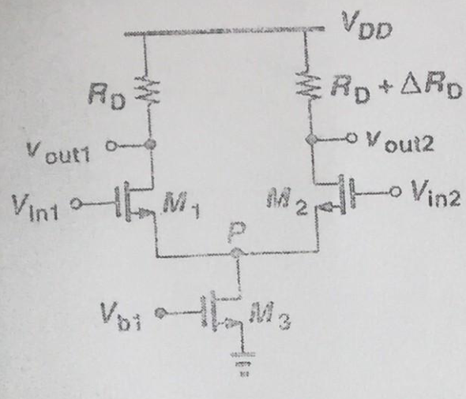

# 기출 2013-1 중간 3 — 부하 저항 불일치 ΔR_D가 있는 MOS 차동쌍의 입력 CM 최대값, 차동·CM 이득, A_CM-DM, CMRR

## 원문
MOS differential pair가 다음 조건으로 동작할 때, 질문에 답하시오.

$V_{DD} = 1.8\ \text{V}$, $I_{D3} = 2\ \text{mA}$, $(W/L)_{1,2} = 500$, $R_D = 1\ \text{k}\Omega$, $\mu_n C_{ox} = 100\ \mu\text{A/V}^2$, $\lambda_n = 0.1\ \text{V}^{-1}$, $V_{TH,N} = 0.4\ \text{V}$

이 때, $r_{o1,2} >> R_D$ 로 가정한다.

(1) $M_1$, $M_2$가 saturation 영역에서 동작하기 위한 입력 CM level ($V_{CM}$)의 최대값을 구하시오. ($\Delta R_D = 0$으로 가정)

(2) 차동 전압이득을 구하시오. ($\Delta R_D = 0$으로 가정)

(3) Common-mode 전압이득을 구하시오. ($\Delta R_D = 0$으로 가정)

(4) Common mode to differential mode 전압이득($A_{CM-DM}$)을 구하시오.

(5) $\Delta R_D / R_D = 1\ \%$ 일 때, common-mode rejection ratio (CMRR)를 구하시오.

## 조건
- 회로: 그림의 MOS 차동 증폭기
- $V_{DD} = 1.8\ \text{V}$, $I_{D3} = 2\ \text{mA}$
- $(W/L)_{1,2} = 500$, $R_D = 1\ \text{k}\Omega$
- $\mu_n C_{ox} = 100\ \mu\text{A/V}^2$, $\lambda_n = 0.1\ \text{V}^{-1}$, $V_{TH,N} = 0.4\ \text{V}$
- $r_{o1,2} \gg R_D$로 가정
- (1), (2), (3) 전용: $\Delta R_D = 0$으로 가정
- (5) 전용: $\Delta R_D / R_D = 1\ \%$
- (4)에는 $\Delta R_D$ 값이 인쇄돼 있지 않음 (원문에 없음)
- 바이어스 전압 $V_{b1}$ 값과 $(W/L)_3$은 주어지지 않음 (원문에 없음)

## 구할 것
- (1) $M_1$, $M_2$가 saturation 영역에서 동작하기 위한 입력 CM level $V_{CM}$의 최대값
- (2) 차동 전압 이득
- (3) Common-mode 전압 이득
- (4) Common mode to differential mode 전압 이득 $A_{CM-DM}$
- (5) $\Delta R_D / R_D = 1\ \%$일 때 common-mode rejection ratio (CMRR)

## 회로 — Fig Q3
```spice
RD1  VDD    vout1  {R_D}          ; 인쇄 라벨 R_D
RD2  VDD    vout2  {R_D+ΔR_D}     ; 인쇄 라벨 R_D + ΔR_D
M1   vout1  Vin1   P    nmos
M2   vout2  Vin2   P    nmos      ; 좌우 반전 (게이트 오른쪽)
M3   P      Vb1    0    nmos
```
- 단자: VDD = 1.8 V 전원 (가로 레일) / Vb1 = 이상적 DC 바이어스, 값 미지정 (점 단자) / Vin1, Vin2 = 입력 (개방 원) / vout1, vout2 = 출력 (개방 원)
- 표시: 노드 라벨 V_DD (레일 오른쪽 끝), v_out1 (왼쪽 출력 원 왼쪽), v_out2 (오른쪽 출력 원 오른쪽), V_in1 (왼쪽 입력 원 왼쪽), V_in2 (오른쪽 입력 원 오른쪽), P (P 접속점 위), V_b1 (점 단자 왼쪽) / 소자 라벨 R_D (왼쪽 저항 왼쪽), R_D + ΔR_D (오른쪽 저항 오른쪽), M_1 (M1 오른쪽), M_2 (M2 왼쪽), M_3 (M3 오른쪽) / 부호 없음 / 화살표 없음 / 수치·면적 라벨 없음
- 배치: 맨 위 굵은 가로 레일 V_DD / 왼쪽 세로줄 위→아래 R_D, vout1 접속점, M1 / 오른쪽 세로줄 위→아래 R_D + ΔR_D, vout2 접속점, M2 / vout1 접속점에서 가로선이 왼쪽 v_out1 원, vout2 접속점에서 가로선이 오른쪽 v_out2 원 (두 출력 원이 바깥쪽을 향함) / M1 nmos 보통 방향(게이트 왼쪽, 드레인 위, 소스 아래·화살표 바깥), M2 nmos 좌우 반전(게이트 막대 오른쪽, 드레인 왼쪽 위, 소스 왼쪽 아래·화살표 바깥) / V_in1 원 → 가로선 → M1 게이트, M2 게이트 → 가로선 → V_in2 원 / 두 소스는 아래로 내려가 가로선으로 가운데 P 점에서 만남 / P 아래 M3 (nmos 보통 방향, 게이트 왼쪽), V_b1 점 단자 → 가로선 → M3 게이트, M3 소스 아래 접지 / 접속점 (세 갈래 이상, 3곳): ① vout1 = 위 R_D + 아래 M1 드레인 + 왼쪽 출력선 (점) ② vout2 = 위 R_D + ΔR_D + 아래 M2 드레인 + 오른쪽 출력선 (점) ③ P = 왼쪽 M1 소스 선 + 오른쪽 M2 소스 선 + 아래 M3 드레인 (점) / 교차: 없음


> 참고: 크롭 안에는 손글씨가 없음. 두 출력 라벨의 v는 소문자로 인쇄됨

## 풀이
### (1) 입력 CM 최대값
- $I_D = 1\ \text{mA}$, 포화 $V_{DS} \ge V_{GS} - V_{TH,N}$에서 $V_{CM} \le V_{DD} - R_D I_D + V_{TH,N}$이라 최대 $1.20\ \text{V}$
### (2) 차동 전압 이득
- $g_m = \sqrt{2\mu_n C_{ox}(W/L)I_D}$는 $10.0\ \text{mS}$
- 차동 출력의 차동 이득 ($r_{o1,2} \gg R_D$): $A_{DM} = -g_m R_D = -10.0$
### (3) Common-mode 전압 이득
- 꼬리 저항 $r_{O3} = 1/(\lambda_n I_{D3})$은 $5.00\ \text{k}\Omega$
- 단일 출력 CM 이득 $A_{CM} = -R_D/(1/g_m + 2r_{O3})$은 $-0.0990$
### (4) $A_{CM-DM}$
- 두 쪽 전류 변화는 같고 부하만 $\Delta R_D$ 다르다: $A_{CM-DM} = \Delta R_D/(1/g_m + 2r_{O3})$
### (5) CMRR
- $\Delta R_D = 10\ \Omega$이면 $A_{CM-DM} = 9.90 \times 10^{-4}$, $\text{CMRR} = |A_{DM}|/A_{CM-DM}$은 $1.01 \times 10^4$ ($80.1\ \text{dB}$)
### 답
- (1) $V_{CM,max} = 1.20\ \text{V}$
- (2) $A_{DM} = -10.0$
- (3) 단일 출력 $A_{CM} = -0.0990$ (차동 출력이면 0)
- (4) $A_{CM-DM} = \Delta R_D/10.1\ \text{k}\Omega$ (1 %이면 $9.90 \times 10^{-4}$)
- (5) $\text{CMRR} \approx 1.01 \times 10^4$ ($80.1\ \text{dB}$)
