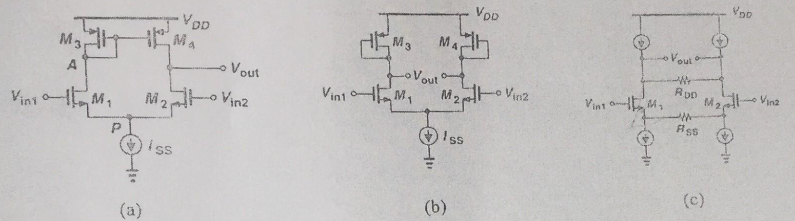

# 기출 2013-1 중간 4 — 전류 거울 부하, 다이오드 연결 부하, R_DD·R_SS 차동쌍의 차동 전압 이득

## 원문
다음 차동증폭단에 대해 다음 조건을 이용하여 질문에 답하시오.

$I_{SS} = 2\ \text{mA}$, $(W/L)_{1,2} = 500$, $(W/L)_{3,4} = 1000$, $R_{DD} = 1\ \text{k}\Omega$, $R_{SS} = 200\ \Omega$,

$\mu_n C_{ox} = 100\ \mu\text{A/V}^2$, $\mu_p C_{ox} = 50\ \mu\text{A/V}^2$, $\lambda_n = 0.1\ \text{V}^{-1}$, $\lambda_p = 0.1\ \text{V}^{-1}$

(1) 그림(a) 회로의 차동 전압이득($v_{out}/(v_{in1} - v_{in2})$) 식을 구하시오.

(2) 주어진 조건을 이용하여 그림(a) 회로의 차동 전압이득 값을 구하시오.

(3) 주어진 조건을 이용하여 그림(b) 회로의 차동 전압이득 값을 구하시오.

(4) 주어진 조건을 이용하여 그림(c) 회로의 차동 전압이득 값을 구하시오. ($I_{DS1} = I_{DS2} = 1\ \text{mA}$)

## 조건
- 회로: 그림 (a), (b), (c)
- $I_{SS} = 2\ \text{mA}$
- $(W/L)_{1,2} = 500$, $(W/L)_{3,4} = 1000$
- $R_{DD} = 1\ \text{k}\Omega$, $R_{SS} = 200\ \Omega$
- $\mu_n C_{ox} = 100\ \mu\text{A/V}^2$, $\mu_p C_{ox} = 50\ \mu\text{A/V}^2$
- $\lambda_n = 0.1\ \text{V}^{-1}$, $\lambda_p = 0.1\ \text{V}^{-1}$
- (4) 전용 (회로 (c)): $I_{DS1} = I_{DS2} = 1\ \text{mA}$
- $V_{DD}$ 값과 (c)의 네 전류원 값은 주어지지 않음 (원문에 없음)

## 구할 것
- (1) 그림 (a) 회로의 차동 전압 이득 $v_{out}/(v_{in1} - v_{in2})$의 식
- (2) 주어진 조건으로 그림 (a) 회로의 차동 전압 이득 값
- (3) 주어진 조건으로 그림 (b) 회로의 차동 전압 이득 값
- (4) 주어진 조건으로 그림 (c) 회로의 차동 전압 이득 값

## 회로 — Fig Q4(a)
```spice
M3   A     A     VDD  pmos   ; 좌우 반전 (게이트 오른쪽), 다이오드 연결
M4   Vout  A     VDD  pmos
M1   A     Vin1  P    nmos
M2   Vout  Vin2  P    nmos   ; 좌우 반전 (게이트 오른쪽)
ISS  P     0     {I_SS}
```
- 단자: VDD = 전원, 값 미지정 (가로 레일) / Vin1, Vin2 = 입력 (개방 원) / Vout = 출력 (개방 원)
- 표시: 노드 라벨 V_DD (레일 오른쪽 끝), A (A 접속점 왼쪽 아래), P (P 접속점 왼쪽 아래), V_in1 (왼쪽 입력 원 왼쪽), V_in2 (오른쪽 입력 원 오른쪽), V_out (출력 원 오른쪽) / 소자 라벨 M_3 (M3 왼쪽), M_4 (M4 오른쪽), M_1 (M1 오른쪽), M_2 (M2 왼쪽), I_SS (전류원 오른쪽) / 부호 없음 / 화살표 없음 / 수치·면적 라벨 없음
- 배치: 맨 위 굵은 가로 레일 V_DD / 왼쪽 세로줄 위→아래 M3, A 접속점, M1 / 오른쪽 세로줄 위→아래 M4, Vout 접속점, M2 / M3 pmos 좌우 반전(게이트 막대 오른쪽, 소스 왼쪽 위·화살표가 채널 쪽으로 들어감, 드레인 왼쪽 아래), M4 pmos 보통 방향(게이트 왼쪽, 소스 오른쪽 위), 두 소스에서 세로선이 위로 레일 / M3, M4 게이트는 가운데 게이트 접속점을 지나는 게이트 높이의 가로선으로 이어짐 / 게이트 접속점에서 세로선이 아래로 내려가 A 높이에서 왼쪽으로 꺾여 A 접속점 (다이오드 연결) / Vout 접속점에서 가로선이 오른쪽 V_out 원 / M1 nmos 보통 방향(게이트 왼쪽), M2 nmos 좌우 반전(게이트 오른쪽, 드레인 왼쪽 위, 소스 왼쪽 아래·화살표 바깥) / V_in1 원 → 가로선 → M1 게이트, M2 게이트 → 가로선 → V_in2 원 / 두 소스는 아래로 내려가 가로선으로 가운데 P 점에서 만남, P에서 아래로 I_SS(화살표 아래), 그 아래 접지 / 접속점 (세 갈래 이상, 4곳): ① 게이트 접속점 = 왼쪽 M3 게이트 + 오른쪽 M4 게이트 + 아래 다이오드 연결선 (점) ② A = 위 M3 드레인 + 아래 M1 드레인 + 오른쪽 다이오드 연결선 (점) ③ Vout = 위 M4 드레인 + 아래 M2 드레인 + 오른쪽 V_out 선 (점) ④ P = 왼쪽 M1 소스 선 + 오른쪽 M2 소스 선 + 아래 I_SS (점) / 교차: 없음

## 회로 — Fig Q4(b)
```spice
M3   out1  out1  VDD  pmos   ; 다이오드 연결
M4   out2  out2  VDD  pmos   ; 좌우 반전 (게이트 오른쪽), 다이오드 연결
M1   out1  Vin1  n1   nmos
M2   out2  Vin2  n1   nmos   ; 좌우 반전 (게이트 오른쪽)
ISS  n1    0     {I_SS}
* out1, out2 = 두 출력 원. 원 사이에 V_out 라벨 하나 (차동 출력)
* n1 = 꼬리 노드 (라벨 없음)
```
- 단자: VDD = 전원, 값 미지정 (가로 레일) / Vin1, Vin2 = 입력 (개방 원) / out1, out2 = 차동 출력 V_out의 두 단자 (개방 원, 각각에는 라벨 없음)
- 표시: 노드 라벨 V_DD (레일 오른쪽 끝), V_out (두 출력 원 사이), V_in1 (왼쪽 입력 원 왼쪽), V_in2 (오른쪽 입력 원 오른쪽) / 소자 라벨 M_3 (M3 오른쪽), M_4 (M4 왼쪽), M_1 (M1 오른쪽), M_2 (M2 왼쪽), I_SS (전류원 오른쪽) / 부호 없음 / 화살표 없음 / 수치·면적 라벨 없음
- 배치: 맨 위 굵은 가로 레일 V_DD / 왼쪽 세로줄 위→아래 M3, out1 첫 접속점, out1 둘째 접속점, M1 / 오른쪽 세로줄은 좌우 대칭으로 M4, out2 첫 접속점, out2 둘째 접속점, M2 / M3 pmos 보통 방향(게이트 막대 왼쪽, 소스 오른쪽 위·화살표가 채널 쪽으로 들어감, 드레인 오른쪽 아래), M4 pmos 좌우 반전(게이트 막대 오른쪽, 소스 왼쪽 위, 드레인 왼쪽 아래), 두 소스에서 세로선이 위로 레일 / M3 게이트에서 가로선이 왼쪽으로 나가 아래로 꺾여 out1 첫 접속점 높이에서 오른쪽으로 꺾여 out1 첫 접속점 (다이오드 연결), M4는 좌우 대칭으로 오른쪽으로 돌아 out2 첫 접속점 / out1 둘째 접속점에서 가로선이 오른쪽 출력 원, out2 둘째 접속점에서 가로선이 왼쪽 출력 원 (두 원이 가운데에서 마주 보고 그 사이에 V_out) / M1 nmos 보통 방향(게이트 왼쪽, 드레인 위, 소스 아래·화살표 바깥), M2 nmos 좌우 반전(게이트 막대 오른쪽, 드레인 왼쪽 위, 소스 왼쪽 아래·화살표 바깥) / V_in1 원 → 가로선 → M1 게이트, M2 게이트 → 가로선 → V_in2 원 / 두 소스는 아래로 내려가 가로선으로 가운데 n1 점에서 만남, n1에서 아래로 I_SS(화살표 아래), 그 아래 접지 / 접속점 (세 갈래 이상, 5곳): ① out1 첫 = 위 M3 드레인 + 왼쪽 다이오드 연결선 + 아래 세로선 (점) ② out1 둘째 = 위 세로선 + 아래 M1 드레인 + 오른쪽 출력선 (점) ③ out2 첫 = 위 M4 드레인 + 오른쪽 다이오드 연결선 + 아래 세로선 (점) ④ out2 둘째 = 위 세로선 + 아래 M2 드레인 + 왼쪽 출력선 (점) ⑤ n1 = 왼쪽 M1 소스 선 + 오른쪽 M2 소스 선 + 아래 I_SS (점) / 교차: 없음

## 회로 — Fig Q4(c)
```spice
I1   VDD   out1   ; 라벨·값 없음
I2   VDD   out2   ; 라벨·값 없음
RDD  out1  out2  {R_DD}
M1   out1  Vin1  n1   nmos
M2   out2  Vin2  n2   nmos   ; 좌우 반전 (게이트 오른쪽)
RSS  n1    n2    {R_SS}
I3   n1    0      ; 라벨·값 없음
I4   n2    0      ; 라벨·값 없음
* out1, out2 = 두 출력 원. 원 사이에 V_out 라벨 하나 (차동 출력)
```
- 단자: VDD = 전원, 값 미지정 (가로 레일) / Vin1, Vin2 = 입력 (개방 원) / out1, out2 = 차동 출력 V_out의 두 단자 (개방 원, 각각에는 라벨 없음)
- 표시: 노드 라벨 V_DD (레일 오른쪽 끝), V_out (두 출력 원 사이), V_in1 (왼쪽 입력 원 왼쪽), V_in2 (오른쪽 입력 원 오른쪽) / 소자 라벨 R_DD (위 가로 저항 아래), R_SS (아래 가로 저항 아래), M_1 (M1 오른쪽), M_2 (M2 왼쪽), I1–I4 (라벨 없음) / 부호 없음 / 화살표 없음 / 수치·면적 라벨 없음
- 배치: 맨 위 굵은 가로 레일 V_DD / 왼쪽 세로줄 위→아래 전류원(화살표 아래), out1 첫 접속점, out1 둘째 접속점, M1, n1 접속점, 전류원(화살표 아래), 접지 / 오른쪽 세로줄은 좌우 대칭으로 전류원, out2 첫 접속점, out2 둘째 접속점, M2, n2 접속점, 전류원, 접지 / M1 nmos 보통 방향(게이트 왼쪽, 드레인 위, 소스 아래·화살표 바깥), M2 nmos 좌우 반전(게이트 막대 오른쪽, 드레인 왼쪽 위, 소스 왼쪽 아래·화살표 바깥) / out1 첫 접속점에서 가로선이 오른쪽 출력 원, out2 첫 접속점에서 가로선이 왼쪽 출력 원 (두 원이 가운데에서 마주 보고 그 사이에 V_out) / 두 둘째 접속점 사이에 가로로 놓인 R_DD (M1, M2 드레인 위 높이) / n1, n2 사이에 가로로 놓인 R_SS (소스 바로 아래 높이) / V_in1 원 → 가로선 → M1 게이트, M2 게이트 → 가로선 → V_in2 원 / 접속점 (세 갈래 이상, 6곳): ① out1 첫 = 위 전류원 + 아래 세로선 + 오른쪽 출력선 (점) ② out1 둘째 = 위 세로선 + 아래 M1 드레인 + 오른쪽 R_DD (점) ③ n1 = 위 M1 소스 + 아래 전류원 + 오른쪽 R_SS (점) ④ out2 첫 = 위 전류원 + 아래 세로선 + 왼쪽 출력선 (점) ⑤ out2 둘째 = 위 세로선 + 아래 M2 드레인 + 왼쪽 R_DD (점) ⑥ n2 = 위 M2 소스 + 아래 전류원 + 왼쪽 R_SS (점) / 교차: 없음


> 참고: 답안지 손글씨가 겹침 ((c)의 M1 소스와 n1 접속점 왼쪽 아래의 짧은 사선 획). (c)는 다른 두 패널보다 작고 흐리게 인쇄됨

## 힌트
### (4) $R_{DD}$·$R_{SS}$ 가운데는 가상 접지
- 차동 입력에서는 두 쪽 노드가 크기는 같고 부호가 반대로 움직이므로, 두 노드를 잇는 저항의 한가운데 점은 전압이 변하지 않는다
- 그래서 저항을 반으로 잘라 한쪽만 남긴 반회로로 볼 수 있다

## 풀이
### (1) 그림 (a) 이득의 식
- 거울 $M_3$–$M_4$가 $M_1$의 신호 전류를 출력으로 옮겨 $M_2$ 쪽과 더하므로 $G_m = g_{m1}$
- $v_{out}/(v_{in1} - v_{in2}) = g_{m1}(r_{O2} \parallel r_{O4})$
### (2) 그림 (a) 이득의 값
- $I_D = 1\ \text{mA}$: $g_{m1} = 10.0\ \text{mS}$, $r_{O2} = r_{O4} = 10.0\ \text{k}\Omega$
- $A_v = g_{m1}(r_{O2} \parallel r_{O4}) = 50.0$
### (3) 그림 (b) 이득
- 다이오드 $M_3$은 $1/g_{m3}$, $g_{m3} = 10.0\ \text{mS}$ ($\mu_p C_{ox}(W/L)_3 = \mu_n C_{ox}(W/L)_1$)
- 왼쪽 − 오른쪽 출력: $A_v = -g_{m1}(1/g_{m3} \parallel r_{O3} \parallel r_{O1}) = -0.980$
### (4) 그림 (c) 이득
- 두 쪽이 반대로 움직여 $R_{DD}$, $R_{SS}$ 가운데가 가상 접지: $R_{SS}/2$ 퇴화 CS 반회로, $M_1$ 드레인으로 본 저항 $R_{out} = (1 + g_m R_{SS}/2) r_O = 20.0\ \text{k}\Omega$
- $A_v = -\dfrac{g_m (R_{DD}/2 \parallel R_{out})}{1 + g_m R_{SS}/2} = -2.44$ ($r_O$ 무시하면 $-2.50$)
### 답
- (1) $g_{m1}(r_{O2} \parallel r_{O4})$
- (2) $50.0$
- (3) $-0.980$ ($r_O$를 무시하면 $-1$)
- (4) $-2.44$ ($r_O$를 무시하면 $-2.50$)
