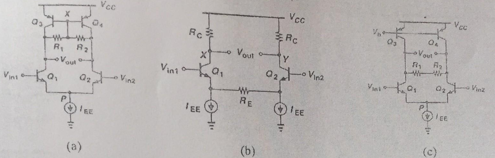

# 기출 2013-1 중간 5 — R_1·R_2로 베이스를 정한 pnp 부하, R_E 축퇴, V_b 바이어스 pnp 부하 바이폴라 차동쌍의 차동 전압 이득

## 원문
다음 차동증폭단에 대해 질문에 답하시오.

이 때, $V_{CC} = 2.5\ \text{V}$, $I_{EE} = 1\ \text{mA}$, $V_{A,npn} = 5\ \text{V}$, $V_{A,pnp} = 5\ \text{V}$, $V_T = 25\ \text{mV}$, $V_{CC} = 2.5\ \text{V}$,

$R_1 = R_2 = 5\ \text{k}\Omega$, $R_C = 1\ \text{k}\Omega$, $R_E = 150\ \Omega$ 으로 가정한다.

(1) 주어진 조건을 이용하여 그림(a) 회로의 차동 전압이득 값을 구하시오.

(2) 주어진 조건을 이용하여 그림(b) 회로의 차동 전압이득 값을 구하시오. ($V_A = \infty$로 가정)

(3) 주어진 조건을 이용하여 그림(c) 회로의 차동 전압이득 값을 구하시오.

## 조건
- 회로: 그림 (a), (b), (c)
- $V_{CC} = 2.5\ \text{V}$, $I_{EE} = 1\ \text{mA}$
- $V_{A,npn} = 5\ \text{V}$, $V_{A,pnp} = 5\ \text{V}$, $V_T = 25\ \text{mV}$
- 원문에 $V_{CC} = 2.5\ \text{V}$가 두 번 인쇄됨 (원문의 메모)
- $R_1 = R_2 = 5\ \text{k}\Omega$, $R_C = 1\ \text{k}\Omega$, $R_E = 150\ \Omega$
- (2) 전용 (회로 (b)): $V_A = \infty$로 가정
- (b) 전용: 그림의 두 전류원은 모두 $I_{EE}$로 인쇄됨
- $\beta$ 값과 (c)의 $V_b$ 값은 주어지지 않음 (원문에 없음)

## 구할 것
- (1) 주어진 조건으로 그림 (a) 회로의 차동 전압 이득 값
- (2) 주어진 조건으로 그림 (b) 회로의 차동 전압 이득 값
- (3) 주어진 조건으로 그림 (c) 회로의 차동 전압 이득 값

## 회로 — Fig Q5(a)
```spice
Q3   out1  X     VCC  pnp    ; 좌우 반전 (베이스 오른쪽)
Q4   out2  X     VCC  pnp
R1   out1  X     {R_1}
R2   X     out2  {R_2}
Q1   out1  Vin1  P    npn
Q2   out2  Vin2  P    npn    ; 좌우 반전 (베이스 오른쪽)
IEE  P     0     {I_EE}
* out1, out2 = 두 출력 원. 원 사이에 V_out 라벨 하나 (차동 출력)
* X = Q3·Q4 베이스와 R1·R2 사이 노드 (X 라벨은 베이스 공통선 위)
```
- 단자: VCC = 2.5 V 전원 (가로 레일) / Vin1, Vin2 = 입력 (개방 원) / out1, out2 = 차동 출력 V_out의 두 단자 (개방 원, 각각에는 라벨 없음)
- 표시: 노드 라벨 V_CC (레일 오른쪽 끝), X (베이스 공통선 위 가운데), V_out (두 출력 원 사이), V_in1 (왼쪽 입력 원 왼쪽), V_in2 (오른쪽 입력 원 오른쪽), P (P 접속점 왼쪽 아래) / 소자 라벨 Q_3 (Q3 왼쪽), Q_4 (Q4 오른쪽), R_1, R_2 (각 저항 아래), Q_1 (Q1 오른쪽), Q_2 (Q2 왼쪽), I_EE (전류원 오른쪽) / 부호 없음 / 화살표 없음 / 수치·면적 라벨 없음
- 배치: 맨 위 굵은 가로 레일 V_CC / 왼쪽 세로줄 위→아래 Q3, out1 저항 접속점, out1 출력 접속점, Q1 / 오른쪽 세로줄 위→아래 Q4, out2 저항 접속점, out2 출력 접속점, Q2 / Q3 pnp 좌우 반전(베이스 막대 오른쪽, 이미터 왼쪽 위·화살표가 막대 쪽으로 들어감, 컬렉터 왼쪽 아래), Q4 pnp 보통 방향(베이스 막대 왼쪽, 이미터 오른쪽 위, 컬렉터 오른쪽 아래), 두 이미터에서 세로선이 위로 레일 / 베이스 공통선은 Q3 베이스에서 Q4 베이스까지 베이스 높이로 가로지르고 가운데 위 X 접속점에서 세로선이 아래로 R1–R2 사이 아래 X 접속점 / R1, R2는 두 저항 접속점 사이에 가로로 이어 놓임 (R1 왼쪽, R2 오른쪽) / out1 출력 접속점에서 가로선이 오른쪽 출력 원, out2 출력 접속점에서 가로선이 왼쪽 출력 원 (두 원이 가운데에서 마주 보고 그 사이에 V_out) / Q1 npn 보통 방향(베이스 왼쪽, 컬렉터 오른쪽 위, 이미터 오른쪽 아래·화살표 바깥), Q2 npn 좌우 반전(베이스 막대 오른쪽, 컬렉터 왼쪽 위, 이미터 왼쪽 아래·화살표 바깥) / V_in1 원 → 가로선 → Q1 베이스, Q2 베이스 → 가로선 → V_in2 원 / 두 이미터는 아래로 내려가 가로선으로 가운데 P 점에서 만남, P에서 아래로 I_EE(화살표 아래), 그 아래 접지 / 접속점 (세 갈래 이상, 7곳): ① 위 X = 왼쪽 Q3 베이스 + 오른쪽 Q4 베이스 + 아래 세로선 (점) ② 아래 X = 왼쪽 R1 + 오른쪽 R2 + 위 세로선 (점) ③ out1 저항 = 위 Q3 컬렉터 + 오른쪽 R1 + 아래 세로선 (점) ④ out1 출력 = 위 세로선 + 아래 Q1 컬렉터 + 오른쪽 출력선 (점) ⑤ out2 저항 = 위 Q4 컬렉터 + 왼쪽 R2 + 아래 세로선 (점) ⑥ out2 출력 = 위 세로선 + 아래 Q2 컬렉터 + 왼쪽 출력선 (점) ⑦ P = 왼쪽 Q1 이미터 선 + 오른쪽 Q2 이미터 선 + 아래 I_EE (점) / 교차: 없음

## 회로 — Fig Q5(b)
```spice
RC1   VCC   X     {R_C}     ; 두 저항 모두 R_C로 인쇄
RC2   VCC   Y     {R_C}
Q1    X     Vin1  n1   npn
Q2    Y     Vin2  n2   npn  ; 좌우 반전 (베이스 오른쪽)
RE    n1    n2    {R_E}
IEE1  n1    0     {I_EE}    ; 두 전류원 모두 I_EE로 인쇄
IEE2  n2    0     {I_EE}
* X, Y = 두 출력 원에 이어진 노드. 원 사이에 V_out 라벨 하나 (차동 출력)
* n1, n2 라벨 없음
```
- 단자: VCC = 2.5 V 전원 (가로 레일) / Vin1, Vin2 = 입력 (개방 원) / X, Y = 차동 출력 V_out의 두 단자 (개방 원)
- 표시: 노드 라벨 V_CC (레일 오른쪽 끝), X (X 접속점 왼쪽 아래), Y (Y 접속점 오른쪽 아래), V_out (두 출력 원 사이), V_in1 (왼쪽 입력 원 왼쪽), V_in2 (오른쪽 입력 원 오른쪽) / 소자 라벨 R_C (왼쪽 저항 왼쪽), R_C (오른쪽 저항 오른쪽), Q_1 (Q1 오른쪽), Q_2 (Q2 왼쪽), R_E (가로 저항 아래), I_EE (왼쪽 전류원 왼쪽), I_EE (오른쪽 전류원 오른쪽) / 부호 없음 / 화살표 없음 / 수치·면적 라벨 없음
- 배치: 맨 위 굵은 가로 레일 V_CC / 왼쪽 세로줄 위→아래 R_C, X 접속점, Q1, n1 접속점, I_EE 전류원(화살표 아래), 접지 / 오른쪽 세로줄은 좌우 대칭으로 R_C, Y 접속점, Q2, n2 접속점, I_EE 전류원(화살표 아래), 접지 / X 접속점에서 가로선이 오른쪽 출력 원, Y 접속점에서 가로선이 왼쪽 출력 원 (두 원이 가운데에서 마주 보고 그 사이에 V_out) / Q1 npn 보통 방향(베이스 왼쪽, 컬렉터 오른쪽 위, 이미터 오른쪽 아래·화살표 바깥), Q2 npn 좌우 반전(베이스 막대 오른쪽, 컬렉터 왼쪽 위, 이미터 왼쪽 아래·화살표 바깥) / V_in1 원 → 가로선 → Q1 베이스, Q2 베이스 → 가로선 → V_in2 원 / n1, n2 사이에 가로로 놓인 R_E (이미터 아래 높이) / 접속점 (세 갈래 이상, 4곳): ① X = 위 R_C + 아래 Q1 컬렉터 + 오른쪽 출력선 (점) ② Y = 위 R_C + 아래 Q2 컬렉터 + 왼쪽 출력선 (점) ③ n1 = 위 Q1 이미터 + 아래 I_EE + 오른쪽 R_E (점) ④ n2 = 위 Q2 이미터 + 아래 I_EE + 왼쪽 R_E (점) / 교차: 없음

## 회로 — Fig Q5(c)
```spice
Q3   out1  Vb    VCC  pnp
Q4   out2  Vb    VCC  pnp
R1   out1  n1    {R_1}
R2   n1    out2  {R_2}
Q1   out1  Vin1  P    npn
Q2   out2  Vin2  P    npn    ; 좌우 반전 (베이스 오른쪽)
IEE  P     0     {I_EE}
* out1, out2 = 두 출력 원. 원 사이에 V_out 라벨 하나 (차동 출력)
* n1 = R1과 R2 사이 노드, 라벨 없음 (다른 곳에 이어지지 않음)
```
- 단자: VCC = 2.5 V 전원 (가로 레일) / Vb = DC 바이어스, 값 미지정 (개방 원) / Vin1, Vin2 = 입력 (개방 원) / out1, out2 = 차동 출력 V_out의 두 단자 (개방 원, 각각에는 라벨 없음)
- 표시: 노드 라벨 V_CC (레일 오른쪽 끝), V_b (단자 원 왼쪽), V_out (두 출력 원 사이), V_in1 (왼쪽 입력 원 왼쪽), V_in2 (오른쪽 입력 원 오른쪽), P (P 접속점 왼쪽 아래) / 소자 라벨 Q_3 (Q3 아래), Q_4 (Q4 아래), R_1, R_2 (각 저항 위), Q_1 (Q1 오른쪽), Q_2 (Q2 왼쪽), I_EE (전류원 오른쪽) / 부호 없음 / 화살표 없음 / 수치·면적 라벨 없음
- 배치: 맨 위 굵은 가로 레일 V_CC / 왼쪽 세로줄 위→아래 Q3, out1 출력 접속점, out1 저항 접속점, Q1 / 오른쪽 세로줄 위→아래 Q4, out2 출력 접속점, out2 저항 접속점, Q2 / Q3, Q4 pnp 보통 방향(베이스 막대 왼쪽, 이미터 오른쪽 위·화살표가 막대 쪽으로 들어감, 컬렉터 오른쪽 아래), 두 이미터에서 세로선이 위로 레일 / V_b 원 → 가로선 → Q3 베이스, 같은 높이의 가로선이 Q3 베이스 막대에서 오른쪽으로 이어져 Q4 베이스까지 / out1 출력 접속점에서 가로선이 오른쪽 출력 원, out2 출력 접속점에서 가로선이 왼쪽 출력 원 (두 원이 가운데에서 마주 보고 그 사이에 V_out) / 두 저항 접속점 사이에 R1, R2가 가로로 이어 놓임 (가운데 n1에는 다른 선이 없음) / Q1 npn 보통 방향(베이스 왼쪽, 컬렉터 오른쪽 위, 이미터 오른쪽 아래·화살표 바깥), Q2 npn 좌우 반전(베이스 막대 오른쪽, 컬렉터 왼쪽 위, 이미터 왼쪽 아래·화살표 바깥) / V_in1 원 → 가로선 → Q1 베이스, Q2 베이스 → 가로선 → V_in2 원 / 두 이미터는 아래로 내려가 가로선으로 가운데 P 점에서 만남, P에서 아래로 I_EE(화살표 아래), 그 아래 접지 / 접속점 (세 갈래 이상, 5곳): ① out1 출력 = 위 Q3 컬렉터 + 아래 세로선 + 오른쪽 출력선 (점) ② out1 저항 = 위 세로선 + 아래 Q1 컬렉터 + 오른쪽 R1 (점) ③ out2 출력 = 위 Q4 컬렉터 + 아래 세로선 + 왼쪽 출력선 (점) ④ out2 저항 = 위 세로선 + 아래 Q2 컬렉터 + 왼쪽 R2 (점) ⑤ P = 왼쪽 Q1 이미터 선 + 오른쪽 Q2 이미터 선 + 아래 I_EE (점) / 교차: 없음


> 참고: 크롭 안에 손글씨로 보이는 획은 없음. (c) 레일 위 가운데의 작은 점은 인쇄 얼룩으로 보이며 회로에 이어지지 않음. (c)의 V_b 단자는 작은 빈 원으로 인쇄됨. (c)는 다른 두 패널보다 작고 흐리게 인쇄됨

## 힌트
### (1) $X$는 차동 신호에서 가상 접지
- 두 출력이 크기는 같고 부호가 반대로 움직이고 $R_1 = R_2$이므로, 두 저항 사이의 $X$는 차동 신호에서 움직이지 않는다
- 그러면 $Q_3$, $Q_4$의 베이스는 소신호 접지가 되어, 각 pnp는 출력에 $r_O$만 남긴다
- $R_1$, $R_2$도 사라지지 않고 각 출력에서 가상 접지로 가는 부하로 남는다

## 풀이
### (1) 소신호 파라미터
- 대칭이라 $R_1$, $R_2$에는 DC 전류가 없어 $I_{C1} = |I_{C3}| = I_{EE}/2 = 0.5\ \text{mA}$ (베이스 전류 무시)
- $g_{m1} = I_{C1}/V_T = 20.0\ \text{mS}$, $r_{O1} = V_{A,npn}/I_{C1} = 10.0\ \text{k}\Omega$, $r_{O3} = V_{A,pnp}/|I_{C3}| = 10.0\ \text{k}\Omega$
### (1) 그림 (a) 차동 이득
- 두 출력이 반대로 움직이고 $R_1 = R_2$라 $X$는 가상 접지: $Q_3$은 $r_{O3}$만 남고 $R_1$은 출력에서 접지로 가는 저항이 된다
- 왼쪽에서 오른쪽 출력을 뺀 차동 출력: $A_v = -g_{m1}(r_{O1} \parallel r_{O3} \parallel R_1) = -20.0\ \text{mS} \times 2.50\ \text{k}\Omega = -50.0$
### (2) 그림 (b) 차동 이득
- 각 트랜지스터 전류 $I_{EE} = 1\ \text{mA}$: $g_m = I_{EE}/V_T = 40.0\ \text{mS}$, $1/g_m = 25.0\ \Omega$
- 두 이미터가 반대로 움직여 $R_E$의 가운데가 가상 접지이므로 반회로는 이미터 퇴화 $R_E/2 = 75\ \Omega$인 CE 단 ($V_A = \infty$)
- $A_v = -R_C/(1/g_m + R_E/2) = -1\ \text{k}\Omega/100\ \Omega = -10.0$
### (3) 그림 (c) 차동 이득
- $Q_3$, $Q_4$ 베이스는 DC $V_b$라 각각 $r_O$만 남고, 대칭이라 $|I_{C3}| = I_{EE}/2$로 (1)과 같은 값이다
- $R_1$, $R_2$ 사이 노드도 같은 이유로 가상 접지라 출력에 $r_{O1}$, $r_{O3}$, $R_1$이 달린 (a)와 같은 반회로: $A_v = -g_{m1}(r_{O1} \parallel r_{O3} \parallel R_1) = -50.0$
### 답
- (1) $-50.0$
- (2) $-10.0$
- (3) $-50.0$
