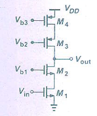

# 기출 2014-1 중간 1 — MOS 캐스코드 증폭기의 바이어스 전류, V_b3, 출력 저항, 전압 이득

## 원문
다음 회로에 대해 다음 조건을 이용하여 질문에 답하시오.

$(W/L)_{1,2} = 50/0.2$, $(W/L)_{3,4} = 100/0.2$, $V_{DD} = 1.8\ \text{V}$

$\mu_n C_{ox} = 100\ \mu\text{A/V}^2$, $\mu_p C_{ox} = 50\ \mu\text{A/V}^2$, $V_{TH,N} = 0.4\ \text{V}$, $V_{TH,P} = -0.5\ \text{V}$, $\lambda_n = 0.1\ \text{V}^{-1}$, $\lambda_p = 0.2\ \text{V}^{-1}$

(1) $M_1$의 transconductance $g_{m1} = 5\ \text{mA/V}$ 가 되기 위한, 바이어스 전류를 구하시오.

(2) DC 바이어스 전압 $V_{b3}$의 값을 구하시오.

(3) 출력 저항을 구하시오.

(4) 전압이득 ($V_{out}/V_{in}$)을 구하시오.

## 조건
- 회로: 그림의 MOS 캐스코드 증폭기
- $(W/L)_{1,2} = 50/0.2$, $(W/L)_{3,4} = 100/0.2$
- $V_{DD} = 1.8\ \text{V}$
- $\mu_n C_{ox} = 100\ \mu\text{A/V}^2$, $\mu_p C_{ox} = 50\ \mu\text{A/V}^2$
- $V_{TH,N} = 0.4\ \text{V}$, $V_{TH,P} = -0.5\ \text{V}$
- $\lambda_n = 0.1\ \text{V}^{-1}$, $\lambda_p = 0.2\ \text{V}^{-1}$
- (1) 전용: $g_{m1} = 5\ \text{mA/V}$
- 바이어스 전압 $V_{b1}$, $V_{b2}$ 값은 주어지지 않음 (원문에 없음)

## 구할 것
- (1) $M_1$의 transconductance가 $g_{m1} = 5\ \text{mA/V}$가 되기 위한 바이어스 전류
- (2) DC 바이어스 전압 $V_{b3}$의 값
- (3) 출력 저항
- (4) 전압 이득 $V_{out}/V_{in}$

## 회로 — Fig Q1
```spice
M4  n1    Vb3  VDD  pmos
M3  Vout  Vb2  n1   pmos
M2  Vout  Vb1  n2   nmos
M1  n2    Vin  0    nmos
* n1 = M4 드레인·M3 소스, n2 = M2 소스·M1 드레인 (라벨 없음)
* W/L 값은 문제 문장에만 인쇄됨 (그림에는 없음)
```
- 단자: VDD = 1.8 V 전원 (T 전원 기호) / Vb3, Vb2, Vb1 = DC 바이어스 (점 단자, Vb3은 (2)에서 구함, Vb1·Vb2는 값 미지정) / Vin = 입력 (개방 원) / Vout = 출력 (개방 원)
- 표시: 노드 라벨 V_DD (T 기호 오른쪽), V_b3, V_b2, V_b1 (각 점 단자 왼쪽), V_out (출력 원 오른쪽), V_in (입력 원 왼쪽) / 소자 라벨 M_4, M_3, M_2, M_1 (각 트랜지스터 오른쪽) / 부호 없음 / 화살표 없음 / 수치·면적 라벨 없음
- 배치: 한 세로줄 위→아래 VDD T 기호, M4, M3, Vout 접속점, M2, M1, 접지 / M4, M3 pmos 보통 방향 (게이트 왼쪽, 소스 오른쪽 위·화살표가 막대 쪽으로 들어감, 드레인 오른쪽 아래), M4 소스에서 세로선이 위로 T 기호 / M2, M1 nmos 보통 방향 (게이트 왼쪽, 드레인 오른쪽 위, 소스 오른쪽 아래·화살표 바깥), M1 소스 아래 접지 / 네 게이트는 각각 왼쪽 가로선으로 V_b3, V_b2, V_b1 점 단자와 V_in 원 / Vout 접속점에서 가로선이 오른쪽 V_out 원 / 접속점 (세 갈래 이상, 1곳): Vout = 위 M3 드레인 + 아래 M2 드레인 + 오른쪽 출력선 (점) / 교차: 없음



## 풀이
### (1) 바이어스 전류
- $I_D = g_{m1}^2/[2\mu_n C_{ox}(W/L)_1] = (5\ \text{mS})^2/(200\ \mu\text{A/V}^2 \times 250) = 0.500\ \text{mA}$ ($V_{DS1}$를 모르므로 DC에서는 $\lambda$ 무시)
### (2) $M_4$로 정한 $V_{b3}$
- 직렬이라 $M_4$에도 $I_D$: $|V_{GS4}| = |V_{TH,P}| + \sqrt{2I_D/[\mu_p C_{ox}(W/L)_4]} = 0.5 + 0.200 = 0.700\ \text{V}$
- $V_{b3} = V_{DD} - |V_{GS4}| = 1.10\ \text{V}$
### (3) 출력 저항
- $g_{m2} = g_{m1} = 5.00\ \text{mS}$, $r_{O1} = r_{O2} = 1/(\lambda_n I_D) = 20.0\ \text{k}\Omega$
- $M_3$도 오버드라이브 $0.2\ \text{V}$: $g_{m3} = 5.00\ \text{mS}$, $r_{O3} = r_{O4} = 1/(\lambda_p I_D) = 10.0\ \text{k}\Omega$
- $g_{m2} r_{O1} = 100$, $g_{m3} r_{O4} = 50 \gg 1$: $R_{out} \approx (g_{m2} r_{O2} r_{O1}) \parallel (g_{m3} r_{O3} r_{O4}) = 2.00\ \text{M}\Omega \parallel 500\ \text{k}\Omega = 400\ \text{k}\Omega$ (몸체 효과 무시)
### (4) 전압 이득
- 캐스코드의 $G_m \approx g_{m1}$: $A_v = -g_{m1} R_{out} = -2000$
### 답
- (1) $I_D = 0.500\ \text{mA}$
- (2) $V_{b3} = 1.10\ \text{V}$
- (3) $R_{out} \approx 400\ \text{k}\Omega$
- (4) $V_{out}/V_{in} \approx -2000$
