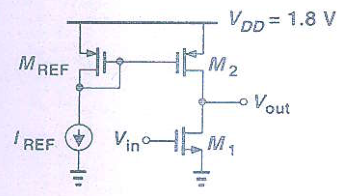

# 기출 2014-1 중간 2 — PMOS 전류 거울 부하 공통 소스 증폭기의 입력 DC 바이어스와 전압 이득

## 원문
다음 회로에 대해 다음 조건을 이용하여 질문에 답하시오.

$(W/L)_1 = 50/0.2$, $(W/L)_2 = 100/0.2$, $(W/L)_{REF} = 10/0.2$, $I_{REF} = 50\ \mu\text{A}$, $V_{DD} = 1.8\ \text{V}$

$\mu_n C_{ox} = 100\ \mu\text{A/V}^2$, $\mu_p C_{ox} = 50\ \mu\text{A/V}^2$, $V_{TH,N} = 0.4\ \text{V}$, $V_{TH,P} = -0.5\ \text{V}$, $\lambda_n = \lambda_p = 0.1\ \text{V}^{-1}$

(1) 입력($V_{in}$)의 DC 바이어스 전압을 구하시오.

(2) 전압이득 ($V_{out}/V_{in}$)을 구하시오.

## 조건
- 회로: 그림의 PMOS 전류 거울($M_{REF}$, $M_2$) 부하 공통 소스 증폭기
- $(W/L)_1 = 50/0.2$, $(W/L)_2 = 100/0.2$, $(W/L)_{REF} = 10/0.2$
- $I_{REF} = 50\ \mu\text{A}$, $V_{DD} = 1.8\ \text{V}$
- $\mu_n C_{ox} = 100\ \mu\text{A/V}^2$, $\mu_p C_{ox} = 50\ \mu\text{A/V}^2$
- $V_{TH,N} = 0.4\ \text{V}$, $V_{TH,P} = -0.5\ \text{V}$
- $\lambda_n = \lambda_p = 0.1\ \text{V}^{-1}$

## 구할 것
- (1) 입력 $V_{in}$의 DC 바이어스 전압
- (2) 전압 이득 $V_{out}/V_{in}$

## 회로 — Fig Q2
```spice
MREF  n1    n1   VDD  pmos    ; 좌우 반전 (게이트 오른쪽), 다이오드 연결
IREF  n1    0    {I_REF}      ; 화살표 아래 (n1 → 접지)
M2    Vout  n1   VDD  pmos
M1    Vout  Vin  0    nmos
* n1 = M_REF 드레인·게이트, M2 게이트 (라벨 없음)
* W/L 값은 문제 문장에만 인쇄됨 (그림에는 없음)
```
- 단자: VDD = 1.8 V 전원 (가로 레일) / Vin = 입력 (개방 원) / Vout = 출력 (개방 원)
- 표시: 노드 라벨 V_DD (레일 오른쪽 끝), V_in (입력 원 왼쪽), V_out (출력 원 오른쪽) / 소자 라벨 M_REF (M_REF 왼쪽), M_2 (M2 오른쪽), M_1 (M1 오른쪽), I_REF (전류원 왼쪽) / 부호 없음 / 화살표 없음 / 수치·면적 라벨 "= 1.8 V" (V_DD 라벨 바로 뒤, 레일 오른쪽 끝)
- 배치: 맨 위 굵은 가로 레일 V_DD / 왼쪽 세로줄 위→아래 M_REF, n1 아래 접속점, I_REF 전류원 (화살표 아래), 접지 / M_REF pmos 좌우 반전 (게이트 막대 오른쪽, 소스 왼쪽 위·화살표가 막대 쪽으로 들어감, 드레인 왼쪽 아래), 레일에서 세로선이 내려와 오른쪽으로 꺾여 소스, 드레인에서 세로선이 내려가 n1 아래 접속점 / M_REF 게이트 오른쪽 n1 위 접속점에서 가로선이 게이트 높이로 오른쪽 M2 게이트, 같은 접속점에서 세로선이 내려가 n1 아래 접속점 높이에서 왼쪽으로 꺾여 n1 아래 접속점 (다이오드 연결) / 오른쪽 세로줄 위→아래 M2, Vout 접속점, M1, 접지 / M2 pmos 보통 방향 (게이트 왼쪽, 소스 오른쪽 위·화살표가 막대 쪽으로 들어감, 드레인 오른쪽 아래), 소스에서 세로선이 위로 레일 / M1 nmos 보통 방향 (게이트 왼쪽, 드레인 오른쪽 위, 소스 오른쪽 아래·화살표 바깥), V_in 원 → 가로선 → M1 게이트, 소스 아래 접지 / Vout 접속점에서 가로선이 오른쪽 V_out 원 / 접속점 (세 갈래 이상, 3곳): ① n1 위 = 왼쪽 M_REF 게이트 + 오른쪽 M2 게이트 선 + 아래 다이오드 연결선 (점) ② n1 아래 = 위 M_REF 드레인 + 아래 I_REF + 오른쪽 다이오드 연결선 (점) ③ Vout = 위 M2 드레인 + 아래 M1 드레인 + 오른쪽 출력선 (점) / 교차: 없음



## 풀이
### (1) 거울 전류
- DC 바이어스에서는 채널 길이 변조를 무시한다: $I_{D2} = [(W/L)_2/(W/L)_{REF}]\, I_{REF} = (500/50) \times 50\ \mu\text{A} = 500\ \mu\text{A}$
- $M_1$은 $M_2$와 직렬이라 $I_{D1} = 500\ \mu\text{A}$
### (1) 입력 DC 바이어스
- $V_{GS1} - V_{TH,N} = \sqrt{2I_{D1}/[\mu_n C_{ox}(W/L)_1]} = \sqrt{1\ \text{mA}/(100\ \mu\text{A/V}^2 \times 250)} = 0.200\ \text{V}$
- $V_{in} = V_{GS1} = 0.4 + 0.200 = 0.600\ \text{V}$
### (2) 전압 이득
- $g_{m1} = 2I_{D1}/(V_{GS1} - V_{TH,N}) = 5.00\ \text{mS}$, $r_{O1} = r_{O2} = 1/(\lambda I_{D1}) = 20.0\ \text{k}\Omega$
- $M_2$ 게이트는 신호가 없는 DC 노드라 부하는 $r_{O2}$: $A_v = -g_{m1}(r_{O1} \parallel r_{O2}) = -5.00\ \text{mS} \times 10.0\ \text{k}\Omega = -50.0$
### 답
- (1) $V_{in} = 0.600\ \text{V}$
- (2) $V_{out}/V_{in} = -50.0$
