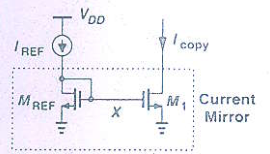

# 기출 2014-1 중간 3 — λ≠0인 MOS 전류 거울에서 I_copy = I_REF가 되는 V_DS1과 복사 전류 오차

## 원문
MOS current mirror에 대해 질문에 답하시오.

이 때, $M_{REF}$와 $M_1$은 동일하고 $\lambda \neq 0$으로 가정한다.

(1) $\lambda \neq 0$일 때, $I_{copy} = I_{REF}$ 가 되기 위한 $M_1$의 $V_{DS1}$을 구하시오.

(2) 만약 $V_{DS1} = V_{GS} - V_{TH}$ 일 때, $I_{REF}$ 에 관해 $I_{copy}$의 오차를 식으로 구하시오.

## 조건
- 회로: 그림의 MOS 전류 거울 ($M_{REF}$ 다이오드 연결, $M_1$ 복사)
- $M_{REF}$와 $M_1$은 동일
- $\lambda \neq 0$
- (2) 전용: $V_{DS1} = V_{GS} - V_{TH}$
- $I_{REF}$, $V_{DD}$ 값은 주어지지 않음 (원문에 없음)

## 구할 것
- (1) $I_{copy} = I_{REF}$가 되기 위한 $M_1$의 $V_{DS1}$
- (2) $I_{REF}$에 대한 $I_{copy}$의 오차 (식)

## 회로 — Fig Q3
```spice
IREF  VDD  X    {I_REF}
MREF  X    X    0    nmos    ; 좌우 반전 (게이트 오른쪽), 다이오드 연결
M1    out  X    0    nmos
* out = I_copy 화살표가 붙은 M1 드레인 선 끝 (라벨 없음)
* 점선 상자 "Current Mirror"가 M_REF, M1을 둘러쌈 (블랙박스가 아니라 묶음 표시)
```
- 단자: VDD = 전원, 값 미지정 (T 전원 기호) / out = I_copy 측정 단자 (선 끝)
- 표시: 노드 라벨 V_DD (T 기호 오른쪽), X (게이트 공통선 아래, M_REF와 M1 사이) / 소자 라벨 I_REF (전류원 왼쪽), M_REF (M_REF 왼쪽), M_1 (M1 오른쪽), "Current Mirror" (점선 상자 안 오른쪽 끝, 두 줄) / 부호 없음 / 화살표 "I_copy": M1 드레인 위 세로선, 아래 방향 (M1 드레인으로 들어감), 도선 위, 글자는 화살표 오른쪽 / 수치·면적 라벨 없음
- 배치: 왼쪽 세로줄 위→아래 VDD T 기호, I_REF 전류원 (화살표 아래), X 위 접속점, M_REF, 접지 / M_REF nmos 좌우 반전 (게이트 막대 오른쪽, 드레인 왼쪽 위, 소스 왼쪽 아래·화살표 바깥) / X 위 접속점에서 가로선이 오른쪽으로 나가 아래로 꺾여 M_REF 게이트 오른쪽의 X 게이트 접속점 (다이오드 연결) / X 게이트 접속점에서 가로선이 게이트 높이로 오른쪽 M1 게이트 / M1 nmos 보통 방향 (게이트 왼쪽, 드레인 오른쪽 위, 소스 오른쪽 아래·화살표 바깥), 드레인에서 세로선이 위로 V_DD 높이까지 올라가 선 끝 (I_copy 화살표), 소스 아래 접지 / 점선 직사각형이 X 위 접속점 바로 위부터 두 접지 아래까지 M_REF와 M1을 둘러싸고, I_REF 아래 선과 I_copy 선은 상자 위 변을 지나 들어감 / 접속점 (세 갈래 이상, 2곳): ① X 위 = 위 I_REF + 아래 M_REF 드레인 + 오른쪽 다이오드 연결선 (점) ② X 게이트 = 왼쪽 M_REF 게이트 + 위 다이오드 연결선 + 오른쪽 M1 게이트 선 (점) / 교차: 없음 (점선 상자 변은 도선이 아님)



## 풀이
### (1) 두 소자의 전류 식
- $M_{REF}$는 다이오드 연결이라 $V_{DS,REF} = V_{GS}$: $I_{REF} = \frac{1}{2}\mu_n C_{ox}\frac{W}{L}(V_{GS} - V_{TH})^2(1 + \lambda V_{GS})$
- $M_1$은 같은 $V_{GS}$를 받는다: $I_{copy} = \frac{1}{2}\mu_n C_{ox}\frac{W}{L}(V_{GS} - V_{TH})^2(1 + \lambda V_{DS1})$
### (1) $I_{copy} = I_{REF}$인 조건
- 나누면 $I_{copy}/I_{REF} = (1 + \lambda V_{DS1})/(1 + \lambda V_{GS})$이고, 1이 되려면 $V_{DS1} = V_{GS}$
### (2) 복사 전류 오차
- $V_{DS1} = V_{GS} - V_{TH}$를 넣으면 $I_{copy} = I_{REF}\,[1 + \lambda(V_{GS} - V_{TH})]/(1 + \lambda V_{GS})$
- 오차 $\Delta I = I_{copy} - I_{REF} = -\lambda V_{TH} I_{REF}/(1 + \lambda V_{GS})$
- 상대 오차는 $-\lambda V_{TH}/(1 + \lambda V_{GS}) \approx -\lambda V_{TH}$ ($\lambda V_{GS} \ll 1$일 때)
### 답
- (1) $V_{DS1} = V_{GS}$ ($M_{REF}$의 $V_{DS}$와 같게)
- (2) $I_{copy} - I_{REF} = -\lambda V_{TH} I_{REF}/(1 + \lambda V_{GS})$, 즉 $I_{copy}$가 $I_{REF}$보다 작다
