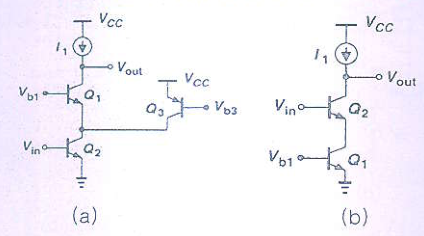

# 기출 2014-1 중간 4 — 전류를 넣는 pnp Q3가 붙은 바이폴라 캐스코드와 Q1을 이미터 쪽에 단 CE 단의 출력 저항·G_m·이득 식

## 원문
다음 회로에 대해 질문에 답하시오. $V_A < \infty$ 이고, $\beta \gg 1$, $g_m r_o \gg 1$로 가정한다.

(1) 회로 (a)의 출력 저항 식을 구하시오.

(2) 회로 (a)의 전압이득 ($V_{out}/V_{in}$) 식을 구하시오.

(3) 회로 (b)의 transconductance $G_m (= i_{out}/V_{in})$ 식을 구하시오.

(4) 회로 (b)의 전압이득 ($V_{out}/V_{in}$) 식을 구하시오.

## 조건
- 회로: 그림 (a), (b)
- $V_A < \infty$ (Early 효과 고려)
- $\beta \gg 1$, $g_m r_o \gg 1$로 가정
- 값은 주어지지 않음, 식으로 답함 (원문에 없음)
- (3) 전용: $G_m = i_{out}/V_{in}$ ($i_{out}$의 위치·방향은 그림에 인쇄돼 있지 않음 (원문에 없음))

## 구할 것
- (1) 회로 (a)의 출력 저항 식
- (2) 회로 (a)의 전압 이득 $V_{out}/V_{in}$ 식
- (3) 회로 (b)의 transconductance $G_m (= i_{out}/V_{in})$ 식
- (4) 회로 (b)의 전압 이득 $V_{out}/V_{in}$ 식

## 회로 — Fig Q4(a)
```spice
I1  VCC   Vout  {I_1}
Q1  Vout  Vb1   n1   npn
Q2  n1    Vin   0    npn
Q3  n1    Vb3   VCC  pnp    ; 좌우 반전 (베이스 오른쪽), 컬렉터 = n1
* VCC는 T 전원 기호 두 개 (I1 위, Q3 이미터 위)
```
- 단자: VCC = 전원, 값 미지정 (T 전원 기호 2개, 둘 다 V_CC로 인쇄) / Vb1, Vb3 = 이상적 DC 바이어스, 값 미지정 (점 단자) / Vin = 입력 (개방 원) / Vout = 출력 (개방 원)
- 표시: 노드 라벨 V_CC (위 T 기호 오른쪽), V_CC (Q3 위 T 기호 오른쪽), V_out (출력 원 오른쪽), V_b1 (점 단자 왼쪽), V_in (입력 원 왼쪽), V_b3 (점 단자 오른쪽) / 소자 라벨 I_1 (전류원 왼쪽), Q_1, Q_2 (각 트랜지스터 오른쪽), Q_3 (Q3 왼쪽, 컬렉터 옆) / 부호 없음 / 화살표 없음 / 수치·면적 라벨 없음
- 배치: 왼쪽 세로줄 위→아래 VCC T 기호, I_1 전류원 (화살표 아래), Vout 접속점, Q1, n1 접속점, Q2, 접지 / Q1, Q2 npn 보통 방향 (베이스 왼쪽, 컬렉터 위, 이미터 아래·화살표 바깥) / Vout 접속점에서 가로선이 오른쪽 V_out 원 / V_b1 점 단자 → 가로선 → Q1 베이스, V_in 원 → 가로선 → Q2 베이스 / Q3은 오른쪽, Q1 높이보다 조금 아래, pnp 좌우 반전 (베이스 막대 오른쪽, 이미터 왼쪽 위·화살표가 막대 쪽으로 들어감, 컬렉터 왼쪽 아래) / Q3 이미터에서 세로선이 위로 따로 그린 VCC T 기호 / Q3 베이스 → 가로선 → 오른쪽 V_b3 점 단자 / Q3 컬렉터에서 세로선이 n1 높이까지 내려가 모서리에서 왼쪽으로 꺾여 긴 가로선으로 n1 접속점 / Q2 이미터 아래 접지 / 접속점 (세 갈래 이상, 2곳): ① Vout = 위 I_1 + 아래 Q1 컬렉터 + 오른쪽 V_out 가로선 (점) ② n1 = 위 Q1 이미터 + 아래 Q2 컬렉터 + 오른쪽 Q3 컬렉터로 가는 가로선 (점) / 교차: 없음

## 회로 — Fig Q4(b)
```spice
I1  VCC   Vout  {I_1}
Q2  Vout  Vin   n1   npn
Q1  n1    Vb1   0    npn
* n1 = Q2 이미터·Q1 컬렉터 (라벨 없음)
```
- 단자: VCC = 전원, 값 미지정 (T 전원 기호) / Vin = 입력 (개방 원) / Vb1 = 이상적 DC 바이어스, 값 미지정 (점 단자) / Vout = 출력 (개방 원)
- 표시: 노드 라벨 V_CC (T 기호 오른쪽), V_out (출력 원 오른쪽), V_in (입력 원 왼쪽), V_b1 (점 단자 왼쪽) / 소자 라벨 I_1 (전류원 왼쪽), Q_2 (위 트랜지스터 오른쪽), Q_1 (아래 트랜지스터 오른쪽) / 부호 없음 / 화살표 없음 / 수치·면적 라벨 없음
- 배치: 한 세로줄 위→아래 VCC T 기호, I_1 전류원 (화살표 아래), Vout 접속점, Q2, Q1, 접지 / Q2, Q1 npn 보통 방향 (베이스 왼쪽, 컬렉터 위, 이미터 아래·화살표 바깥), Q2 이미터에서 세로선이 바로 Q1 컬렉터 / Vout 접속점에서 가로선이 오른쪽 V_out 원 / V_in 원 → 가로선 → Q2 베이스, V_b1 점 단자 → 가로선 → Q1 베이스 / Q1 이미터 아래 접지 / 위가 입력 소자 Q2, 아래가 바이어스 소자 Q1 (회로 (a)와 위아래가 바뀜) / 접속점 (세 갈래 이상, 1곳): Vout = 위 I_1 + 아래 Q2 컬렉터 + 오른쪽 V_out 가로선 (점) / 교차: 없음


