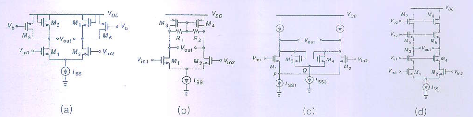

# 기출 2014-1 중간 5 — 부하가 다른 네 MOS 차동 증폭기의 차동 전압 이득 식

## 원문
다음 차동증폭기에 대해 질문에 답하시오. 이 때, $\lambda \neq 0$으로 가정한다.

(1) 회로 (a)의 차동 전압이득($V_{out}/(V_{in1} - V_{in2})$) 식을 구하시오.

(2) 회로 (b)의 차동 전압이득($V_{out}/(V_{in1} - V_{in2})$) 식을 구하시오. ($R_1 = R_2$)

(3) 회로 (c)의 차동 전압이득($V_{out}/(V_{in1} - V_{in2})$) 식을 구하시오.

(4) 회로 (d)의 차동 전압이득($V_{out}/(V_{in1} - V_{in2})$) 식을 구하시오. ($g_m r_o \gg 1$로 가정)

## 조건
- 회로: 그림 (a), (b), (c), (d)의 차동 증폭기
- $\lambda \neq 0$ (채널 길이 변조 고려)
- 값은 주어지지 않음, 식으로 답함 (원문에 없음)
- (2) 전용: $R_1 = R_2$
- (4) 전용: $g_m r_o \gg 1$로 가정

## 구할 것
- (1) 회로 (a)의 차동 전압 이득 $V_{out}/(V_{in1} - V_{in2})$ 식
- (2) 회로 (b)의 차동 전압 이득 $V_{out}/(V_{in1} - V_{in2})$ 식
- (3) 회로 (c)의 차동 전압 이득 $V_{out}/(V_{in1} - V_{in2})$ 식
- (4) 회로 (d)의 차동 전압 이득 $V_{out}/(V_{in1} - V_{in2})$ 식

## 회로 — Fig Q5(a)
```spice
M5   out1  Vb    VDD   pmos
M3   VDD   VDD   out1  nmos    ; 게이트 = VDD (레일에서 내려온 선), 소스 = out1
M4   VDD   VDD   out2  nmos    ; 좌우 반전 (게이트 오른쪽), 게이트 = VDD, 소스 = out2
M6   out2  Vb    VDD   pmos    ; 좌우 반전 (게이트 오른쪽)
M1   out1  Vin1  n1    nmos
M2   out2  Vin2  n1    nmos    ; 좌우 반전 (게이트 오른쪽)
ISS  n1    0     {I_SS}
* out1, out2 = 두 출력 원. 원 사이에 V_out 라벨 하나 (차동 출력)
* n1 = 공통 소스(테일) 노드, 라벨 없음
```
- 단자: VDD = 전원, 값 미지정 (가로 레일) / Vb = 이상적 DC 바이어스, 값 미지정 (점 단자 2개, 둘 다 V_b로 인쇄) / Vin1, Vin2 = 입력 (개방 원) / out1, out2 = 출력 (개방 원 2개, 차동 출력)
- 표시: 노드 라벨 V_DD (레일 오른쪽 끝 위), V_b (왼쪽 점 단자 왼쪽), V_b (오른쪽 점 단자 오른쪽), V_out (두 출력 원 사이, 하나만 인쇄), V_in1 (입력 원 왼쪽), V_in2 (입력 원 오른쪽) / 소자 라벨 M_5 (M5 아래), M_3 (M3 오른쪽), M_4 (M4 왼쪽), M_6 (M6 아래), M_1 (M1 오른쪽), M_2 (M2 왼쪽), I_SS (전류원 오른쪽) / 부호 없음 / 화살표 없음 / 수치·면적 라벨 없음
- 배치: 맨 위 가로 레일 V_DD / 왼쪽 위 M5 pmos 보통 방향 (게이트 왼쪽 → V_b 점 단자, 소스 오른쪽 위가 레일로·화살표가 막대 쪽으로 들어감, 드레인 오른쪽 아래), M5 드레인에서 세로선이 out1 높이까지 내려가 오른쪽으로 꺾여 out1 접속점 / M3는 M5 오른쪽, nmos 보통 방향 (드레인 오른쪽 위가 레일로, 소스 오른쪽 아래·화살표 바깥이 out1 접속점으로), 레일에서 세로선이 내려와 오른쪽으로 꺾여 M3 게이트 / 오른쪽은 좌우 대칭: M4 nmos 좌우 반전 (게이트 오른쪽, 드레인 왼쪽 위가 레일로, 소스 왼쪽 아래·화살표 바깥이 out2 접속점으로), M4 게이트에서 짧은 가로선이 오른쪽으로 나가 위로 꺾여 레일 (이 세로선은 스캔에서 점선처럼 흐림) / M6 pmos 좌우 반전 (게이트 오른쪽 → V_b 점 단자, 소스 왼쪽 위가 레일로·화살표가 막대 쪽으로 들어감, 드레인 왼쪽 아래), M6 드레인에서 세로선이 out2 높이까지 내려가 왼쪽으로 꺾여 out2 접속점 / out1 접속점에서 가로선이 오른쪽 출력 원, out2 접속점에서 가로선이 왼쪽 출력 원 (두 원이 가운데서 마주 봄) / out1 아래 M1 (nmos 보통 방향, 게이트 왼쪽 ← V_in1 원), out2 아래 M2 (nmos 좌우 반전, 게이트 오른쪽 ← V_in2 원) / M1 소스, M2 소스에서 각각 세로선이 내려가 꺾여 한 가로선으로 이어지고, 그 가운데 n1 접속점에서 아래로 I_SS 전류원 (화살표 아래), 접지 / 접속점 (세 갈래 이상, 3곳): out1 = 위 M3 소스 + 왼쪽 M5 드레인 선 + 아래 M1 드레인 + 오른쪽 출력 원 선 (점), out2 = 위 M4 소스 + 오른쪽 M6 드레인 선 + 아래 M2 드레인 + 왼쪽 출력 원 선 (점), n1 = 왼쪽 M1 소스 선 + 오른쪽 M2 소스 선 + 아래 I_SS (점) / 교차: 없음

## 회로 — Fig Q5(b)
```spice
M3   out1  n1    VDD   pmos    ; 좌우 반전 (게이트 오른쪽)
M4   out2  n1    VDD   pmos
R1   out1  n1    {R_1}
R2   n1    out2  {R_2}
M1   out1  Vin1  n2    nmos
M2   out2  Vin2  n2    nmos    ; 좌우 반전 (게이트 오른쪽)
ISS  n2    0     {I_SS}
* out1, out2 = 두 출력 원. 원 사이에 V_out 라벨 하나 (차동 출력)
* n1 = M3·M4 게이트와 R1·R2 가운데 (라벨 없음), n2 = 공통 소스(테일) 노드, 라벨 없음
```
- 단자: VDD = 전원, 값 미지정 (가로 레일) / Vin1, Vin2 = 입력 (개방 원) / out1, out2 = 출력 (개방 원 2개, 차동 출력)
- 표시: 노드 라벨 V_DD (레일 오른쪽 끝), V_out (두 출력 원 사이, 하나만 인쇄), V_in1 (입력 원 왼쪽), V_in2 (입력 원 오른쪽) / 소자 라벨 M_3 (M3 왼쪽), M_4 (M4 오른쪽), R_1 (왼쪽 저항 아래), R_2 (오른쪽 저항 아래), M_1 (M1 오른쪽), M_2 (M2 왼쪽), I_SS (전류원 오른쪽) / 부호 없음 / 화살표 없음 / 수치·면적 라벨 없음
- 배치: 맨 위 가로 레일 V_DD / M3 pmos 좌우 반전 (게이트 오른쪽, 소스 왼쪽 위·화살표가 막대 쪽으로 들어감, 드레인 왼쪽 아래), 레일에서 세로선이 내려와 오른쪽으로 꺾여 소스 / M4 pmos 보통 방향 (게이트 왼쪽, 소스 오른쪽 위·화살표가 막대 쪽으로 들어감, 드레인 오른쪽 아래), 소스에서 꺾여 레일 / 두 게이트는 게이트 높이 가로선으로 이어지고 그 가운데 n1 위 접속점에서 세로선이 내려가 R_1·R_2 사이 n1 아래 접속점 / M3 드레인에서 왼쪽으로 꺾여 왼쪽 세로선의 out1 위 접속점, M4 드레인에서 오른쪽으로 꺾여 오른쪽 세로선의 out2 위 접속점 / 가로 저항 줄: out1 위 접속점 — R_1 — n1 아래 접속점 — R_2 — out2 위 접속점 (게이트 공통선 바로 아래 높이) / 왼쪽 세로선은 out1 위 접속점에서 내려가 out1 아래 접속점 (오른쪽 출력 원으로 가로선), 다시 내려가 M1 드레인 / 오른쪽 세로선은 out2 위 접속점에서 내려가 out2 아래 접속점 (왼쪽 출력 원으로 가로선), 다시 내려가 M2 드레인 / M1 nmos 보통 방향 (게이트 왼쪽 ← V_in1 원), M2 nmos 좌우 반전 (게이트 오른쪽 ← V_in2 원) / 두 소스에서 세로선이 내려가 한 가로선으로 이어지고 가운데 n2 접속점에서 아래로 I_SS 전류원 (화살표 아래), 접지 / 접속점 (세 갈래 이상, 7곳): ① n1 위 = 왼쪽 M3 게이트 선 + 오른쪽 M4 게이트 선 + 아래 n1 세로선 (점) ② n1 아래 = 왼쪽 R_1 + 오른쪽 R_2 + 위 n1 세로선 (점) ③ out1 위 = 위 M3 드레인 선 + 오른쪽 R_1 + 아래 세로선 (점) ④ out2 위 = 위 M4 드레인 선 + 왼쪽 R_2 + 아래 세로선 (점) ⑤ out1 아래 = 위 세로선 + 아래 M1 드레인 + 오른쪽 출력 원 선 (점) ⑥ out2 아래 = 위 세로선 + 아래 M2 드레인 + 왼쪽 출력 원 선 (점) ⑦ n2 = 왼쪽 M1 소스 선 + 오른쪽 M2 소스 선 + 아래 I_SS (점) / 교차: 없음

## 회로 — Fig Q5(c)
```spice
I1   VDD   out1  ; 라벨·값 없음
I2   VDD   out2  ; 라벨·값 없음
M1   out1  Vin1  P     nmos
M2   out2  Vin2  P     nmos    ; 좌우 반전 (게이트 오른쪽)
M3   out1  out1  Q     nmos    ; 좌우 반전 (게이트 오른쪽), 다이오드 연결
M4   out2  out2  Q     nmos    ; 다이오드 연결
ISS1 P     0     {I_SS1}
ISS2 Q     0     {I_SS2}
* out1, out2 = 두 출력 원. 원 사이에 V_out 라벨 하나 (차동 출력)
```
- 단자: VDD = 전원, 값 미지정 (가로 레일) / Vin1, Vin2 = 입력 (개방 원) / out1, out2 = 출력 (개방 원 2개, 차동 출력)
- 표시: 노드 라벨 V_DD (레일 오른쪽 끝), V_out (두 출력 원 사이, 하나만 인쇄), V_in1 (입력 원 왼쪽), V_in2 (입력 원 오른쪽, 크롭 오른쪽 끝에 붙음), P (P 접속점 왼쪽), Q (Q 접속점 아래 왼쪽) / 소자 라벨 M_1 (M1 아래 왼쪽), M_2 (M2 아래), M_3 (M3 왼쪽), M_4 (M4 오른쪽), I_SS1 (전류원 오른쪽), I_SS2 (전류원 오른쪽), I1, I2 (라벨 없음) / 부호 없음 / 화살표 없음 / 수치·면적 라벨 없음
- 배치: 맨 위 가로 레일 V_DD / 왼쪽 세로줄 위→아래 I1 전류원 (화살표 아래), out1 위 접속점 (오른쪽 출력 원으로 가로선), out1 아래 접속점, M1, P 접속점, I_SS1 전류원 (화살표 아래), 접지 / 오른쪽 세로줄 위→아래 I2 전류원 (화살표 아래), out2 위 접속점 (왼쪽 출력 원으로 가로선), out2 아래 접속점, M2 / M1 nmos 보통 방향 (게이트 왼쪽 ← V_in1 원), M2 nmos 좌우 반전 (게이트 오른쪽 ← V_in2 원) / out1 아래 접속점에서 가로선이 오른쪽으로 나가 M3 드레인 접속점을 지나 오른쪽 끝에서 아래로 꺾여 M3 게이트 / M3 nmos 좌우 반전 (게이트 오른쪽, 드레인 왼쪽 위, 소스 왼쪽 아래·화살표 바깥), M3 드레인은 위로 그 가로선의 접속점 / out2 아래 접속점에서 가로선이 왼쪽으로 나가 M4 드레인 접속점을 지나 왼쪽 끝에서 아래로 꺾여 M4 게이트 / M4 nmos 보통 방향 (게이트 왼쪽, 드레인 오른쪽 위, 소스 오른쪽 아래·화살표 바깥) / M3 소스와 M4 소스에서 세로선이 내려가 한 가로선으로 이어지고 가운데 Q 접속점에서 아래로 I_SS2 전류원 (화살표 아래), 접지 / P 접속점에서 가로선이 Q 아래 높이로 오른쪽 끝까지 가서 위로 꺾여 M2 소스 / 접속점 (세 갈래 이상, 8곳): ① out1 위 = 위 I1 + 아래 세로선 + 오른쪽 출력 원 선 (점) ② out1 아래 = 위 세로선 + 아래 M1 드레인 + 오른쪽 M3 쪽 가로선 (점) ③ M3 드레인 = 왼쪽 가로선 + 오른쪽 게이트 쪽 가로선 + 아래 M3 드레인 (점) ④ out2 위 = 위 I2 + 아래 세로선 + 왼쪽 출력 원 선 (점) ⑤ out2 아래 = 위 세로선 + 아래 M2 드레인 + 왼쪽 M4 쪽 가로선 (점) ⑥ M4 드레인 = 오른쪽 가로선 + 왼쪽 게이트 쪽 가로선 + 아래 M4 드레인 (점) ⑦ Q = 왼쪽 M3 소스 선 + 오른쪽 M4 소스 선 + 아래 I_SS2 (점) ⑧ P = 위 M1 소스 + 아래 I_SS1 + 오른쪽 M2 소스로 가는 가로선 (점) / 교차: 1곳, P에서 M2 소스로 가는 가로선이 Q와 I_SS2 사이 세로선을 점 없이 지나감

## 회로 — Fig Q5(d)
```spice
M7   n1    Vb3   VDD   pmos
M8   n2    Vb3   VDD   pmos
M5   n1    Vb2   out1  nmos    ; 드레인 = n1 (위, M7 드레인), 소스 = out1 (아래, 화살표가 아래 단자)
M6   n2    Vb2   out2  nmos    ; 드레인 = n2 (위, M8 드레인), 소스 = out2 (아래, 화살표가 아래 단자)
M3   out1  Vb1   n3    nmos
M4   out2  Vb1   n4    nmos
M1   n3    Vin1  n5    nmos
M2   n4    Vin2  n5    nmos    ; 좌우 반전 (게이트 오른쪽)
ISS  n5    0     {I_SS}
* out1, out2 = 두 출력 원. 원 사이에 V_out 라벨 하나 (차동 출력)
* n1–n4 = 위아래 소자 사이 노드, n5 = 공통 소스(테일) 노드 (모두 라벨 없음)
* M5, M6 종류는 화살표 위치로 정함 (판독 근거는 이미지 아래 참고 줄)
```
- 단자: VDD = 전원, 값 미지정 (가로 레일) / Vb3, Vb2, Vb1 = 이상적 DC 바이어스, 값 미지정 (점 단자) / Vin1, Vin2 = 입력 (개방 원) / out1, out2 = 출력 (개방 원 2개, 차동 출력)
- 표시: 노드 라벨 V_DD (레일 오른쪽 끝), V_b3, V_b2, V_b1 (각 점 단자 왼쪽), V_out (두 출력 원 사이, 하나만 인쇄), V_in1 (입력 원 왼쪽), V_in2 (입력 원 오른쪽) / 소자 라벨 M_7, M_8 (각 트랜지스터 위), M_5, M_6 (각 트랜지스터 아래), M_3 (M3 위 왼쪽), M_4 (M4 오른쪽), M_1 (M1 오른쪽), M_2 (M2 왼쪽), I_SS (전류원 오른쪽) / 부호 없음 / 화살표 없음 / 수치·면적 라벨 없음
- 배치: 맨 위 가로 레일 V_DD (왼쪽 세로줄 조금 왼쪽부터 오른쪽 세로줄 너머까지) / 왼쪽 세로줄 위→아래 M7, M5, out1 접속점, M3, M1 / 오른쪽 세로줄 위→아래 M8, M6, out2 접속점, M4, M2 / M7, M8 pmos 보통 방향 (게이트 왼쪽, 소스 오른쪽 위·화살표가 있는 단자가 레일로, 드레인 오른쪽 아래) / M5, M6 게이트 왼쪽, 위 단자가 M7·M8 드레인, 아래 단자(화살표)가 출력 접속점 / M3, M4, M1 게이트 왼쪽, 위 드레인·아래 소스(화살표) / M2 nmos 좌우 반전 (게이트 오른쪽 ← V_in2 원) / 게이트 공통선 3개: V_b3 점 단자 → M7 게이트 → 게이트 높이로 M8 게이트, V_b2 점 단자 → M5 게이트 → M6 게이트, V_b1 점 단자 → M3 게이트 → M4 게이트 (각 공통선은 왼쪽 소자의 위아래 단자 리드 사이를 지나 점·교차 없음) / V_in1 원 → 가로선 → M1 게이트 / out1 접속점에서 가로선이 오른쪽 출력 원, out2 접속점에서 가로선이 왼쪽 출력 원 (두 원이 가운데서 마주 봄) / M1 소스, M2 소스에서 각각 세로선이 내려가 한 가로선으로 이어지고 가운데 n5 접속점에서 아래로 I_SS 전류원 (화살표 아래), 접지 / 접속점 (세 갈래 이상, 3곳): out1 = 위 M5 아래 단자 + 아래 M3 드레인 + 오른쪽 출력 원 선 (점), out2 = 위 M6 아래 단자 + 아래 M4 드레인 + 왼쪽 출력 원 선 (점), n5 = 왼쪽 M1 소스 선 + 오른쪽 M2 소스 선 + 아래 I_SS (점) / 교차: 없음


> 참고: 크롭에 손글씨는 없음. (d)는 원본에서도 작게 인쇄되고 스캔이 흐려 MOSFET 화살표 방향은 확대해도 판독 불가. M7, M8은 화살표가 위 단자(레일 쪽)에 있어 pmos, M5, M6은 화살표가 아래 단자(출력 쪽)에 있고 모양이 M3, M4 화살표와 같아 nmos로 봄. (d)의 V_b3 라벨의 첨자 3은 흐리게 인쇄됨
