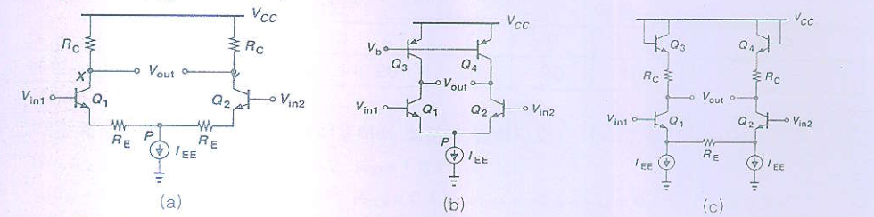

# 기출 2014-1 중간 6 — R_E 축퇴 바이폴라 차동쌍의 V_CM 최대값·이득과 pnp 전류원 부하·다이오드 부하 차동쌍의 차동 이득

## 원문
다음 차동증폭기에 대해 다음 조건을 이용하여 질문에 답하시오.

$V_{CC} = 2.5\ \text{V}$, $I_{EE} = 1\ \text{mA}$, $R_E = 50\ \Omega$, $V_T = 25\ \text{mV}$.

(1) 회로 (a)에서 $R_C = 1\ \text{k}\Omega$ 일 때, 입력 common-mode level ($V_{CM}$)의 최대값을 구하시오.

(2) 회로 (a)에서 $R_C = 1\ \text{k}\Omega$ 일 때, 차동 전압이득 값을 구하시오. ($V_A = \infty$ 가정)

(3) 회로 (b)의 차동 전압이득 값을 구하시오. ($V_{A,n} = V_{A,p} = 5\ \text{V}$ 가정)

(4) 회로 (c)에서 $R_C = 125\ \Omega$ 일 때, 차동 전압이득 값을 구하시오. ($V_A = \infty$ 가정)

## 조건
- 회로: 그림 (a), (b), (c)의 바이폴라 차동 증폭기
- $V_{CC} = 2.5\ \text{V}$, $I_{EE} = 1\ \text{mA}$
- $R_E = 50\ \Omega$, $V_T = 25\ \text{mV}$
- (1) 전용: 회로 (a), $R_C = 1\ \text{k}\Omega$
- (2) 전용: 회로 (a), $R_C = 1\ \text{k}\Omega$, $V_A = \infty$ 가정
- (3) 전용: 회로 (b), $V_{A,n} = V_{A,p} = 5\ \text{V}$ 가정
- (4) 전용: 회로 (c), $R_C = 125\ \Omega$, $V_A = \infty$ 가정
- $\beta$와 회로 (b)의 바이어스 전압 $V_b$ 값은 주어지지 않음 (원문에 없음)

## 구할 것
- (1) 회로 (a)의 입력 common-mode level $V_{CM}$의 최대값
- (2) 회로 (a)의 차동 전압 이득 값
- (3) 회로 (b)의 차동 전압 이득 값
- (4) 회로 (c)의 차동 전압 이득 값

## 회로 — Fig Q6(a)
```spice
RC1  VCC   X     {R_C}    ; 인쇄 라벨 R_C
RC2  VCC   out2  {R_C}    ; 인쇄 라벨 R_C
Q1   X     Vin1  n1   npn
Q2   out2  Vin2  n2   npn    ; 좌우 반전 (베이스 오른쪽)
RE1  n1    P     {R_E}    ; 인쇄 라벨 R_E
RE2  P     n2    {R_E}    ; 인쇄 라벨 R_E
IEE  P     0     {I_EE}
* X, out2 = 두 출력 원. 원 사이에 V_out 라벨 하나 (차동 출력). 왼쪽 원은 라벨 X 노드에 이어짐
* n1, n2 = Q1, Q2 이미터 (라벨 없음)
```
- 단자: VCC = 2.5 V 전원 (가로 레일) / Vin1, Vin2 = 입력 (개방 원) / X, out2 = 출력 (개방 원 2개, 차동 출력)
- 표시: 노드 라벨 V_CC (레일 오른쪽 끝), X (왼쪽 컬렉터 접속점 아래 왼쪽), V_out (두 출력 원 사이, 하나만 인쇄), V_in1 (입력 원 왼쪽), V_in2 (입력 원 오른쪽), P (P 접속점 아래 왼쪽) / 소자 라벨 R_C (왼쪽 저항 왼쪽), R_C (오른쪽 저항 오른쪽), Q_1 (Q1 오른쪽), Q_2 (Q2 왼쪽), R_E (왼쪽 가로 저항 아래), R_E (오른쪽 가로 저항 아래), I_EE (전류원 오른쪽) / 부호 없음 / 화살표 없음 / 수치·면적 라벨 없음
- 배치: 맨 위 가로 레일 V_CC / 왼쪽 세로줄 위→아래 R_C, X 접속점, Q1 / 오른쪽 세로줄 위→아래 R_C, out2 접속점, Q2 / X 접속점에서 가로선이 오른쪽 출력 원, out2 접속점에서 가로선이 왼쪽 출력 원 (두 원이 가운데서 마주 봄) / Q1 npn 보통 방향 (베이스 왼쪽 ← V_in1 원, 컬렉터 오른쪽 위, 이미터 오른쪽 아래·화살표 바깥), Q2 npn 좌우 반전 (베이스 오른쪽 ← V_in2 원, 컬렉터 왼쪽 위, 이미터 왼쪽 아래·화살표 바깥) / 두 이미터에서 세로선이 내려가 꺾여 한 가로선: 왼쪽 이미터 — 가로 R_E — P 접속점 — 가로 R_E — 오른쪽 이미터 / P 접속점에서 아래로 I_EE 전류원 (화살표 아래), 접지 / 접속점 (세 갈래 이상, 3곳): ① X = 위 R_C + 아래 Q1 컬렉터 + 오른쪽 출력 원 선 (점) ② out2 = 위 R_C + 아래 Q2 컬렉터 + 왼쪽 출력 원 선 (점) ③ P = 왼쪽 R_E + 오른쪽 R_E + 아래 I_EE (점) / 교차: 없음

## 회로 — Fig Q6(b)
```spice
Q3   out1  Vb    VCC  pnp
Q4   out2  Vb    VCC  pnp
Q1   out1  Vin1  P    npn
Q2   out2  Vin2  P    npn    ; 좌우 반전 (베이스 오른쪽)
IEE  P     0     {I_EE}
* out1, out2 = 두 출력 원. 원 사이에 V_out 라벨 하나 (차동 출력)
```
- 단자: VCC = 2.5 V 전원 (가로 레일) / Vb = DC 바이어스, 값 미지정 (개방 원) / Vin1, Vin2 = 입력 (개방 원) / out1, out2 = 출력 (개방 원 2개, 차동 출력)
- 표시: 노드 라벨 V_CC (레일 오른쪽 끝), V_b (바이어스 원 왼쪽), V_out (두 출력 원 사이, 하나만 인쇄), V_in1 (입력 원 왼쪽), V_in2 (입력 원 오른쪽), P (P 접속점 아래 왼쪽) / 소자 라벨 Q_3 (Q3 아래), Q_4 (Q4 아래), Q_1 (Q1 오른쪽), Q_2 (Q2 왼쪽), I_EE (전류원 오른쪽) / 부호 없음 / 화살표 없음 / 수치·면적 라벨 없음
- 배치: 맨 위 굵은 가로 레일 V_CC / Q3, Q4 pnp 보통 방향 (베이스 왼쪽, 이미터 오른쪽 위·화살표가 막대 쪽으로 들어감, 컬렉터 오른쪽 아래), 각 이미터에서 세로선이 위로 레일 / 베이스 공통선은 V_b 원에서 Q3 베이스 막대를 지나 베이스 높이로 Q4 베이스까지 가로지름 (Q3 이미터·컬렉터 리드 사이를 지나 교차 없음, Q3 베이스에서 점 없음) / Q3 컬렉터에서 세로선이 내려가 out1 접속점 (오른쪽 출력 원으로 가로선), 다시 내려가 Q1 컬렉터 / Q4 컬렉터에서 세로선이 내려가 out2 접속점 (왼쪽 출력 원으로 가로선), 다시 내려가 Q2 컬렉터 / Q1 npn 보통 방향 (베이스 왼쪽 ← V_in1 원), Q2 npn 좌우 반전 (베이스 오른쪽 ← V_in2 원) / 두 이미터에서 세로선이 내려가 한 가로선으로 이어지고 가운데 P 접속점에서 아래로 I_EE 전류원 (화살표 아래), 접지 / 접속점 (세 갈래 이상, 3곳): ① out1 = 위 Q3 컬렉터 + 아래 Q1 컬렉터 + 오른쪽 출력 원 선 (점) ② out2 = 위 Q4 컬렉터 + 아래 Q2 컬렉터 + 왼쪽 출력 원 선 (점) ③ P = 왼쪽 Q1 이미터 선 + 오른쪽 Q2 이미터 선 + 아래 I_EE (점) / 교차: 없음

## 회로 — Fig Q6(c)
```spice
Q3    VCC   VCC   n1   npn    ; 베이스 = VCC (레일에서 내려온 선), 이미터 = n1
RC1   n1    out1  {R_C}       ; 인쇄 라벨 R_C
Q4    VCC   VCC   n2   npn    ; 좌우 반전 (베이스 오른쪽), 베이스 = VCC, 이미터 = n2
RC2   n2    out2  {R_C}       ; 인쇄 라벨 R_C
Q1    out1  Vin1  n3   npn
Q2    out2  Vin2  n4   npn    ; 좌우 반전 (베이스 오른쪽)
RE    n3    n4    {R_E}
IEE1  n3    0     {I_EE}      ; 인쇄 라벨 I_EE
IEE2  n4    0     {I_EE}      ; 인쇄 라벨 I_EE
* out1, out2 = 두 출력 원. 원 사이에 V_out 라벨 하나 (차동 출력)
* n1, n2 = Q3·Q4 이미터, n3, n4 = Q1·Q2 이미터 (라벨 없음)
```
- 단자: VCC = 2.5 V 전원 (가로 레일) / Vin1, Vin2 = 입력 (개방 원) / out1, out2 = 출력 (개방 원 2개, 차동 출력)
- 표시: 노드 라벨 V_CC (레일 오른쪽 끝), V_out (두 출력 원 사이, 하나만 인쇄), V_in1 (입력 원 왼쪽), V_in2 (입력 원 오른쪽) / 소자 라벨 Q_3 (Q3 오른쪽), Q_4 (Q4 왼쪽), R_C (왼쪽 저항 왼쪽), R_C (오른쪽 저항 오른쪽), Q_1 (Q1 오른쪽), Q_2 (Q2 왼쪽), R_E (가로 저항 아래), I_EE (왼쪽 전류원 왼쪽), I_EE (오른쪽 전류원 오른쪽) / 부호 없음 / 화살표 없음 / 수치·면적 라벨 없음
- 배치: 맨 위 가로 레일 V_CC / 왼쪽 세로줄 위→아래 Q3, R_C, out1 접속점, Q1, n3 접속점, I_EE 전류원 (화살표 아래), 접지 / 오른쪽 세로줄 위→아래 Q4, R_C, out2 접속점, Q2, n4 접속점, I_EE 전류원 (화살표 아래), 접지 / Q3 npn 보통 방향 (베이스 왼쪽, 컬렉터 오른쪽 위가 레일로, 이미터 오른쪽 아래·화살표 바깥이 R_C로), 레일에서 세로선이 내려와 오른쪽으로 꺾여 Q3 베이스 / Q4 npn 좌우 반전 (베이스 오른쪽, 컬렉터 왼쪽 위가 레일로, 이미터 왼쪽 아래·화살표 바깥이 R_C로), 레일에서 세로선이 내려와 왼쪽으로 꺾여 Q4 베이스 / out1 접속점에서 가로선이 오른쪽 출력 원, out2 접속점에서 가로선이 왼쪽 출력 원 (두 원이 가운데서 마주 봄) / Q1 npn 보통 방향 (베이스 왼쪽 ← V_in1 원), Q2 npn 좌우 반전 (베이스 오른쪽 ← V_in2 원) / n3 접속점과 n4 접속점 사이 가로 R_E / 접속점 (세 갈래 이상, 4곳): ① out1 = 위 R_C + 아래 Q1 컬렉터 + 오른쪽 출력 원 선 (점) ② out2 = 위 R_C + 아래 Q2 컬렉터 + 왼쪽 출력 원 선 (점) ③ n3 = 위 Q1 이미터 + 아래 I_EE + 오른쪽 R_E (점) ④ n4 = 위 Q2 이미터 + 아래 I_EE + 왼쪽 R_E (점) / 교차: 없음


> 참고: (a)의 오른쪽 컬렉터 접속점(out2) 바로 아래에 작은 V자(체크 표시 모양) 획이 있음. 손글씨 표시인지 인쇄인지 판독 불가라 넷리스트와 표시 bullet에 넣지 않음
