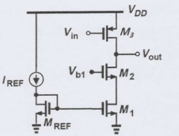

# 기출 2015-1 중간 1 — 전류 거울로 바이어스한 NMOS 캐스코드 부하를 가진 PMOS 공통 소스 증폭기의 최소 V_b1, 출력 임피던스, 이득

## 원문
With device parameters below,

$V_{DD}=1.8\text{V}$, $\mu_n C_{ox} = 100\ \text{uA/V}^2$, $\mu_p C_{ox} = 50\ \text{uA/V}^2$, $\lambda_n=0.1\ \text{V}^{-1}$, $\lambda_p=0.2\ \text{V}^{-1}$, $V_{TH,N} =0.4\text{V}$,

$I_{REF}=0.1\text{mA}$

$(W/L)_1=(W/L)_2=(W/L)_{REF}=50$

1) Determine minimum $V_{b1}$ to operate $M_1$ in saturation region. (10pt)

2) Derive output impedance. (10pt)

3) Derive gain ($v_{out}/v_{in}$). (10pt)

## 조건
- 회로: 그림의 증폭기 ($M_3$ PMOS 입력 소자, $M_2$–$M_1$ NMOS 캐스코드 부하, $M_{REF}$–$M_1$ 전류 거울)
- $V_{DD} = 1.8\ \text{V}$
- $\mu_n C_{ox} = 100\ \mu\text{A/V}^2$, $\mu_p C_{ox} = 50\ \mu\text{A/V}^2$ (원문 표기는 uA/V²)
- $\lambda_n = 0.1\ \text{V}^{-1}$, $\lambda_p = 0.2\ \text{V}^{-1}$
- $V_{TH,N} = 0.4\ \text{V}$
- $I_{REF} = 0.1\ \text{mA}$
- $(W/L)_1 = (W/L)_2 = (W/L)_{REF} = 50$
- $(W/L)_3$, PMOS 문턱 전압, 입력 $V_{in}$의 DC 레벨은 주어지지 않음 (원문에 없음)

## 구할 것
- 1) $M_1$이 포화 영역에서 동작하기 위한 최소 $V_{b1}$
- 2) 출력 임피던스
- 3) 이득 $v_{out}/v_{in}$

## 회로 — Fig Q1
```spice
IREF  VDD   n1    {I_REF}
MREF  n1    n1    0     nmos   ; 좌우 반전 (게이트 오른쪽), 다이오드 연결
M1    n2    n1    0     nmos
M2    Vout  Vb1   n2    nmos
M3    Vout  Vin   VDD   pmos
* (W/L)_1 = (W/L)_2 = (W/L)_REF = 50은 문제 문장에만 인쇄됨 (그림에는 없음)
```
- 단자: VDD = 1.8 V 전원 (가로 레일) / Vb1 = 이상적 DC 바이어스, 값은 구할 것 (점 단자) / Vin = 입력 (개방 원) / Vout = 출력 (개방 원)
- 표시: 노드 라벨 V_DD (레일 오른쪽 끝), V_in (입력 원 왼쪽), V_b1 (점 단자 왼쪽), V_out (출력 원 오른쪽) / 소자 라벨 I_REF (전류원 왼쪽), M_REF (M_REF 오른쪽 아래, 접지 옆), M_1, M_2, M_3 (각 트랜지스터 오른쪽) / 부호 없음 / 화살표 없음 / 수치·면적 라벨 없음
- 배치: 맨 위 굵은 가로 레일 V_DD (왼쪽 끝은 I_REF 세로선 조금 왼쪽, 오른쪽 끝은 M3 소스 세로선 조금 오른쪽) / 왼쪽 세로줄 위→아래 레일, 긴 세로선, I_REF 전류원(화살표 아래), n1 위 접속점, M_REF, 접지 / M_REF nmos 좌우 반전(게이트 막대 오른쪽, 드레인 왼쪽 위, 소스 왼쪽 아래·화살표 바깥) / n1 위 접속점에서 가로선이 오른쪽으로 나가 M_REF 게이트 오른쪽에서 아래로 꺾여 게이트 선의 n1 아래 접속점 (다이오드 연결) / 게이트 선은 M_REF 게이트에서 M1 게이트까지 게이트 높이로 가로지름 / 오른쪽 세로줄 위→아래 M3, Vout 접속점, M2, M1, 접지 / M3 pmos 보통 방향(게이트 왼쪽, 소스 위·화살표가 채널 쪽으로 들어감, 드레인 아래), 소스에서 세로선이 위로 레일 / M2, M1 nmos 보통 방향(게이트 왼쪽, 드레인 위, 소스 아래·화살표 바깥) / M2 소스에서 곧은 세로선이 M1 드레인으로 (n2, 라벨 없음) / Vout 접속점에서 가로선이 오른쪽 V_out 원 / V_in 원 → 가로선 → M3 게이트, V_b1 점 단자 → 가로선 → M2 게이트 / M_REF 소스, M1 소스 아래 각각 접지 / 접속점 (세 갈래 이상, 3곳): ① n1 위 = 위 I_REF + 아래 M_REF 드레인 + 오른쪽 다이오드 연결선 (점) ② n1 아래 = 왼쪽 M_REF 게이트 + 오른쪽 M1 게이트 쪽 가로선 + 위 다이오드 연결선 (점) ③ Vout = 위 M3 드레인 + 아래 M2 드레인 + 오른쪽 V_out 선 (점) / 교차: 없음


