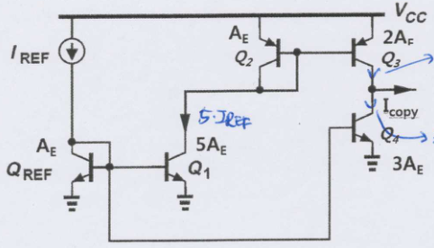
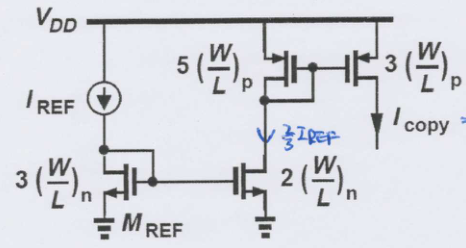

# 기출 2015-1 중간 2 — 이미터 면적비 바이폴라 전류 거울과 W/L 배수 MOS 전류 거울의 I_copy

## 원문
Calculate $I_{copy}$ in each of the circuits when $I_{REF}=1\text{mA}$. Neglect base current of BJT.

1) (10pt)

2) (10pt)

## 조건
- 회로: 소문항 1)은 그림 Q2(바이폴라 전류 거울), 소문항 2)는 그림 Q2-2(MOS 전류 거울) (그림 id는 원문에 없음, 원문에서는 각 소문항 번호 아래에 회로만 인쇄됨)
- $I_{REF} = 1\ \text{mA}$ (두 회로 공통)
- BJT의 베이스 전류는 무시
- 1) 전용: 이미터 면적 $Q_{REF} = A_E$, $Q_1 = 5A_E$, $Q_2 = A_E$, $Q_3 = 2A_E$ (다음 줄 참고), $Q_4 = 3A_E$ (그림에 인쇄된 라벨)
- 1) 전용: $Q_3$ 옆 면적 라벨은 첨자 아래 획이 빠져 "2A_F"처럼 인쇄됨. 다른 면적 라벨과 같이 $2A_E$로 읽음 (원문에 없음)
- 2) 전용: 크기 $M_{REF} = 3(W/L)_n$, 가운데 NMOS $= 2(W/L)_n$, 왼쪽 PMOS $= 5(W/L)_p$, 오른쪽 PMOS $= 3(W/L)_p$ (그림에 인쇄된 라벨)
- 채널 길이 변조와 Early 효과에 대한 언급은 없음 (원문에 없음)

## 구할 것
- 1) 그림 Q2 회로의 $I_{copy}$
- 2) 그림 Q2-2 회로의 $I_{copy}$

## 회로 — Fig Q2
```spice
IREF  VCC  n1   {I_REF}
QREF  n1   n1   0    npn  area=1   ; 좌우 반전 (베이스 오른쪽), 다이오드 연결
Q1    n2   n1   0    npn  area=5
Q2    n2   n2   VCC  pnp  area=1   ; 좌우 반전 (베이스 오른쪽), 다이오드 연결
Q3    out  n2   VCC  pnp  area=2   ; 면적 라벨은 "2A_F"처럼 인쇄됨
Q4    out  n1   0    npn  area=3   ; 베이스는 아래쪽 긴 선으로 n1에 이어짐
* out = Q3 컬렉터와 Q4 컬렉터가 만나는 노드, 오른쪽으로 I_copy 화살표가 붙은 선이 나감
```
- 단자: VCC = 전원, 값 미지정 (가로 레일) / out = I_copy 측정 단자 (선 끝, 끝에 화살촉)
- 표시: 노드 라벨 V_CC (레일 오른쪽 끝) / 소자 라벨 I_REF (전류원 왼쪽), Q_REF (Q_REF 왼쪽), Q_1 (Q1 오른쪽 아래), Q_2 (Q2 왼쪽 아래), Q_3 (Q3 오른쪽), Q_4 (Q4 오른쪽) / 부호 없음 / 화살표 "I_copy": out 노드에서 오른쪽으로 나가는 선, 오른쪽 방향, 도선 위(선 끝의 화살촉), 글자는 화살표 아래 / Q1 컬렉터 전류 (라벨 없음): Q1 컬렉터 세로선, 아래 방향(Q1 컬렉터로 들어감), 도선 위 / 수치·면적 라벨 A_E (Q_REF 라벨 위), 5A_E (Q1 컬렉터 오른쪽, Q_1 라벨 위), A_E (Q2 이미터 왼쪽, Q_2 라벨 위), 2A_E (Q3 오른쪽 위, Q_3 라벨 위; 첨자 E의 아래 획이 빠져 F처럼 보임), 3A_E (Q4 이미터 아래 접지 오른쪽)
- 배치: 맨 위 굵은 가로 레일 V_CC (왼쪽 끝은 I_REF 세로선 조금 왼쪽, 오른쪽 끝은 Q3 이미터 세로선 조금 오른쪽) / 왼쪽 세로줄 위→아래 레일, I_REF 전류원(화살표 아래), 긴 세로선, n1 위 접속점, Q_REF, 접지 / Q_REF npn 좌우 반전(베이스 막대 오른쪽, 컬렉터 왼쪽 위, 이미터 왼쪽 아래·화살표 바깥) / n1 위 접속점에서 가로선이 오른쪽으로 나가 Q_REF 베이스 오른쪽에서 아래로 꺾여 베이스 선의 n1 아래 접속점 (다이오드 연결), 이 세로선은 접속점을 지나 맨 아래까지 계속 내려감 / 베이스 선은 Q_REF 베이스에서 Q1 베이스까지 베이스 높이로 가로지름 / Q1은 Q_REF 오른쪽, npn 보통 방향(베이스 왼쪽, 컬렉터 위, 이미터 오른쪽 아래·화살표 바깥), 이미터 아래 접지 / Q1 컬렉터에서 세로선이 위로 올라가(화살표) Q2 컬렉터 아래 높이에서 오른쪽으로 꺾여 n2 접속점 / Q2는 가운데 위, pnp 좌우 반전(베이스 막대 오른쪽, 이미터 왼쪽 위·화살표가 막대 쪽으로 들어감, 컬렉터 왼쪽 아래), 이미터에서 세로선이 위로 레일, 컬렉터에서 세로선이 아래로 n2 접속점 / n2 접속점에서 가로선이 오른쪽으로 가 Q2 베이스 오른쪽에서 위로 꺾여 베이스 선의 n2 위 접속점 (다이오드 연결) / n2 위 접속점에서 베이스 높이의 가로선이 왼쪽 Q2 베이스, 오른쪽 Q3 베이스로 / 오른쪽 세로줄 위→아래 Q3, out 접속점, Q4, 접지 / Q3 pnp 보통 방향(베이스 왼쪽, 이미터 오른쪽 위·화살표가 막대 쪽으로 들어감, 컬렉터 오른쪽 아래), 이미터에서 세로선이 위로 레일 / out 접속점에서 가로선이 오른쪽으로 나가 화살촉으로 끝남 / Q4 npn 보통 방향(베이스 왼쪽, 컬렉터 위, 이미터 아래·화살표 바깥), 이미터 아래 접지 / Q4 베이스에서 가로선이 왼쪽으로 조금 가서 아래로 꺾여 회로 맨 아래 높이까지 내려가고, 맨 아래 가로선으로 왼쪽 끝까지 가서 위로 꺾여 n1 아래 접속점으로 올라감 / 접속점 (세 갈래 이상, 5곳): ① n1 위 = 위 I_REF + 아래 Q_REF 컬렉터 + 오른쪽 다이오드 연결선 (점) ② n1 아래 = 왼쪽 Q_REF 베이스 + 오른쪽 Q1 베이스 + 위 다이오드 연결선 + 아래 Q4 베이스로 가는 세로선 (점, 네 갈래) ③ n2 = 위 Q2 컬렉터 + 왼쪽 Q1 컬렉터 쪽 가로선 + 오른쪽 다이오드 연결선 (점) ④ n2 위 = 왼쪽 Q2 베이스 + 오른쪽 Q3 베이스 + 아래 다이오드 연결선 (점) ⑤ out = 위 Q3 컬렉터 + 아래 Q4 컬렉터 + 오른쪽 I_copy 선 (점) / 교차: 없음


> 참고: 답안지 손글씨가 겹침 (Q1 컬렉터 화살표 옆 "5·IREF", Q3 오른쪽에서 나가는 화살표와 "10IREF" 일부, Q3·Q4 컬렉터 선 위 작은 v자 획, Q4 라벨 위를 지나는 화살표와 "3IREF" 일부)

## 회로 — Fig Q2-2
```spice
IREF  VDD  n1   {I_REF}
MREF  n1   n1   0    nmos  W/L={(W/L)_n}  m=3   ; 좌우 반전 (게이트 오른쪽), 다이오드 연결
M1    n2   n1   0    nmos  W/L={(W/L)_n}  m=2   ; 라벨 없음
M2    n2   n2   VDD  pmos  W/L={(W/L)_p}  m=5   ; 라벨 없음, 좌우 반전 (게이트 오른쪽), 다이오드 연결
M3    out  n2   VDD  pmos  W/L={(W/L)_p}  m=3   ; 라벨 없음
* out = M3 드레인에서 내려온 선 끝, I_copy 화살표가 붙음
```
- 단자: VDD = 전원, 값 미지정 (가로 레일) / out = I_copy 측정 단자 (선 끝)
- 표시: 노드 라벨 V_DD (레일 왼쪽 끝) / 소자 라벨 I_REF (전류원 왼쪽), M_REF (M_REF 아래 오른쪽, 접지 옆), M1–M3 (라벨 없음) / 부호 없음 / 화살표 "I_copy": M3 드레인 세로선 끝, 아래 방향, 도선 위, 글자는 화살표 오른쪽 / 수치·면적 라벨 3(W/L)_n (M_REF 왼쪽), 2(W/L)_n (가운데 NMOS 오른쪽), 5(W/L)_p (왼쪽 PMOS 왼쪽), 3(W/L)_p (오른쪽 PMOS 오른쪽)
- 배치: 맨 위 굵은 가로 레일 V_DD (라벨은 왼쪽 끝 바깥, 오른쪽 끝은 M3 소스 세로선 조금 오른쪽) / 왼쪽 세로줄 위→아래 레일, I_REF 전류원(화살표 아래), n1 위 접속점, M_REF, 접지 / M_REF nmos 좌우 반전(게이트 막대 오른쪽, 드레인 왼쪽 위, 소스 왼쪽 아래·화살표 바깥) / n1 위 접속점에서 가로선이 오른쪽으로 나가 M_REF 게이트 오른쪽에서 아래로 꺾여 게이트 선의 n1 아래 접속점 (다이오드 연결) / 게이트 선은 M_REF 게이트에서 M1 게이트까지 게이트 높이로 가로지름 / 가운데 세로줄 위→아래 레일, M2, n2 접속점, M1, 접지 / M1 nmos 보통 방향(게이트 왼쪽, 드레인 위, 소스 아래·화살표 바깥) / M2 pmos 좌우 반전(게이트 막대 오른쪽, 소스 왼쪽 위·화살표가 채널 쪽으로 들어감, 드레인 왼쪽 아래), 소스에서 세로선이 위로 레일 / n2 접속점에서 가로선이 오른쪽으로 가 M2 게이트 오른쪽에서 위로 꺾여 게이트 선의 n2 위 접속점 (다이오드 연결) / n2 위 접속점에서 게이트 높이의 가로선이 왼쪽 M2 게이트, 오른쪽 M3 게이트로 / M3은 오른쪽, pmos 보통 방향(게이트 왼쪽, 소스 오른쪽 위·화살표가 채널 쪽으로 들어감, 드레인 오른쪽 아래), 소스에서 세로선이 위로 레일, 드레인에서 세로선이 아래로 내려가 화살촉(I_copy)으로 끝남 / 접속점 (세 갈래 이상, 4곳): ① n1 위 = 위 I_REF + 아래 M_REF 드레인 + 오른쪽 다이오드 연결선 (점) ② n1 아래 = 왼쪽 M_REF 게이트 + 오른쪽 M1 게이트 쪽 가로선 + 위 다이오드 연결선 (점) ③ n2 = 위 M2 드레인 + 아래 M1 드레인 + 오른쪽 다이오드 연결선 (점) ④ n2 위 = 왼쪽 M2 게이트 + 오른쪽 M3 게이트 + 아래 다이오드 연결선 (점) / 교차: 없음


> 참고: 답안지 손글씨가 겹침 (n2 아래 M1 드레인 선 옆 "↓ 2/3 IREF", 오른쪽 끝 I_copy 라벨 옆 "=" 일부)

## 풀이
### (1) $Q_1$ 컬렉터 전류
- 베이스 전류를 무시하면 복사 전류는 이미터 면적비를 따른다: $I_{C1} = (5A_E/A_E)\, I_{REF} = 5.00\ \text{mA}$
### (1) $Q_3$, $Q_4$ 컬렉터 전류
- 다이오드 연결 $Q_2$가 $I_{C1}$을 받아 $Q_3$로 복사: $|I_{C3}| = (2A_E/A_E)\, I_{C1} = 10.0\ \text{mA}$ (출력 노드로 밀어 넣음)
- $Q_4$ 베이스는 맨 아래 선으로 $Q_{REF}$ 베이스에 이어진다: $I_{C4} = (3A_E/A_E)\, I_{REF} = 3.00\ \text{mA}$ (출력 노드에서 뽑아 냄)
### (1) 출력 노드 KCL
- $I_{copy} = |I_{C3}| - I_{C4} = 10.0 - 3.00 = 7.00\ \text{mA}$
### (2) MOS 거울 두 단
- 채널 길이 변조를 무시하면 복사 전류는 $W/L$ 비를 따른다. 가운데 NMOS 전류 $I_{D,M} = (2/3)\, I_{REF} = 0.667\ \text{mA}$
- 다이오드 연결 왼쪽 PMOS가 받아 오른쪽 PMOS로 복사: $I_{copy} = (3/5)\, I_{D,M} = 0.400\ \text{mA}$
### 답
- (1) $I_{copy} = 7.00\ \text{mA}$
- (2) $I_{copy} = 0.400\ \text{mA}$
