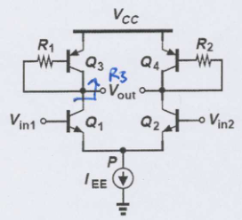
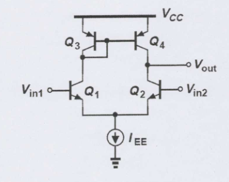
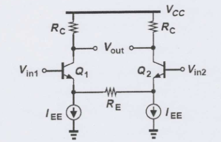

# 기출 2015-1 중간 3 — 베이스–컬렉터 저항 R1·R2를 단 pnp 부하, 전류 거울 부하, 이미터 저항 R_E를 가진 바이폴라 차동쌍의 차동 전압 이득

## 원문
Calculate differential voltage gain of following circuits.

1) $I_{EE}=2\text{mA}$, $V_{A,p}=10\text{V}$, $V_{A,n}=10\text{V}$, $R_{1,2} = 10\text{kohm}$, $\beta=100$ (10pt)

2) $I_{EE}=0.2\text{mA}$, $V_{A,p}=4\text{V}$, $V_{A,n}=5\text{V}$, $\beta=100$ (5pt)

3) $I_{EE}=0.1\text{mA}$, $V_{A,n}=10\text{V}$, $R_C=1\text{kohm}$, $R_E=5\text{kohm}$, $\beta=100$ (5pt)

## 조건
- 회로: 소문항 1)은 그림 Q3, 2)는 그림 Q3-2, 3)은 그림 Q3-3 (그림 id는 원문에 없음, 원문에서는 각 소문항 줄 아래에 회로가 인쇄됨)
- 1) 전용: $I_{EE} = 2\ \text{mA}$, $V_{A,p} = 10\ \text{V}$, $V_{A,n} = 10\ \text{V}$, $R_1 = R_2 = 10\ \text{k}\Omega$ (원문 표기 $R_{1,2}$ = 10kohm), $\beta = 100$
- 2) 전용: $I_{EE} = 0.2\ \text{mA}$, $V_{A,p} = 4\ \text{V}$, $V_{A,n} = 5\ \text{V}$, $\beta = 100$
- 3) 전용: $I_{EE} = 0.1\ \text{mA}$, $V_{A,n} = 10\ \text{V}$, $R_C = 1\ \text{k}\Omega$, $R_E = 5\ \text{k}\Omega$, $\beta = 100$
- 3) 전용: 그림의 두 전류원은 모두 $I_{EE}$로 인쇄됨
- 열전압 $V_T$와 $V_{CC}$ 값은 주어지지 않음 (원문에 없음)

## 구할 것
- 1) 그림 Q3 회로의 차동 전압 이득
- 2) 그림 Q3-2 회로의 차동 전압 이득
- 3) 그림 Q3-3 회로의 차동 전압 이득

## 회로 — Fig Q3
```spice
Q3   out1  n1    VCC  pnp
R1   n1    out1  {R_1}
Q4   out2  n2    VCC  pnp    ; 좌우 반전 (베이스 오른쪽)
R2   n2    out2  {R_2}
Q1   out1  Vin1  P    npn
Q2   out2  Vin2  P    npn    ; 좌우 반전 (베이스 오른쪽)
IEE  P     0     {I_EE}
* out1, out2 = 두 출력 원. 원 사이에 V_out 라벨 하나 (차동 출력)
```
- 단자: VCC = 전원, 값 미지정 (가로 레일) / Vin1, Vin2 = 입력 (개방 원) / out1, out2 = 차동 출력 V_out의 두 단자 (개방 원, 각각에는 라벨 없음)
- 표시: 노드 라벨 V_CC (레일 위 가운데), V_out (두 출력 원 사이), V_in1 (왼쪽 입력 원 왼쪽), V_in2 (오른쪽 입력 원 오른쪽), P (P 접속점 아래 왼쪽, I_EE 위) / 소자 라벨 R_1 (R1 위), R_2 (R2 위), Q_3 (Q3 오른쪽), Q_4 (Q4 왼쪽), Q_1 (Q1 오른쪽), Q_2 (Q2 왼쪽), I_EE (전류원 왼쪽) / 부호 없음 / 화살표 없음 / 수치·면적 라벨 없음
- 배치: 맨 위 굵은 가로 레일 V_CC (Q3 이미터 세로선 조금 왼쪽에서 Q4 이미터 세로선 조금 오른쪽까지) / 왼쪽 세로줄 위→아래 Q3, out1 접속점, Q1 / 오른쪽 세로줄 위→아래 Q4, out2 접속점, Q2 / Q3 pnp 보통 방향(베이스 왼쪽, 이미터 오른쪽 위·화살표가 막대 쪽으로 들어감, 컬렉터 오른쪽 아래), Q4 pnp 좌우 반전(베이스 막대 오른쪽, 이미터 왼쪽 위·화살표가 막대 쪽으로 들어감, 컬렉터 왼쪽 아래), 두 이미터에서 세로선이 위로 레일 / Q3 베이스 → 가로선 → 왼쪽에 가로로 놓인 R_1 → 왼쪽 끝에서 아래로 꺾여 out1 높이까지 내려가고 → 가로선으로 오른쪽 out1 접속점 / Q4 베이스 → 가로선 → 오른쪽에 가로로 놓인 R_2 → 오른쪽 끝에서 아래로 꺾여 out2 높이까지 내려가고 → 가로선으로 왼쪽 out2 접속점 / out1 접속점에서 가로선이 오른쪽 출력 원, out2 접속점에서 가로선이 왼쪽 출력 원 (두 원이 가운데에서 마주 보고 그 사이에 V_out) / Q1 npn 보통 방향(베이스 왼쪽, 컬렉터 위, 이미터 오른쪽 아래·화살표 바깥), Q2 npn 좌우 반전(베이스 막대 오른쪽, 컬렉터 왼쪽 위, 이미터 왼쪽 아래·화살표 바깥) / V_in1 원 → 가로선 → Q1 베이스, Q2 베이스 → 가로선 → V_in2 원 / 두 이미터는 아래로 내려가 가로선으로 가운데 P 점에서 만남, P에서 아래로 I_EE(화살표 아래), 그 아래 접지 / 접속점 (세 갈래 이상, 3곳): ① out1 = 위 Q3 컬렉터 + 아래 Q1 컬렉터 + 왼쪽 R_1 귀환선 + 오른쪽 출력선 (점, 네 갈래) ② out2 = 위 Q4 컬렉터 + 아래 Q2 컬렉터 + 오른쪽 R_2 귀환선 + 왼쪽 출력선 (점, 네 갈래) ③ P = 왼쪽 Q1 이미터 선 + 오른쪽 Q2 이미터 선 + 아래 I_EE (점) / 교차: 없음


> 참고: 답안지 손글씨가 겹침 (out1 접속점과 왼쪽 출력 원 사이의 파란 "R3" 글자와 화살표, 그 아래 꺾인 획)

## 회로 — Fig Q3-2
```spice
Q3   n1    n1    VCC  pnp    ; 좌우 반전 (베이스 오른쪽), 다이오드 연결
Q4   Vout  n1    VCC  pnp
Q1   n1    Vin1  n2   npn
Q2   Vout  Vin2  n2   npn    ; 좌우 반전 (베이스 오른쪽)
IEE  n2    0     {I_EE}
```
- 단자: VCC = 전원, 값 미지정 (가로 레일) / Vin1, Vin2 = 입력 (개방 원) / Vout = 출력 (개방 원)
- 표시: 노드 라벨 V_CC (레일 오른쪽 끝), V_out (출력 원 오른쪽), V_in1 (왼쪽 입력 원 왼쪽), V_in2 (오른쪽 입력 원 오른쪽) / 소자 라벨 Q_3 (Q3 왼쪽), Q_4 (Q4 오른쪽), Q_1 (Q1 오른쪽), Q_2 (Q2 왼쪽), I_EE (전류원 오른쪽) / 부호 없음 / 화살표 없음 / 수치·면적 라벨 없음
- 배치: 맨 위 굵은 가로 레일 V_CC / 왼쪽 세로줄 위→아래 Q3, n1 접속점, Q1 / 오른쪽 세로줄 위→아래 Q4, Vout 접속점, Q2 / Q3 pnp 좌우 반전(베이스 막대 오른쪽, 이미터 왼쪽 위·화살표가 막대 쪽으로 들어감, 컬렉터 왼쪽 아래), Q4 pnp 보통 방향(베이스 왼쪽, 이미터 오른쪽 위·화살표가 막대 쪽으로 들어감, 컬렉터 오른쪽 아래), 두 이미터에서 세로선이 위로 레일 / Q3, Q4 베이스는 Q3 베이스 바로 오른쪽 베이스 접속점을 지나는 베이스 높이의 가로선으로 이어짐 / 베이스 접속점에서 세로선이 아래로 내려가 n1 높이에서 왼쪽으로 꺾여 n1 접속점 (다이오드 연결) / Vout 접속점에서 가로선이 오른쪽 V_out 원 / Q1 npn 보통 방향(베이스 왼쪽, 이미터 오른쪽 아래·화살표 바깥), Q2 npn 좌우 반전(베이스 막대 오른쪽, 컬렉터 왼쪽 위, 이미터 왼쪽 아래·화살표 바깥) / V_in1 원 → 가로선 → Q1 베이스, Q2 베이스 → 가로선 → V_in2 원 / 두 이미터는 아래로 내려가 가로선으로 가운데 n2 점에서 만남, n2에서 아래로 I_EE(화살표 아래), 그 아래 접지 / 접속점 (세 갈래 이상, 4곳): ① 베이스 접속점 = 왼쪽 Q3 베이스 + 오른쪽 Q4 베이스 + 아래 다이오드 연결선 (점) ② n1 = 위 Q3 컬렉터 + 아래 Q1 컬렉터 + 오른쪽 다이오드 연결선 (점) ③ Vout = 위 Q4 컬렉터 + 아래 Q2 컬렉터 + 오른쪽 V_out 선 (점) ④ n2 = 왼쪽 Q1 이미터 선 + 오른쪽 Q2 이미터 선 + 아래 I_EE (점) / 교차: 없음


> 참고: 그림은 5쪽 위쪽 (문제 문장과 소문항 1)은 4쪽)

## 회로 — Fig Q3-3
```spice
RC1   VCC   out1  {R_C}     ; 두 저항 모두 R_C로 인쇄
RC2   VCC   out2  {R_C}
Q1    out1  Vin1  n1   npn
Q2    out2  Vin2  n2   npn  ; 좌우 반전 (베이스 오른쪽)
RE    n1    n2    {R_E}
IEE1  n1    0     {I_EE}    ; 두 전류원 모두 I_EE로 인쇄
IEE2  n2    0     {I_EE}
* out1, out2 = 두 출력 원. 원 사이에 V_out 라벨 하나 (차동 출력)
```
- 단자: VCC = 전원, 값 미지정 (가로 레일) / Vin1, Vin2 = 입력 (개방 원) / out1, out2 = 차동 출력 V_out의 두 단자 (개방 원, 각각에는 라벨 없음)
- 표시: 노드 라벨 V_CC (레일 오른쪽 끝), V_out (두 출력 원 사이), V_in1 (왼쪽 입력 원 왼쪽), V_in2 (오른쪽 입력 원 오른쪽) / 소자 라벨 R_C (왼쪽 저항 왼쪽), R_C (오른쪽 저항 오른쪽), Q_1 (Q1 오른쪽), Q_2 (Q2 왼쪽), R_E (가로 저항 아래), I_EE (왼쪽 전류원 왼쪽), I_EE (오른쪽 전류원 오른쪽) / 부호 없음 / 화살표 없음 / 수치·면적 라벨 없음
- 배치: 맨 위 굵은 가로 레일 V_CC / 왼쪽 세로줄 위→아래 R_C, out1 접속점, Q1, n1 접속점, I_EE(화살표 아래), 접지 / 오른쪽 세로줄 위→아래 R_C, out2 접속점, Q2, n2 접속점, I_EE(화살표 아래), 접지 / Q1 npn 보통 방향(베이스 왼쪽, 컬렉터 위, 이미터 오른쪽 아래·화살표 바깥), Q2 npn 좌우 반전(베이스 막대 오른쪽, 컬렉터 왼쪽 위, 이미터 왼쪽 아래·화살표 바깥) / out1 접속점에서 가로선이 오른쪽 출력 원, out2 접속점에서 가로선이 왼쪽 출력 원 (두 원이 가운데에서 마주 보고 그 사이에 V_out) / V_in1 원 → 가로선 → Q1 베이스, Q2 베이스 → 가로선 → V_in2 원 / n1, n2 사이에 가로로 놓인 R_E (이미터 바로 아래 높이) / 접속점 (세 갈래 이상, 4곳): ① out1 = 위 R_C + 아래 Q1 컬렉터 + 오른쪽 출력선 (점) ② out2 = 위 R_C + 아래 Q2 컬렉터 + 왼쪽 출력선 (점) ③ n1 = 위 Q1 이미터 + 아래 I_EE + 오른쪽 R_E (점) ④ n2 = 위 Q2 이미터 + 아래 I_EE + 왼쪽 R_E (점) / 교차: 없음


> 참고: 그림은 5쪽 아래쪽. 그림 왼쪽 아래에 붙여 넣은 메모 상자(A_v 식)는 크롭에 넣지 않음

## 힌트
### (1) $Q_3$는 $R_1$을 단 다이오드
- $Q_3$ 베이스가 $R_1$을 거쳐 자기 컬렉터에 물려 있어, 컬렉터 전압이 $R_1$과 $r_\pi$의 분압으로 자기 베이스를 움직인다
- 그래서 컬렉터에서 보면 다이오드 연결처럼 작은 저항이 되고, 이것이 $r_O$보다 훨씬 작아 이득을 정한다
### (3) $R_E$ 가운데가 가상 접지
- 차동 입력에서 두 이미터는 같은 크기로 반대로 움직이므로 $R_E$의 가운데 점은 움직이지 않는다
- 그래서 반회로는 $R_E$의 절반으로 퇴화된 CE이고, 두 $I_{EE}$는 소신호에서 개방이다

## 풀이
### (1) $Q_3$ 컬렉터에서 본 저항
- $I_C = I_{EE}/2 = 1\ \text{mA}$, $V_T = 26\ \text{mV}$로 둔다: $g_m = 38.5\ \text{mS}$, $r_\pi = 2.60\ \text{k}\Omega$, $r_O = 10.0\ \text{k}\Omega$
- 컬렉터 전압이 $R_1$–$r_\pi$ 분압으로 자기 베이스를 구동해 다이오드처럼 $(R_1 + r_\pi)/(1+\beta) = 125\ \Omega$로 보인다
### (1) 차동 이득
- $P$는 차동 신호에 가상 접지. 반회로 출력 저항 $r_{O1} \parallel r_{O3} \parallel 125\ \Omega = 122\ \Omega$
- $A_v = -g_m \times 122\ \Omega = -4.68$ (왼쪽 − 오른쪽 출력)
### (2) 전류 거울 부하
- $g_m = 0.1\ \text{mA}/V_T = 3.85\ \text{mS}$, $Q_2$, $Q_4$의 $r_{O2} = 50.0\ \text{k}\Omega$, $r_{O4} = 40.0\ \text{k}\Omega$
- $V_{in1}$이 오르면 $Q_4$가 밀고 $Q_2$가 덜 당겨 $V_{out}$이 오른다: $A_v = V_{out}/(V_{in1} - V_{in2}) = g_m(r_{O2} \parallel r_{O4}) = 85.5$
### (3) 반회로 퇴화 CE
- $I_C = I_{EE} = 0.1\ \text{mA}$, $1/g_m = 260\ \Omega$. 두 이미터가 같은 크기로 반대로 움직여 $R_E$ 가운데가 가상 접지라 반회로는 $R_E/2$로 퇴화된 CE
- 퇴화된 출력 저항이 $R_C$보다 훨씬 커 $r_O$는 무시: $A_v = -R_C/(1/g_m + R_E/2) = -0.362$ (왼쪽 − 오른쪽 출력)
### 답
- (1) $A_v \approx -4.68$
- (2) $A_v \approx 85.5$
- (3) $A_v \approx -0.362$
