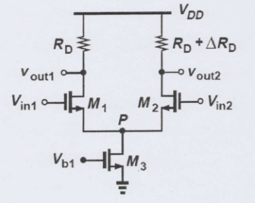

# 기출 2015-1 중간 4 — 부하 저항 불일치 ΔR_D가 있는 MOS 차동 증폭기의 입력 범위, A_DM, A_CM, A_CM-DM, CMRR로 정하는 ΔR_D

## 원문
With device parameters,

$\mu_n C_{ox} = 100\ \text{uA/V}^2$, $\mu_p C_{ox} = 50\ \text{uA/V}^2$, $\lambda_n=0.1\ \text{V}^{-1}$, $\lambda_p=0.2\ \text{V}^{-1}$, $V_{TH,N} =0.4\text{V}$, $R_D=10\text{kohm}$, $I_{D3}=0.2\text{mA}$

$(W/L)_1=(W/L)_2=50$

1) Doubling (W/L) increases differential input range ( O / X ) (5pt)

2) Calculate differential gain $A_{DM}$ when $\Delta R_D=0$ (5pt)

3) Calculate common-mode gain $A_{CM}$ when $\Delta R_D=0$ (5pt)

4) Calculate common-mode to differential gain $A_{CM-DM}$ when $\Delta R_D=100\text{ohm}$ (5pt)

5) Calculate $\Delta R_D$ if common-mode rejection ratio is 30000. (10pt)

## 조건
- 회로: 그림의 차동 증폭기
- $\mu_n C_{ox} = 100\ \mu\text{A/V}^2$, $\mu_p C_{ox} = 50\ \mu\text{A/V}^2$ (원문 표기는 uA/V²)
- $\lambda_n = 0.1\ \text{V}^{-1}$, $\lambda_p = 0.2\ \text{V}^{-1}$
- $V_{TH,N} = 0.4\ \text{V}$
- $R_D = 10\ \text{k}\Omega$, $I_{D3} = 0.2\ \text{mA}$
- $(W/L)_1 = (W/L)_2 = 50$
- 2) 전용: $\Delta R_D = 0$
- 3) 전용: $\Delta R_D = 0$
- 4) 전용: $\Delta R_D = 100\ \Omega$
- 5) 전용: common-mode rejection ratio (CMRR) $= 30000$
- $V_{DD}$, 바이어스 전압 $V_{b1}$, $(W/L)_3$ 값은 주어지지 않음 (원문에 없음)

## 구할 것
- 1) (W/L)를 두 배로 하면 차동 입력 범위가 늘어나는지 O / X로 답함
- 2) $\Delta R_D = 0$일 때 차동 이득 $A_{DM}$
- 3) $\Delta R_D = 0$일 때 common-mode 이득 $A_{CM}$
- 4) $\Delta R_D = 100\ \Omega$일 때 common-mode to differential 이득 $A_{CM-DM}$
- 5) CMRR이 30000이 되는 $\Delta R_D$

## 회로 — Fig Q4
```spice
RD1  VDD    vout1  {R_D}          ; 인쇄 라벨 R_D
RD2  VDD    vout2  {R_D+ΔR_D}     ; 인쇄 라벨 R_D + ΔR_D
M1   vout1  Vin1   P    nmos
M2   vout2  Vin2   P    nmos      ; 좌우 반전 (게이트 오른쪽)
M3   P      Vb1    0    nmos
```
- 단자: VDD = 전원, 값 미지정 (가로 레일) / Vb1 = 이상적 DC 바이어스, 값 미지정 (점 단자) / Vin1, Vin2 = 입력 (개방 원) / vout1, vout2 = 출력 (개방 원)
- 표시: 노드 라벨 V_DD (레일 오른쪽 끝), v_out1 (왼쪽 출력 원 왼쪽), v_out2 (오른쪽 출력 원 오른쪽), V_in1 (왼쪽 입력 원 왼쪽), V_in2 (오른쪽 입력 원 오른쪽), P (P 접속점 위), V_b1 (점 단자 왼쪽) / 소자 라벨 R_D (왼쪽 저항 왼쪽), R_D + ΔR_D (오른쪽 저항 오른쪽), M_1 (M1 오른쪽), M_2 (M2 왼쪽), M_3 (M3 오른쪽) / 부호 없음 / 화살표 없음 / 수치·면적 라벨 없음
- 배치: 맨 위 굵은 가로 레일 V_DD / 왼쪽 세로줄 위→아래 R_D, vout1 접속점, M1 / 오른쪽 세로줄 위→아래 R_D + ΔR_D, vout2 접속점, M2 / vout1 접속점에서 가로선이 왼쪽 v_out1 원, vout2 접속점에서 가로선이 오른쪽 v_out2 원 (두 출력 원이 바깥쪽을 향함) / M1 nmos 보통 방향(게이트 왼쪽, 드레인 위, 소스 아래·화살표 바깥), M2 nmos 좌우 반전(게이트 막대 오른쪽, 드레인 왼쪽 위, 소스 왼쪽 아래·화살표 바깥) / V_in1 원 → 가로선 → M1 게이트, M2 게이트 → 가로선 → V_in2 원 / 두 소스는 아래로 내려가 가로선으로 가운데 P 점에서 만남 / P 아래 M3 (nmos 보통 방향, 게이트 왼쪽), V_b1 점 단자 → 가로선 → M3 게이트, M3 소스 아래 접지 / 접속점 (세 갈래 이상, 3곳): ① vout1 = 위 R_D + 아래 M1 드레인 + 왼쪽 출력선 (점) ② vout2 = 위 R_D + ΔR_D + 아래 M2 드레인 + 오른쪽 출력선 (점) ③ P = 왼쪽 M1 소스 선 + 오른쪽 M2 소스 선 + 아래 M3 드레인 (점) / 교차: 없음


> 참고: 두 출력 라벨의 v는 소문자로 인쇄됨. 소문항 1)의 "( O / X )" 가운데 X에 그려진 동그라미는 답안지 손글씨임 (크롭 밖)

## 힌트
### (3) 꼬리 저항을 둘로 쪼개기
- 공통 모드 입력에서는 두 쪽이 똑같이 움직여 두 소스를 잇는 선으로 전류가 오가지 않는다
- 그래서 $M_3$이 보이는 저항을 크기가 두 배인 저항 둘의 병렬로 나누면 각 쪽을 소스 퇴화 CS로 따로 볼 수 있다

## 풀이
### (1) 차동 입력 범위
- 한쪽이 꺼지는 경계 $\sqrt{2I_{D3}/(\mu_n C_{ox} W/L)}$가 $W/L$ 두 배면 $1/\sqrt{2}$배($0.283 \to 0.200\ \text{V}$)로 준다: X
### (2) 차동 이득
- $M_1$의 $g_m = \sqrt{2\mu_n C_{ox}(W/L) I_{D1}} = 1.00\ \text{mS}$ ($I_{D1} = I_{D3}/2$), $P$ 가상 접지, $r_{O1}$, $r_{O2}$ 무시: $A_{DM} = -g_m R_D = -10.0$
- 정확식으로는 $-9.09$ ($r_{O1} = 100\ \text{k}\Omega$가 $R_D$와 병렬)
### (3) 공통 모드 이득
- 두 소스 사이에 전류가 없어 각 쪽은 $2r_{O3}$($r_{O3} = 50.0\ \text{k}\Omega$)로 퇴화된 CS: $A_{CM}=-R_D/(1/g_m+2r_{O3})=-0.0990$
### (4) $A_{CM-DM}$
- 출력 차 기준 $|A_{CM-DM}|=\Delta R_D/(1/g_m+2r_{O3})$, 곧 $9.90 \times 10^{-4}$. 정확식으로는 $8.90 \times 10^{-4}$ (출력 차가 $R_D \parallel r_{O1}$을 봄)
### (5) CMRR로 정하는 $\Delta R_D$
- $\text{CMRR} = |A_{DM}/A_{CM-DM}|$: $\Delta R_D=g_m R_D(1/g_m+2r_{O3})/30000$, 곧 $33.7\ \Omega$ (정확식으로도 $34.1\ \Omega$)
### 답
- (1) X
- (2) $A_{DM} \approx -10.0$
- (3) $A_{CM} \approx -0.0990$ (각 출력)
- (4) $|A_{CM-DM}| \approx 9.90 \times 10^{-4}$
- (5) $\Delta R_D \approx 33.7\ \Omega$
