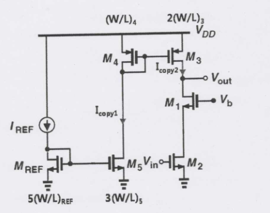

# 기출 2015-2 중간 1 — 전류 거울 두 단으로 바이어스한 PMOS 전류원 부하 NMOS 캐스코드 증폭기

## 원문
With device parameters below,

$V_{DD}=1.8\text{V}$, $\mu_n C_{ox} = 100\ \text{uA/V}^2$, $\mu_p C_{ox} = 50\ \text{uA/V}^2$, $\lambda_n=0.1\ \text{V}^{-1}$, $\lambda_p=0.2\ \text{V}^{-1}$, $V_{TH,N} =0.4\text{V}$,

$I_{REF}=1\text{mA}$

$(W/L)_1=(W/L)_2=50$

1) Derive $I_{copy1}$(5pt)

2) Derive $I_{copy2}$(5pt)

3) Determine minimum $V_b$ to operate $M_2$ in saturation region. (10pt)

4) Derive output impedance. (10pt)

5) Derive gain ($v_{out}/v_{in}$). (10pt)

## 조건
- 회로: 그림 Q1
- $V_{DD} = 1.8\ \text{V}$
- $\mu_n C_{ox} = 100\ \mu\text{A/V}^2$, $\mu_p C_{ox} = 50\ \mu\text{A/V}^2$ (원문 표기는 "uA/V²")
- $\lambda_n = 0.1\ \text{V}^{-1}$, $\lambda_p = 0.2\ \text{V}^{-1}$
- $V_{TH,N} = 0.4\ \text{V}$
- $I_{REF} = 1\ \text{mA}$
- $(W/L)_1 = (W/L)_2 = 50$
- 그림의 크기 라벨: $M_{REF}$는 $5(W/L)_{REF}$, $M_5$는 $3(W/L)_5$, $M_4$는 $(W/L)_4$, $M_3$은 $2(W/L)_3$
- $(W/L)_{REF}$, $(W/L)_3$, $(W/L)_4$, $(W/L)_5$의 값과 PMOS 문턱 전압은 주어지지 않음 (원문에 없음)
- 그림의 배수만으로 복사 비를 정함: $(W/L)_{REF} = (W/L)_5$, $(W/L)_4 = (W/L)_3$ (원문에 없음)

## 구할 것
- 1) $I_{copy1}$
- 2) $I_{copy2}$
- 3) $M_2$가 포화 영역에서 동작하도록 하는 최소 $V_b$
- 4) 출력 임피던스
- 5) 이득 $v_{out}/v_{in}$

## 회로 — Fig Q1
```spice
IREF  VDD   n1    {I_REF}
MREF  n1    n1    0     nmos  W/L={(W/L)_REF} m=5   ; 좌우 반전 (게이트 오른쪽), 다이오드 연결
M5    n2    n1    0     nmos  W/L={(W/L)_5} m=3
M4    n2    n2    VDD   pmos  W/L={(W/L)_4}         ; 좌우 반전 (게이트 오른쪽), 다이오드 연결
M3    Vout  n2    VDD   pmos  W/L={(W/L)_3} m=2
M1    Vout  Vb    n3    nmos                        ; 좌우 반전 (게이트 오른쪽)
M2    n3    Vin   0     nmos
* (W/L)_1 = (W/L)_2 = 50 은 문제 문장에만 인쇄됨 (그림에는 없음)
```
- 단자: VDD = 1.8 V 전원 (가로 레일) / Vb = DC 바이어스, 값은 3)에서 구함 (점 단자) / Vin = 입력 (개방 원) / Vout = 출력 (개방 원)
- 표시: 노드 라벨 V_DD (레일 오른쪽 끝, 위), V_out (출력 원 오른쪽), V_b (점 단자 오른쪽), V_in (입력 원 왼쪽, M_5 라벨 바로 오른쪽) / 소자 라벨 I_REF (전류원 왼쪽), M_REF (M_REF 왼쪽), M_5 (M5 오른쪽), M_4 (M4 왼쪽), M_3 (M3 오른쪽), M_1 (M1 왼쪽), M_2 (M2 오른쪽) / 부호 없음 / 화살표 "I_copy1": M4 드레인–M5 드레인 세로선, 아래 방향, 도선 위 (회색 화살촉), 글자는 화살표 왼쪽 위 / "I_copy2": M3 드레인–Vout 세로선, 아래 방향, 도선 위 (회색 화살촉), 글자는 화살표 왼쪽 / 수치·면적 라벨 "(W/L)_4" (M4 위, 레일 위), "2(W/L)_3" (M3 위, 레일 위), "5(W/L)_REF" (M_REF 아래 접지 아래), "3(W/L)_5" (M5 아래 접지 아래)
- 배치: 맨 위 굵은 가로 레일 V_DD (왼쪽 끝은 I_REF 세로선 위, 오른쪽 끝은 M3 소스 너머) / 왼쪽 세로줄 위→아래 레일에서 내려오는 긴 세로선, I_REF 전류원(화살표 아래), n1 접속점, M_REF, 접지 / M_REF nmos 좌우 반전(게이트 막대 오른쪽, 드레인 왼쪽 위, 소스 왼쪽 아래·화살표 바깥) / n1 접속점에서 가로선이 오른쪽으로 나가 아래로 꺾여 게이트 높이의 접속점 (다이오드 연결) / 게이트 공통선은 M_REF 게이트에서 M5 게이트까지 게이트 높이로 가로지름 / 가운데 세로줄 위→아래 레일, M4, n2 접속점, I_copy1 화살표가 붙은 긴 세로선, M5, 접지 / M4 pmos 좌우 반전(게이트 막대 오른쪽, 소스 왼쪽 위·화살표가 채널 쪽으로 들어감, 드레인 왼쪽 아래) / M4 게이트 오른쪽 접속점에서 가로선이 오른쪽 M3 게이트로, 같은 접속점에서 세로선이 아래로 내려가 왼쪽으로 꺾여 n2 접속점 (다이오드 연결) / M5 nmos 보통 방향(게이트 왼쪽, 드레인 위, 소스 아래·화살표 바깥) / 오른쪽 세로줄 위→아래 레일, M3, I_copy2 화살표, Vout 접속점, M1, 긴 세로선, M2, 접지 / M3 pmos 보통 방향(게이트 왼쪽, 소스 오른쪽 위·화살표가 채널 쪽으로 들어감, 드레인 오른쪽 아래) / Vout 접속점에서 가로선이 오른쪽 V_out 원 / M1 nmos 좌우 반전(게이트 막대 오른쪽, 드레인 왼쪽 위, 소스 왼쪽 아래·화살표 바깥), 게이트 → 가로선 → 오른쪽 V_b 점 단자 / M2 nmos 보통 방향, V_in 원 → 가로선 → M2 게이트 / 접속점 (세 갈래 이상, 5곳): ① n1 = 위 I_REF + 아래 M_REF 드레인 + 오른쪽 다이오드 연결선 (점) ② M_REF 게이트 높이 = 왼쪽 M_REF 게이트 + 위 다이오드 연결선 + 오른쪽 M5 게이트로 가는 선 (점) ③ M4 게이트 오른쪽 = 왼쪽 M4 게이트 + 오른쪽 M3 게이트로 가는 선 + 아래 다이오드 연결선 (점) ④ n2 = 위 M4 드레인 + 오른쪽 다이오드 연결선 + 아래 M5 드레인으로 가는 세로선 (점) ⑤ Vout = 위 M3 드레인 + 아래 M1 드레인 + 오른쪽 V_out 선 (점) / 교차: 없음


> 참고: 두 I_copy 라벨은 다른 라벨과 글꼴이 다름(세리프 글꼴), 두 화살촉은 회색

## 풀이
### (1)(2) 거울 전류
- $I_{copy1} = \dfrac{3(W/L)_5}{5(W/L)_{REF}} I_{REF} = 0.600\ \text{mA}$ ($\lambda$ 무시)
- $M_4$가 받아 $M_3$로: $I_{copy2} = \dfrac{2(W/L)_3}{(W/L)_4} I_{copy1} = 1.20\ \text{mA}$
### (3) $M_2$ 포화 경계의 $V_b$
- $M_1$, $M_2$의 $V_{ov}$ (같은 $W/L$, 같은 전류): $V_{ov} = \sqrt{2I_{copy2}/[\mu_n C_{ox}(W/L)_1]} = 0.693\ \text{V}$
- $V_{DS2} = V_b - V_{GS1} \ge V_{ov}$: $V_{b,min} = V_{TH,N} + 2V_{ov} = 1.79\ \text{V}$
### (4) 출력 임피던스
- $g_{m1} = g_{m2} = 2I_{copy2}/V_{ov} = 3.46\ \text{mS}$
- $r_O = 1/(\lambda I_{copy2})$: $r_{O1} = r_{O2} = 8.33\ \text{k}\Omega$, $r_{O3} = 4.17\ \text{k}\Omega$
- $g_{m1} r_{O2} = 28.9 \gg 1$, $M_3$ 게이트는 AC 접지: $R_{out} = r_{O3} \parallel g_{m1} r_{O1} r_{O2} = 4.10\ \text{k}\Omega$
### (5) 이득
- $A_v = -g_{m2} R_{out} = -14.2$
### 답
- 1) $I_{copy1} = 0.600\ \text{mA}$
- 2) $I_{copy2} = 1.20\ \text{mA}$
- 3) $V_{b,min} = 1.79\ \text{V}$
- 4) $R_{out} = 4.10\ \text{k}\Omega$
- 5) $A_v = -14.2$
