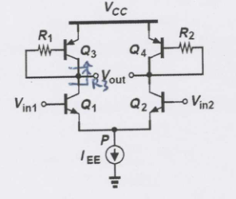
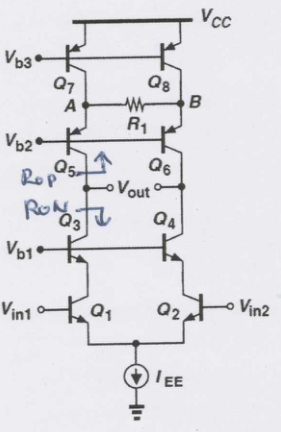

# 기출 2015-2 중간 2 — 베이스 저항 pnp 부하 바이폴라 차동쌍과 R_1으로 묶은 캐스코드 차동 증폭기의 R_out과 차동 이득

## 원문
Calculate $R_{out}$ and differential voltage gain ($A_v$) of following circuits.

1) $I_{EE}=1\text{mA}$, $V_{A,p}=10\text{V}$, $V_{A,n}=10\text{V}$, $R_{1,2} = 10\text{kohm}$, $\beta=100$, $V_T=26\text{mV}$ (15pt : $R_{out}$ 10pt / $A_v$ 5pt)

2) $I_{EE}=1\text{mA}$, $V_{A,p}=10\text{V}$, $V_{A,n}=10\text{V}$, $R_{1,2} = 10\text{kohm}$, $\beta=100$, $V_T=26\text{mV}$ (15pt : $R_{out}$ 10pt / $A_v$ 5pt)

## 조건
- 회로: 1)은 그림 Q2, 2)는 그림 Q2-2
- 1) 전용 (그림 Q2): $I_{EE} = 1\ \text{mA}$, $V_{A,p} = 10\ \text{V}$, $V_{A,n} = 10\ \text{V}$, $R_{1,2} = 10\ \text{k}\Omega$, $\beta = 100$, $V_T = 26\ \text{mV}$
- 2) 전용 (그림 Q2-2): $I_{EE} = 1\ \text{mA}$, $V_{A,p} = 10\ \text{V}$, $V_{A,n} = 10\ \text{V}$, $R_{1,2} = 10\ \text{k}\Omega$, $\beta = 100$, $V_T = 26\ \text{mV}$
- 2)의 그림에는 $R_1$만 있음 ($R_2$ 없음) (원문에 없음)
- 바이어스 전압 $V_{b1}$–$V_{b3}$와 $V_{CC}$ 값은 주어지지 않음 (원문에 없음)

## 구할 것
- 1) 그림 Q2 회로의 $R_{out}$과 차동 전압 이득 $A_v$
- 2) 그림 Q2-2 회로의 $R_{out}$과 차동 전압 이득 $A_v$

## 회로 — Fig Q2
```spice
Q3   out1  n1    VCC  pnp
R1   n1    out1  {R_1}     ; Q3 베이스 ↔ 왼쪽 출력 노드
Q4   out2  n2    VCC  pnp    ; 좌우 반전 (베이스 오른쪽)
R2   n2    out2  {R_2}     ; Q4 베이스 ↔ 오른쪽 출력 노드
Q1   out1  Vin1  P    npn
Q2   out2  Vin2  P    npn    ; 좌우 반전 (베이스 오른쪽)
IEE  P     0     {I_EE}
* out1, out2 = 두 출력 원. 원 사이에 V_out 라벨 하나 (차동 출력)
```
- 단자: VCC = 전원, 값 미지정 (가로 레일) / Vin1, Vin2 = 입력 (개방 원) / out1, out2 = 차동 출력 V_out의 두 단자 (개방 원, 각각에는 라벨 없음)
- 표시: 노드 라벨 V_CC (레일 위 가운데), V_out (두 출력 원 사이, 왼쪽 원 바로 오른쪽), V_in1 (왼쪽 입력 원 왼쪽), V_in2 (오른쪽 입력 원 오른쪽), P (꼬리 접속점 아래 왼쪽) / 소자 라벨 R_1 (R1 위), R_2 (R2 위), Q_3 (Q3 오른쪽), Q_4 (Q4 왼쪽), Q_1 (Q1 오른쪽), Q_2 (Q2 왼쪽), I_EE (전류원 왼쪽) / 부호 없음 / 화살표 없음 / 수치·면적 라벨 없음
- 배치: 맨 위 굵은 짧은 가로 레일 V_CC (Q3 이미터에서 Q4 이미터까지) / 왼쪽 세로줄 위→아래 Q3, out1 접속점, Q1 / 오른쪽 세로줄 위→아래 Q4, out2 접속점, Q2 / Q3 pnp 보통 방향(베이스 왼쪽, 이미터 오른쪽 위·화살표가 막대 쪽으로 들어감, 컬렉터 오른쪽 아래) / Q4 pnp 좌우 반전(베이스 막대 오른쪽, 이미터 왼쪽 위·화살표가 막대 쪽으로 들어감, 컬렉터 왼쪽 아래) / R_1은 Q3 베이스 높이에서 왼쪽으로 가로로 놓이고, R_1 왼쪽 끝에서 세로선이 출력 높이까지 내려가 오른쪽으로 꺾여 긴 가로선으로 out1 접속점 / R_2는 Q4 베이스 높이에서 오른쪽으로 가로로 놓이고, R_2 오른쪽 끝에서 세로선이 출력 높이까지 내려가 왼쪽으로 꺾여 out2 접속점 / out1 접속점에서 가로선이 오른쪽 출력 원, out2 접속점에서 가로선이 왼쪽 출력 원 (두 원이 가운데에서 마주 보고 그 사이에 V_out) / Q1 npn 보통 방향(베이스 왼쪽, 컬렉터 위, 이미터 오른쪽 아래·화살표 바깥), V_in1 원 → 가로선 → Q1 베이스 / Q2 npn 좌우 반전(베이스 막대 오른쪽, 컬렉터 왼쪽 위, 이미터 왼쪽 아래·화살표 바깥), V_in2 원 → 가로선 → Q2 베이스 / 두 이미터에서 세로선이 내려가 아래 가로선으로 이어지고 가운데 P 접속점 아래로 I_EE 전류원(화살표 아래), 접지 / 접속점 (세 갈래 이상, 3곳): ① out1 = 위 Q3 컬렉터 + 아래 Q1 컬렉터 + 왼쪽 R_1 귀환선 + 오른쪽 출력 원 선 (점, 네 갈래) ② out2 = 위 Q4 컬렉터 + 아래 Q2 컬렉터 + 오른쪽 R_2 귀환선 + 왼쪽 출력 원 선 (점, 네 갈래) ③ P = 왼쪽 Q1 이미터 선 + 오른쪽 Q2 이미터 선 + 아래 I_EE (점) / 교차: 없음


> 참고: 답안지 손글씨가 겹침 (out1 접속점 둘레의 파란 괄호 획과 위쪽 화살표, 그 오른쪽 아래 "R3")

## 회로 — Fig Q2-2
```spice
Q7   A     Vb3   VCC  pnp
Q8   B     Vb3   VCC  pnp
R1   A     B     {R_1}
Q5   out1  Vb2   A    pnp
Q6   out2  Vb2   B    pnp
Q3   out1  Vb1   n1   npn
Q4   out2  Vb1   n2   npn
Q1   n1    Vin1  n3   npn
Q2   n2    Vin2  n3   npn    ; 좌우 반전 (베이스 오른쪽)
IEE  n3    0     {I_EE}
* out1, out2 = 두 출력 원. 원 사이에 V_out 라벨 하나 (차동 출력)
* n3 = 꼬리 노드 (라벨 없음)
```
- 단자: VCC = 전원, 값 미지정 (가로 레일) / Vb3, Vb2, Vb1 = 이상적 DC 바이어스, 값 미지정 (점 단자) / Vin1, Vin2 = 입력 (개방 원) / out1, out2 = 차동 출력 V_out의 두 단자 (개방 원, 각각에는 라벨 없음)
- 표시: 노드 라벨 V_CC (레일 오른쪽 끝), V_b3, V_b2, V_b1 (각 점 단자 왼쪽), A (A 접속점 왼쪽), B (B 접속점 오른쪽), V_out (두 출력 원 사이, 왼쪽 원 바로 오른쪽), V_in1 (왼쪽 입력 원 왼쪽), V_in2 (오른쪽 입력 원 오른쪽) / 소자 라벨 Q_7 (Q7 아래, A 위), Q_8 (Q8 아래), R_1 (R1 아래), Q_5 (Q5 아래 왼쪽), Q_6 (Q6 아래), Q_3 (Q3 위), Q_4 (Q4 위), Q_1 (Q1 오른쪽), Q_2 (Q2 왼쪽), I_EE (전류원 오른쪽) / 부호 없음 / 화살표 없음 / 수치·면적 라벨 없음
- 배치: 맨 위 굵은 가로 레일 V_CC / 왼쪽 세로줄 위→아래 Q7, A 접속점, Q5, out1 접속점, Q3, Q1 / 오른쪽 세로줄 위→아래 Q8, B 접속점, Q6, out2 접속점, Q4, Q2 / Q7, Q8, Q5, Q6 pnp 보통 방향(베이스 왼쪽, 이미터 오른쪽 위·화살표가 막대 쪽으로 들어감, 컬렉터 오른쪽 아래) / Q3, Q4, Q1 npn 보통 방향(베이스 왼쪽, 컬렉터 오른쪽 위, 이미터 오른쪽 아래·화살표 바깥) / Q2 npn 좌우 반전(베이스 막대 오른쪽, 컬렉터 왼쪽 위, 이미터 왼쪽 아래·화살표 바깥), 오른쪽 세로줄보다 조금 오른쪽에 있어 Q4 이미터 선이 아래로 내려가 오른쪽으로 꺾여 Q2 컬렉터로 들어감 / V_b3 점 단자 → 가로선 → Q7 베이스, 같은 높이의 가로선이 Q7 베이스 막대에서 이어져 오른쪽 Q8 베이스까지 감 (Q7, Q8 베이스 공통선). V_b2(Q5, Q6), V_b1(Q3, Q4)도 같은 모양 / A, B 사이에 가로로 놓인 R_1 (Q7, Q8 컬렉터 바로 아래 높이) / out1 접속점에서 가로선이 오른쪽 출력 원, out2 접속점에서 가로선이 왼쪽 출력 원 (두 원이 가운데에서 마주 보고 그 사이에 V_out) / V_in1 원 → 가로선 → Q1 베이스, V_in2 원 → 가로선 → Q2 베이스 / Q1, Q2 이미터에서 세로선이 내려가 아래 가로선으로 이어지고 가운데 n3 접속점 아래로 I_EE 전류원(화살표 아래), 접지 / 접속점 (세 갈래 이상, 5곳): ① A = 위 Q7 컬렉터 + 아래 Q5 이미터 + 오른쪽 R_1 (점) ② B = 위 Q8 컬렉터 + 아래 Q6 이미터 + 왼쪽 R_1 (점) ③ out1 = 위 Q5 컬렉터 + 아래 Q3 컬렉터 + 오른쪽 출력 원 선 (점) ④ out2 = 위 Q6 컬렉터 + 아래 Q4 컬렉터 + 왼쪽 출력 원 선 (점) ⑤ n3 = 왼쪽 Q1 이미터 선 + 오른쪽 Q2 이미터 선 + 아래 I_EE (점) / 교차: 없음


> 참고: 2)의 조건 문장과 그림 Q2-2는 PDF 4쪽에 있음. 답안지 손글씨가 겹침 (Q5 왼쪽 "Rop"와 위쪽 화살표, Q3 왼쪽 "RoN"과 아래쪽 화살표)

## 힌트
### (1) $R_1$을 단 $Q_3$는 다이오드 꼴
- $Q_3$ 베이스가 $R_1$을 거쳐 자기 컬렉터에 붙어 있어, 컬렉터 전압이 $R_1$과 $r_{\pi 3}$의 분압으로 베이스를 움직인다
- 그래서 컬렉터에서 보면 베이스 쪽에 저항이 끼인 다이오드 연결 소자처럼 낮은 저항으로 보인다
### (2) $R_1$ 가운데는 가상 접지
- 차동 입력에서 A와 B는 크기가 같고 부호가 반대로 움직이므로 $R_1$ 가운데 점의 전위는 변하지 않는다
- 그래서 반회로의 $Q_5$ 이미터에는 $r_{O7}$과 $R_1$의 절반이 병렬로 달린다

## 풀이
### (1) 소신호 파라미터
- 베이스 전류를 무시하면 모든 트랜지스터가 $I_{EE}/2 = 0.5\ \text{mA}$: $g_m = 0.5\ \text{mA}/V_T = 19.2\ \text{mS}$, $r_\pi = \beta/g_m = 5.20\ \text{k}\Omega$
- $r_O = V_A/0.5\ \text{mA} = 20.0\ \text{k}\Omega$ (npn, pnp 같음), $R_1 = 10\ \text{k}\Omega$
### (1) $R_{out}$과 $A_v$
- $Q_3$는 베이스가 $R_1$을 거쳐 컬렉터에 붙은 다이오드 꼴이라, 컬렉터에서 본 저항은 $r_O \parallel (R_1 + r_\pi)/(1+\beta)$
- P는 차동 입력에서 가상 접지(대칭): 반회로 $R_h = r_{O1} \parallel r_{O3} \parallel (R_1 + r_\pi)/(1+\beta) = 148\ \Omega$
- 두 출력 사이: $R_{out} = 2R_h = 297\ \Omega$, $A_v = (v_{out1} - v_{out2})/(v_{in1} - v_{in2}) = -g_m R_h = -2.85$
### (2) 위쪽 캐스코드 저항
- 차동에서 A, B가 반대로 움직여 $R_1$ 가운데는 가상 접지: $Q_5$ 이미터 저항 $R_{E5} = r_{O7} \parallel (R_1/2) = 4.00\ \text{k}\Omega$
- $g_m(R_{E5} \parallel r_\pi) = 43.5 \gg 1$: $R_{up} \approx g_m r_O (R_{E5} \parallel r_\pi) = 870\ \text{k}\Omega$
### (2) 아래쪽 캐스코드와 이득
- $Q_3$ 이미터에는 $r_{O1}$ (꼬리는 가상 접지), $g_m(r_O \parallel r_\pi) = 79.4 \gg 1$: $R_{dn} \approx g_m r_O (r_{O1} \parallel r_\pi) = 1.59\ \text{M}\Omega$
- $R_h = R_{up} \parallel R_{dn} = 562\ \text{k}\Omega$, 두 출력 사이 $R_{out} = 2R_h = 1.12\ \text{M}\Omega$
- $A_v = -g_m R_h = -1.08 \times 10^4$
### 답
- 1) $R_{out} = 297\ \Omega$ (두 출력 사이, 한쪽 $148\ \Omega$), $A_v = -2.85$
- 2) $R_{out} = 1.12\ \text{M}\Omega$ (두 출력 사이, 한쪽 $562\ \text{k}\Omega$), $A_v = -1.08 \times 10^4$
