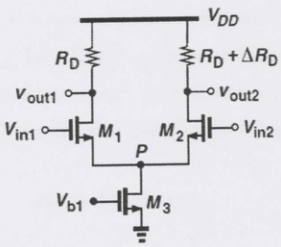

# 기출 2015-2 중간 3 — 부하 저항 불일치가 있는 MOS 차동쌍의 차동·공통 모드 이득과 CMRR

## 원문
With device parameters,

$\mu_n C_{ox} = 100\ \text{uA/V}^2$, $\mu_p C_{ox} = 50\ \text{uA/V}^2$, $\lambda_n=0.1\ \text{V}^{-1}$, $\lambda_p=0.2\ \text{V}^{-1}$, $V_{TH,N}=0.4\text{V}$, $R_D=10\text{kohm}$, $V_{b1}=0.6\text{V}$, $(W/L)_1=(W/L)_2=50$, $(W/L)_3=100$

1) Doubling $(W/L)_3$ increases differential input range ( O / X ) (5pt)

2) Calculate differential gain $A_{DM}$ when $\Delta R_D=0$ (5pt)

3) Calculate common-mode gain $A_{CM}$ when $\Delta R_D=0$ (5pt)

4) Calculate common-mode input to differential output gain $A_{CM-DM}$ when $\Delta R_D/R_D=1\%$ (5pt)

5) Calculate CMRR (5pt)

6) Calculate CMRR if $(W/L)_3$ is doubled. (5pt)

## 조건
- 회로: 그림 Q3
- $\mu_n C_{ox} = 100\ \mu\text{A/V}^2$, $\mu_p C_{ox} = 50\ \mu\text{A/V}^2$ (원문 표기는 "uA/V²")
- $\lambda_n = 0.1\ \text{V}^{-1}$, $\lambda_p = 0.2\ \text{V}^{-1}$
- $V_{TH,N} = 0.4\ \text{V}$
- $R_D = 10\ \text{k}\Omega$
- $V_{b1} = 0.6\ \text{V}$
- $(W/L)_1 = (W/L)_2 = 50$, $(W/L)_3 = 100$
- 2) 전용: $\Delta R_D = 0$
- 3) 전용: $\Delta R_D = 0$
- 4) 전용: $\Delta R_D / R_D = 1\%$
- 6) 전용: $(W/L)_3$를 두 배로 함
- $V_{DD}$ 값은 주어지지 않음 (원문에 없음)

## 구할 것
- 1) $(W/L)_3$를 두 배로 하면 차동 입력 범위가 늘어나는지 O / X로 답함
- 2) $\Delta R_D = 0$일 때 차동 이득 $A_{DM}$
- 3) $\Delta R_D = 0$일 때 공통 모드 이득 $A_{CM}$
- 4) $\Delta R_D / R_D = 1\%$일 때 공통 모드 입력에서 차동 출력으로의 이득 $A_{CM-DM}$
- 5) CMRR
- 6) $(W/L)_3$를 두 배로 했을 때의 CMRR

## 회로 — Fig Q3
```spice
RD1  VDD    vout1  {R_D}
RD2  VDD    vout2  {R_D+ΔR_D}
M1   vout1  Vin1   P     nmos
M2   vout2  Vin2   P     nmos    ; 좌우 반전 (게이트 오른쪽)
M3   P      Vb1    0     nmos
* (W/L)_1 = (W/L)_2 = 50, (W/L)_3 = 100 은 문제 문장에만 인쇄됨 (그림에는 없음)
```
- 단자: VDD = 전원, 값 미지정 (가로 레일) / Vb1 = DC 바이어스 0.6 V (점 단자) / Vin1, Vin2 = 입력 (개방 원) / vout1, vout2 = 출력 (개방 원)
- 표시: 노드 라벨 V_DD (레일 오른쪽 끝), v_out1 (왼쪽 출력 원 왼쪽, 소문자 v), v_out2 (오른쪽 출력 원 오른쪽, 소문자 v), V_in1 (왼쪽 입력 원 왼쪽), V_in2 (오른쪽 입력 원 오른쪽), P (꼬리 접속점 위), V_b1 (점 단자 왼쪽) / 소자 라벨 R_D (왼쪽 저항 왼쪽), R_D + ΔR_D (오른쪽 저항 오른쪽), M_1 (M1 오른쪽), M_2 (M2 왼쪽), M_3 (M3 오른쪽) / 부호 없음 / 화살표 없음 / 수치·면적 라벨 없음
- 배치: 맨 위 굵은 가로 레일 V_DD / 왼쪽 세로줄 위→아래 R_D, vout1 접속점, M1 / 오른쪽 세로줄 위→아래 R_D + ΔR_D, vout2 접속점, M2 / vout1 접속점에서 가로선이 왼쪽 v_out1 원, vout2 접속점에서 가로선이 오른쪽 v_out2 원 / M1 nmos 보통 방향(게이트 왼쪽, 드레인 위, 소스 아래·화살표 바깥), V_in1 원 → 가로선 → M1 게이트 / M2 nmos 좌우 반전(게이트 막대 오른쪽, 드레인 왼쪽 위, 소스 왼쪽 아래·화살표 바깥), V_in2 원 → 가로선 → M2 게이트 / 두 소스에서 세로선이 내려가 아래 가로선으로 이어지고 가운데 P 접속점 / P 아래로 M3 드레인, M3 nmos 보통 방향, V_b1 점 단자 → 가로선 → M3 게이트, M3 소스 아래 접지 / 접속점 (세 갈래 이상, 3곳): ① vout1 = 위 R_D + 아래 M1 드레인 + 왼쪽 v_out1 선 (점) ② vout2 = 위 R_D + ΔR_D + 아래 M2 드레인 + 오른쪽 v_out2 선 (점) ③ P = 왼쪽 M1 소스 선 + 오른쪽 M2 소스 선 + 아래 M3 드레인 (점) / 교차: 없음


