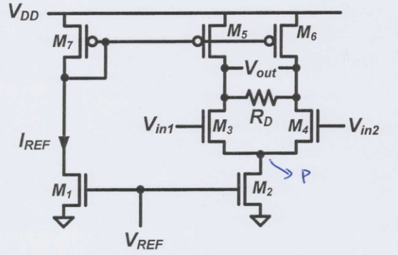

# 기출 2016-1 중간 1 — 전류 거울 바이어스와 R_D 부하를 둔 MOS 차동 증폭기의 I_REF, (W/L)_7, CM 입력 하한, 차동 입력 범위, 이득

## 원문
With device parameters below, (50pt)

$V_{DD} = 1.8\text{V}$, $\mu_n C_{ox} = 100\ \text{uA/V}^2$, $\mu_p C_{ox} = 50\ \text{uA/V}^2$, $V_{TH,N} = 0.4\text{V}$, $\lambda_n = \lambda_p = 0$

$V_{ref} = 0.6\text{V}$, $R_D = 50\text{kohm}$

$(W/L)_1 = (W/L)_2 = 50$, $(W/L)_{3,4} = 25$, $(W/L)_{5,6} = 100$

1) Calculate $I_{REF}$ (10pt)

2) Determine $(W/L)_7$ (10pt)

3) Calculate lowest voltage of common mode input($V_{CM}$) (10pt)

4) Calculate max input range of differential input ($V_{in1}$-$V_{in2}$). (10pt)

5) Calculate differential voltage gain of this amplifier (10pt)

## 조건
- 회로: 그림 Q1
- $V_{DD} = 1.8\ \text{V}$
- $\mu_n C_{ox} = 100\ \mu\text{A/V}^2$, $\mu_p C_{ox} = 50\ \mu\text{A/V}^2$ (원문은 "uA/V²"로 적음)
- $V_{TH,N} = 0.4\ \text{V}$, $\lambda_n = \lambda_p = 0$
- $V_{ref} = 0.6\ \text{V}$ (그림 라벨은 $V_{REF}$)
- $R_D = 50\ \text{k}\Omega$ (원문은 "50kohm"으로 적음)
- $(W/L)_1 = (W/L)_2 = 50$, $(W/L)_{3,4} = 25$, $(W/L)_{5,6} = 100$
- $V_{TH,P}$ 값은 주어지지 않음 (원문에 없음)

## 구할 것
- (1) $I_{REF}$
- (2) $(W/L)_7$ (정함)
- (3) 공통 모드 입력 $V_{CM}$의 가장 낮은 전압
- (4) 차동 입력 $V_{in1} - V_{in2}$의 최대 입력 범위
- (5) 이 증폭기의 차동 전압 이득

## 회로 — Fig Q1
```spice
M7  n1    n1    VDD   pmos   ; 좌우 반전 (게이트 오른쪽), 다이오드 연결
M5  out1  n1    VDD   pmos
M6  out2  n1    VDD   pmos
RD  out1  out2  {R_D}
M3  out1  Vin1  n2    nmos
M4  out2  Vin2  n2    nmos   ; 좌우 반전 (게이트 오른쪽)
M1  n1    VREF  0     nmos   ; 좌우 반전 (게이트 오른쪽)
M2  n2    VREF  0     nmos
* n1 = M7 드레인·게이트, M5·M6 게이트, M1 드레인 (라벨 없음). n2 = M3·M4 소스, M2 드레인 (라벨 없음)
* out1, out2 = 두 출력 선 끝. 그 사이에 V_out 라벨 하나 (차동 출력)
* W/L 값은 문제 문장에만 인쇄됨 (그림에는 없음)
```
- 단자: VDD = 1.8 V 전원 (가로 레일) / VREF = 기준 전압 V_ref = 0.6 V (선 끝) / Vin1, Vin2 = 입력 (선 끝) / out1, out2 = 차동 출력 V_out의 두 단자 (선 끝, 각각에는 라벨 없음)
- 표시: 노드 라벨 V_DD (레일 왼쪽 끝), V_out (두 출력 선 끝 사이), V_in1 (왼쪽 입력 선 왼쪽), V_in2 (오른쪽 입력 선 오른쪽), V_REF (아래 세로선 끝 아래) / 소자 라벨 M_7 (M7 왼쪽), M_5 (M5 오른쪽 위, 드레인 선 오른쪽), M_6 (M6 오른쪽 위), R_D (저항 아래), M_3 (M3 채널 오른쪽), M_4 (M4 채널 왼쪽), M_1 (M1 왼쪽), M_2 (M2 오른쪽) / 부호 없음 / 화살표 "I_REF": M7 드레인 접속점–M1 드레인 세로선, 아래 방향, 도선 위, 글자는 화살표 왼쪽 / 수치·면적 라벨 없음
- 배치: 맨 위 굵은 가로 레일 V_DD (왼쪽 끝에 라벨, 오른쪽은 M6 너머까지) / pmos는 게이트에 버블(○)을 단 기호이고 소스 화살표 없음, nmos도 화살표 없음 / 왼쪽 세로줄 위→아래 M7, n1 드레인 접속점, I_REF 화살표, M1, 접지 / M7 pmos 좌우 반전(게이트 버블 오른쪽, 소스 왼쪽 위에서 위로 레일, 드레인 왼쪽 아래) / M7 게이트 버블 오른쪽 n1 게이트 접속점에서 게이트 공통선이 게이트 높이로 오른쪽 M5 게이트 버블까지 가고, M5 기호를 지나 M6 게이트 버블까지 이어짐 / n1 게이트 접속점에서 세로선이 아래로 내려가 n1 드레인 접속점 높이에서 왼쪽으로 꺾여 n1 드레인 접속점 (다이오드 연결) / M1 nmos 좌우 반전(게이트 오른쪽, 드레인 왼쪽 위, 소스 왼쪽 아래) / 가운데 위 M5, 오른쪽 위 M6, 둘 다 pmos 보통 방향(게이트 버블 왼쪽, 소스 오른쪽 위에서 위로 레일, 드레인 오른쪽 아래) / M5 드레인 세로줄 위→아래 out1 첫 접속점, out1 둘째 접속점, M3 드레인 / M6 드레인 세로줄은 같은 높이로 out2 첫 접속점, out2 둘째 접속점, M4 드레인 / out1 첫 접속점에서 가로선이 오른쪽으로, out2 첫 접속점에서 가로선이 왼쪽으로 나와 가운데 V_out 라벨 앞뒤에서 끝남 (원 없음) / 두 둘째 접속점 사이에 가로로 놓인 R_D / M3 nmos 보통 방향(게이트 왼쪽), M4 nmos 좌우 반전(게이트 오른쪽) / V_in1 선 → M3 게이트, M4 게이트 → V_in2 선 / M3, M4 소스는 아래로 내려가 가로선으로 n2 접속점(가운데보다 조금 오른쪽)에서 만남 / n2 아래 M2 nmos 보통 방향(게이트 왼쪽, 드레인 위, 소스 아래), M2 소스 아래 접지 / M1 게이트와 M2 게이트는 게이트 높이의 가로선으로 이어지고, 중간 VREF 접속점에서 세로선이 아래로 내려가 V_REF 선 끝 / 접속점 (세 갈래 이상, 8곳): ① n1 게이트 = 왼쪽 M7 게이트 버블 + 오른쪽 게이트 공통선 + 아래 다이오드 연결선 (점) ② n1 드레인 = 위 M7 드레인 + 아래 I_REF 선 + 오른쪽 다이오드 연결선 (점) ③ out1 첫 = 위 M5 드레인 + 아래 세로선 + 오른쪽 V_out 선 (점) ④ out2 첫 = 위 M6 드레인 + 아래 세로선 + 왼쪽 V_out 선 (점) ⑤ out1 둘째 = 위 세로선 + 아래 M3 드레인 + 오른쪽 R_D (점) ⑥ out2 둘째 = 위 세로선 + 아래 M4 드레인 + 왼쪽 R_D (점) ⑦ n2 = 왼쪽 M3 소스 선 + 오른쪽 M4 소스 선 + 아래 M2 드레인 (점) ⑧ VREF = 왼쪽 M1 게이트 + 오른쪽 M2 게이트 + 아래 V_REF 선 (점) / 교차: 게이트 공통선이 M5 게이트 버블 오른쪽에서 M5 기호의 채널 세로선을 가로질러 M6 쪽으로 지나감 (점 없음, 소자 기호 위)


> 참고: 답안지 손글씨가 겹침 (n2 접속점 오른쪽 아래의 손글씨 화살표와 "P"). 꼬리 노드 라벨 "P"는 손글씨라 넷리스트에 넣지 않음. 게이트 공통선은 원본에서 M5 기호의 채널 세로선을 가로질러 그려져 있음 (넷리스트는 M5, M6, M7 게이트를 모두 n1로 둠)

## 힌트
### (2) $M_5$·$M_6$ 전류는 꼬리가 정함
- $\lambda = 0$인 전류원 둘이 직렬로 만나면 두 전류가 정확히 같아야 DC 해가 있다
- $R_D$는 대칭이라 DC 전류가 흐르지 않으므로, PMOS 하나의 전류는 그 아래 입력 소자 전류, 곧 $M_2$ 전류의 절반과 같아야 한다

### (5) $R_D$ 가운데는 가상 접지
- 차동 입력에서 두 출력은 같은 크기로 반대로 움직이므로 $R_D$ 가운데 점의 전압은 변하지 않는다
- $\lambda = 0$이라 $M_5$, $M_6$는 소신호에서 열려 있고, 반회로의 출력에는 가운데에서 자른 $R_D$ 한쪽만 남는다

## 풀이
### (1) $I_{REF}$
- $I_{REF} = \mu_n C_{ox}(W/L)_1 (V_{REF} - V_{TH,N})^2/2 = (100\ \mu)(50)(0.2)^2/2 = 100\ \mu\text{A}$
### (2) $(W/L)_7$
- $M_2$가 $M_1$과 같아 꼬리 전류 $I_{SS} = I_{REF}$. $\lambda = 0$인 직렬 전류원은 전류가 같고 $R_D$엔 DC 전류가 없어 $|I_{D5}| = I_{SS}/2$
- $(W/L)_7 = (W/L)_5\, I_{REF}/|I_{D5}| = 200$
### (3)·(4) $V_{CM}$ 하한과 차동 입력 범위
- $I_{D3} = I_{SS}/2 = 50\ \mu\text{A}$: $V_{GS3} - V_{TH,N} = \sqrt{2 I_{D3}/[\mu_n C_{ox}(W/L)_3]} = 0.200\ \text{V}$
- (3) 꼬리 노드가 $M_2$ 포화 경계일 때: $V_{CM,min} = V_{GS3} + V_{REF} - V_{TH,N} = 0.800\ \text{V}$
- (4) 한쪽이 $I_{SS}$를 다 받는 경계: $|V_{in1} - V_{in2}|_{max} = \sqrt{2}\,(V_{GS3} - V_{TH,N}) = 0.283\ \text{V}$
### (5) 차동 전압 이득
- $g_{m3} = 2 I_{D3}/(V_{GS3} - V_{TH,N}) = 0.500\ \text{mS}$
- 두 출력이 반대로 움직여 $R_D$ 가운데는 가상 접지, $M_5$·$M_6$는 열림: $A_v = -g_{m3} R_D/2 = -12.5$
### 답
- (1) $I_{REF} = 100\ \mu\text{A}$
- (2) $(W/L)_7 = 200$
- (3) $V_{CM,min} = 0.800\ \text{V}$
- (4) $|V_{in1} - V_{in2}| \le 0.283\ \text{V}$
- (5) $A_v = -12.5$ ($M_3$ 쪽 − $M_4$ 쪽 출력)
