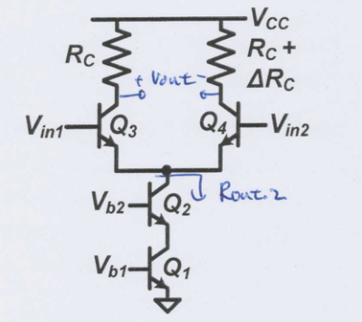

# 기출 2016-1 중간 2 — 캐스코드 꼬리 전류원과 컬렉터 저항 불일치 ΔR_C가 있는 바이폴라 차동쌍의 A_DM, A_CM, A_CM-DM, CMRR

## 원문
$I_{Q1,E} = 2\text{mA}$, $V_{A,n} = 10\text{V}$, $R_C = 10\text{kohm}$, $\beta = 100$ (25pt)

1) Doubling base width of Q3 and Q4 increases differential input range ( O / X ) (5pt)

2) Calculate differential gain $A_{DM}$ when $\Delta R_C = 0$ (5pt)

3) Calculate common-mode gain $A_{CM}$ when $\Delta R_C = 0$ (5pt)

4) Calculate common-mode input to differential output gain $A_{CM-DM}$ when $\Delta R_C/R_C = 1\%$ (5pt)

5) Calculate CMRR (5pt)

## 조건
- 회로: 그림 Q2
- $I_{Q1,E} = 2\ \text{mA}$ ($Q_1$ 이미터 전류, 괄호 안은 원문에 없음)
- $V_{A,n} = 10\ \text{V}$
- $R_C = 10\ \text{k}\Omega$ (원문은 "10kohm"으로 적음)
- $\beta = 100$
- 오른쪽 컬렉터 저항은 $R_C + \Delta R_C$ (그림 라벨)
- (2), (3) 전용: $\Delta R_C = 0$
- (4) 전용: $\Delta R_C/R_C = 1\%$
- $V_T$ 값과 바이어스 전압 $V_{b1}$, $V_{b2}$, $V_{CC}$ 값은 주어지지 않음 (원문에 없음)
- 출력 단자는 그림에 인쇄되지 않음. 차동 출력은 $Q_3$, $Q_4$ 컬렉터 사이로 봄 (원문에 없음)

## 구할 것
- (1) $Q_3$, $Q_4$의 베이스 폭을 두 배로 하면 차동 입력 범위가 늘어나는지 O / X로 답함
- (2) $\Delta R_C = 0$일 때 차동 이득 $A_{DM}$
- (3) $\Delta R_C = 0$일 때 공통 모드 이득 $A_{CM}$
- (4) $\Delta R_C/R_C = 1\%$일 때 공통 모드 입력 → 차동 출력 이득 $A_{CM-DM}$
- (5) CMRR

## 회로 — Fig Q2
```spice
RC1  VCC  n1    {R_C}
RC2  VCC  n2    {R_C+ΔR_C}   ; 인쇄 라벨 "R_C +" / "ΔR_C" (두 줄)
Q3   n1   Vin1  n3   npn
Q4   n2   Vin2  n3   npn     ; 좌우 반전 (베이스 오른쪽)
Q2   n3   Vb2   n4   npn
Q1   n4   Vb1   0    npn
* n1, n2 = Q3, Q4 컬렉터 (출력 단자·라벨 인쇄 없음, 원문에 없음). n3 = 꼬리 노드, n4 = Q2 이미터–Q1 컬렉터 (라벨 없음)
```
- 단자: VCC = 전원, 값 미지정 (가로 레일) / Vin1, Vin2 = 입력 (선 끝) / Vb2, Vb1 = 바이어스 전압, 값 미지정 (선 끝)
- 표시: 노드 라벨 V_CC (레일 오른쪽 끝), V_in1 (왼쪽 입력 선 왼쪽), V_in2 (오른쪽 입력 선 오른쪽), V_b2, V_b1 (각 선 끝 왼쪽) / 소자 라벨 R_C (왼쪽 저항 왼쪽), R_C + ΔR_C (오른쪽 저항 오른쪽, "R_C +"와 "ΔR_C" 두 줄), Q_3 (Q3 오른쪽), Q_4 (Q4 왼쪽), Q_2 (Q2 오른쪽), Q_1 (Q1 오른쪽) / 부호 없음 / 화살표 없음 / 수치·면적 라벨 없음
- 배치: 맨 위 굵은 가로 레일 V_CC (오른쪽 끝에 라벨) / 왼쪽 세로줄 위→아래 R_C, Q3 / 오른쪽 세로줄 위→아래 R_C + ΔR_C, Q4 / 두 저항은 레일에 매달린 세로 저항 / Q3 npn 보통 방향(베이스 왼쪽, 컬렉터 오른쪽 위, 이미터 오른쪽 아래·화살표 바깥), Q4 npn 좌우 반전(베이스 오른쪽, 컬렉터 왼쪽 위, 이미터 왼쪽 아래·화살표 바깥) / Q3, Q4 이미터에서 세로선이 내려가 가로선으로 이어지고, 가운데 n3 접속점에서 아래로 Q2 컬렉터 / 가운데 세로줄 위→아래 n3, Q2, Q1, 접지 / Q2, Q1 npn 보통 방향(베이스 왼쪽, 컬렉터 위, 이미터 오른쪽 아래·화살표 바깥) / Q2 이미터에서 세로선이 아래로 내려가 Q1 컬렉터 / V_in1 선 → Q3 베이스, Q4 베이스 → V_in2 선, V_b2 선 → Q2 베이스, V_b1 선 → Q1 베이스 / Q1 이미터 아래 접지 / 접속점 (세 갈래 이상, 1곳): ① n3 = 왼쪽 Q3 이미터 선 + 오른쪽 Q4 이미터 선 + 아래 Q2 컬렉터 (점) / 교차: 없음


> 참고: 답안지 손글씨가 겹침 (두 컬렉터 옆에 손으로 그린 출력 원과 "+ Vout −", n3 아래 가로 획과 "↓ Rout,2"). 출력 원과 V_out 라벨은 손글씨라 넷리스트에 넣지 않음

## 힌트
### (3) 꼬리는 캐스코드 전류원
- $V_{b1}$, $V_{b2}$는 DC라 $Q_1$은 $Q_2$ 이미터에 달린 저항 $r_{O1}$로만 보이고, 꼬리는 퇴화된 $Q_2$의 컬렉터에서 본 저항이 된다
- 공통 모드 입력에서는 두 반쪽이 같은 꼬리를 나눠 쓰므로 반회로의 이미터 저항은 꼬리 저항의 두 배다

## 풀이
### (1) 베이스 폭과 입력 범위
- $I_{C3}/I_{C4} = \exp[(V_{in1} - V_{in2})/V_T]$에 $I_S$가 없어 차동 입력 범위는 $V_T$로만 정해진다
- 베이스 폭을 두 배로 해 $I_S$가 절반이 되어도 범위는 그대로: **X**
### (2) $A_{DM}$
- $V_T = 26\ \text{mV}$(조건에 없음), $I_{C3} = I_{Q1,E}/2 = 1\ \text{mA}$, $g_{m3} = 38.5\ \text{mS}$
- $Q_3$, $Q_4$ 컬렉터 전압 차, $r_O$ 무시(교재 관례): $A_{DM} = -g_{m3} R_C = -385$ ($r_{O3} = 10\ \text{k}\Omega$를 넣으면 $-192$)
### (3) 꼬리 저항과 $A_{CM}$
- $Q_2$ ($2\ \text{mA}$): $g_{m2} = 76.9\ \text{mS}$, $r_{\pi 2} = 1.30\ \text{k}\Omega$, $r_{O1} = r_{O2} = 5.00\ \text{k}\Omega$
- $Q_1$은 $Q_2$ 이미터의 $r_{O1}$: 꼬리 저항 $R_{EE} \approx g_{m2} r_{O2}(r_{O1} \parallel r_{\pi 2}) = 397\ \text{k}\Omega$
- 반회로 이미터 저항 $2R_{EE}$: $A_{CM} = -R_C/(1/g_{m3} + 2R_{EE}) = -0.0126$
### (4)·(5) $A_{CM-DM}$와 CMRR
- (4) $A_{CM-DM} = \Delta R_C/(1/g_{m3} + 2R_{EE}) = 1.26 \times 10^{-4}$
- (5) $\text{CMRR} = |A_{DM}/A_{CM-DM}| = 3.05 \times 10^{6}$
### 답
- (1) X
- (2) $A_{DM} = -385$
- (3) $A_{CM} = -0.0126$ (한쪽 출력)
- (4) $A_{CM-DM} = 1.26 \times 10^{-4}$
- (5) $\text{CMRR} = 3.05 \times 10^{6}$ ($129.7\ \text{dB}$)
