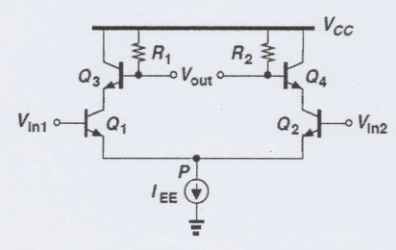
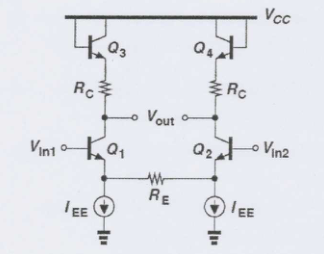

# 기출 2016-1 중간 3 — 베이스에 R_1·R_2를 단 트랜지스터 부하 차동쌍과 베이스를 V_CC에 이은 트랜지스터 부하·R_E 축퇴 차동쌍의 차동 전압 이득

## 원문
Calculate differential voltage gain of following circuits. (25pt)

1) $I_{EE} = 2\text{mA}$, $V_{A,p} = 10\text{V}$, $V_{A,n} = 10\text{V}$, $R_{1,2} = 10\text{kohm}$, $\beta = 100$ (15pt)

2) $I_{EE} = 0.1\text{mA}$, $V_{A,n} = 10\text{V}$, $R_C = 1\text{kohm}$, $R_E = 5\text{kohm}$, $\beta = 100$ (10pt)

## 조건
- 회로: 그림 Q3 (소문항 (1)), 그림 Q3-2 (소문항 (2))
- (1) 전용 (그림 Q3): $I_{EE} = 2\ \text{mA}$, $V_{A,p} = 10\ \text{V}$, $V_{A,n} = 10\ \text{V}$, $R_{1,2} = 10\ \text{k}\Omega$ ($R_1 = R_2$, 괄호 안은 원문에 없음), $\beta = 100$
- (2) 전용 (그림 Q3-2): $I_{EE} = 0.1\ \text{mA}$ (두 전류원 모두 $I_{EE}$로 인쇄), $V_{A,n} = 10\ \text{V}$, $R_C = 1\ \text{k}\Omega$, $R_E = 5\ \text{k}\Omega$, $\beta = 100$
- 원문은 저항을 "kohm"으로 적음
- (1)의 그림에는 pnp 소자가 없음 ($V_{A,p}$는 인쇄된 그대로 적음) (원문에 없음)
- $V_T$ 값과 $V_{CC}$ 값은 주어지지 않음 (원문에 없음)

## 구할 것
- (1) 그림 Q3 회로의 차동 전압 이득
- (2) 그림 Q3-2 회로의 차동 전압 이득

## 회로 — Fig Q3
```spice
R1   VCC   out1  {R_1}
R2   VCC   out2  {R_2}
Q3   VCC   out1  n1   npn   ; 좌우 반전 (베이스 오른쪽)
Q4   VCC   out2  n2   npn
Q1   n1    Vin1  P    npn
Q2   n2    Vin2  P    npn   ; 좌우 반전 (베이스 오른쪽)
IEE  P     0     {I_EE}
* out1, out2 = 두 출력 원. 원 사이에 V_out 라벨 하나 (차동 출력)
* n1 = Q3 이미터–Q1 컬렉터, n2 = Q4 이미터–Q2 컬렉터 (라벨 없음)
```
- 단자: VCC = 전원, 값 미지정 (가로 레일) / Vin1, Vin2 = 입력 (개방 원) / out1, out2 = 차동 출력 V_out의 두 단자 (개방 원, 각각에는 라벨 없음)
- 표시: 노드 라벨 V_CC (레일 오른쪽 끝), V_out (두 출력 원 사이, 왼쪽 원 바로 오른쪽), V_in1 (왼쪽 입력 원 왼쪽), V_in2 (오른쪽 입력 원 오른쪽), P (P 접속점 아래 세로선 왼쪽, I_EE 위) / 소자 라벨 R_1 (R1 오른쪽), R_2 (R2 왼쪽), Q_3 (Q3 왼쪽 아래), Q_4 (Q4 오른쪽), Q_1 (Q1 오른쪽), Q_2 (Q2 왼쪽), I_EE (전류원 왼쪽) / 부호 없음 / 화살표 없음 / 수치·면적 라벨 없음
- 배치: 맨 위 굵은 가로 레일 V_CC (오른쪽 끝에 라벨) / 왼쪽: Q3 컬렉터 선이 레일 왼쪽 끝 근처에서 내려옴, Q3 npn 좌우 반전(베이스 막대 오른쪽, 컬렉터 왼쪽 위, 이미터 왼쪽 아래·화살표 바깥) / R1은 Q3 오른쪽에서 레일에 매달린 세로 저항, 아래 끝이 out1 접속점 / out1 접속점에서 왼쪽으로 Q3 베이스, 오른쪽으로 가로선이 출력 원 / 오른쪽은 좌우 대칭: Q4 컬렉터 선이 레일 오른쪽 부분에서 내려옴, Q4 npn 보통 방향(베이스 왼쪽, 컬렉터 오른쪽 위, 이미터 오른쪽 아래·화살표 바깥), R2는 Q4 왼쪽에서 레일에 매달린 세로 저항, out2 접속점에서 오른쪽으로 Q4 베이스, 왼쪽으로 가로선이 출력 원 (두 원이 가운데에서 마주 봄) / Q3 이미터에서 세로선이 내려가 아래 Q1 컬렉터 (n1), Q4 이미터에서 세로선이 내려가 아래 Q2 컬렉터 (n2) / Q1 npn 보통 방향(베이스 왼쪽, 컬렉터 오른쪽 위, 이미터 오른쪽 아래·화살표 바깥), Q2 npn 좌우 반전(베이스 오른쪽, 이미터 왼쪽 아래·화살표 바깥) / V_in1 원 → 가로선 → Q1 베이스, Q2 베이스 → 가로선 → V_in2 원 / Q1, Q2 이미터에서 세로선이 내려가 가로선으로 가운데 P 접속점, P에서 아래로 I_EE(원 안 화살표 아래), 그 아래 접지(가로 막대 세 줄) / 접속점 (세 갈래 이상, 3곳): ① out1 = 위 R1 + 왼쪽 Q3 베이스 + 오른쪽 출력선 (점) ② out2 = 위 R2 + 오른쪽 Q4 베이스 + 왼쪽 출력선 (점) ③ P = 왼쪽 Q1 이미터 선 + 오른쪽 Q2 이미터 선 + 아래 I_EE (점) / 교차: 없음



## 회로 — Fig Q3-2
```spice
Q3    VCC   VCC   n1    npn   ; 베이스를 VCC 레일에 이음
Q4    VCC   VCC   n2    npn   ; 좌우 반전 (베이스 오른쪽), 베이스를 VCC 레일에 이음
RC1   n1    out1  {R_C}     ; 두 저항 모두 R_C로 인쇄
RC2   n2    out2  {R_C}
Q1    out1  Vin1  n3    npn
Q2    out2  Vin2  n4    npn   ; 좌우 반전 (베이스 오른쪽)
RE    n3    n4    {R_E}
IEE1  n3    0     {I_EE}    ; 두 전류원 모두 I_EE로 인쇄
IEE2  n4    0     {I_EE}
* out1, out2 = 두 출력 원. 원 사이에 V_out 라벨 하나 (차동 출력)
```
- 단자: VCC = 전원, 값 미지정 (가로 레일) / Vin1, Vin2 = 입력 (개방 원) / out1, out2 = 차동 출력 V_out의 두 단자 (개방 원, 각각에는 라벨 없음)
- 표시: 노드 라벨 V_CC (레일 오른쪽 끝), V_out (두 출력 원 사이), V_in1 (왼쪽 입력 원 왼쪽), V_in2 (오른쪽 입력 원 오른쪽) / 소자 라벨 Q_3 (Q3 오른쪽), Q_4 (Q4 왼쪽), R_C (왼쪽 저항 왼쪽), R_C (오른쪽 저항 오른쪽), Q_1 (Q1 오른쪽), Q_2 (Q2 왼쪽), R_E (가로 저항 아래), I_EE (왼쪽 전류원 왼쪽), I_EE (오른쪽 전류원 오른쪽) / 부호 없음 / 화살표 없음 / 수치·면적 라벨 없음
- 배치: 맨 위 굵은 가로 레일 V_CC (오른쪽 끝에 라벨) / 왼쪽 세로줄 위→아래 Q3, R_C, out1 접속점, Q1, n3 접속점, I_EE, 접지 / 오른쪽 세로줄 위→아래 Q4, R_C, out2 접속점, Q2, n4 접속점, I_EE, 접지 / Q3 npn 보통 방향(베이스 왼쪽, 컬렉터 오른쪽 위에서 위로 레일, 이미터 오른쪽 아래·화살표 바깥), Q3 베이스에서 가로선이 왼쪽으로 나가 위로 꺾여 레일 왼쪽 끝 / Q4 npn 좌우 반전(베이스 오른쪽, 컬렉터 왼쪽 위에서 위로 레일, 이미터 왼쪽 아래·화살표 바깥), Q4 베이스에서 가로선이 오른쪽으로 나가 위로 꺾여 레일 / 두 R_C는 이미터 아래 세로 저항 / out1 접속점에서 가로선이 오른쪽 출력 원, out2 접속점에서 가로선이 왼쪽 출력 원 (두 원이 가운데에서 마주 보고 그 사이에 V_out) / Q1 npn 보통 방향(베이스 왼쪽, 컬렉터 위, 이미터 아래·화살표 바깥), Q2 npn 좌우 반전(베이스 오른쪽, 컬렉터 위, 이미터 왼쪽 아래·화살표 바깥) / V_in1 원 → 가로선 → Q1 베이스, Q2 베이스 → 가로선 → V_in2 원 / n3, n4 사이에 가로로 놓인 R_E (이미터 바로 아래 높이) / 전류원 화살표는 아래, 접지는 가로 막대 세 줄 / 접속점 (세 갈래 이상, 4곳): ① out1 = 위 R_C + 아래 Q1 컬렉터 + 오른쪽 출력선 (점) ② out2 = 위 R_C + 아래 Q2 컬렉터 + 왼쪽 출력선 (점) ③ n3 = 위 Q1 이미터 + 아래 I_EE + 오른쪽 R_E (점) ④ n4 = 위 Q2 이미터 + 아래 I_EE + 왼쪽 R_E (점) / 교차: 없음


> 참고: 두 그림은 같은 쪽에 위아래로 떨어져 있고 그 사이에 손글씨 풀이와 소문항 2) 문장이 있어 두 장으로 나눔. 크롭 안에는 손글씨가 없음 (오른쪽의 손글씨 화살표와 등가회로는 크롭 밖)

## 힌트
### (1) $R_1$에는 $Q_3$ 베이스 전류만
- $Q_3$ 컬렉터는 $V_{CC}$라 AC 접지이고, $Q_1$의 신호 전류는 $Q_3$ 이미터로 들어간다
- 출력은 $Q_3$ 베이스라서, $R_1$을 지나는 것은 그 전류 중 베이스로 갈라지는 몫뿐이다

### (2) $R_E$ 가운데는 가상 접지
- 차동 입력에서 두 이미터는 반대로 움직이므로 $R_E$ 가운데 점의 전압은 변하지 않는다
- $Q_3$는 베이스와 컬렉터가 모두 $V_{CC}$라 이미터에서 보면 다이오드 연결 소자처럼 작은 저항이다

## 풀이
### (1) $Q_1$ 컬렉터에서 본 저항
- $V_T = 26\ \text{mV}$(조건에 없음). 베이스 전류 무시, 네 소자 모두 $1\ \text{mA}$: $g_m = 38.5\ \text{mS}$, $r_\pi = 2.60\ \text{k}\Omega$, $r_O = 10.0\ \text{k}\Omega$
- 대칭이라 $P$는 가상 접지, $Q_3$ 컬렉터는 AC 접지: $Q_1$ 컬렉터에서 본 저항 $R_X = [(R_1 + r_\pi)/(\beta + 1)] \parallel r_{O1} \parallel r_{O3} = 122\ \Omega$
### (1) 차동 이득
- $R_1$에는 $Q_3$ 베이스로 갈라지는 전류만 흐름: $v_{out1} = v_X R_1/(R_1 + r_\pi)$ ($v_X$: $Q_1$ 컬렉터)
- $V_{out}$을 $Q_1$ 쪽 − $Q_2$ 쪽으로 보면 $A_v = -g_m R_X R_1/(R_1 + r_\pi) = -3.72$
### (2) 반회로와 차동 이득
- $0.1\ \text{mA}$: $g_m = 3.85\ \text{mS}$, $1/g_m = 260\ \Omega$ ($r_\pi$, $r_O \gg 1/g_m$)
- $Q_3$는 베이스·컬렉터가 $V_{CC}$라 이미터에서 $1/g_{m3}$, $R_E$ 가운데는 두 이미터가 반대로 움직여 가상 접지라 $Q_1$은 $R_E/2$로 퇴화
- $A_v = -(R_C + 1/g_{m3})/(1/g_{m1} + R_E/2) = -0.457$
### 답
- (1) $A_v \approx -3.72$
- (2) $A_v \approx -0.457$
