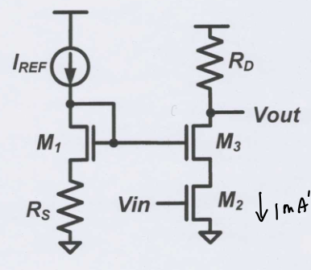

# 기출 2017-1 중간 (C030) 1 — R_S 축퇴 전류 거울로 게이트를 바이어스한 NMOS 캐스코드 증폭기의 R_S, 최대 R_D, 이득

## 원문
With device parameters below,

$V_{DD}=15\text{V}$, $\mu_n C_{ox} = 100\ \text{uA/V}^2$, $V_{TH,N} =0.4\text{V}$, $\lambda_n=0.2\ \text{V}^{-1}$

$I_{ref}=1\text{mA}$, $(W/L)_1=50$, $(W/L)_{2,3} = 25$

1) Choose $R_S$ to flow $I_{D2}=1\text{mA}$ (drain current of $M_2$) (10pt)

2) Choose maximum value of $R_D$ to operate $M_{2,3}$ in saturation region. (10pt)

3) Calculate the small signal voltage gain ($v_{out}/v_{in}$) of this amplifier. (10pt)

## 조건
- 회로: 그림의 증폭기 ($M_2$ 입력 소자, $M_3$ 캐스코드 소자, $R_D$ 부하, $M_1$–$R_S$ 다이오드 연결 소자가 $M_3$ 게이트를 바이어스) (괄호 안은 원문에 없음)
- $V_{DD} = 15\ \text{V}$
- $\mu_n C_{ox} = 100\ \mu\text{A/V}^2$ (원문 표기는 uA/V²)
- $V_{TH,N} = 0.4\ \text{V}$, $\lambda_n = 0.2\ \text{V}^{-1}$
- $I_{ref} = 1\ \text{mA}$ (그림 라벨은 $I_{REF}$)
- $(W/L)_1 = 50$, $(W/L)_2 = (W/L)_3 = 25$ (원문 표기 $(W/L)_{2,3} = 25$)
- 1) 전용: $M_2$의 드레인 전류 $I_{D2} = 1\ \text{mA}$
- 그림의 두 T 전원 기호에는 라벨이 없음. 문제 문장의 $V_{DD}$로 봄 (원문에 없음)
- 입력 $V_{in}$의 DC 레벨은 주어지지 않음 (원문에 없음)

## 구할 것
- 1) $I_{D2} = 1\ \text{mA}$가 흐르게 하는 $R_S$
- 2) $M_2$, $M_3$가 포화 영역에서 동작하기 위한 $R_D$의 최대값
- 3) 이 증폭기의 소신호 전압 이득 $v_{out}/v_{in}$

## 회로 — Fig Q1
```spice
IREF  VDD   n1    {I_REF}
M1    n1    n1    n2    nmos   ; 좌우 반전 (게이트 오른쪽), 다이오드 연결
RS    n2    0     {R_S}
RD    VDD   Vout  {R_D}
M3    Vout  n1    n3    nmos
M2    n3    Vin   0     nmos
* VDD = 라벨 없는 T 전원 기호 2개 (I_REF 위, R_D 위). 문제 문장의 V_DD로 봄 (원문에 없음)
* (W/L)_1 = 50, (W/L)_2,3 = 25는 문제 문장에만 인쇄됨 (그림에는 없음)
```
- 단자: VDD = 15 V 전원, 그림에는 라벨 없음 (T 전원 기호 2개) / Vin = 입력 (선 끝) / Vout = 출력 (선 끝)
- 표시: 노드 라벨 Vin (M2 게이트 선 왼쪽 끝), Vout (출력선 오른쪽 끝) / 소자 라벨 I_REF (전류원 왼쪽), M_1 (M1 왼쪽), R_S (R_S 왼쪽), R_D (R_D 오른쪽), M_3 (M3 오른쪽), M_2 (M2 오른쪽) / 부호 없음 / 화살표 없음 / 수치·면적 라벨 없음
- 배치: 왼쪽 세로줄 위→아래 T 전원 기호, I_REF 전류원(화살표 아래), n1 접속점, M1, R_S, 접지 / 오른쪽 세로줄 위→아래 T 전원 기호, R_D, Vout 접속점, M3, M2, 접지 / 세 MOSFET 모두 소스 화살표 없는 기호 / M1 nmos 좌우 반전(게이트 막대 오른쪽, 드레인 왼쪽 위, 소스 왼쪽 아래) / M3, M2 nmos 보통 방향(게이트 왼쪽, 드레인 위, 소스 아래) / n1 접속점에서 가로선이 오른쪽으로 나가 M1 게이트 오른쪽에서 아래로 꺾여 게이트 선의 게이트 접속점 (다이오드 연결) / 게이트 선은 M1 게이트에서 M3 게이트까지 게이트 높이로 가로지름 / M3 소스에서 곧은 세로선이 M2 드레인으로 (n3, 라벨 없음) / Vout 접속점에서 가로선이 오른쪽으로 나가 Vout 라벨 앞에서 끝남 / Vin 라벨 → 가로선 → M2 게이트 / 접속점 (세 갈래 이상, 3곳): ① n1 = 위 I_REF + 아래 M1 드레인 + 오른쪽 다이오드 연결선 (점) ② 게이트 접속점 = 왼쪽 M1 게이트 + 위 다이오드 연결선 + 오른쪽 M3 게이트 쪽 가로선 (점) ③ Vout = 위 R_D + 아래 M3 드레인 + 오른쪽 출력선 (점) / 교차: 없음


> 참고: 답안지 손글씨가 겹침 (M_2 라벨 오른쪽의 "↓1mA'"). M1과 M3 사이 위쪽(다이오드 연결선 오른쪽)의 희미한 작은 회색 획은 인쇄 글자가 아님
