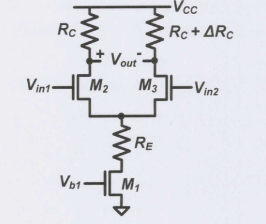

# 기출 2017-1 중간 (C030) 2 — R_E 축퇴 테일과 부하 저항 불일치 ΔR_C가 있는 MOS 차동 증폭기의 입력 범위, A_DM, A_CM, A_CM-DM, CMRR

## 원문
$V_{DD}=3\text{V}$, $\mu_n C_{ox} = 100\ \text{uA/V}^2$, $V_{TH,N} =0.4\text{V}$, $\lambda_n=0.1\ \text{V}^{-1}$,

$I_{D1}=100\text{uA}$, $(W/L)_1=50$, $(W/L)_{2,3} = 25$ , $R_E=R_c=10\ \text{kohm}$

1) Calculate input range of common-mode input of $V_{in1,2}$ (5pt)

2) Calculate input range of differential input ($V_{in1}$-$V_{in2}$) (5pt)

3) Calculate small signal differential gain $A_{DM}$ ($V_{out}/(V_{in1}$-$V_{in2}$)) when $\Delta R_C=0$ (5pt)

4) Calculate common-mode gain $A_{CM}$ when $\Delta R_C=0$ (5pt)

5) Calculate common-mode input to differential output gain $A_{CM-DM}$ when $\Delta R_C = 10\text{ohm}$ (5pt)

6) Calculate CMRR (5pt)

## 조건
- 회로: 그림의 차동 증폭기 ($M_2$–$M_3$ 차동쌍, 테일은 $R_E$와 $V_{b1}$로 바이어스한 $M_1$ 전류원) (괄호 안은 원문에 없음)
- $V_{DD} = 3\ \text{V}$
- 그림에는 전원이 $V_{CC}$로 인쇄됨. 문제 문장의 $V_{DD}$를 이 전원 값으로 봄 (원문에 없음)
- $\mu_n C_{ox} = 100\ \mu\text{A/V}^2$ (원문 표기는 uA/V²)
- $V_{TH,N} = 0.4\ \text{V}$, $\lambda_n = 0.1\ \text{V}^{-1}$
- $I_{D1} = 100\ \mu\text{A}$ (원문 표기는 100uA)
- $(W/L)_1 = 50$, $(W/L)_2 = (W/L)_3 = 25$ (원문 표기 $(W/L)_{2,3} = 25$)
- $R_E = R_C = 10\ \text{k}\Omega$ (원문 표기 $R_c$ = 10 kohm, 그림 라벨은 $R_C$)
- 3), 4) 전용: $\Delta R_C = 0$
- 5) 전용: $\Delta R_C = 10\ \Omega$ (원문 표기 10ohm)
- 바이어스 전압 $V_{b1}$ 값은 주어지지 않음 (원문에 없음)

## 구할 것
- 1) $V_{in1,2}$ 공통 모드 입력의 입력 범위
- 2) 차동 입력 $V_{in1} - V_{in2}$의 입력 범위
- 3) $\Delta R_C = 0$일 때 소신호 차동 이득 $A_{DM} = V_{out}/(V_{in1} - V_{in2})$
- 4) $\Delta R_C = 0$일 때 공통 모드 이득 $A_{CM}$
- 5) $\Delta R_C = 10\ \Omega$일 때 공통 모드 입력에서 차동 출력으로의 이득 $A_{CM-DM}$
- 6) CMRR

## 회로 — Fig Q2
```spice
RC1  VCC   out1  {R_C}          ; 인쇄 라벨 R_C
RC2  VCC   out2  {R_C+ΔR_C}     ; 인쇄 라벨 R_C + ΔR_C
M2   out1  Vin1  n1    nmos
M3   out2  Vin2  n1    nmos     ; 좌우 반전 (게이트 오른쪽)
RE   n1    n2    {R_E}
M1   n2    Vb1   0     nmos
* out1, out2 = 두 출력 선 끝. 그 사이에 + V_out − 라벨 하나 (차동 출력, out1 쪽 +)
```
- 단자: VCC = 전원, 그림에는 값 없음 (가로 레일, 문제 문장에 V_DD = 3 V) / Vb1 = 이상적 DC 바이어스, 값 미지정 (선 끝) / Vin1, Vin2 = 입력 (선 끝) / out1, out2 = 차동 출력 V_out의 두 단자 (선 끝, 각각에는 라벨 없음)
- 표시: 노드 라벨 V_CC (레일 오른쪽 끝), V_out (두 출력 선 끝 사이), V_in1 (M2 게이트 선 왼쪽 끝), V_in2 (M3 게이트 선 오른쪽 끝), V_b1 (M1 게이트 선 왼쪽 끝) / 소자 라벨 R_C (왼쪽 저항 왼쪽), R_C + ΔR_C (오른쪽 저항 오른쪽), M_2 (M2 오른쪽), M_3 (M3 왼쪽), R_E (R_E 오른쪽), M_1 (M1 오른쪽) / 부호 + (out1 선 끝 오른쪽 위, V_out 왼쪽), − (out2 선 끝 왼쪽 위, V_out 오른쪽 위) / 화살표 없음 / 수치·면적 라벨 없음
- 배치: 맨 위 굵은 가로 레일 V_CC (왼쪽 끝은 R_C 세로선 조금 왼쪽, 오른쪽 끝에 라벨) / 왼쪽 세로줄 위→아래 R_C, out1 접속점, M2 / 오른쪽 세로줄 위→아래 R_C + ΔR_C, out2 접속점, M3 / 세 MOSFET 모두 소스 화살표 없는 기호 / M2 nmos 보통 방향(게이트 왼쪽, 드레인 위, 소스 아래), M3 nmos 좌우 반전(게이트 막대 오른쪽, 드레인 왼쪽 위, 소스 왼쪽 아래) / out1 접속점에서 짧은 가로선이 오른쪽으로, out2 접속점에서 짧은 가로선이 왼쪽으로 나가 가운데에서 마주 보고 끝남 (그 사이에 + V_out −) / V_in1 → 가로선 → M2 게이트, M3 게이트 → 가로선 → V_in2 / 두 소스는 아래로 내려가 가로선으로 가운데 n1 점에서 만남, n1에서 아래로 R_E, 그 아래 M1 (nmos 보통 방향, 게이트 왼쪽), V_b1 → 가로선 → M1 게이트, M1 소스 아래 접지 / 접속점 (세 갈래 이상, 3곳): ① out1 = 위 R_C + 아래 M2 드레인 + 오른쪽 출력선 (점) ② out2 = 위 R_C + ΔR_C + 아래 M3 드레인 + 왼쪽 출력선 (점) ③ n1 = 왼쪽 M2 소스 선 + 오른쪽 M3 소스 선 + 아래 R_E (점) / 교차: 없음


