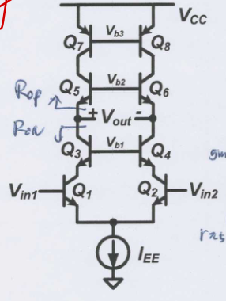
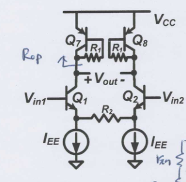

# 기출 2017-1 중간 (C030) 3 — 바이폴라 캐스코드 차동 증폭기와 베이스–컬렉터 저항 R_1 pnp 부하·R_2 축퇴 차동쌍의 차동 전압 이득

## 원문
Calculate differential voltage gain of following circuits.

1) $I_{EE}=2\text{mA}$, $V_{A,p}=10\text{V}$, $V_{A,n}=10\text{V}$, $R_{1,2} = 10\text{kohm}$, $\beta=100$, $V_T=25\text{mV}$ (20pt)

2) $I_{EE}=1\text{mA}$, $V_{A,p}=10\text{V}$, $V_{A,n}=10\text{V}$, $R_{1,2} = 10\text{kohm}$, $\beta=100$, $V_T=25\text{mV}$ (20pt)

## 조건
- 회로: 소문항 1)은 그림 Q3, 2)는 그림 Q3-2 (그림 id는 원문에 없음, 원문에서는 각 소문항 줄 아래에 회로가 인쇄됨)
- 두 소문항 공통: $V_{A,p} = 10\ \text{V}$, $V_{A,n} = 10\ \text{V}$, $R_1 = R_2 = 10\ \text{k}\Omega$ (원문 표기 $R_{1,2}$ = 10kohm), $\beta = 100$, $V_T = 25\ \text{mV}$
- 1) 전용: $I_{EE} = 2\ \text{mA}$
- 1) 전용: 그림 Q3에는 $R_1$, $R_2$가 없음 (원문에 없음, 원문은 1)에도 $R_{1,2}$ 값을 적음)
- 1) 전용: 그림 Q3의 $Q_5$, $Q_6$은 npn 기호(이미터 화살표 바깥)로, 이미터가 아래 출력 노드 쪽에 인쇄됨 (원문에 없음, 그림 그대로 적음)
- 2) 전용: $I_{EE} = 1\ \text{mA}$
- 2) 전용: 그림 Q3-2의 두 전류원은 모두 $I_{EE}$로, 두 베이스–컬렉터 저항은 모두 $R_1$로 인쇄됨
- 바이어스 전압 $V_{b1}$–$V_{b3}$와 $V_{CC}$ 값은 주어지지 않음 (원문에 없음)

## 구할 것
- 1) 그림 Q3 회로의 차동 전압 이득
- 2) 그림 Q3-2 회로의 차동 전압 이득

## 회로 — Fig Q3
```spice
Q7   n1    Vb3   VCC   pnp    ; 좌우 반전 (베이스 오른쪽)
Q8   n2    Vb3   VCC   pnp
Q5   n1    Vb2   out1  npn    ; 좌우 반전 (베이스 오른쪽), 이미터가 아래 out1 쪽
Q6   n2    Vb2   out2  npn    ; 이미터가 아래 out2 쪽
Q3   out1  Vb1   n3    npn    ; 좌우 반전 (베이스 오른쪽)
Q4   out2  Vb1   n4    npn
Q1   n3    Vin1  n5    npn
Q2   n4    Vin2  n5    npn    ; 좌우 반전 (베이스 오른쪽)
IEE  n5    0     {I_EE}
* out1, out2 = 두 출력 선 끝. 그 사이에 + V_out − 라벨 하나 (차동 출력, out1 쪽 +)
* Vb1, Vb2, Vb3 = 두 베이스를 잇는 가로선 위에 인쇄된 라벨 (단자 기호 없음)
```
- 단자: VCC = 전원, 값 미지정 (가로 레일) / Vb3, Vb2, Vb1 = 이상적 DC 바이어스, 값 미지정 (단자 기호 없음, 각 쌍의 두 베이스를 잇는 가로선 위에 라벨만) / Vin1, Vin2 = 입력 (선 끝) / out1, out2 = 차동 출력 V_out의 두 단자 (선 끝, 각각에는 라벨 없음)
- 표시: 노드 라벨 V_CC (레일 오른쪽 끝 아래), V_b3 (Q7–Q8 베이스선 위 가운데), V_b2 (Q5–Q6 베이스선 위 가운데), V_b1 (Q3–Q4 베이스선 위 가운데), V_out (두 출력 선 끝 사이), V_in1 (Q1 베이스 선 왼쪽 끝), V_in2 (Q2 베이스 선 오른쪽 끝) / 소자 라벨 Q_7 (Q7 왼쪽), Q_8 (Q8 오른쪽), Q_5 (Q5 왼쪽 위), Q_6 (Q6 오른쪽 위), Q_3 (Q3 왼쪽 아래), Q_4 (Q4 오른쪽 아래), Q_1 (Q1 오른쪽), Q_2 (Q2 왼쪽), I_EE (전류원 오른쪽) / 부호 + (out1 선 끝 오른쪽, V_out 왼쪽), − (out2 선 끝 왼쪽 위, V_out 오른쪽 위) / 화살표 없음 / 수치·면적 라벨 없음
- 배치: 맨 위 굵은 가로 레일 V_CC (Q7 이미터 세로선 조금 왼쪽에서 Q8 이미터 세로선 조금 오른쪽까지) / 왼쪽 세로줄 위→아래 Q7, Q5, out1 접속점, Q3, Q1 / 오른쪽 세로줄 위→아래 Q8, Q6, out2 접속점, Q4, Q2 / 두 세로줄 사이에 Q7–Q8, Q5–Q6, Q3–Q4 베이스를 잇는 가로선 3개가 각 베이스 높이로 가로지름 / Q7 pnp 좌우 반전(베이스 막대 오른쪽, 이미터 왼쪽 위·화살표가 막대 쪽으로 들어감, 컬렉터 왼쪽 아래), Q8 pnp 보통 방향(베이스 왼쪽, 이미터 오른쪽 위·화살표가 막대 쪽으로 들어감, 컬렉터 오른쪽 아래), 두 이미터에서 세로선이 위로 레일 / Q5 npn 좌우 반전(베이스 막대 오른쪽, 컬렉터 왼쪽 위, 이미터 왼쪽 아래·화살표 바깥), Q6 npn 보통 방향(베이스 왼쪽, 컬렉터 오른쪽 위, 이미터 오른쪽 아래·화살표 바깥) / Q7 컬렉터에서 세로선이 Q5 컬렉터로 (n1, 라벨 없음), Q8 컬렉터에서 세로선이 Q6 컬렉터로 (n2, 라벨 없음) / Q5 이미터와 Q3 컬렉터 사이 out1 접속점에서 짧은 가로선이 오른쪽으로, Q6 이미터와 Q4 컬렉터 사이 out2 접속점에서 짧은 가로선이 왼쪽으로 나가 가운데에서 마주 보고 끝남 (그 사이에 + V_out −) / Q3 npn 좌우 반전(베이스 막대 오른쪽, 컬렉터 왼쪽 위, 이미터 왼쪽 아래·화살표 바깥), Q4 npn 보통 방향(베이스 왼쪽, 이미터 오른쪽 아래·화살표 바깥) / Q3 이미터에서 꺾인 선이 Q1 컬렉터로 (n3), Q4 이미터에서 꺾인 선이 Q2 컬렉터로 (n4) / Q1 npn 보통 방향(베이스 왼쪽, 컬렉터 오른쪽 위, 이미터 오른쪽 아래·화살표 바깥), Q2 npn 좌우 반전(베이스 막대 오른쪽, 컬렉터 왼쪽 위, 이미터 왼쪽 아래·화살표 바깥) / V_in1 → 가로선 → Q1 베이스, Q2 베이스 → 가로선 → V_in2 / 두 이미터는 아래로 내려가 가로선으로 가운데 n5 점에서 만남, n5에서 아래로 I_EE(화살표 아래), 그 아래 접지 / 접속점 (세 갈래 이상, 3곳): ① out1 = 위 Q5 이미터 + 아래 Q3 컬렉터 + 오른쪽 출력선 (점) ② out2 = 위 Q6 이미터 + 아래 Q4 컬렉터 + 왼쪽 출력선 (점) ③ n5 = 왼쪽 Q1 이미터 선 + 오른쪽 Q2 이미터 선 + 아래 I_EE (점) / 교차: 없음


> 참고: 답안지 손글씨가 겹침 (왼쪽 위 모서리의 빨간 별표 획, Q5–Q3 왼쪽의 파란 "Rop"·"Ron" 글자와 화살표, 오른쪽 가장자리의 파란 "gm5"·"rπ5" 글자 조각)

## 회로 — Fig Q3-2
```spice
Q7    out1  n1    VCC   pnp    ; 좌우 반전 (베이스 오른쪽)
R11   out1  n1    {R_1}        ; 인쇄 라벨 R_1 (왼쪽)
Q8    out2  n2    VCC   pnp
R12   out2  n2    {R_1}        ; 인쇄 라벨 R_1 (오른쪽)
Q1    out1  Vin1  n3    npn
Q2    out2  Vin2  n4    npn    ; 좌우 반전 (베이스 오른쪽)
R2    n3    n4    {R_2}
IEE1  n3    0     {I_EE}       ; 두 전류원 모두 I_EE로 인쇄
IEE2  n4    0     {I_EE}
* out1, out2 = 두 출력 선 끝. 그 사이에 + V_out − 라벨 하나 (차동 출력, out1 쪽 +)
```
- 단자: VCC = 전원, 값 미지정 (가로 레일) / Vin1, Vin2 = 입력 (선 끝) / out1, out2 = 차동 출력 V_out의 두 단자 (선 끝, 각각에는 라벨 없음)
- 표시: 노드 라벨 V_CC (레일 오른쪽 끝 아래), V_out (두 출력 선 끝 사이), V_in1 (Q1 베이스 선 왼쪽 끝), V_in2 (Q2 베이스 선 오른쪽 끝) / 소자 라벨 Q_7 (Q7 왼쪽), R_1 (왼쪽 R1 위, Q7 베이스 고리 안), R_1 (오른쪽 R1 위, Q8 베이스 고리 안), Q_8 (Q8 오른쪽), Q_1 (Q1 오른쪽), Q_2 (Q2 왼쪽), R_2 (가로 저항 위), I_EE (왼쪽 전류원 왼쪽), I_EE (오른쪽 전류원 오른쪽) / 부호 + (out1 선 끝 아래 오른쪽, V_out 왼쪽), − (out2 선 끝 아래 왼쪽, V_out 오른쪽) / 화살표 없음 / 수치·면적 라벨 없음
- 배치: 맨 위 굵은 가로 레일 V_CC (Q7 이미터 세로선 조금 왼쪽에서 Q8 이미터 세로선 조금 오른쪽까지) / 왼쪽 세로줄 위→아래 Q7, out1 첫 접속점, out1 둘째 접속점, Q1, n3 접속점, I_EE(화살표 아래), 접지 / 오른쪽 세로줄은 좌우 대칭으로 Q8, out2 첫 접속점, out2 둘째 접속점, Q2, n4 접속점, I_EE(화살표 아래), 접지 / Q7 pnp 좌우 반전(베이스 막대 오른쪽, 이미터 왼쪽 위·화살표가 막대 쪽으로 들어감, 컬렉터 왼쪽 아래), Q8 pnp 보통 방향(베이스 왼쪽, 이미터 오른쪽 위·화살표가 막대 쪽으로 들어감, 컬렉터 오른쪽 아래), 두 이미터에서 세로선이 위로 레일 / Q7 베이스 → 가로선 오른쪽 → 아래로 꺾여 out1 첫 접속점 높이까지 → 왼쪽으로 가로로 놓인 R_1 → out1 첫 접속점 (Q7 막대 오른쪽에 사각 고리) / Q8 베이스 → 가로선 왼쪽 → 아래로 꺾여 out2 첫 접속점 높이까지 → 오른쪽으로 가로로 놓인 R_1 → out2 첫 접속점 (두 고리는 가운데에서 서로 닿지 않음) / out1 둘째 접속점에서 짧은 가로선이 오른쪽으로, out2 둘째 접속점에서 짧은 가로선이 왼쪽으로 나가 가운데에서 마주 보고 끝남 (그 아래에 + V_out −) / Q1 npn 보통 방향(베이스 왼쪽, 컬렉터 오른쪽 위, 이미터 오른쪽 아래·화살표 바깥), Q2 npn 좌우 반전(베이스 막대 오른쪽, 컬렉터 왼쪽 위, 이미터 왼쪽 아래·화살표 바깥) / V_in1 → 가로선 → Q1 베이스, Q2 베이스 → 가로선 → V_in2 / n3, n4 사이에 가로로 놓인 R_2 (이미터 바로 아래 높이) / 접속점 (세 갈래 이상, 6곳): ① out1 첫 = 위 Q7 컬렉터 + 오른쪽 R_1 + 아래 세로선 (점) ② out1 둘째 = 위 세로선 + 아래 Q1 컬렉터 + 오른쪽 출력선 (점) ③ n3 = 위 Q1 이미터 + 오른쪽 R_2 + 아래 I_EE (점) ④ out2 첫 = 위 Q8 컬렉터 + 왼쪽 R_1 + 아래 세로선 (점) ⑤ out2 둘째 = 위 세로선 + 아래 Q2 컬렉터 + 왼쪽 출력선 (점) ⑥ n4 = 위 Q2 이미터 + 왼쪽 R_2 + 아래 I_EE (점) / 교차: 없음


> 참고: 답안지 손글씨가 겹침 (out1 첫 접속점 왼쪽의 파란 "Rop" 글자와 화살표, 오른쪽 아래 I_EE 옆의 파란 "rπ" 글자와 손으로 그린 저항 획)
