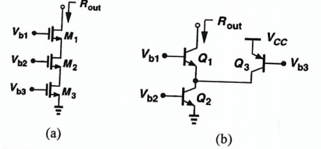

# 기출 2017-1 중간 (D반) 1 — 캐스코드의 장점과 3단 MOS 캐스코드, 전류를 넣는 pnp Q3가 붙은 바이폴라 캐스코드의 R_out

## 원문
다음 회로에 대해 질문에 답하시오. 이 때, $g_m r_o \gg 1$로 가정한다.

(1) Cascode 전류원의 장점과 cascode 증폭기의 장점을 각각 설명하시오.

(2) 회로 (a)에서 $R_{out}$ 값을 구하시오.

(3) 회로 (b)에서 $R_{out}$ 값을 구하시오.

## 조건
- 회로: 그림 (a), (b)
- $g_m r_o \gg 1$로 가정
- 소자 파라미터와 바이어스 전압 $V_{b1}$–$V_{b3}$, $V_{CC}$ 값은 주어지지 않음 (원문에 없음)

## 구할 것
- (1) cascode 전류원의 장점과 cascode 증폭기의 장점을 각각 설명
- (2) 회로 (a)의 $R_{out}$ (값이 주어지지 않으므로 소자의 $g_m$, $r_o$로 나타낸 식) (괄호 안은 원문에 없음)
- (3) 회로 (b)의 $R_{out}$ (값이 주어지지 않으므로 소자 파라미터로 나타낸 식) (괄호 안은 원문에 없음)

## 회로 — Fig Q1(a)
```spice
M1  out  Vb1  n1  nmos
M2  n1   Vb2  n2  nmos
M3  n2   Vb3  0   nmos
* out = R_out 측정 단자 (개방 원), n1, n2 라벨 없음
```
- 단자: Vb1, Vb2, Vb3 = 이상적 DC 바이어스, 값 미지정 (점 단자) / out = R_out 측정 단자 (개방 원)
- 표시: 노드 라벨 V_b1, V_b2, V_b3 (각 점 단자 왼쪽) / 소자 라벨 M_1, M_2, M_3 (각 트랜지스터 오른쪽) / 부호 없음 / 화살표 "R_out": out 원 아래 M1 드레인 세로선, 아래 방향(회로 쪽으로 들여다봄), 도선 옆 별도 화살표 (┌ 꺾임), 글자는 화살표 오른쪽 위 / 수치·면적 라벨 없음
- 배치: 한 세로줄 위→아래 out 개방 원, M1, M2, M3, 접지 / 세 트랜지스터 모두 nmos 보통 방향(게이트 왼쪽, 드레인 위, 소스 아래·화살표 바깥) / M1 소스에서 곧은 세로선이 M2 드레인(n1), M2 소스에서 곧은 세로선이 M3 드레인(n2) / 각 점 단자 → 가로선 → 각 게이트 / M3 소스 아래 접지 / 접속점: 세 갈래 이상 만나는 곳 없음 / 교차: 없음

## 회로 — Fig Q1(b)
```spice
Q1  out  Vb1  n1   npn
Q2  n1   Vb2  0    npn
Q3  n1   Vb3  VCC  pnp    ; 좌우 반전 (베이스 오른쪽), 컬렉터 = n1
* out = R_out 측정 단자 (개방 원), n1 라벨 없음
```
- 단자: Vb1, Vb2, Vb3 = 이상적 DC 바이어스, 값 미지정 (점 단자) / out = R_out 측정 단자 (개방 원) / VCC = 전원, 값 미지정 (T 전원 기호)
- 표시: 노드 라벨 V_b1, V_b2 (각 점 단자 왼쪽), V_b3 (점 단자 오른쪽), V_CC (T 기호 오른쪽) / 소자 라벨 Q_1, Q_2 (각 트랜지스터 오른쪽), Q_3 (Q3 베이스 막대 왼쪽 아래) / 부호 없음 / 화살표 "R_out": out 원 아래 Q1 컬렉터 세로선, 아래 방향(회로 쪽으로 들여다봄), 도선 옆 별도 화살표 (┌ 꺾임), 글자는 화살표 오른쪽 위 / 수치·면적 라벨 없음
- 배치: 왼쪽 세로줄 위→아래 out 개방 원, Q1, n1 접속점, Q2, 접지 / Q1, Q2 npn 보통 방향(베이스 왼쪽, 컬렉터 위, 이미터 아래·화살표 바깥) / 각 점 단자 → 가로선 → Q1, Q2 베이스 / Q2 이미터 아래 접지 / Q3은 오른쪽, Q1 높이, pnp 좌우 반전(베이스 막대 오른쪽, 이미터 왼쪽 위·화살표가 막대 쪽으로 들어감, 컬렉터 왼쪽 아래) / Q3 이미터에서 세로선이 위로 V_CC T 기호 / Q3 베이스 → 가로선 → 오른쪽 V_b3 점 단자 / Q3 컬렉터에서 세로선이 n1 높이까지 내려가 모서리에서 왼쪽으로 꺾여 긴 가로선으로 n1 접속점 / 접속점 (세 갈래 이상, 1곳): n1 = 위 Q1 이미터 + 아래 Q2 컬렉터 + 오른쪽 Q3 컬렉터로 가는 가로선 (점) / 교차: 없음



## 힌트
### (3) $Q_3$는 $r_O$ 하나로 남는다
- $Q_3$의 베이스는 DC 바이어스 $V_{b3}$, 이미터는 $V_{CC}$라 둘 다 AC 접지다
- 그래서 소신호에서 $Q_3$는 $Q_1$ 이미터와 AC 접지 사이에 놓인 자기 출력 저항으로만 남고, $Q_2$의 출력 저항과 병렬이 된다

## 풀이
### (1) 캐스코드의 장점
- 캐스코드 전류원: 출력 저항이 한 소자의 $r_O$보다 약 $g_m r_O$배 커져, 출력 전압이 바뀌어도 전류가 거의 변하지 않는 이상적인 전류원에 가까워진다
- 캐스코드 증폭기: 같은 바이어스 전류에서 출력 저항이 약 $g_m r_O$배 커져 전압 이득이 크게 늘고, 입력 소자의 드레인(컬렉터)을 출력과 떼어 놓아 밀러 효과가 줄어든다
### (2) 회로 (a)의 $R_{out}$
- 각 소자의 트랜스컨덕턴스와 출력 저항을 $g_{mi}$, $r_{Oi}$라 한다 (몸체 효과는 주어지지 않아 무시)
- $M_2$ 드레인에서 본 저항: $M_3$의 $r_{O3}$로 축퇴된 $M_2$라 $R_2 \approx g_{m2} r_{O2} r_{O3}$
- $M_1$은 $R_2$로 축퇴: $R_{out} \approx g_{m1} r_{O1} R_2 = g_{m1} r_{O1} g_{m2} r_{O2} r_{O3}$ ($g_m r_O \gg 1$)
### (3) $Q_1$ 이미터에 달린 저항
- $Q_3$ 베이스($V_{b3}$)와 이미터($V_{CC}$)가 AC 접지라 $Q_3$는 $r_{O3}$ 하나로 남는다
- $Q_1$ 이미터 저항 $R_E = r_{O2} \parallel r_{O3}$, $Q_1$의 베이스 쪽 저항 $r_{\pi 1}$과 병렬로 들어간다
### (3) 회로 (b)의 $R_{out}$
- $g_{m1}(R_E \parallel r_{\pi 1}) \gg 1$이므로 $R_{out} \approx g_{m1} r_{O1} (r_{O2} \parallel r_{O3} \parallel r_{\pi 1})$
### 답
- (1) 캐스코드 전류원은 출력 저항이 약 $g_m r_O$배 커져 이상적인 전류원에 가깝고, 캐스코드 증폭기는 출력 저항이 커져 이득이 크게 늘고 밀러 효과가 줄어든다
- (2) $R_{out} \approx g_{m1} r_{O1} g_{m2} r_{O2} r_{O3}$
- (3) $R_{out} \approx g_{m1} r_{O1} (r_{O2} \parallel r_{O3} \parallel r_{\pi 1})$
