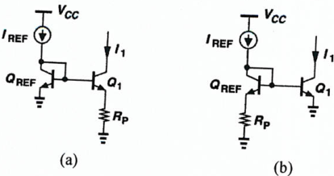

# 기출 2017-1 중간 (D반) 2 — 축퇴 저항 R_P로 복사 전류비를 정하는 바이폴라 전류 거울

## 원문
다음 회로에 대해 질문에 답하시오. 이 때, $Q_{REF} = Q_1$ 이고 base 전류는 무시한다.

(1) 전류 미러를 이용한 바이어스 회로의 장점을 설명하시오.

(2) 회로 (a)에서 $I_1 = I_{REF}/2$ 일 때, $R_P$ 값을 구하시오.

(3) 회로 (b)에서 $I_1 = 2I_{REF}$ 일 때, $R_P$ 값을 구하시오.

## 조건
- 회로: 그림 (a), (b)
- $Q_{REF} = Q_1$ (두 트랜지스터가 같은 소자, 괄호 안은 원문에 없음)
- 베이스 전류는 무시
- $I_{REF}$, $V_{CC}$, $V_T$ 값은 주어지지 않음 (원문에 없음)
- (2) 전용 (회로 (a)): $I_1 = I_{REF}/2$
- (3) 전용 (회로 (b)): $I_1 = 2I_{REF}$

## 구할 것
- (1) 전류 미러를 이용한 바이어스 회로의 장점 설명
- (2) 회로 (a)에서 $I_1 = I_{REF}/2$일 때의 $R_P$ (값이 주어지지 않으므로 $V_T$, $I_{REF}$로 나타낸 식) (괄호 안은 원문에 없음)
- (3) 회로 (b)에서 $I_1 = 2I_{REF}$일 때의 $R_P$ (값이 주어지지 않으므로 $V_T$, $I_{REF}$로 나타낸 식) (괄호 안은 원문에 없음)

## 회로 — Fig Q2(a)
```spice
IREF  VCC  n1   {I_REF}
QREF  n1   n1   0    npn    ; 좌우 반전 (베이스 오른쪽), 다이오드 연결
Q1    out  n1   n2   npn
RP    n2   0    {R_P}       ; Q1 이미터 ↔ 접지
* out = I_1 화살표가 붙은 Q1 컬렉터 선 끝
```
- 단자: VCC = 전원, 값 미지정 (T 전원 기호) / out = Q1 컬렉터, I_1이 흘러드는 단자 (선 끝)
- 표시: 노드 라벨 V_CC (T 기호 오른쪽) / 소자 라벨 I_REF (전류원 왼쪽), Q_REF (Q_REF 왼쪽), Q_1 (Q1 오른쪽), R_P (저항 오른쪽) / 부호 없음 / 화살표 "I_1": Q1 컬렉터 위 세로선, 아래 방향(Q1 컬렉터로 들어감), 도선 위, 글자는 화살표 오른쪽 / 수치·면적 라벨 없음
- 배치: 왼쪽 세로줄 위→아래 V_CC T 기호, I_REF 전류원(화살표 아래), 위 n1 접속점, Q_REF, 접지 / Q_REF npn 좌우 반전(베이스 막대 오른쪽, 컬렉터 왼쪽 위, 이미터 왼쪽 아래·화살표 바깥), 이미터 아래 접지 / 위 n1 접속점에서 가로선이 오른쪽으로 나가 아래로 꺾여 베이스 공통선의 아래 n1 접속점 (다이오드 연결) / 베이스 공통선은 Q_REF 베이스에서 Q1 베이스까지 베이스 높이로 가로지름 / 오른쪽 세로줄 위→아래 선 끝(I_1 화살표), Q1, R_P, 접지 / Q1 npn 보통 방향(베이스 왼쪽, 컬렉터 위, 이미터 아래·화살표 바깥) / 접속점 (세 갈래 이상, 2곳): ① 위 n1 = 위 I_REF + 아래 Q_REF 컬렉터 + 오른쪽 다이오드 연결선 (점) ② 아래 n1 = 왼쪽 Q_REF 베이스 + 오른쪽 Q1 베이스 + 위 다이오드 연결선 (점) / 교차: 없음

## 회로 — Fig Q2(b)
```spice
IREF  VCC  n1   {I_REF}
QREF  n1   n1   n2   npn    ; 좌우 반전 (베이스 오른쪽), 다이오드 연결
RP    n2   0    {R_P}       ; Q_REF 이미터 ↔ 접지
Q1    out  n1   0    npn
* out = I_1 화살표가 붙은 Q1 컬렉터 선 끝
```
- 단자: VCC = 전원, 값 미지정 (T 전원 기호) / out = Q1 컬렉터, I_1이 흘러드는 단자 (선 끝)
- 표시: 노드 라벨 V_CC (T 기호 오른쪽) / 소자 라벨 I_REF (전류원 왼쪽), Q_REF (Q_REF 왼쪽), Q_1 (Q1 오른쪽), R_P (저항 오른쪽) / 부호 없음 / 화살표 "I_1": Q1 컬렉터 위 세로선, 아래 방향(Q1 컬렉터로 들어감), 도선 위, 글자는 화살표 오른쪽 / 수치·면적 라벨 없음
- 배치: 왼쪽 세로줄 위→아래 V_CC T 기호, I_REF 전류원(화살표 아래), 위 n1 접속점, Q_REF, R_P, 접지 / Q_REF npn 좌우 반전(베이스 막대 오른쪽, 컬렉터 왼쪽 위, 이미터 왼쪽 아래·화살표 바깥) / 위 n1 접속점에서 가로선이 오른쪽으로 나가 아래로 꺾여 베이스 공통선의 아래 n1 접속점 (다이오드 연결) / 베이스 공통선은 Q_REF 베이스에서 Q1 베이스까지 베이스 높이로 가로지름 / 오른쪽 세로줄 위→아래 선 끝(I_1 화살표), Q1, 접지 / Q1 npn 보통 방향(베이스 왼쪽, 컬렉터 위, 이미터 아래·화살표 바깥), 이미터 아래 접지 / 접속점 (세 갈래 이상, 2곳): ① 위 n1 = 위 I_REF + 아래 Q_REF 컬렉터 + 오른쪽 다이오드 연결선 (점) ② 아래 n1 = 왼쪽 Q_REF 베이스 + 오른쪽 Q1 베이스 + 위 다이오드 연결선 (점) / 교차: 없음



## 풀이
### (1) 전류 거울 바이어스의 장점
- 출력 전류가 기준 전류 $I_{REF}$의 복사로 정해져 $V_{CC}$, 온도, 공정($I_S$) 변화에 둔감하고, 기준 하나로 여러 단을 바이어스할 수 있다
### (2) 회로 (a)의 $R_P$
- 베이스가 공통이므로 $V_{BE,REF} = V_{BE1} + I_1 R_P$ (베이스 전류 무시, $R_P$에는 $I_1$)
- 같은 소자라 $I_S$가 같아 $I_1 R_P = V_T \ln(I_{REF}/I_1) = V_T \ln 2$: $R_P = 2 V_T \ln 2 / I_{REF} \approx 1.39\, V_T/I_{REF}$
### (3) 회로 (b)의 $R_P$
- 베이스가 공통이므로 $V_{BE,REF} + I_{REF} R_P = V_{BE1}$ ($R_P$에는 $I_{REF}$)
- $I_{REF} R_P = V_T \ln(I_1/I_{REF}) = V_T \ln 2$: $R_P = V_T \ln 2 / I_{REF} \approx 0.693\, V_T/I_{REF}$
### 답
- (1) 출력 전류가 기준 전류의 복사로 정해져 전원·온도·공정 변화에 둔감하고, 기준 전류 하나로 여러 단의 바이어스를 원하는 비로 줄 수 있다
- (2) $R_P = 2 V_T \ln 2 / I_{REF} \approx 1.39\, V_T/I_{REF}$
- (3) $R_P = V_T \ln 2 / I_{REF} \approx 0.693\, V_T/I_{REF}$
