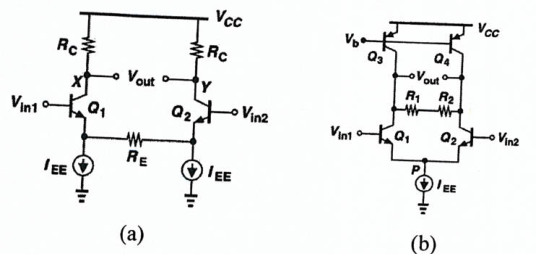

# 기출 2017-1 중간 (D반) 3 — R_E 축퇴 바이폴라 차동쌍의 입력 CM 최대값·이득과 pnp 전류원 부하·R_1, R_2가 붙은 차동쌍의 이득

## 원문
다음 차동증폭기에 대해 질문에 답하시오. 이 때, $V_{CC} = 2.5\ \text{V}$, $V_T = 25\ \text{mV}$, $R_C = 1\ \text{k}\Omega$, $R_E = 100\ \Omega$, $R_1 = R_2 = 5\ \text{k}\Omega$으로 가정한다.

(1) 회로 (a)에서 $I_{EE} = 0.5\ \text{mA}$일 때, 입력 common-mode level($V_{CM}$)의 최대값을 구하시오.

(2) 회로 (a)에서 $I_{EE} = 0.5\ \text{mA}$일 때, 전압이득 값을 구하시오. (이 때, $V_A = \infty$로 가정함.)

(3) 회로 (b)에서 $I_{EE} = 1\ \text{mA}$일 때, 전압이득 값을 구하시오. (이 때, $V_{A,n} = V_{A,p} = 5\ \text{V}$로 가정함.)

## 조건
- 회로: 그림 (a), (b)
- $V_{CC} = 2.5\ \text{V}$, $V_T = 25\ \text{mV}$
- $R_C = 1\ \text{k}\Omega$, $R_E = 100\ \Omega$, $R_1 = R_2 = 5\ \text{k}\Omega$
- (1) 전용 (회로 (a)): $I_{EE} = 0.5\ \text{mA}$
- (2) 전용 (회로 (a)): $I_{EE} = 0.5\ \text{mA}$, $V_A = \infty$로 가정
- (3) 전용 (회로 (b)): $I_{EE} = 1\ \text{mA}$, $V_{A,n} = V_{A,p} = 5\ \text{V}$로 가정
- $\beta$와 (b)의 바이어스 전압 $V_b$ 값은 주어지지 않음 (원문에 없음)

## 구할 것
- (1) 회로 (a)에서 입력 common-mode level $V_{CM}$의 최대값
- (2) 회로 (a)의 전압 이득
- (3) 회로 (b)의 전압 이득

## 회로 — Fig Q3(a)
```spice
RC1   VCC  X     {R_C}    ; 두 저항 모두 R_C로 인쇄
RC2   VCC  Y     {R_C}
Q1    X    Vin1  n1   npn
Q2    Y    Vin2  n2   npn    ; 좌우 반전 (베이스 오른쪽)
RE    n1   n2    {R_E}
IEE1  n1   0     {I_EE}   ; 두 전류원 모두 I_EE로 인쇄
IEE2  n2   0     {I_EE}
* X, Y = 두 출력 원이 이어진 노드. 원 사이에 V_out 라벨 하나 (차동 출력)
* n1, n2 = 두 이미터 노드, 라벨 없음
```
- 단자: VCC = 2.5 V 전원 (가로 레일) / Vin1, Vin2 = 입력 (개방 원) / X, Y = 차동 출력 V_out의 두 단자 (개방 원, 원 자체에는 라벨 없음)
- 표시: 노드 라벨 V_CC (레일 오른쪽 끝), X (X 접속점 왼쪽 아래), Y (Y 접속점 오른쪽 아래), V_out (두 출력 원 사이), V_in1 (왼쪽 입력 원 왼쪽), V_in2 (오른쪽 입력 원 오른쪽) / 소자 라벨 R_C (왼쪽 저항 왼쪽), R_C (오른쪽 저항 오른쪽), Q_1 (Q1 오른쪽), Q_2 (Q2 왼쪽), R_E (가로 저항 아래), I_EE (왼쪽 전류원 왼쪽), I_EE (오른쪽 전류원 오른쪽) / 부호 없음 / 화살표 없음 / 수치·면적 라벨 없음
- 배치: 맨 위 굵은 가로 레일 V_CC / 왼쪽 세로줄 위→아래 R_C, X 접속점, Q1, n1 접속점, I_EE 전류원(화살표 아래), 접지 / 오른쪽 세로줄 위→아래 R_C, Y 접속점, Q2, n2 접속점, I_EE 전류원(화살표 아래), 접지 / Q1 npn 보통 방향(베이스 왼쪽, 컬렉터 위, 이미터 아래·화살표 바깥), Q2 npn 좌우 반전(베이스 막대 오른쪽, 컬렉터 왼쪽 위, 이미터 왼쪽 아래·화살표 바깥) / X 접속점에서 가로선이 오른쪽 출력 원, Y 접속점에서 가로선이 왼쪽 출력 원 (두 원이 가운데에서 마주 보고 그 사이에 V_out) / V_in1 원 → 가로선 → Q1 베이스, Q2 베이스 → 가로선 → V_in2 원 / n1, n2 사이에 가로로 놓인 R_E (이미터 바로 아래 높이) / 접속점 (세 갈래 이상, 4곳): ① X = 위 R_C + 아래 Q1 컬렉터 + 오른쪽 출력선 (점) ② Y = 위 R_C + 아래 Q2 컬렉터 + 왼쪽 출력선 (점) ③ n1 = 위 Q1 이미터 + 아래 I_EE + 오른쪽 R_E (점) ④ n2 = 위 Q2 이미터 + 아래 I_EE + 왼쪽 R_E (점) / 교차: 없음

## 회로 — Fig Q3(b)
```spice
Q3   out1  Vb    VCC  pnp
Q4   out2  Vb    VCC  pnp
R1   out1  n1    {R_1}
R2   n1    out2  {R_2}
Q1   out1  Vin1  P    npn
Q2   out2  Vin2  P    npn    ; 좌우 반전 (베이스 오른쪽)
IEE  P     0     {I_EE}
* out1, out2 = 두 출력 원. 원 사이에 V_out 라벨 하나 (차동 출력)
* n1 = R1과 R2 사이 노드, 라벨 없음
```
- 단자: VCC = 2.5 V 전원 (가로 레일) / Vb = 이상적 DC 바이어스, 값 미지정 (점 단자) / Vin1, Vin2 = 입력 (개방 원) / out1, out2 = 차동 출력 V_out의 두 단자 (개방 원, 각각에는 라벨 없음)
- 표시: 노드 라벨 V_CC (레일 오른쪽 끝), V_b (점 단자 왼쪽), V_out (두 출력 원 사이), V_in1 (왼쪽 입력 원 왼쪽), V_in2 (오른쪽 입력 원 오른쪽), P (P 접속점 왼쪽 아래) / 소자 라벨 Q_3 (Q3 왼쪽 아래), Q_4 (Q4 왼쪽 아래), R_1, R_2 (각 저항 위), Q_1 (Q1 오른쪽), Q_2 (Q2 왼쪽), I_EE (전류원 오른쪽) / 부호 없음 / 화살표 없음 / 수치·면적 라벨 없음
- 배치: 맨 위 가로 레일 V_CC / 왼쪽 세로줄 위→아래 Q3, out1 위 접속점, out1 아래 접속점, Q1 / 오른쪽 세로줄 위→아래 Q4, out2 위 접속점, out2 아래 접속점, Q2 / Q3, Q4 pnp 보통 방향(베이스 왼쪽, 이미터 오른쪽 위·화살표가 막대 쪽으로 들어감, 컬렉터 오른쪽 아래), 두 이미터에서 세로선이 위로 레일 / 베이스 공통선은 V_b 점 단자에서 Q3 베이스 막대를 지나 오른쪽 Q4 베이스 막대까지 베이스 높이로 가로지름 / out1 위 접속점에서 가로선이 오른쪽 출력 원, out2 위 접속점에서 가로선이 왼쪽 출력 원 (두 원이 가운데에서 마주 보고 그 사이에 V_out) / 두 아래 접속점 사이에 가로로 R_1, R_2가 직렬 (R_1 왼쪽, R_2 오른쪽, 두 저항 사이 n1은 점 없이 이어짐) / Q1 npn 보통 방향(베이스 왼쪽, 컬렉터 위, 이미터 아래·화살표 바깥), Q2 npn 좌우 반전(베이스 막대 오른쪽, 컬렉터 왼쪽 위, 이미터 왼쪽 아래·화살표 바깥) / V_in1 원 → 가로선 → Q1 베이스, Q2 베이스 → 가로선 → V_in2 원 / 두 이미터는 아래로 내려가 가로선으로 가운데 P 점에서 만남, P에서 아래로 I_EE(화살표 아래), 그 아래 접지 / 접속점 (세 갈래 이상, 5곳): ① out1 위 = 위 Q3 컬렉터 + 아래 세로선 + 오른쪽 출력선 (점) ② out1 아래 = 위 세로선 + 아래 Q1 컬렉터 + 오른쪽 R_1 (점) ③ out2 위 = 위 Q4 컬렉터 + 아래 세로선 + 왼쪽 출력선 (점) ④ out2 아래 = 위 세로선 + 아래 Q2 컬렉터 + 왼쪽 R_2 (점) ⑤ P = 왼쪽 Q1 이미터 선 + 오른쪽 Q2 이미터 선 + 아래 I_EE (점) / 교차: 없음



## 힌트
### 저항 가운데 점은 차동 AC 접지
- 회로가 좌우 대칭이고 차동 입력에서는 두 이미터 전압이 크기는 같고 부호가 반대로 움직인다
- 그래서 $R_E$를 반으로 나눈 가운데 점의 전압은 0이고, 반회로에서는 이미터에 그 절반만 달린다. (3)의 $R_1$, $R_2$ 사이 점도 같은 이유로 AC 접지다

## 풀이
### (1) 입력 CM 최대값
- CM 입력에서는 대칭이라 $R_E$에 DC 전류가 없고, $\beta$가 주어지지 않아 $I_C \approx I_{EE} = 0.5\ \text{mA}$로 본다
- $V_X = V_{CC} - R_C I_{EE} = 2.00\ \text{V}$. $Q_1$이 포화되지 않으려면 $V_{BC} \le 0$이라 $V_{CM} \le V_X$
### (2) 회로 (a)의 반회로 이득
- $g_m = I_C/V_T = 0.5\ \text{mA}/25\ \text{mV} = 20.0\ \text{mS}$
- 차동 입력에서 $R_E$ 가운데는 대칭으로 AC 접지라 반회로 이미터 저항은 $R_E/2 = 50\ \Omega$
- $V_{out} = V_X - V_Y$로 $A_v = V_{out}/(V_{in1} - V_{in2}) = -R_C/(1/g_m + R_E/2) = -1\ \text{k}\Omega/100\ \Omega = -10.0$
### (3) 회로 (b)의 소신호 파라미터
- 각 쪽 $I_C = I_{EE}/2 = 0.5\ \text{mA}$ (DC에서는 대칭이라 $R_1$, $R_2$에 전류가 없고 $Q_3$, $Q_4$도 $0.5\ \text{mA}$)
- $g_m = 20.0\ \text{mS}$, $r_{On} = V_{A,n}/I_C = 10.0\ \text{k}\Omega$, $r_{Op} = V_{A,p}/I_C = 10.0\ \text{k}\Omega$ ($Q_1$, $Q_3$의 출력 저항)
### (3) 회로 (b)의 이득
- 차동 입력에서 $P$와 $R_1$, $R_2$ 사이 점은 대칭으로 AC 접지라 반회로 출력에는 $R_1$이 접지로 달린다
- $A_v = -g_m (r_{On} \parallel r_{Op} \parallel R_1) = -20.0\ \text{mS} \times 2.50\ \text{k}\Omega = -50.0$
### 답
- (1) $V_{CM,max} = 2.00\ \text{V}$
- (2) $A_v = -10.0$
- (3) $A_v = -50.0$
