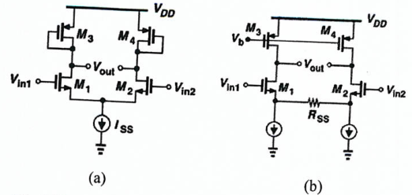
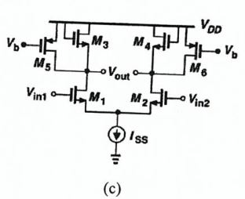

# 기출 2017-1 중간 (D반) 4 — 다이오드 연결 부하, R_SS 축퇴, NMOS 부하·PMOS 전류원이 붙은 MOS 차동 증폭기의 전압 이득

## 원문
다음 차동증폭기에 대해 질문에 답하시오. 이 때, $\lambda \neq 0$으로 가정한다.

(1) 회로 (a)의 전압이득을 구하시오.

(2) 회로 (b)의 전압이득을 구하시오.

(3) 회로 (c)의 전압이득을 구하시오.

## 조건
- 회로: 그림 (a), (b), (c)
- $\lambda \neq 0$으로 가정
- 소자 파라미터, $I_{SS}$, $R_{SS}$, $V_b$, $V_{DD}$ 값과 (b)의 두 전류원 값은 주어지지 않음 (원문에 없음)

## 구할 것
- (1) 회로 (a)의 전압 이득 (소자의 $g_m$, $r_o$로 나타낸 식) (괄호 안은 원문에 없음)
- (2) 회로 (b)의 전압 이득 (소자의 $g_m$, $r_o$와 $R_{SS}$로 나타낸 식) (괄호 안은 원문에 없음)
- (3) 회로 (c)의 전압 이득 (소자의 $g_m$, $r_o$로 나타낸 식) (괄호 안은 원문에 없음)

## 회로 — Fig Q4(a)
```spice
M3   out1  out1  VDD  pmos   ; 다이오드 연결 (게이트 ↔ 드레인)
M4   out2  out2  VDD  pmos   ; 좌우 반전 (게이트 오른쪽), 다이오드 연결
M1   out1  Vin1  n1   nmos
M2   out2  Vin2  n1   nmos   ; 좌우 반전 (게이트 오른쪽)
ISS  n1    0     {I_SS}
* out1, out2 = 두 출력 원. 원 사이에 V_out 라벨 하나 (차동 출력)
* n1 = 공통 소스(테일) 노드, 라벨 없음
```
- 단자: VDD = 전원, 값 미지정 (가로 레일) / Vin1, Vin2 = 입력 (개방 원) / out1, out2 = 차동 출력 V_out의 두 단자 (개방 원, 각각에는 라벨 없음)
- 표시: 노드 라벨 V_DD (레일 오른쪽 끝), V_out (두 출력 원 사이), V_in1 (왼쪽 입력 원 왼쪽), V_in2 (오른쪽 입력 원 오른쪽) / 소자 라벨 M_3 (M3 오른쪽), M_4 (M4 왼쪽), M_1 (M1 오른쪽), M_2 (M2 왼쪽), I_SS (전류원 오른쪽) / 부호 없음 / 화살표 없음 / 수치·면적 라벨 없음
- 배치: 맨 위 굵은 가로 레일 V_DD / 왼쪽 세로줄 위→아래 M3, 다이오드 접속점, out1 접속점, M1 / 오른쪽 세로줄 위→아래 M4, 다이오드 접속점, out2 접속점, M2 / M3 pmos 보통 방향(게이트 왼쪽, 소스 오른쪽 위·화살표가 채널 쪽으로 들어감, 드레인 오른쪽 아래), M4 pmos 좌우 반전(게이트 막대 오른쪽, 소스 왼쪽 위, 드레인 왼쪽 아래), 두 소스에서 세로선이 위로 레일 / M3 게이트에서 가로선이 왼쪽으로 나가 아래로 꺾이고 다시 오른쪽으로 꺾여 M3 드레인 아래 다이오드 접속점 (M4는 좌우 대칭으로 오른쪽에서 돌아 들어감) / out1 접속점에서 가로선이 오른쪽 출력 원, out2 접속점에서 가로선이 왼쪽 출력 원 (두 원이 가운데에서 마주 보고 그 사이에 V_out) / M1 nmos 보통 방향(게이트 왼쪽, 드레인 위, 소스 아래·화살표 바깥), M2 nmos 좌우 반전(게이트 막대 오른쪽, 드레인 왼쪽 위, 소스 왼쪽 아래·화살표 바깥) / V_in1 원 → 가로선 → M1 게이트, M2 게이트 → 가로선 → V_in2 원 / 두 소스는 아래로 내려가 가로선으로 가운데 n1 점에서 만남, n1에서 아래로 I_SS(화살표 아래), 그 아래 접지 / 접속점 (세 갈래 이상, 5곳): ① M3 다이오드 = 위 M3 드레인 + 왼쪽 게이트 되돌림선 + 아래 세로선 (점) ② out1 = 위 세로선 + 아래 M1 드레인 + 오른쪽 출력선 (점) ③ M4 다이오드 = 위 M4 드레인 + 오른쪽 게이트 되돌림선 + 아래 세로선 (점) ④ out2 = 위 세로선 + 아래 M2 드레인 + 왼쪽 출력선 (점) ⑤ n1 = 왼쪽 M1 소스 선 + 오른쪽 M2 소스 선 + 아래 I_SS (점) / 교차: 없음

## 회로 — Fig Q4(b)
```spice
M3   out1  Vb    VDD  pmos
M4   out2  Vb    VDD  pmos
M1   out1  Vin1  n1   nmos
M2   out2  Vin2  n2   nmos   ; 좌우 반전 (게이트 오른쪽)
RSS  n1    n2    {R_SS}
I1   n1    0      ; 라벨·값 없음
I2   n2    0      ; 라벨·값 없음
* out1, out2 = 두 출력 원. 원 사이에 V_out 라벨 하나 (차동 출력)
* n1, n2 = 두 소스 노드, 라벨 없음
```
- 단자: VDD = 전원, 값 미지정 (가로 레일) / Vb = 이상적 DC 바이어스, 값 미지정 (점 단자) / Vin1, Vin2 = 입력 (개방 원) / out1, out2 = 차동 출력 V_out의 두 단자 (개방 원, 각각에는 라벨 없음)
- 표시: 노드 라벨 V_DD (레일 오른쪽 끝), V_b (점 단자 왼쪽), V_out (두 출력 원 사이), V_in1 (왼쪽 입력 원 왼쪽), V_in2 (오른쪽 입력 원 오른쪽) / 소자 라벨 M_3 (M3 왼쪽 위), M_4 (M4 왼쪽 위), M_1 (M1 오른쪽), M_2 (M2 왼쪽), R_SS (가로 저항 아래), I1, I2 (라벨 없음) / 부호 없음 / 화살표 없음 / 수치·면적 라벨 없음
- 배치: 맨 위 굵은 가로 레일 V_DD / 왼쪽 세로줄 위→아래 M3, out1 접속점, M1, n1 접속점, 전류원(화살표 아래), 접지 / 오른쪽 세로줄 위→아래 M4, out2 접속점, M2, n2 접속점, 전류원(화살표 아래), 접지 / M3, M4 pmos 보통 방향(게이트 왼쪽, 소스 오른쪽 위·화살표가 채널 쪽으로 들어감, 드레인 오른쪽 아래), 두 소스에서 세로선이 위로 레일 / 게이트 공통선은 V_b 점 단자에서 M3 게이트로 들어가고, M3 기호를 가로질러 오른쪽 M4 게이트까지 게이트 높이로 지나감 / out1 접속점에서 가로선이 오른쪽 출력 원, out2 접속점에서 가로선이 왼쪽 출력 원 (두 원이 가운데에서 마주 보고 그 사이에 V_out) / M1 nmos 보통 방향(게이트 왼쪽, 드레인 위, 소스 아래·화살표 바깥), M2 nmos 좌우 반전(게이트 막대 오른쪽, 드레인 왼쪽 위, 소스 왼쪽 아래·화살표 바깥) / V_in1 원 → 가로선 → M1 게이트, M2 게이트 → 가로선 → V_in2 원 / n1, n2 사이에 가로로 놓인 R_SS (소스 바로 아래 높이) / 접속점 (세 갈래 이상, 4곳): ① out1 = 위 M3 드레인 + 아래 M1 드레인 + 오른쪽 출력선 (점) ② out2 = 위 M4 드레인 + 아래 M2 드레인 + 왼쪽 출력선 (점) ③ n1 = 위 M1 소스 + 아래 전류원 + 오른쪽 R_SS (점) ④ n2 = 위 M2 소스 + 아래 전류원 + 왼쪽 R_SS (점) / 교차: 게이트 공통선이 M3 채널 막대를 점 없이 가로질러 그려짐 (M3 게이트 높이)



## 회로 — Fig Q4(c)
```spice
M5   out1  Vb    VDD   pmos
M3   VDD   VDD   out1  nmos   ; 게이트와 드레인 모두 V_DD 레일
M4   VDD   VDD   out2  nmos   ; 좌우 반전 (게이트 오른쪽), 게이트와 드레인 모두 V_DD 레일
M6   out2  Vb    VDD   pmos   ; 좌우 반전 (게이트 오른쪽)
M1   out1  Vin1  n1    nmos
M2   out2  Vin2  n1    nmos   ; 좌우 반전 (게이트 오른쪽)
ISS  n1    0     {I_SS}
* out1, out2 = 두 출력 원. 원 사이에 V_out 라벨 하나 (차동 출력)
* Vb = 좌우 두 점 단자, 둘 다 V_b로 인쇄
* n1 = 공통 소스(테일) 노드, 라벨 없음
```
- 단자: VDD = 전원, 값 미지정 (가로 레일) / Vb = 이상적 DC 바이어스, 값 미지정 (점 단자 2개, 둘 다 V_b로 인쇄) / Vin1, Vin2 = 입력 (개방 원) / out1, out2 = 차동 출력 V_out의 두 단자 (개방 원, 각각에는 라벨 없음)
- 표시: 노드 라벨 V_DD (레일 오른쪽 끝), V_b (왼쪽 점 단자 왼쪽), V_b (오른쪽 점 단자 오른쪽), V_out (두 출력 원 사이), V_in1 (왼쪽 입력 원 왼쪽), V_in2 (오른쪽 입력 원 오른쪽) / 소자 라벨 M_5 (M5 왼쪽 아래), M_3 (M3 오른쪽), M_4 (M4 왼쪽), M_6 (M6 오른쪽 아래), M_1 (M1 오른쪽), M_2 (M2 왼쪽), I_SS (전류원 오른쪽) / 부호 없음 / 화살표 없음 / 수치·면적 라벨 없음
- 배치: 맨 위 굵은 가로 레일 V_DD / 레일 아래 왼쪽부터 M5, M3, M4, M6이 한 줄 / M5 pmos 보통 방향(게이트 왼쪽, 소스 오른쪽 위·화살표가 채널 쪽으로 들어감, 드레인 오른쪽 아래), 소스에서 세로선이 위로 레일, V_b 점 단자 → 가로선 → M5 게이트 / M5 드레인에서 세로선이 out1 높이까지 내려가 오른쪽으로 꺾여 out1 접속점 / M3 nmos 보통 방향(게이트 왼쪽, 드레인 오른쪽 위, 소스 오른쪽 아래·화살표 바깥), 게이트는 왼쪽으로 나간 선이 위로 꺾여 레일, 드레인은 오른쪽으로 나간 선이 위로 꺾여 레일, 소스에서 세로선이 아래로 out1 접속점 / M4 nmos 좌우 반전(게이트 막대 오른쪽, 드레인 왼쪽 위, 소스 왼쪽 아래·화살표 바깥), 게이트는 오른쪽으로 나간 선이 위로 꺾여 레일, 드레인은 왼쪽으로 나간 선이 위로 꺾여 레일, 소스에서 세로선이 아래로 out2 접속점 / M6 pmos 좌우 반전(게이트 막대 오른쪽, 소스 왼쪽 위·화살표가 채널 쪽으로 들어감, 드레인 왼쪽 아래), 소스에서 세로선이 위로 레일, M6 게이트 → 가로선 → 오른쪽 V_b 점 단자 / M6 드레인에서 세로선이 out2 높이까지 내려가 왼쪽으로 꺾여 out2 접속점 / out1 접속점에서 가로선이 오른쪽 출력 원, out2 접속점에서 가로선이 왼쪽 출력 원 (두 원이 가운데에서 마주 보고 그 사이에 V_out) / out1 아래 M1, out2 아래 M2: M1 nmos 보통 방향(게이트 왼쪽, 드레인 위, 소스 아래·화살표 바깥), M2 nmos 좌우 반전(게이트 막대 오른쪽, 드레인 왼쪽 위, 소스 왼쪽 아래·화살표 바깥) / V_in1 원 → 가로선 → M1 게이트, M2 게이트 → 가로선 → V_in2 원 / 두 소스는 아래로 내려가 가로선으로 가운데 n1 점에서 만남, n1에서 아래로 I_SS(화살표 아래), 그 아래 접지 / 접속점 (세 갈래 이상, 3곳): ① out1 = 왼쪽 M5 드레인 선 + 위 M3 소스 + 아래 M1 드레인 + 오른쪽 출력선 (네 갈래, 점) ② out2 = 오른쪽 M6 드레인 선 + 위 M4 소스 + 아래 M2 드레인 + 왼쪽 출력선 (네 갈래, 점) ③ n1 = 왼쪽 M1 소스 선 + 오른쪽 M2 소스 선 + 아래 I_SS (점) / 교차: 없음


> 참고: (c)는 캡션이 소문항 (1) 글줄과 같은 높이까지 내려와 (a), (b)와 한 직사각형으로 자를 수 없어 따로 잘랐다

## 힌트
### (2) $R_{SS}$ 가운데는 AC 접지
- 좌우 대칭인 회로에 차동 입력을 넣으면 두 소스 전압이 반대로 움직여, $R_{SS}$를 반으로 나눈 가운데 점은 움직이지 않는다
- 그래서 반회로는 소스에 $R_{SS}$의 절반이 달린 축퇴 CS 단이 된다
### (3) $M_3$는 게이트=드레인 다이오드
- $M_3$의 게이트와 드레인이 모두 $V_{DD}$에 붙어 있어 게이트와 드레인이 이어진 다이오드 연결과 같다
- 출력은 $M_3$의 소스에 붙으므로, 출력에서 $M_3$를 보면 다이오드 연결 소자의 작은 저항이 보인다

## 풀이
### (1) 회로 (a)의 이득
- 각 소자의 트랜스컨덕턴스와 출력 저항을 $g_{mi}$, $r_{Oi}$라 한다. 차동 입력에서 꼬리 노드는 가상 접지라 반회로는 CS 단이다
- 부하 $M_3$는 다이오드 연결이라 $1/g_{m3} \parallel r_{O3}$: $A_v = -g_{m1}(g_{m3}^{-1} \parallel r_{O1} \parallel r_{O3})$
### (2) 회로 (b)의 반회로
- 차동 입력에서 $R_{SS}$ 가운데 점은 대칭으로 AC 접지라 $M_1$ 소스에 $R_{SS}/2$가 달린다. 아래 전류원은 이상적이라 소신호에서 개방
- 부하는 게이트가 $V_b$인 $M_3$의 $r_{O3}$
### (2) 회로 (b)의 이득
- $G_m \approx g_{m1}/(1 + g_{m1} R_{SS}/2)$, $M_1$ 드레인에서 본 저항 $(1 + g_{m1} R_{SS}/2)\, r_{O1}$
- $A_v = -G_m \{ r_{O3} \parallel [(1 + g_{m1} R_{SS}/2)\, r_{O1}] \} = -\dfrac{g_{m1} r_{O1} r_{O3}}{(1 + g_{m1} R_{SS}/2)\, r_{O1} + r_{O3}}$
### (3) 회로 (c)의 이득
- $M_3$는 게이트와 드레인이 모두 $V_{DD}$라 다이오드 연결과 같고, 소스(출력)에서 보면 $1/g_{m3} \parallel r_{O3}$ (몸체 효과는 주어지지 않아 무시)
- $M_5$는 게이트가 $V_b$라 $r_{O5}$: $A_v = -g_{m1}(g_{m3}^{-1} \parallel r_{O3} \parallel r_{O5} \parallel r_{O1})$
### 답
- (1) $A_v = -g_{m1}(g_{m3}^{-1} \parallel r_{O1} \parallel r_{O3})$
- (2) $A_v = -\dfrac{g_{m1} r_{O1} r_{O3}}{(1 + g_{m1} R_{SS}/2)\, r_{O1} + r_{O3}}$
- (3) $A_v = -g_{m1}(g_{m3}^{-1} \parallel r_{O1} \parallel r_{O3} \parallel r_{O5})$
