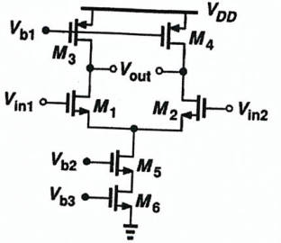

# 기출 2017-1 중간 (D반) 5 — 캐스코드 테일과 PMOS 전류원 부하를 가진 MOS 차동 증폭기의 CM 잡음 원인, 이득, A_CM

## 원문
다음 차동증폭기가 아래의 조건으로 동작할 때, 질문에 답하시오.

: $V_{DD} = 1.8\ \text{V}$, $I_{D5} = I_{D6} = 2\ \text{mA}$, $(W/L)_{1,2} = 100/0.2$, $(W/L)_{3,4} = 200/0.2$, $(W/L)_{5,6} = 200/0.2$, $\mu_n C_{ox} = 100\ \mu\text{A/V}^2$, $\mu_p C_{ox} = 50\ \mu\text{A/V}^2$, $\lambda_n = \lambda_p = 0.1\ \text{V}^{-1}$. 이 때, $g_m r_o \gg 1$로 가정한다.

(1) 실제 차동증폭기의 차동출력에서 입력 common-mode noise의 영향이 나타나는 이유 2가지를 설명하시오.

(2) 주어진 조건을 이용하여 전압이득 값을 구하시오.

(3) Common-mode 이득($A_{CM}$) 식을 구하시오.

(4) 주어진 조건을 이용하여 $A_{CM}$ 값을 구하시오.

## 조건
- 회로: 그림의 차동 증폭기
- $V_{DD} = 1.8\ \text{V}$, $I_{D5} = I_{D6} = 2\ \text{mA}$
- $(W/L)_{1,2} = 100/0.2$, $(W/L)_{3,4} = 200/0.2$, $(W/L)_{5,6} = 200/0.2$
- $\mu_n C_{ox} = 100\ \mu\text{A/V}^2$, $\mu_p C_{ox} = 50\ \mu\text{A/V}^2$
- $\lambda_n = \lambda_p = 0.1\ \text{V}^{-1}$
- $g_m r_o \gg 1$로 가정
- 바이어스 전압 $V_{b1}$–$V_{b3}$ 값은 주어지지 않음 (원문에 없음)

## 구할 것
- (1) 실제 차동 증폭기의 차동 출력에 입력 common-mode noise의 영향이 나타나는 이유 2가지 설명
- (2) 주어진 조건으로 전압 이득
- (3) Common-mode 이득 $A_{CM}$의 식
- (4) 주어진 조건으로 $A_{CM}$ 값

## 회로 — Fig Q5
```spice
M3  out1  Vb1   VDD  pmos
M4  out2  Vb1   VDD  pmos
M1  out1  Vin1  n1   nmos
M2  out2  Vin2  n1   nmos    ; 좌우 반전 (게이트 오른쪽)
M5  n1    Vb2   n2   nmos
M6  n2    Vb3   0    nmos
* out1, out2 = 두 출력 원. 원 사이에 V_out 라벨 하나 (차동 출력)
* n1 = 공통 소스(테일) 노드, n2 = M5 소스·M6 드레인, 둘 다 라벨 없음
```
- 단자: VDD = 1.8 V 전원 (가로 레일) / Vb1, Vb2, Vb3 = 이상적 DC 바이어스, 값 미지정 (점 단자) / Vin1, Vin2 = 입력 (개방 원) / out1, out2 = 차동 출력 V_out의 두 단자 (개방 원, 각각에는 라벨 없음)
- 표시: 노드 라벨 V_DD (레일 오른쪽 끝), V_b1 (점 단자 왼쪽), V_out (두 출력 원 사이), V_in1 (왼쪽 입력 원 왼쪽), V_in2 (오른쪽 입력 원 오른쪽), V_b2, V_b3 (각 점 단자 왼쪽) / 소자 라벨 M_3 (M3 왼쪽 아래), M_4 (M4 오른쪽), M_1 (M1 오른쪽), M_2 (M2 왼쪽), M_5, M_6 (각 트랜지스터 오른쪽) / 부호 없음 / 화살표 없음 / 수치·면적 라벨 없음
- 배치: 맨 위 굵은 가로 레일 V_DD / 왼쪽 세로줄 위→아래 M3, out1 접속점, M1 / 오른쪽 세로줄 위→아래 M4, out2 접속점, M2 / M3, M4 pmos 보통 방향(게이트 왼쪽, 소스 오른쪽 위·화살표가 채널 쪽으로 들어감, 드레인 오른쪽 아래), 두 소스에서 세로선이 위로 레일 / 게이트 공통선은 V_b1 점 단자에서 M3 게이트로 들어가고, M3 기호를 가로질러 오른쪽 M4 게이트까지 게이트 높이로 지나감 / out1 접속점에서 가로선이 오른쪽 출력 원, out2 접속점에서 가로선이 왼쪽 출력 원 (두 원이 가운데에서 마주 보고 그 사이에 V_out) / M1 nmos 보통 방향(게이트 왼쪽, 드레인 위, 소스 아래·화살표 바깥), M2 nmos 좌우 반전(게이트 막대 오른쪽, 드레인 왼쪽 위, 소스 왼쪽 아래·화살표 바깥) / V_in1 원 → 가로선 → M1 게이트, M2 게이트 → 가로선 → V_in2 원 / 두 소스는 아래로 내려가 가로선으로 가운데 n1 점에서 만남 / n1 아래 세로줄 위→아래 M5, M6, 접지 (둘 다 nmos 보통 방향, 게이트 왼쪽), V_b2, V_b3 점 단자 → 가로선 → 각 게이트, M5 소스에서 곧은 세로선이 M6 드레인 / 접속점 (세 갈래 이상, 3곳): ① out1 = 위 M3 드레인 + 아래 M1 드레인 + 오른쪽 출력선 (점) ② out2 = 위 M4 드레인 + 아래 M2 드레인 + 왼쪽 출력선 (점) ③ n1 = 왼쪽 M1 소스 선 + 오른쪽 M2 소스 선 + 아래 M5 드레인 (점) / 교차: 게이트 공통선이 M3 채널 막대를 점 없이 가로질러 그려짐 (M3 게이트 높이)



## 풀이
### (1) CM 잡음이 차동 출력에 나타나는 이유
- ① 꼬리 전류원 출력 저항이 유한해 CM 입력이 두 쪽 전류를 함께 바꾼다
- ② 부하 저항·$g_m$ 불일치로 회로가 비대칭이라 그 변화가 차동 출력으로 나온다
### 소신호 파라미터
- $g_m = \sqrt{2\mu C_{ox}(W/L)I_D}$, $r_O = 1/(\lambda I_D)$
- $I_{D1} = I_{D5}/2 = 1\ \text{mA}$: $g_{m1} = 10.0\ \text{mS}$, $r_{O1} = r_{O3} = 10.0\ \text{k}\Omega$
- $M_5$, $M_6$ ($2\ \text{mA}$): $g_{m5} = 20.0\ \text{mS}$, $r_{O5} = r_{O6} = 5.00\ \text{k}\Omega$
### (2) 차동 전압 이득
- 꼬리 노드는 가상 접지: $A_v = -g_{m1}(r_{O1} \parallel r_{O3}) = -50.0$
### (3) $A_{CM}$ 식
- $M_5$ 드레인에서 본 꼬리 저항 $R_{SS} \approx g_{m5} r_{O5} r_{O6}$ ($g_{m5} r_{O6} \gg 1$), CM 반회로 소스에 $2R_{SS}$
- $M_1$ 드레인으로 본 $g_{m1} r_{O1} \cdot 2R_{SS} \gg r_{O3}$라 무시. 단일 출력 $A_{CM} = -r_{O3}/(1/g_{m1} + 2 g_{m5} r_{O5} r_{O6})$
### (4) $A_{CM}$ 값
- $R_{SS} = 500\ \text{k}\Omega$: $A_{CM} = -1.00 \times 10^{-2}$
### 답
- (1) ① 꼬리 전류원 출력 저항이 유한해 CM 입력이 두 쪽 전류를 바꾼다 ② 부하 저항·$g_m$ 불일치로 회로가 비대칭이라 그 변화가 차동 출력으로 나온다
- (2) $A_v = -50.0$
- (3) $A_{CM} = -r_{O3}/(1/g_{m1} + 2 g_{m5} r_{O5} r_{O6})$ (단일 출력)
- (4) $A_{CM} \approx -1.00 \times 10^{-2}$
