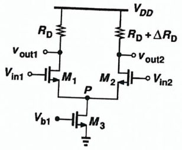

# 기출 2017-1 중간 (D반) 6 — 부하 저항 불일치 ΔR_D가 있는 MOS 차동 증폭기의 입력 CM 최대값, A_CM-DM, CMRR

## 원문
다음 차동증폭기가 아래의 조건으로 동작할 때, 질문에 답하시오.

: $V_{DD} = 1.8\ \text{V}$, $I_D$[판독 불가] $= 2\ \text{mA}$, $(W/L)_{1,2} = 100/0.2$, $(W/L)_3 = 200/0.2$, $R_D = 1\ \text{k}\Omega$, $\Delta R_D = 0.02 \times R_D$, $\mu_n C_{ox} = 100\ \mu\text{A/V}^2$, $\lambda_n = 0.1\ \text{V}^{-1}$, $V_{TH,N} = 0.4\ \text{V}$. 이 때, $r_o \gg R_D$이고 $g_m r_o \gg 1$로 가정한다.

(1) $M_1$에서 입력 common-mode level ($V_{CM}$)의 최대값을 구하시오.

(2) Common-mode to differential-mode 변환 이득($A_{CM-DM}$) 값을 구하시오.

(3) Common-mode rejection ratio (CMRR) 식을 구하시오.

(4) 위에서 구한 식을 이용하여 CMRR 값을 구하시오.

## 조건
- 회로: 그림의 차동 증폭기
- $V_{DD} = 1.8\ \text{V}$
- $I_D$[판독 불가] $= 2\ \text{mA}$ ($I_D$의 아래첨자 D 뒤 글자가 답안지 손글씨 획에 가려 판독 불가)
- 꼬리 트랜지스터 $M_3$의 전류 $I_{D3} = 2\ \text{mA}$로 보임 (원문에 없음, 답안지 손글씨가 그 아래첨자 위에 획을 긋고 아래에 3을 적음)
- $(W/L)_{1,2} = 100/0.2$, $(W/L)_3 = 200/0.2$
- $R_D = 1\ \text{k}\Omega$, $\Delta R_D = 0.02 \times R_D$
- $\mu_n C_{ox} = 100\ \mu\text{A/V}^2$, $\lambda_n = 0.1\ \text{V}^{-1}$, $V_{TH,N} = 0.4\ \text{V}$
- $r_o \gg R_D$, $g_m r_o \gg 1$로 가정
- 바이어스 전압 $V_{b1}$ 값은 주어지지 않음 (원문에 없음)

## 구할 것
- (1) $M_1$에서 정해지는 입력 common-mode level $V_{CM}$의 최대값
- (2) Common-mode to differential-mode 변환 이득 $A_{CM-DM}$ 값
- (3) Common-mode rejection ratio (CMRR)의 식
- (4) (3)의 식으로 CMRR 값

## 회로 — Fig Q6
```spice
RD1  VDD    vout1  {R_D}          ; 인쇄 라벨 R_D
RD2  VDD    vout2  {R_D+ΔR_D}     ; 인쇄 라벨 R_D + ΔR_D
M1   vout1  Vin1   P    nmos
M2   vout2  Vin2   P    nmos      ; 좌우 반전 (게이트 오른쪽)
M3   P      Vb1    0    nmos
```
- 단자: VDD = 1.8 V 전원 (가로 레일) / Vb1 = 이상적 DC 바이어스, 값 미지정 (점 단자) / Vin1, Vin2 = 입력 (개방 원) / vout1, vout2 = 출력 (개방 원)
- 표시: 노드 라벨 V_DD (레일 오른쪽 끝), v_out1 (왼쪽 출력 원 왼쪽), v_out2 (오른쪽 출력 원 오른쪽), V_in1 (왼쪽 입력 원 왼쪽), V_in2 (오른쪽 입력 원 오른쪽), P (P 접속점 위), V_b1 (점 단자 왼쪽) / 소자 라벨 R_D (왼쪽 저항 왼쪽), R_D + ΔR_D (오른쪽 저항 오른쪽), M_1 (M1 오른쪽), M_2 (M2 왼쪽), M_3 (M3 오른쪽) / 부호 없음 / 화살표 없음 / 수치·면적 라벨 없음
- 배치: 맨 위 굵은 가로 레일 V_DD / 왼쪽 세로줄 위→아래 R_D, vout1 접속점, M1 / 오른쪽 세로줄 위→아래 R_D + ΔR_D, vout2 접속점, M2 / vout1 접속점에서 가로선이 왼쪽 v_out1 원, vout2 접속점에서 가로선이 오른쪽 v_out2 원 (두 출력 원이 바깥쪽을 향함) / M1 nmos 보통 방향(게이트 왼쪽, 드레인 위, 소스 아래·화살표 바깥), M2 nmos 좌우 반전(게이트 막대 오른쪽, 드레인 왼쪽 위, 소스 왼쪽 아래·화살표 바깥) / V_in1 원 → 가로선 → M1 게이트, M2 게이트 → 가로선 → V_in2 원 / 두 소스는 아래로 내려가 가로선으로 가운데 P 점에서 만남 / P 아래 M3 (nmos 보통 방향, 게이트 왼쪽), V_b1 점 단자 → 가로선 → M3 게이트, M3 소스 아래 접지 / 접속점 (세 갈래 이상, 3곳): ① vout1 = 위 R_D + 아래 M1 드레인 + 왼쪽 출력선 (점) ② vout2 = 위 R_D + ΔR_D + 아래 M2 드레인 + 오른쪽 출력선 (점) ③ P = 왼쪽 M1 소스 선 + 오른쪽 M2 소스 선 + 아래 M3 드레인 (점) / 교차: 없음


> 참고: 두 출력 라벨의 v는 소문자로 인쇄됨

## 풀이
### DC·소신호 파라미터
- 판독 불가인 아래첨자를 꼬리 $M_3$로 보고 $I_{D3} = 2\ \text{mA}$로 가정한다 ($(W/L)_3$가 $(W/L)_{1,2}$의 2배라 맞는 값)
- $I_{D1} = 1\ \text{mA}$: $g_m = \sqrt{2\mu_n C_{ox}(W/L)_1 I_{D1}} = 10.0\ \text{mS}$
- 꼬리 저항 $R_{SS} = r_{O3} = 1/(\lambda_n I_{D3}) = 5.00\ \text{k}\Omega$
### (1) 입력 CM 최대값
- $M_1$ 드레인 $V_{DD} - R_D I_{D1} = 0.800\ \text{V}$, 포화 $V_{GD} \le V_{TH,N}$: $V_{CM} \le 1.20\ \text{V}$
### (2) $A_{CM-DM}$
- CM 입력의 각 쪽 축퇴 저항은 $2R_{SS}$, 부하만 $\Delta R_D = 20\ \Omega$ 다름: $A_{CM-DM} = \Delta R_D/(1/g_m + 2R_{SS}) = 1.98 \times 10^{-3}$
### (3) CMRR 식
- $P$는 차동 입력에서 가상 접지라 $|A_{DM}| \approx g_m R_D$: $\text{CMRR} = (R_D/\Delta R_D)(1 + 2 g_m R_{SS})$
### (4) CMRR 값
- $\text{CMRR} = 50 \times 101 = 5.05 \times 10^3$ ($74.1\ \text{dB}$)
### 답
- (1) $V_{CM,max} = 1.20\ \text{V}$
- (2) $A_{CM-DM} \approx 1.98 \times 10^{-3}$ ($v_{out1} - v_{out2}$)
- (3) $\text{CMRR} = (R_D/\Delta R_D)(1 + 2 g_m R_{SS})$
- (4) $\text{CMRR} \approx 5.05 \times 10^3$ ($74.1\ \text{dB}$)
