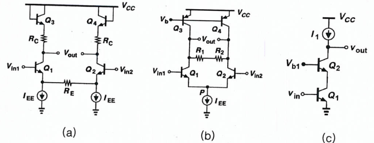

# 기출 2018-2 중간 1 — 다이오드 연결 부하·R_E 축퇴 차동쌍, R_1·R_2가 걸린 pnp 전류원 부하 차동쌍, 바이폴라 캐스코드의 이득

## 원문
다음 회로에 대해 주어진 조건을 이용하여 질문에 답하시오.

: $V_{CC} = 2.5\ \text{V}$, $I_{EE} = I_1 = 0.5\ \text{mA}$, $R_C = 450\ \Omega$, $R_E = 100\ \Omega$, $R_1 = R_2 = 10\ \text{k}\Omega$, $V_T = 25\ \text{mV}$

(1) 회로 (a)의 차동 전압 이득을 구하시오. $V_A = \infty$로 가정한다.

(2) 회로 (b)의 차동 전압 이득을 구하시오. $V_{A,n} = V_{A,p} = 5\ \text{V}$로 가정한다.

(3) 회로 (c)의 전압 이득을 구하시오. $V_{A,n} = V_{A,p} = 5\ \text{V}$, $\beta = 200$으로 가정한다.

## 조건
- 회로: 그림 (a), (b), (c)
- $V_{CC} = 2.5\ \text{V}$
- $I_{EE} = I_1 = 0.5\ \text{mA}$
- $R_C = 450\ \Omega$, $R_E = 100\ \Omega$, $R_1 = R_2 = 10\ \text{k}\Omega$
- $V_T = 25\ \text{mV}$
- (1) 전용 (회로 (a)): $V_A = \infty$로 가정
- (2) 전용 (회로 (b)): $V_{A,n} = V_{A,p} = 5\ \text{V}$로 가정
- (3) 전용 (회로 (c)): $V_{A,n} = V_{A,p} = 5\ \text{V}$, $\beta = 200$으로 가정
- 바이어스 전압 $V_b$, $V_{b1}$ 값은 주어지지 않음 (원문에 없음)

## 구할 것
- (1) 회로 (a)의 차동 전압 이득
- (2) 회로 (b)의 차동 전압 이득
- (3) 회로 (c)의 전압 이득

## 회로 — Fig Q1(a)
```spice
Q3   VCC   VCC   n1   npn    ; 베이스·컬렉터 모두 V_CC 레일 (다이오드 연결)
Q4   VCC   VCC   n2   npn    ; 좌우 반전 (베이스 오른쪽), 베이스·컬렉터 모두 V_CC 레일
RC1  n1    out1  {R_C}       ; 인쇄 라벨 R_C
RC2  n2    out2  {R_C}       ; 인쇄 라벨 R_C
Q1   out1  Vin1  n3   npn
Q2   out2  Vin2  n4   npn    ; 좌우 반전 (베이스 오른쪽)
RE   n3    n4    {R_E}
IEE1 n3    0     {I_EE}      ; 인쇄 라벨 I_EE
IEE2 n4    0     {I_EE}      ; 인쇄 라벨 I_EE
* out1, out2 = 두 출력 원. 원 사이에 V_out 라벨 하나 (차동 출력)
* n1–n4 라벨 없음
```
- 단자: VCC = 2.5 V 전원 (가로 레일) / Vin1, Vin2 = 입력 (개방 원) / out1, out2 = 차동 출력 V_out의 두 단자 (개방 원, 각각에는 라벨 없음)
- 표시: 노드 라벨 V_CC (레일 오른쪽 끝), V_out (두 출력 원 사이), V_in1 (왼쪽 입력 원 왼쪽), V_in2 (오른쪽 입력 원 오른쪽) / 소자 라벨 Q_3 (Q3 오른쪽), Q_4 (Q4 왼쪽), R_C (왼쪽 저항 왼쪽), R_C (오른쪽 저항 오른쪽), Q_1 (Q1 오른쪽), Q_2 (Q2 왼쪽), R_E (가로 저항 아래), I_EE (왼쪽 전류원 왼쪽), I_EE (오른쪽 전류원 오른쪽) / 부호 없음 / 화살표 없음 / 수치·면적 라벨 없음
- 배치: 맨 위 굵은 가로 레일 V_CC / 왼쪽 세로줄 위→아래 Q3, R_C, out1 접속점, Q1, n3 접속점, I_EE 전류원(화살표 아래), 접지 / 오른쪽 세로줄은 좌우 대칭으로 Q4, R_C, out2 접속점, Q2, n4 접속점, I_EE 전류원(화살표 아래), 접지 / Q3 npn 보통 방향(베이스 왼쪽, 컬렉터 오른쪽 위, 이미터 오른쪽 아래·화살표 바깥), 컬렉터에서 세로선이 위로 레일, 베이스에서 가로선이 왼쪽으로 나가 위로 꺾여 레일 / Q4 npn 좌우 반전(베이스 막대 오른쪽, 컬렉터 왼쪽 위, 이미터 왼쪽 아래·화살표 바깥), 컬렉터에서 세로선이 위로 레일, 베이스에서 가로선이 오른쪽으로 나가 위로 꺾여 레일 / Q1 npn 보통 방향(베이스 왼쪽), Q2 npn 좌우 반전(베이스 막대 오른쪽, 컬렉터 왼쪽 위, 이미터 왼쪽 아래·화살표 바깥) / out1 접속점에서 가로선이 오른쪽 출력 원, out2 접속점에서 가로선이 왼쪽 출력 원 (두 원이 가운데에서 마주 보고 그 사이에 V_out) / V_in1 원 → 가로선 → Q1 베이스, Q2 베이스 → 가로선 → V_in2 원 / n3, n4 사이에 가로로 놓인 R_E (이미터 바로 아래 높이) / 접속점 (세 갈래 이상, 4곳): ① out1 = 위 R_C + 아래 Q1 컬렉터 + 오른쪽 출력선 (점) ② out2 = 위 R_C + 아래 Q2 컬렉터 + 왼쪽 출력선 (점) ③ n3 = 위 Q1 이미터 + 아래 I_EE + 오른쪽 R_E (점) ④ n4 = 위 Q2 이미터 + 아래 I_EE + 왼쪽 R_E (점) / 교차: 없음

## 회로 — Fig Q1(b)
```spice
Q3   out1  Vb    VCC  pnp
Q4   out2  Vb    VCC  pnp
R1   out1  n1    {R_1}
R2   n1    out2  {R_2}
Q1   out1  Vin1  P    npn
Q2   out2  Vin2  P    npn    ; 좌우 반전 (베이스 오른쪽)
IEE  P     0     {I_EE}
* out1, out2 = 두 출력 원. 원 사이에 V_out 라벨 하나 (차동 출력)
* n1 = R1과 R2 사이 노드, 라벨 없음
```
- 단자: VCC = 2.5 V 전원 (가로 레일) / Vb = 이상적 DC 바이어스, 값 미지정 (점 단자) / Vin1, Vin2 = 입력 (개방 원) / out1, out2 = 차동 출력 V_out의 두 단자 (개방 원, 각각에는 라벨 없음)
- 표시: 노드 라벨 V_CC (레일 오른쪽 끝), V_b (점 단자 왼쪽), V_out (두 출력 원 사이), V_in1 (왼쪽 입력 원 왼쪽), V_in2 (오른쪽 입력 원 오른쪽), P (P 접속점 아래 왼쪽) / 소자 라벨 Q_3 (Q3 아래 왼쪽), Q_4 (Q4 아래 왼쪽), R_1, R_2 (각 저항 위), Q_1 (Q1 오른쪽), Q_2 (Q2 왼쪽), I_EE (전류원 오른쪽) / 부호 없음 / 화살표 없음 / 수치·면적 라벨 없음
- 배치: 맨 위 굵은 가로 레일 V_CC (왼쪽 끝은 Q3 이미터 조금 왼쪽) / 왼쪽 세로줄 위→아래 Q3, out1 첫 접속점, out1 둘째 접속점, Q1 / 오른쪽 세로줄 위→아래 Q4, out2 첫 접속점, out2 둘째 접속점, Q2 / Q3, Q4 pnp 보통 방향(베이스 막대 왼쪽, 이미터 오른쪽 위·화살표가 막대 쪽으로 들어감, 컬렉터 오른쪽 아래), 두 이미터에서 세로선이 위로 레일 / V_b 점 단자 → 가로선 → Q3 베이스, 같은 높이의 가로선이 Q3 베이스 막대에서 오른쪽으로 이어져 Q4 베이스까지 감 (Q3, Q4 베이스 공통선, Q3 이미터·컬렉터 선과는 만나지 않음) / out1 첫 접속점에서 가로선이 오른쪽 출력 원, out2 첫 접속점에서 가로선이 왼쪽 출력 원 (두 원이 가운데에서 마주 보고 그 사이에 V_out) / 두 둘째 접속점 사이에 가로로 R_1, R_2가 이어져 놓임 (Q1, Q2 컬렉터 바로 위 높이, 왼쪽 R_1) / Q1 npn 보통 방향(베이스 왼쪽, 컬렉터 위, 이미터 아래·화살표 바깥), Q2 npn 좌우 반전(베이스 막대 오른쪽, 컬렉터 왼쪽 위, 이미터 왼쪽 아래·화살표 바깥) / V_in1 원 → 가로선 → Q1 베이스, Q2 베이스 → 가로선 → V_in2 원 / 두 이미터는 아래로 내려가 가로선으로 가운데 P 점에서 만남, P에서 아래로 I_EE(화살표 아래), 그 아래 접지 / 접속점 (세 갈래 이상, 5곳): ① out1 첫 = 위 Q3 컬렉터 + 아래 세로선 + 오른쪽 출력선 (점) ② out1 둘째 = 위 세로선 + 아래 Q1 컬렉터 + 오른쪽 R_1 (점) ③ out2 첫 = 위 Q4 컬렉터 + 아래 세로선 + 왼쪽 출력선 (점) ④ out2 둘째 = 위 세로선 + 아래 Q2 컬렉터 + 왼쪽 R_2 (점) ⑤ P = 왼쪽 Q1 이미터 선 + 오른쪽 Q2 이미터 선 + 아래 I_EE (점) / 교차: 없음

## 회로 — Fig Q1(c)
```spice
I1   VCC   vout  {I_1}
Q2   vout  Vb1   n1   npn
Q1   n1    vin   0    npn
* n1 = Q2 이미터, Q1 컬렉터 노드, 라벨 없음
```
- 단자: VCC = 2.5 V 전원 (T 전원 기호) / Vb1 = 이상적 DC 바이어스, 값 미지정 (점 단자) / vin = 소신호 입력 (개방 원) / vout = 출력 (개방 원)
- 표시: 노드 라벨 V_CC (T 기호 오른쪽), v_out (출력 원 오른쪽), V_b1 (점 단자 왼쪽), v_in (입력 원 왼쪽) / 소자 라벨 I_1 (전류원 왼쪽), Q_2 (Q2 오른쪽), Q_1 (Q1 오른쪽) / 부호 없음 / 화살표 없음 / 수치·면적 라벨 없음
- 배치: 세로줄 하나 위→아래 V_CC T 기호, I_1 전류원(화살표 아래), vout 접속점, Q2, Q1, 접지 / Q2, Q1 npn 보통 방향(베이스 왼쪽, 컬렉터 위, 이미터 아래·화살표 바깥) / Q2 이미터에서 곧은 세로선이 Q1 컬렉터로 (n1) / vout 접속점에서 가로선이 오른쪽 v_out 원 / V_b1 점 단자 → 가로선 → Q2 베이스, v_in 원 → 가로선 → Q1 베이스 / Q1 이미터 아래 접지 / 접속점 (세 갈래 이상, 1곳): ① vout = 위 I_1 + 아래 Q2 컬렉터 + 오른쪽 출력선 (점) / 교차: 없음


> 참고: 크롭 안에는 손글씨가 없음. 출력·입력 라벨 v_out, v_in은 (c)에서만 소문자 v로 인쇄됨

## 힌트
### (1) $R_E$ 가운데는 AC 접지
- 차동 입력에서는 두 이미터가 크기는 같고 방향은 반대로 움직이므로, $R_E$의 가운데 점 전압은 변하지 않는다
- 그래서 절반 회로의 이미터에는 $R_E$의 절반만 달린다
### (2) $R_1$·$R_2$ 사이 노드는 AC 접지
- $R_1 = R_2$이고 두 출력이 크기는 같고 방향은 반대로 움직이므로, 가운데 노드 전압은 변하지 않는다
- 그래서 절반 회로의 출력 노드에는 $R_1$이 AC 접지로 달린다

## 풀이
### (1) 절반 회로와 차동 이득
- 균형에서 $R_E$에 DC 전류가 없어 $Q_1$, $Q_3$는 $I_{EE} = 0.5\ \text{mA}$: $g_m = I_{EE}/V_T = 20.0\ \text{mS}$
- $R_E$ 가운데 점은 차동 입력에서 움직이지 않아 AC 접지이므로, 절반 회로 이미터에는 $R_E/2$가 달린다
- 다이오드 연결 $Q_3$는 이미터에서 $1/g_{m3}$로 보인다($V_A = \infty$, $\beta$가 없어 $\alpha \approx 1$)
- 이득을 (왼쪽 − 오른쪽 출력)/$(V_{in1} - V_{in2})$로 잡으면 $A_v = -(R_C + 1/g_{m3})/(1/g_{m1} + R_E/2) = -5.00$
### (2) 차동 이득
- 대칭이라 $Q_1$–$Q_4$는 $I_C = 0.25\ \text{mA}$: $g_{m1} = I_C/V_T = 10.0\ \text{mS}$, $Q_1$, $Q_3$의 $r_O = V_A/I_C = 20.0\ \text{k}\Omega$
- 두 출력이 반대로 움직여 $R_1$·$R_2$ 사이는 AC 접지이므로, 절반 회로 출력에 $R_1$이 달린다
- $A_v = -g_{m1}(r_{O1} \parallel r_{O3} \parallel R_1) = -10.0\ \text{mS} \times 5.00\ \text{k}\Omega = -50.0$
### (3) 캐스코드 이득
- $I_1 = 0.5\ \text{mA}$: $g_{m1} = g_{m2} = 20.0\ \text{mS}$, $r_{\pi 2} = \beta/g_{m2} = 10.0\ \text{k}\Omega$, $Q_1$, $Q_2$의 $r_O = V_{A,n}/I_1 = 10.0\ \text{k}\Omega$
- $g_{m2}(r_{O1} \parallel r_{\pi 2}) = 100 \gg 1$: $R_{out} \approx g_{m2} r_{O2}(r_{O1} \parallel r_{\pi 2}) = 1.00\ \text{M}\Omega$
- $I_1$이 이상적이라 $A_v = -g_{m1} R_{out} = -2.00 \times 10^4$
### 답
- (1) $A_v = -5.00$
- (2) $A_v = -50.0$
- (3) $A_v \approx -2.00 \times 10^4$
