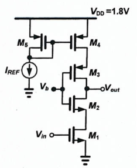

# 기출 2018-2 중간 2 — M5–M4 전류 거울로 바이어스한 pmos 캐스코드 전류원 부하의 MOS 캐스코드 증폭기

## 원문
다음 회로에 대해 주어진 조건을 이용하여 질문에 답하시오.

$(W/L)_{1,2} = 100/0.2$, $(W/L)_{3,4} = 200/0.2$, $(W/L)_5 = 20/0.2$, $I_{REF} = 100\ \mu\text{A}$, $\mu_n C_{ox} = 100\ \mu\text{A/V}^2$, $\mu_p C_{ox} = 50\ \mu\text{A/V}^2$, $V_{TH,N} = 0.4\ \text{V}$, $V_{TH,P} = -0.4\ \text{V}$, $\lambda_n = 0.1\ \text{V}^{-1}$, $\lambda_p = 0.1\ \text{V}^{-1}$

(1) 전압 바이어스 대신에 current mirror를 이용한 바이어스 회로를 사용하는 이유를 설명하시오. 그리고, cascode current source를 사용하는 이유를 설명하시오.

(2) $M_1$과 $M_4$가 saturation 영역에서 동작하기 위한 DC 바이어스 전압 $V_b$의 최소값과 최대값을 각각 구하시오.

(3) 전압 이득을 구하시오.

## 조건
- 회로: 그림의 MOS 캐스코드 증폭기 ($M_5$–$M_4$ 전류 거울, $M_4$–$M_3$ pmos 캐스코드 전류원 부하) (괄호 안은 원문에 없음)
- $V_{DD} = 1.8\ \text{V}$ (문장에는 없고 그림의 $V_{DD}$ 라벨에 인쇄됨)
- $(W/L)_{1,2} = 100/0.2$, $(W/L)_{3,4} = 200/0.2$, $(W/L)_5 = 20/0.2$
- $I_{REF} = 100\ \mu\text{A}$
- $\mu_n C_{ox} = 100\ \mu\text{A/V}^2$, $\mu_p C_{ox} = 50\ \mu\text{A/V}^2$
- $V_{TH,N} = 0.4\ \text{V}$, $V_{TH,P} = -0.4\ \text{V}$
- $\lambda_n = 0.1\ \text{V}^{-1}$, $\lambda_p = 0.1\ \text{V}^{-1}$
- (1)은 회로 값을 쓰지 않는 서술형 소문항 (원문에 없음)
- $M_3$, $M_2$ 게이트는 같은 바이어스 $V_b$에 이어짐. $V_{in}$의 DC 레벨은 주어지지 않음 (원문에 없음)

## 구할 것
- (1) 전압 바이어스 대신 current mirror를 이용한 바이어스 회로를 사용하는 이유를 설명. 그리고 cascode current source를 사용하는 이유를 설명
- (2) $M_1$과 $M_4$가 saturation 영역에서 동작하기 위한 DC 바이어스 전압 $V_b$의 최소값과 최대값
- (3) 전압 이득

## 회로 — Fig Q2
```spice
IREF  n1    0     {I_REF}
M5    n1    n1    VDD  pmos   ; 좌우 반전 (게이트 오른쪽), 다이오드 연결
M4    n2    n1    VDD  pmos
M3    Vout  Vb    n2   pmos
M2    Vout  Vb    n3   nmos
M1    n3    Vin   0    nmos
* n1 = M5 드레인·게이트와 M4 게이트 노드, 라벨 없음
* n2, n3 라벨 없음
```
- 단자: VDD = 1.8 V 전원 (가로 레일) / Vb = DC 바이어스, 값은 (2)에서 범위를 구함 (점 단자) / Vin = 입력 (개방 원) / Vout = 출력 (개방 원)
- 표시: 노드 라벨 V_DD (레일 오른쪽 끝 위), V_b (점 단자 왼쪽), V_out (출력 원 오른쪽), V_in (입력 원 왼쪽) / 소자 라벨 M_5 (M5 왼쪽), M_4, M_3, M_2, M_1 (각 트랜지스터 오른쪽), I_REF (전류원 왼쪽) / 부호 없음 / 화살표 없음 / 수치·면적 라벨 "=1.8V" (V_DD 라벨 바로 뒤, 레일 오른쪽 끝 위)
- 배치: 맨 위 굵은 가로 레일 V_DD / 왼쪽 위 M5 pmos 좌우 반전(게이트 막대 오른쪽, 소스 왼쪽 위·화살표가 채널 쪽으로 들어감, 드레인 왼쪽 아래), 소스에서 세로선이 위로 레일 / M5 아래 왼쪽 세로줄 위→아래 n1 접속점, I_REF 전류원(화살표 아래), 접지 / 오른쪽 세로줄 위→아래 M4, M3, Vout 접속점, M2, M1, 접지 / M4, M3 pmos 보통 방향(게이트 왼쪽, 소스 오른쪽 위·화살표가 채널 쪽으로 들어감, 드레인 오른쪽 아래), M4 소스에서 세로선이 위로 레일 / M4 드레인에서 곧은 세로선이 M3 소스로 (n2) / M2, M1 nmos 보통 방향(게이트 왼쪽, 드레인 위, 소스 아래·화살표 바깥), M2 소스에서 곧은 세로선이 M1 드레인으로 (n3) / M5 게이트와 M4 게이트는 게이트 높이의 가로선으로 이어지고, M5 게이트 바로 오른쪽 게이트 접속점에서 세로선이 아래로 내려가 n1 높이에서 왼쪽으로 꺾여 n1 접속점 (다이오드 연결) / V_b 점 단자 → 짧은 가로선 → Vb 접속점, 거기서 세로선이 위로 올라가 오른쪽으로 꺾여 M3 게이트, 아래로 내려가 오른쪽으로 꺾여 M2 게이트 / Vout 접속점에서 가로선이 오른쪽 V_out 원 / V_in 원 → 가로선 → M1 게이트 / M1 소스 아래 접지 / 접속점 (세 갈래 이상, 4곳): ① 게이트 접속점 = 왼쪽 M5 게이트 + 오른쪽 M4 게이트 + 아래 다이오드 연결선 (점) ② n1 = 위 M5 드레인 + 아래 I_REF + 오른쪽 다이오드 연결선 (점) ③ Vb 접속점 = 왼쪽 V_b 점 단자 선 + 위 M3 게이트 선 + 아래 M2 게이트 선 (점) ④ Vout = 위 M3 드레인 + 아래 M2 드레인 + 오른쪽 출력선 (점) / 교차: 없음


> 참고: 크롭 안에는 손글씨가 없음

## 힌트
### (2) $M_2$·$M_3$ 소스는 $V_b$를 따라감
- 가지 전류가 정해져 있으므로 $M_2$, $M_3$의 $|V_{GS}|$도 정해지고, 두 소스는 $V_b$에서 그만큼 내려가거나 올라간 전압에 놓인다
- 그래서 $M_1$ 드레인과 $M_4$ 드레인 전압이 모두 $V_b$ 하나로 정해진다

## 풀이
### (1) 거울과 캐스코드 전류원
- 전압 바이어스 전류는 전원 전압, 공정($V_{TH}$), 온도에 민감하다. 거울은 기준 전류를 $W/L$ 비로 복사해 둔감하다
- 캐스코드 전류원은 출력 저항이 커서 이상적 전류원에 가깝고 증폭기의 높은 이득을 살린다
### (2) $V_b$의 범위
- $\lambda$ 무시: $I_D = 10 I_{REF} = 1.00\ \text{mA}$, $V_{ov1} = |V_{ov4}| = 0.200\ \text{V}$, $V_{GS2} = V_{SG3} = 0.600\ \text{V}$
- 전류가 정해져 $M_1$ 드레인은 $V_b - V_{GS2}$, $M_4$ 드레인은 $V_b + V_{SG3}$
- $M_1$: $V_b - V_{GS2} \ge V_{ov1}$ → $V_{b,min} = 0.800\ \text{V}$. $M_4$: $V_{DD} - V_b - V_{SG3} \ge |V_{ov4}|$ → $V_{b,max} = 1.00\ \text{V}$
### (3) 전압 이득
- $g_m = 2I_D/V_{ov} = 10.0\ \text{mS}$, $r_O = 1/(\lambda I_D) = 10.0\ \text{k}\Omega$ (모든 소자 같음), $g_m r_O = 100 \gg 1$
- 몸체 효과 무시: 아래 캐스코드 $R_n \approx g_{m2} r_{O2} r_{O1}$, 위 캐스코드 $R_p \approx g_{m3} r_{O3} r_{O4}$, 둘 다 $1.00\ \text{M}\Omega$
- $A_v = -g_{m1}(R_n \parallel R_p) = -10.0\ \text{mS} \times 500\ \text{k}\Omega = -5.00 \times 10^3$
### 답
- (1) 전류 거울은 전원 전압·공정·온도 변동에 둔감한 바이어스 전류를 주고, 캐스코드 전류원은 큰 출력 저항으로 높은 이득을 살린다
- (2) $V_{b,min} = 0.800\ \text{V}$, $V_{b,max} = 1.00\ \text{V}$
- (3) $A_v \approx -5.00 \times 10^3$
