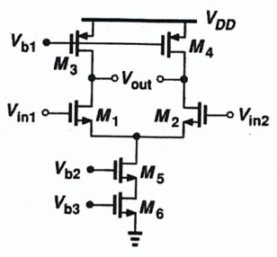

# 기출 2018-2 중간 3 — pmos 전류원 부하와 캐스코드 테일을 가진 MOS 차동 증폭기의 차동 이득과 A_CM

## 원문
다음 회로에 대해 주어진 조건을 이용하여 질문에 답하시오.

: $V_{DD} = 1.8\ \text{V}$, $I_{D5} = I_{D6} = 1\ \text{mA}$, $(W/L)_{1,2} = 200/0.2$, $(W/L)_{3,4} = 400/0.2$, $(W/L)_{5,6} = 400/0.2$, $\mu_n C_{ox} = 100\ \mu\text{A/V}^2$, $\mu_p C_{ox} = 50\ \mu\text{A/V}^2$, $\lambda_n = \lambda_p = 0.1\ \text{V}^{-1}$. 이 때, $g_m r_o \gg 1$로 가정한다.

(1) 차동 전압 이득을 구하시오.

(2) Common-mode 이득($A_{CM} = \Delta V_{out,CM}/\Delta V_{in,CM}$)을 구하시오.

## 조건
- 회로: 그림의 MOS 차동 증폭기 (pmos 전류원 부하 $M_3$, $M_4$, 캐스코드 테일 전류원 $M_5$, $M_6$) (괄호 안은 원문에 없음)
- $V_{DD} = 1.8\ \text{V}$
- $I_{D5} = I_{D6} = 1\ \text{mA}$
- $(W/L)_{1,2} = 200/0.2$, $(W/L)_{3,4} = 400/0.2$, $(W/L)_{5,6} = 400/0.2$
- $\mu_n C_{ox} = 100\ \mu\text{A/V}^2$, $\mu_p C_{ox} = 50\ \mu\text{A/V}^2$
- $\lambda_n = \lambda_p = 0.1\ \text{V}^{-1}$
- $g_m r_o \gg 1$로 가정
- 바이어스 전압 $V_{b1}$–$V_{b3}$ 값은 주어지지 않음 (원문에 없음)

## 구할 것
- (1) 차동 전압 이득
- (2) Common-mode 이득 $A_{CM} = \Delta V_{out,CM}/\Delta V_{in,CM}$

## 회로 — Fig Q3
```spice
M3  out1  Vb1   VDD  pmos
M4  out2  Vb1   VDD  pmos
M1  out1  Vin1  n1   nmos
M2  out2  Vin2  n1   nmos    ; 좌우 반전 (게이트 오른쪽)
M5  n1    Vb2   n2   nmos
M6  n2    Vb3   0    nmos
* out1, out2 = 두 출력 원. 원 사이에 V_out 라벨 하나 (차동 출력)
* n1 = 공통 소스(테일) 노드, 라벨 없음
```
- 단자: VDD = 1.8 V 전원 (가로 레일) / Vb1, Vb2, Vb3 = 이상적 DC 바이어스, 값 미지정 (점 단자) / Vin1, Vin2 = 입력 (개방 원) / out1, out2 = 차동 출력 V_out의 두 단자 (개방 원, 각각에는 라벨 없음)
- 표시: 노드 라벨 V_DD (레일 오른쪽 끝), V_b1 (점 단자 왼쪽), V_out (두 출력 원 사이), V_in1 (왼쪽 입력 원 왼쪽), V_in2 (오른쪽 입력 원 오른쪽), V_b2, V_b3 (각 점 단자 왼쪽) / 소자 라벨 M_3 (M3 아래 왼쪽, 드레인 선 왼쪽), M_4 (M4 오른쪽), M_1 (M1 오른쪽), M_2 (M2 왼쪽), M_5, M_6 (각 트랜지스터 오른쪽) / 부호 없음 / 화살표 없음 / 수치·면적 라벨 없음
- 배치: 맨 위 굵은 가로 레일 V_DD (왼쪽 끝은 M3 소스 조금 왼쪽) / 왼쪽 세로줄 위→아래 M3, out1 접속점, M1 / 오른쪽 세로줄 위→아래 M4, out2 접속점, M2 / M3, M4 pmos 보통 방향(게이트 왼쪽, 소스 오른쪽 위·화살표가 채널 쪽으로 들어감, 드레인 오른쪽 아래), 소스에서 세로선이 위로 레일 / V_b1 점 단자 → 가로선 → M3 게이트, 같은 높이의 가로선이 M3 기호 오른쪽(채널 막대)에서 이어져 오른쪽 M4 게이트까지 감 (M3, M4 게이트 공통선, M3 소스·드레인 선과는 만나지 않음) / out1 접속점에서 가로선이 오른쪽 출력 원, out2 접속점에서 가로선이 왼쪽 출력 원 (두 원이 가운데에서 마주 보고 그 사이에 V_out) / M1 nmos 보통 방향(게이트 왼쪽, 드레인 위, 소스 아래·화살표 바깥), M2 nmos 좌우 반전(게이트 막대 오른쪽, 드레인 왼쪽 위, 소스 왼쪽 아래·화살표 바깥) / V_in1 원 → 가로선 → M1 게이트, M2 게이트 → 가로선 → V_in2 원 / 두 소스는 아래로 내려가 가로선으로 가운데 n1 점에서 만남 / n1 아래 가운데 세로줄 위→아래 M5, M6, 접지 (M5, M6 nmos 보통 방향, 게이트 왼쪽) / M5 소스에서 곧은 세로선이 M6 드레인으로 (n2, 라벨 없음) / V_b2, V_b3 점 단자 → 가로선 → 각 게이트 / 접속점 (세 갈래 이상, 3곳): ① out1 = 위 M3 드레인 + 아래 M1 드레인 + 오른쪽 출력선 (점) ② out2 = 위 M4 드레인 + 아래 M2 드레인 + 왼쪽 출력선 (점) ③ n1 = 왼쪽 M1 소스 선 + 오른쪽 M2 소스 선 + 아래 M5 드레인 (점) / 교차: 없음


> 참고: 크롭 안에는 손글씨가 없음

## 힌트
### (2) 꼬리를 둘로 쪼갠 CM 반회로
- CM 입력에서는 두 쪽이 똑같이 움직여 가운데를 가로지르는 전류가 없으므로 회로를 반으로 자를 수 있다
- 두 쪽이 꼬리 전류원 하나를 나눠 쓰므로, 반쪽 소스에는 꼬리 출력 저항의 두 배가 달린다. 꼬리가 $M_5$–$M_6$ 캐스코드라 이 저항은 매우 크다

## 풀이
### 소신호 파라미터
- $g_m = \sqrt{2\mu_n C_{ox}(W/L) I_D}$, $r_O = 1/(\lambda I_D)$로 구한다
- $M_1$, $M_3$ ($I_{D5}/2 = 0.5\ \text{mA}$): $g_{m1} = 10.0\ \text{mS}$, $r_{O1} = r_{O3} = 20.0\ \text{k}\Omega$
- $M_5$, $M_6$ ($1\ \text{mA}$): $g_{m5} = 20.0\ \text{mS}$, $r_{O5} = r_{O6} = 10.0\ \text{k}\Omega$
### (1) 차동 이득
- 차동 입력에서 두 소스 전류 변화가 상쇄돼 꼬리 노드는 AC 접지이다
- 이득을 (왼쪽 출력 − 오른쪽 출력)/$(V_{in1} - V_{in2})$로 잡으면 $A_v = -g_{m1}(r_{O1} \parallel r_{O3}) = -100$
### (2) 꼬리 출력 저항
- 꼬리 노드에서 아래로 본 저항 $R_{SS}$: $g_{m5} r_{O6} = 200 \gg 1$이라 $R_{SS} \approx g_{m5} r_{O5} r_{O6} = 2.00\ \text{M}\Omega$
### (2) CM 이득
- CM 입력에서는 두 쪽이 같이 움직여 가운데로 전류가 넘지 않으므로, 반회로는 소스에 $2R_{SS}$가 달린 CS 단이다
- $M_1$ 드레인에서 아래로 본 저항(약 $g_{m1} r_{O1} \cdot 2R_{SS}$)이 $r_{O3}$보다 훨씬 커서 부하는 $r_{O3}$뿐이다
- $A_{CM} = -r_{O3}/(1/g_{m1} + 2R_{SS}) = -5.00 \times 10^{-3}$
### 답
- (1) $A_v = -100$
- (2) $A_{CM} \approx -5.00 \times 10^{-3}$
