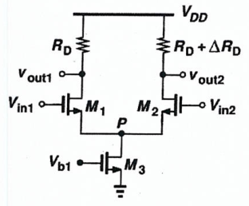

# 기출 2018-2 중간 4 — 부하 저항 불일치 ΔR_D가 있는 MOS 차동 증폭기의 CM 제거 서술형과 A_CM-DM

## 원문
다음 회로에 대해 주어진 조건을 이용하여 질문에 답하시오.

: $V_{DD} = 1.8\ \text{V}$, $I_{D3} = 1\ \text{mA}$, $(W/L)_{1,2} = 200/0.2$, $(W/L)_3 = 400/0.2$, $R_D = 1\ \text{k}\Omega$, $\Delta R_D = 0.02R_D = 20\ \Omega$, $\mu_n C_{ox} = 100\ \mu\text{A/V}^2$, $\lambda_n = 0.1\ \text{V}^{-1}$, $r_o \gg R_D$이고 $g_m r_o \gg 1$로 가정한다.

(1) Differential pair에서 "common-mode (CM) rejection" 특성의 의미를 설명하고, 실제 회로에서 CM rejection 특성이 제한되는 이유 2가지를 설명하시오.

(2) Common-mode input to differential-mode output 이득($A_{CM-DM} = \Delta V_{out}/\Delta V_{in,CM}$)을 구하시오.

## 조건
- 회로: 그림의 차동 증폭기
- $V_{DD} = 1.8\ \text{V}$, $I_{D3} = 1\ \text{mA}$
- $(W/L)_{1,2} = 200/0.2$, $(W/L)_3 = 400/0.2$
- $R_D = 1\ \text{k}\Omega$, $\Delta R_D = 0.02R_D = 20\ \Omega$
- $\mu_n C_{ox} = 100\ \mu\text{A/V}^2$, $\lambda_n = 0.1\ \text{V}^{-1}$
- $r_o \gg R_D$이고 $g_m r_o \gg 1$로 가정
- (1)은 회로 값을 쓰지 않는 서술형 소문항 (원문에 없음)
- 바이어스 전압 $V_{b1}$ 값은 주어지지 않음 (원문에 없음)

## 구할 것
- (1) Differential pair에서 "common-mode (CM) rejection" 특성의 의미를 설명. 그리고 실제 회로에서 CM rejection 특성이 제한되는 이유 2가지를 설명
- (2) Common-mode input to differential-mode output 이득 $A_{CM-DM} = \Delta V_{out}/\Delta V_{in,CM}$

## 회로 — Fig Q4
```spice
RD1  VDD    vout1  {R_D}          ; 인쇄 라벨 R_D
RD2  VDD    vout2  {R_D+ΔR_D}     ; 인쇄 라벨 R_D + ΔR_D
M1   vout1  Vin1   P    nmos
M2   vout2  Vin2   P    nmos      ; 좌우 반전 (게이트 오른쪽)
M3   P      Vb1    0    nmos
```
- 단자: VDD = 1.8 V 전원 (가로 레일) / Vb1 = 이상적 DC 바이어스, 값 미지정 (점 단자) / Vin1, Vin2 = 입력 (개방 원) / vout1, vout2 = 출력 (개방 원)
- 표시: 노드 라벨 V_DD (레일 오른쪽 끝), v_out1 (왼쪽 출력 원 왼쪽), v_out2 (오른쪽 출력 원 오른쪽), V_in1 (왼쪽 입력 원 왼쪽), V_in2 (오른쪽 입력 원 오른쪽), P (P 접속점 위), V_b1 (점 단자 왼쪽) / 소자 라벨 R_D (왼쪽 저항 왼쪽), R_D + ΔR_D (오른쪽 저항 오른쪽), M_1 (M1 오른쪽), M_2 (M2 왼쪽), M_3 (M3 오른쪽) / 부호 없음 / 화살표 없음 / 수치·면적 라벨 없음
- 배치: 맨 위 굵은 가로 레일 V_DD / 왼쪽 세로줄 위→아래 R_D, vout1 접속점, M1 / 오른쪽 세로줄 위→아래 R_D + ΔR_D, vout2 접속점, M2 / vout1 접속점에서 가로선이 왼쪽 v_out1 원, vout2 접속점에서 가로선이 오른쪽 v_out2 원 (두 출력 원이 바깥쪽을 향함) / M1 nmos 보통 방향(게이트 왼쪽, 드레인 위, 소스 아래·화살표 바깥), M2 nmos 좌우 반전(게이트 막대 오른쪽, 드레인 왼쪽 위, 소스 왼쪽 아래·화살표 바깥) / V_in1 원 → 가로선 → M1 게이트, M2 게이트 → 가로선 → V_in2 원 / 두 소스는 아래로 내려가 가로선으로 가운데 P 점에서 만남 / P 아래 M3 (nmos 보통 방향, 게이트 왼쪽), V_b1 점 단자 → 가로선 → M3 게이트, M3 소스 아래 접지 / 접속점 (세 갈래 이상, 3곳): ① vout1 = 위 R_D + 아래 M1 드레인 + 왼쪽 출력선 (점) ② vout2 = 위 R_D + ΔR_D + 아래 M2 드레인 + 오른쪽 출력선 (점) ③ P = 왼쪽 M1 소스 선 + 오른쪽 M2 소스 선 + 아래 M3 드레인 (점) / 교차: 없음


> 참고: 크롭 안에는 손글씨가 없음. 두 출력 라벨의 v는 소문자로 인쇄됨

## 힌트
### (2) 두 쪽 전류 변화는 같다
- $M_1$, $M_2$는 크기가 같고 게이트(CM 입력)와 소스($P$)를 함께 쓰므로, CM 입력에 대한 두 드레인 전류 변화가 같다
- 꼬리 $M_3$의 출력 저항이 유한해 $P$가 따라 움직이므로 이 변화는 0이 아니고, 같은 전류 변화가 서로 다른 부하 저항을 지나며 출력 차이를 만든다

## 풀이
### (1) CM 제거와 그 한계
- 차동 쌍은 두 입력의 차이만 증폭하고, 두 입력에 함께 실린 변화(잡음, 간섭)는 차동 출력에 나타나지 않게 억누른다
- 한계 ① 꼬리 전류원의 출력 저항이 유한해 CM 입력에 따라 $P$와 꼬리 전류가 움직인다
- 한계 ② 두 쪽의 부하 저항이나 트랜지스터($g_m$, $V_{TH}$)가 어긋나 그 CM 변화가 차동 출력으로 바뀐다
### (2) 소신호 파라미터
- $M_1$, $M_2$ ($I_{D3}/2 = 0.5\ \text{mA}$): $g_m = \sqrt{2\mu_n C_{ox}(W/L)_{1}(I_{D3}/2)} = 10.0\ \text{mS}$
- $P$에서 아래로 본 저항 $R_{SS} = r_{O3} = 1/(\lambda_n I_{D3}) = 10.0\ \text{k}\Omega$
### (2) CM 입력에서 차동 출력
- $M_1$, $M_2$는 같은 게이트·소스 전압을 받아 전류 변화가 같고, 반회로는 소스에 $2R_{SS}$가 달린 CS 단이다($r_o \gg R_D$라 $r_{O1}$, $r_{O2}$ 무시): $\Delta I_D = \Delta V_{in,CM}/(1/g_m + 2R_{SS})$
- $\Delta V_{out} = \Delta v_{out1} - \Delta v_{out2} = \Delta I_D \cdot \Delta R_D$
- $A_{CM-DM} = \Delta R_D/(1/g_m + 2R_{SS}) = 20\ \Omega/20.1\ \text{k}\Omega = 9.95 \times 10^{-4}$
### 답
- (1) CM 제거는 두 입력에 함께 실린 변화를 차동 출력에서 억누르는 성질이다. 꼬리 전류원의 출력 저항이 유한하고 두 쪽(부하, 트랜지스터)이 어긋나 있어 제한된다
- (2) $A_{CM-DM} \approx 9.95 \times 10^{-4}$ ($\Delta V_{out} = v_{out1} - v_{out2}$ 기준)
