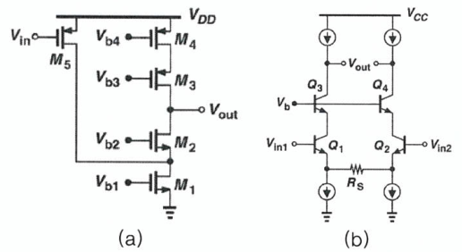

# 기출 2019-1 중간 1 — 폴디드 캐스코드와 R_S 축퇴 바이폴라 캐스코드 차동 증폭기의 출력 저항·이득 식

## 원문
다음 회로에 대해 질문에 답하시오. $g_m r_o \gg 1$로 가정한다.

(1) 회로 (a)의 출력 저항과 전압 이득의 식을 각각 구하시오.

(2) 차동 증폭기 회로 (b)의 출력 저항과 전압 이득의 식을 각각 구하시오.

## 조건
- 회로: 그림 (a), (b)
- $g_m r_o \gg 1$로 가정
- 수치는 주어지지 않음. 답은 소자 파라미터($g_m$, $r_o$, $r_\pi$, $R_S$ 등)의 식으로 나타냄 (원문에 없음)
- 바이어스 전압 $V_{b1}$–$V_{b4}$, $V_b$와 $V_{DD}$, $V_{CC}$ 값, (b)의 네 전류원 값은 주어지지 않음 (원문에 없음)

## 구할 것
- (1) 회로 (a)의 출력 저항과 전압 이득의 식
- (2) 차동 증폭기 회로 (b)의 출력 저항과 전압 이득의 식

## 회로 — Fig Q1(a)
```spice
M5  n1    Vin  VDD  pmos
M4  n2    Vb4  VDD  pmos
M3  Vout  Vb3  n2   pmos
M2  Vout  Vb2  n1   nmos
M1  n1    Vb1  0    nmos
* n1 = M2 소스, M1 드레인, M5 드레인이 만나는 노드, 라벨 없음
```
- 단자: VDD = 전원, 값 미지정 (가로 레일) / Vb4, Vb3, Vb2, Vb1 = 이상적 DC 바이어스, 값 미지정 (점 단자) / Vin = 입력 (개방 원) / Vout = 출력 (개방 원)
- 표시: 노드 라벨 V_DD (레일 오른쪽 끝), V_in (입력 원 왼쪽), V_b4, V_b3, V_b2, V_b1 (각 점 단자 왼쪽), V_out (출력 원 오른쪽) / 소자 라벨 M_5 (M5 아래, 드레인 선 왼쪽), M_4, M_3, M_2, M_1 (각 트랜지스터 오른쪽) / 부호 없음 / 화살표 없음 / 수치·면적 라벨 없음
- 배치: 맨 위 굵은 가로 레일 V_DD / M5는 왼쪽 위, pmos 보통 방향(게이트 왼쪽, 소스 위·화살표가 채널 쪽으로 들어감, 드레인 아래), 소스에서 세로선이 위로 레일 / 오른쪽 세로줄 위→아래 M4, M3, Vout 접속점, M2, n1 접속점, M1, 접지 / M4, M3 pmos 보통 방향(게이트 왼쪽, 소스 위·화살표가 채널 쪽으로 들어감, 드레인 아래), M4 소스에서 세로선이 위로 레일 / M4 드레인에서 곧은 세로선이 M3 소스로 (n2, 라벨 없음) / M2, M1 nmos 보통 방향(게이트 왼쪽, 드레인 위, 소스 아래·화살표 바깥) / M5 드레인에서 긴 세로선이 n1 높이까지 내려가 모서리에서 오른쪽으로 꺾여 n1 접속점 / Vout 접속점에서 가로선이 오른쪽 V_out 원 / 각 점 단자 → 가로선 → 각 게이트, V_in 원 → 가로선 → M5 게이트 / M1 소스 아래 접지 / 접속점 (세 갈래 이상, 2곳): ① Vout = 위 M3 드레인 + 아래 M2 드레인 + 오른쪽 V_out 선 (점) ② n1 = 위 M2 소스 + 아래 M1 드레인 + 왼쪽 M5 드레인 가로선 (점) / 교차: 없음

## 회로 — Fig Q1(b)
```spice
I1  VCC   out1   ; 라벨·값 없음
I2  VCC   out2   ; 라벨·값 없음
Q3  out1  Vb    n1   npn
Q4  out2  Vb    n2   npn
Q1  n1    Vin1  n3   npn
Q2  n2    Vin2  n4   npn    ; 좌우 반전 (베이스 오른쪽)
RS  n3    n4    {R_S}
I3  n3    0      ; 라벨·값 없음
I4  n4    0      ; 라벨·값 없음
* out1, out2 = 두 출력 원. 원 사이에 V_out 라벨 하나 (차동 출력)
```
- 단자: VCC = 전원, 값 미지정 (가로 레일) / Vb = 이상적 DC 바이어스, 값 미지정 (점 단자) / Vin1, Vin2 = 입력 (개방 원) / out1, out2 = 차동 출력 V_out의 두 단자 (개방 원, 각각에는 라벨 없음)
- 표시: 노드 라벨 V_CC (레일 오른쪽 끝), V_out (두 출력 원 사이), V_b (점 단자 왼쪽), V_in1 (왼쪽 입력 원 왼쪽), V_in2 (오른쪽 입력 원 오른쪽) / 소자 라벨 Q_3 (Q3 위 왼쪽, 컬렉터 선 왼쪽), Q_4 (Q4 위 왼쪽, 컬렉터 선 왼쪽), Q_1 (Q1 오른쪽), Q_2 (Q2 왼쪽), R_S (가로 저항 아래), I1–I4 (라벨 없음) / 부호 없음 / 화살표 없음 / 수치·면적 라벨 없음
- 배치: 맨 위 굵은 가로 레일 V_CC / 왼쪽 세로줄 위→아래 전류원(화살표 아래), out1 접속점, Q3, Q1, n3 접속점, 전류원(화살표 아래), 접지 / 오른쪽 세로줄 위→아래 전류원(화살표 아래), out2 접속점, Q4, Q2, n4 접속점, 전류원(화살표 아래), 접지 / Q3, Q4, Q1 npn 보통 방향(베이스 왼쪽, 컬렉터 위, 이미터 아래·화살표 바깥) / Q2 npn 좌우 반전(베이스 막대 오른쪽, 컬렉터 왼쪽 위, 이미터 왼쪽 아래·화살표 바깥) / Q3 이미터에서 곧은 세로선이 Q1 컬렉터로 (n1, 라벨 없음), Q4 이미터에서 세로선이 Q2 컬렉터로 (n2, 라벨 없음) / out1 접속점에서 가로선이 오른쪽 출력 원, out2 접속점에서 가로선이 왼쪽 출력 원 (두 원이 가운데에서 마주 보고 그 사이에 V_out) / V_b 점 단자 → 가로선 → Q3 베이스, 같은 높이의 가로선이 Q3 베이스 막대에서 이어져 오른쪽 Q4 베이스까지 감 (Q3, Q4 베이스 공통선) / V_in1 원 → 가로선 → Q1 베이스, Q2 베이스 → 가로선 → V_in2 원 / n3, n4 사이에 가로로 놓인 R_S (이미터 바로 아래 높이) / 접속점 (세 갈래 이상, 4곳): ① out1 = 위 전류원 + 아래 Q3 컬렉터 + 오른쪽 출력선 (점) ② out2 = 위 전류원 + 아래 Q4 컬렉터 + 왼쪽 출력선 (점) ③ n3 = 위 Q1 이미터 + 아래 전류원 + 오른쪽 R_S (점) ④ n4 = 위 Q2 이미터 + 아래 전류원 + 왼쪽 R_S (점) / 교차: 없음


> 참고: (b)의 베이스 공통선은 원본에서 Q3 기호의 베이스 막대를 가로질러 그려져 있음 (넷리스트는 Q3, Q4 베이스를 모두 Vb로 둠)

## 힌트
### (1) $M_5$ 전류는 $M_2$로 접힌다
- $M_5$ 드레인은 $M_1$ 드레인과 $M_2$ 소스가 만나는 노드로 들어간다(접힌 캐스코드)
- 출력을 AC 접지로 단락하면 $M_2$ 소스에서 본 저항이 약 $1/g_{m2}$로 작아 $M_5$의 신호 전류가 거의 모두 $M_2$를 지난다
- 출력 저항의 아래쪽은 그 노드에 함께 달린 $M_1$, $M_5$로 축퇴된 $M_2$로 본다
### (2) $R_S$ 가운데는 가상 접지
- 차동 입력에서 두 이미터는 크기가 같고 방향이 반대로 움직이므로 $R_S$의 가운데 점은 소신호 전압이 0이다
- 그래서 반회로에서 $Q_1$ 이미터에는 $R_S$의 절반이 축퇴 저항으로 달리고, 이상적인 전류원은 개방으로 본다

## 풀이
### (1) 출력 저항과 전압 이득
- $g_{mk}$, $r_{Ok}$, $r_{\pi k}$는 $M_k$($Q_k$)의 소신호 파라미터
- $M_2$ 소스 노드에 $M_1$, $M_5$가 병렬이라 $M_2$는 $r_{O1} \parallel r_{O5}$로 축퇴된 캐스코드 (축퇴가 $r_O$ 급이라 1을 뺌). $R_{out}$은 아래 $g_{m2} r_{O2}(r_{O1} \parallel r_{O5})$와 위 $g_{m3} r_{O3} r_{O4}$의 병렬
- 출력 단락: $M_2$ 소스 저항 약 $1/g_{m2}$가 작아 $M_5$ 신호 전류가 거의 모두 $M_2$로 가서 $G_m \approx g_{m5}$. $V_{in}$이 오르면 $M_5$ 전류가 줄어 $V_{out}$이 내려간다: $A_v = -g_{m5} R_{out}$
### (2) 반회로와 출력 저항
- 두 이미터가 반대로 움직여 $R_S$ 가운데는 가상 접지: $Q_1$은 $R_S/2$로 축퇴, 전류원은 이상적이라 개방
- $Q_1$ 컬렉터에서 본 저항 $R_1$은 $[1 + g_{m1}(R_S/2 \parallel r_{\pi 1})] r_{O1}$ ($R_S$ 값이 없어 1을 남김)
- $R_1 \ge r_{O1}$, $g_{m3} r_{\pi 3} = \beta$라 $g_{m3}(R_1 \parallel r_{\pi 3}) \gg 1$: 반회로(한쪽) 출력 $R_{out} \approx g_{m3} r_{O3}(R_1 \parallel r_{\pi 3})$, 두 출력 사이 $2R_{out}$
### (2) 전압 이득
- 반회로 $G_m \approx g_{m1}/(1 + g_{m1} R_S/2)$ ($\beta \gg 1$), $V_{out}$은 $Q_1$ 쪽 − $Q_2$ 쪽: $A_v = -G_m R_{out}$
### 답
- (1) $R_{out} \approx [g_{m2} r_{O2}(r_{O1} \parallel r_{O5})] \parallel (g_{m3} r_{O3} r_{O4})$, $A_v \approx -g_{m5} R_{out}$
- (2) 반회로(한쪽) 출력 $R_{out} \approx g_{m3} r_{O3}\{[1 + g_{m1}(R_S/2 \parallel r_{\pi 1})] r_{O1} \parallel r_{\pi 3}\}$ (두 출력 사이 $2R_{out}$), $A_v \approx -g_{m1} R_{out}/(1 + g_{m1} R_S/2)$
