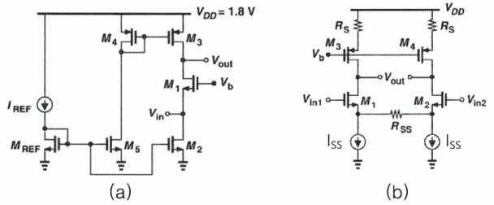

# 기출 2019-1 중간 2 — 전류 거울로 바이어스한 공통 게이트 증폭기와 R_S·R_SS 차동 증폭기의 전압 이득

## 원문
다음 회로에 대해 주어진 조건을 이용하여 질문에 답하시오.

: $V_{DD} = 1.8\ \text{V}$, $(W/L)_{REF} = 10/0.2$, $(W/L)_{1,2} = 100/0.2$, $(W/L)_{3,4} = 200/0.2$, $(W/L)_5 = 100/0.2$, $\mu_n C_{ox} = 100\ \mu\text{A/V}^2$, $\mu_p C_{ox} = 50\ \mu\text{A/V}^2$, $\lambda_n = \lambda_p = 0.1\ \text{V}^{-1}$, $g_m r_o \gg 1$로 가정한다.

(1) 회로 (a)의 전압 이득을 구하시오. $I_{REF} = 100\ \mu\text{A}$이다.

(2) 회로 (b)의 전압 이득을 구하시오. $I_{SS} = 1\ \text{mA}$, $R_S = 0.9\ \text{k}\Omega$, $R_{SS} = 1.8\ \text{k}\Omega$이다.

## 조건
- 회로: 그림 (a), (b)
- $V_{DD} = 1.8\ \text{V}$
- $(W/L)_{REF} = 10/0.2$, $(W/L)_{1,2} = 100/0.2$, $(W/L)_{3,4} = 200/0.2$, $(W/L)_5 = 100/0.2$
- $\mu_n C_{ox} = 100\ \mu\text{A/V}^2$, $\mu_p C_{ox} = 50\ \mu\text{A/V}^2$
- $\lambda_n = \lambda_p = 0.1\ \text{V}^{-1}$
- $g_m r_o \gg 1$로 가정
- (1) 전용 (회로 (a)): $I_{REF} = 100\ \mu\text{A}$
- (2) 전용 (회로 (b)): $I_{SS} = 1\ \text{mA}$ (두 전류원 모두 $I_{SS}$로 인쇄), $R_S = 0.9\ \text{k}\Omega$, $R_{SS} = 1.8\ \text{k}\Omega$
- 바이어스 전압 $V_b$ 값은 (a), (b) 모두 주어지지 않음 (원문에 없음)
- 크기 $(W/L)$는 문제 문장에만 있고 그림에는 인쇄되지 않음. $M_{REF}$, $M_5$는 회로 (a)에만 있음 (원문에 없음)

## 구할 것
- (1) 회로 (a)의 전압 이득
- (2) 회로 (b)의 전압 이득

## 회로 — Fig Q2(a)
```spice
IREF  VDD   n1    {I_REF}
MREF  n1    n1    0    nmos   ; 좌우 반전 (게이트 오른쪽), 다이오드 연결
M5    n2    n1    0    nmos
M4    n2    n2    VDD  pmos   ; 좌우 반전 (게이트 오른쪽), 다이오드 연결
M3    Vout  n2    VDD  pmos
M1    Vout  Vb    Vin  nmos   ; 좌우 반전 (게이트 오른쪽), 소스 = Vin
M2    Vin   n1    0    nmos
* n1 = M_REF 드레인·게이트, M5·M2 게이트 노드, 라벨 없음
* n2 = M4 드레인·게이트, M3 게이트, M5 드레인 노드, 라벨 없음
* (W/L) 값은 문제 문장에만 인쇄됨 (그림에는 없음)
```
- 단자: VDD = 1.8 V 전원 (가로 레일) / Vb = 이상적 DC 바이어스, 값 미지정 (점 단자) / Vin = 입력 (개방 원) / Vout = 출력 (개방 원)
- 표시: 노드 라벨 V_DD = 1.8 V (레일 오른쪽 끝), V_out (출력 원 오른쪽), V_b (점 단자 오른쪽), V_in (입력 원 왼쪽) / 소자 라벨 I_REF (전류원 왼쪽), M_REF (M_REF 왼쪽), M_5 (M5 오른쪽), M_2 (M2 오른쪽), M_4 (M4 왼쪽), M_3 (M3 오른쪽), M_1 (M1 왼쪽, 소스 위) / 부호 없음 / 화살표 없음 / 수치·면적 라벨 "= 1.8 V" (V_DD 라벨 뒤)
- 배치: 맨 위 굵은 가로 레일 V_DD (왼쪽 끝은 I_REF 위) / 왼쪽 세로줄 위→아래 I_REF 전류원(화살표 아래), 위 n1 접속점, M_REF, 접지 / M_REF nmos 좌우 반전(게이트 막대 오른쪽, 드레인 왼쪽 위, 소스 왼쪽 아래·화살표 바깥) / 위 n1 접속점에서 가로선이 오른쪽으로 나가 아래로 꺾여 M_REF 게이트 오른쪽의 게이트 접속점 (다이오드 연결) / 게이트 접속점에서 게이트 높이의 가로선이 오른쪽으로 가다 아래 n1 접속점을 지나 M5 게이트 / 아래 n1 접속점에서 세로선이 M5 접지보다 아래까지 내려가 오른쪽으로 꺾여 M5 밑을 지나고, M2 왼쪽에서 위로 꺾여 M2 게이트 높이에서 오른쪽으로 M2 게이트 / M5 nmos 보통 방향(게이트 왼쪽, 드레인 위, 소스 아래·화살표 바깥), 소스 아래 접지 / M5 드레인에서 긴 세로선이 위로 n2 접속점 / 가운데 위 M4 pmos 좌우 반전(게이트 막대 오른쪽, 소스 왼쪽 위·화살표가 채널 쪽으로 들어감, 드레인 왼쪽 아래), 소스에서 세로선이 위로 레일 / M4 게이트 오른쪽의 게이트 접속점에서 게이트 높이의 가로선이 오른쪽 M3 게이트로, 게이트 접속점에서 세로선이 아래로 내려가 n2 높이에서 왼쪽으로 꺾여 n2 접속점 (다이오드 연결) / 오른쪽 세로줄 위→아래 M3, Vout 접속점, M1, Vin 접속점, M2, 접지 / M3 pmos 보통 방향(게이트 왼쪽, 소스 오른쪽 위·화살표가 채널 쪽으로 들어감, 드레인 아래), 소스에서 세로선이 위로 레일 / M1 nmos 좌우 반전(게이트 막대 오른쪽, 드레인 왼쪽 위, 소스 왼쪽 아래·화살표 바깥), 게이트 → 가로선 → 오른쪽 V_b 점 단자 / Vout 접속점에서 가로선이 오른쪽 V_out 원, V_in 원 → 가로선 → 오른쪽 Vin 접속점 / M2 nmos 보통 방향(게이트 왼쪽), 소스 아래 접지 / 접속점 (세 갈래 이상, 7곳): ① 위 n1 = 위 I_REF + 아래 M_REF 드레인 + 오른쪽 다이오드 연결선 (점) ② M_REF 게이트 접속점 = 왼쪽 M_REF 게이트 + 위 다이오드 연결선 + 오른쪽 게이트 가로선 (점) ③ 아래 n1 = 왼쪽 게이트 가로선 + 오른쪽 M5 게이트 + 아래 M2 게이트로 가는 선 (점) ④ n2 = 위 M4 드레인 + 아래 M5 드레인 선 + 오른쪽 다이오드 연결선 (점) ⑤ M4 게이트 접속점 = 왼쪽 M4 게이트 + 오른쪽 M3 게이트 + 아래 다이오드 연결선 (점) ⑥ Vout = 위 M3 드레인 + 아래 M1 드레인 + 오른쪽 V_out 선 (점) ⑦ Vin = 위 M1 소스 + 아래 M2 드레인 + 왼쪽 V_in 선 (점) / 교차: 없음

## 회로 — Fig Q2(b)
```spice
RS1  VDD   n1    {R_S}    ; 두 저항 모두 R_S로 인쇄
RS2  VDD   n2    {R_S}
M3   out1  Vb    n1   pmos
M4   out2  Vb    n2   pmos
M1   out1  Vin1  n3   nmos
M2   out2  Vin2  n4   nmos    ; 좌우 반전 (게이트 오른쪽)
RSS  n3    n4    {R_SS}
ISS1 n3    0     {I_SS}   ; 두 전류원 모두 I_SS로 인쇄
ISS2 n4    0     {I_SS}
* out1, out2 = 두 출력 원. 원 사이에 V_out 라벨 하나 (차동 출력)
```
- 단자: VDD = 전원 (가로 레일, 그림에는 값 없음, 문제 문장에 1.8 V) / Vb = 이상적 DC 바이어스, 값 미지정 (점 단자) / Vin1, Vin2 = 입력 (개방 원) / out1, out2 = 차동 출력 V_out의 두 단자 (개방 원, 각각에는 라벨 없음)
- 표시: 노드 라벨 V_DD (레일 오른쪽 끝), V_b (점 단자 왼쪽), V_out (두 출력 원 사이), V_in1 (왼쪽 입력 원 왼쪽), V_in2 (오른쪽 입력 원 오른쪽) / 소자 라벨 R_S (왼쪽 저항 왼쪽), R_S (오른쪽 저항 오른쪽), M_3 (M3 게이트 위 왼쪽), M_4 (M4 게이트 위 왼쪽), M_1 (M1 오른쪽), M_2 (M2 왼쪽), R_SS (가로 저항 아래), I_SS (왼쪽 전류원 왼쪽), I_SS (오른쪽 전류원 오른쪽) / 부호 없음 / 화살표 없음 / 수치·면적 라벨 없음
- 배치: 맨 위 굵은 가로 레일 V_DD / 왼쪽 세로줄 위→아래 R_S, M3, out1 접속점, M1, n3 접속점, I_SS, 접지 / 오른쪽 세로줄 위→아래 R_S, M4, out2 접속점, M2, n4 접속점, I_SS, 접지 / M3, M4 pmos 보통 방향(게이트 왼쪽, 소스 위·화살표가 채널 쪽으로 들어감) / M1 nmos 보통 방향(게이트 왼쪽), M2 nmos 좌우 반전(게이트 오른쪽, 드레인 왼쪽 위, 소스 왼쪽 아래·화살표 바깥) / V_b 점 단자 → 가로선 → M3 게이트, 같은 높이의 가로선이 M3 기호 오른쪽(채널 막대)에서 이어져 오른쪽 M4 게이트까지 감 (M3, M4 게이트 공통선) / out1 접속점에서 가로선이 오른쪽 출력 원, out2 접속점에서 가로선이 왼쪽 출력 원 (두 원이 가운데에서 마주 보고 그 사이에 V_out) / V_in1 원 → 가로선 → M1 게이트, M2 게이트 → 가로선 → V_in2 원 / n3, n4 사이에 가로로 놓인 R_SS (소스 높이 바로 아래) / 전류원 화살표는 아래 / 접속점 (세 갈래 이상, 4곳): ① out1 = 위 M3 드레인 + 아래 M1 드레인 + 오른쪽 출력선 (점) ② out2 = 위 M4 드레인 + 아래 M2 드레인 + 왼쪽 출력선 (점) ③ n3 = 위 M1 소스 + 아래 I_SS + 오른쪽 R_SS (점) ④ n4 = 위 M2 소스 + 아래 I_SS + 왼쪽 R_SS (점) / 교차: 없음


> 참고: (b)의 게이트 공통선은 원본에서 M3 기호의 채널 막대를 가로질러 그려져 있음 (넷리스트는 M3, M4 게이트를 모두 Vb로 둠). 두 I_SS 라벨은 다른 라벨과 글꼴이 다름(곧은 글꼴)

## 힌트
### (2) $R_{SS}$ 가운데는 가상 접지
- 차동 입력에서 두 소스는 크기가 같고 방향이 반대로 움직이므로 $R_{SS}$의 가운데 점은 소신호 전압이 0이다
- 그래서 반회로에서 $M_1$ 소스에는 $R_{SS}$의 절반이 축퇴 저항으로 달리고, 이상적인 $I_{SS}$는 개방으로 본다

## 풀이
### (1) 바이어스와 이득
- $L$이 같고 $\lambda$ 영향을 무시하면 전류는 $W$ 비: $I_{D5} = I_{D2} = 10 I_{REF}$, 곧 $1.00\ \text{mA}$. $M_4$가 받아 같은 크기 $M_3$로 복사하고 $M_1$은 $M_3$와 직렬: $I_{D1} = 1.00\ \text{mA}$
- $g_m = \sqrt{2\mu C_{ox}(W/L) I_D}$, $r_O = 1/(\lambda I_D)$: $g_{m1} = 10.0\ \text{mS}$, $r_{O1} = r_{O3} = 10.0\ \text{k}\Omega$
- $V_{in}$이 $M_1$ 소스에 직접 걸려 $M_2$는 영향이 없고, $M_3$ 게이트는 DC라 부하는 $r_{O3}$. 몸체 효과는 값이 없어 무시: $A_v \approx g_{m1}(r_{O1} \parallel r_{O3}) = 50.0$
### (2) 반회로
- 두 소스가 반대로 움직여 $R_{SS}$ 가운데는 가상 접지: $M_1$은 $R_{SS}/2$로 축퇴, $I_{SS}$는 개방. 게이트가 DC인 $M_3$는 $R_S$로 축퇴된 전류원
- 각 쪽 $1\ \text{mA}$: $g_{m1} = g_{m3} = 10.0\ \text{mS}$, $r_O = 10.0\ \text{k}\Omega$
### (2) 출력 저항과 이득
- $g_{m1} R_{SS}/2 = g_{m3} R_S = 9$라 1을 남긴다: 아래 $(1 + g_{m1} R_{SS}/2) r_{O1}$, 위 $(1 + g_{m3} R_S) r_{O3}$가 모두 $100\ \text{k}\Omega$, 한쪽 출력 $R_h = 50.0\ \text{k}\Omega$
- $G_m = g_{m1}/(1 + g_{m1} R_{SS}/2) = 1.00\ \text{mS}$
- $V_{out}$은 $M_1$ 쪽 − $M_2$ 쪽: $A_v = -G_m R_h = -50.0$
### 답
- (1) $A_v \approx 50.0$
- (2) $A_v \approx -50.0$ ($V_{out}/(V_{in1} - V_{in2})$)
