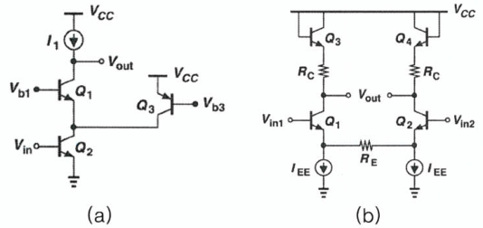

# 기출 2019-1 중간 3 — 전류를 넣는 pnp Q3가 붙은 바이폴라 캐스코드와 다이오드 연결 부하 R_E 축퇴 차동 증폭기의 전압 이득

## 원문
다음 회로에 대해 주어진 조건을 이용하여 질문에 답하시오.

: $V_{CC} = 2.5\ \text{V}$, $V_T = 25\ \text{mV}$, $\beta = 200$, $R_C = 200\ \Omega$, $R_E = 100\ \Omega$, $g_m r_o \gg 1$로 가정한다.

(1) 회로 (a)의 전압 이득을 구하시오. $I_1 = I_{C3} = 0.5\ \text{mA}$, $V_{A,n} = V_{A,p} = 5\ \text{V}$로 가정한다.

(2) 회로 (b)의 차동 전압 이득을 구하시오. $I_{EE} = 0.5\ \text{mA}$, $V_A = \infty$로 가정한다.

## 조건
- 회로: 그림 (a), (b)
- $V_{CC} = 2.5\ \text{V}$, $V_T = 25\ \text{mV}$, $\beta = 200$
- $R_C = 200\ \Omega$, $R_E = 100\ \Omega$
- $g_m r_o \gg 1$로 가정
- (1) 전용 (회로 (a)): $I_1 = I_{C3} = 0.5\ \text{mA}$, $V_{A,n} = V_{A,p} = 5\ \text{V}$
- (2) 전용 (회로 (b)): $I_{EE} = 0.5\ \text{mA}$ (두 전류원 모두 $I_{EE}$로 인쇄), $V_A = \infty$
- 바이어스 전압 $V_{b1}$, $V_{b3}$ 값은 주어지지 않음 (원문에 없음)

## 구할 것
- (1) 회로 (a)의 전압 이득
- (2) 회로 (b)의 차동 전압 이득

## 회로 — Fig Q3(a)
```spice
I1  VCC   Vout  {I_1}
Q1  Vout  Vb1   n1   npn
Q2  n1    Vin   0    npn
Q3  n1    Vb3   VCC  pnp    ; 좌우 반전 (베이스 오른쪽), 컬렉터 = n1
* VCC는 T 전원 기호 두 개 (I1 위, Q3 이미터 위)
```
- 단자: VCC = 2.5 V 전원 (T 전원 기호 2개, 둘 다 V_CC로 인쇄) / Vb1, Vb3 = 이상적 DC 바이어스, 값 미지정 (점 단자) / Vin = 입력 (개방 원) / Vout = 출력 (개방 원)
- 표시: 노드 라벨 V_CC (위 T 기호 오른쪽), V_CC (Q3 위 T 기호 오른쪽), V_out (출력 원 오른쪽), V_b1 (점 단자 왼쪽), V_in (입력 원 왼쪽), V_b3 (점 단자 오른쪽) / 소자 라벨 I_1 (전류원 왼쪽), Q_1, Q_2 (각 트랜지스터 오른쪽), Q_3 (Q3 왼쪽, 컬렉터 옆) / 부호 없음 / 화살표 없음 / 수치·면적 라벨 없음
- 배치: 왼쪽 세로줄 위→아래 VCC T 기호, I_1 전류원(화살표 아래), Vout 접속점, Q1, n1 접속점, Q2, 접지 / Q1, Q2 npn 보통 방향(베이스 왼쪽, 컬렉터 위, 이미터 아래·화살표 바깥) / Vout 접속점에서 가로선이 오른쪽 V_out 원 / Q3은 오른쪽, Q1 높이보다 조금 아래, pnp 좌우 반전(베이스 막대 오른쪽, 이미터 왼쪽 위·화살표가 막대 쪽으로 들어감, 컬렉터 왼쪽 아래) / Q3 이미터에서 세로선이 위로 따로 그린 VCC T 기호 / Q3 베이스 → 가로선 → 오른쪽 V_b3 점 단자 / Q3 컬렉터에서 세로선이 n1 높이까지 내려가 모서리에서 왼쪽으로 꺾여 긴 가로선으로 n1 접속점 / V_b1 점 단자 → 가로선 → Q1 베이스, V_in 원 → 가로선 → Q2 베이스 / Q2 이미터 아래 접지 / 접속점 (세 갈래 이상, 2곳): ① Vout = 위 I_1 + 아래 Q1 컬렉터 + 오른쪽 V_out 가로선 (점) ② n1 = 위 Q1 이미터 + 아래 Q2 컬렉터 + 오른쪽 Q3 컬렉터로 가는 가로선 (점) / 교차: 없음

## 회로 — Fig Q3(b)
```spice
Q3    VCC   VCC   n1   npn    ; 컬렉터·베이스 모두 VCC 레일 (다이오드 연결)
Q4    VCC   VCC   n2   npn    ; 좌우 반전 (베이스 오른쪽), 컬렉터·베이스 모두 VCC 레일
RC1   n1    out1  {R_C}       ; 두 저항 모두 R_C로 인쇄
RC2   n2    out2  {R_C}
Q1    out1  Vin1  n3   npn
Q2    out2  Vin2  n4   npn    ; 좌우 반전 (베이스 오른쪽)
RE    n3    n4    {R_E}
IEE1  n3    0     {I_EE}      ; 두 전류원 모두 I_EE로 인쇄
IEE2  n4    0     {I_EE}
* out1, out2 = 두 출력 원. 원 사이에 V_out 라벨 하나 (차동 출력)
```
- 단자: VCC = 2.5 V 전원 (가로 레일) / Vin1, Vin2 = 입력 (개방 원) / out1, out2 = 차동 출력 V_out의 두 단자 (개방 원, 각각에는 라벨 없음)
- 표시: 노드 라벨 V_CC (레일 오른쪽 끝), V_out (두 출력 원 사이), V_in1 (왼쪽 입력 원 왼쪽), V_in2 (오른쪽 입력 원 오른쪽) / 소자 라벨 Q_3 (Q3 오른쪽), Q_4 (Q4 왼쪽), R_C (왼쪽 저항 왼쪽), R_C (오른쪽 저항 오른쪽), Q_1 (Q1 오른쪽), Q_2 (Q2 왼쪽), R_E (가로 저항 아래), I_EE (왼쪽 전류원 왼쪽), I_EE (오른쪽 전류원 오른쪽) / 부호 없음 / 화살표 없음 / 수치·면적 라벨 없음
- 배치: 맨 위 굵은 가로 레일 V_CC / 왼쪽 세로줄 위→아래 Q3, R_C, out1 접속점, Q1, n3 접속점, I_EE(화살표 아래), 접지 / 오른쪽 세로줄 위→아래 Q4, R_C, out2 접속점, Q2, n4 접속점, I_EE(화살표 아래), 접지 / Q3 npn 보통 방향(베이스 왼쪽, 컬렉터 위, 이미터 아래·화살표 바깥), 컬렉터에서 세로선이 위로 레일, 베이스에서 가로선이 왼쪽으로 나가 위로 꺾여 레일 / Q4 npn 좌우 반전(베이스 막대 오른쪽, 컬렉터 왼쪽 위, 이미터 왼쪽 아래·화살표 바깥), 컬렉터에서 세로선이 위로 레일, 베이스에서 가로선이 오른쪽으로 나가 위로 꺾여 레일 / Q3 이미터 → 세로 R_C → out1, Q4 이미터 → 세로 R_C → out2 / Q1 npn 보통 방향(베이스 왼쪽), Q2 npn 좌우 반전(베이스 막대 오른쪽, 컬렉터 왼쪽 위, 이미터 왼쪽 아래·화살표 바깥) / out1 접속점에서 가로선이 오른쪽 출력 원, out2 접속점에서 가로선이 왼쪽 출력 원 (두 원이 가운데에서 마주 보고 그 사이에 V_out) / V_in1 원 → 가로선 → Q1 베이스, Q2 베이스 → 가로선 → V_in2 원 / n3, n4 사이에 가로로 놓인 R_E (이미터 바로 아래 높이) / 접속점 (세 갈래 이상, 4곳): ① out1 = 위 R_C + 아래 Q1 컬렉터 + 오른쪽 출력선 (점) ② out2 = 위 R_C + 아래 Q2 컬렉터 + 왼쪽 출력선 (점) ③ n3 = 위 Q1 이미터 + 아래 I_EE + 오른쪽 R_E (점) ④ n4 = 위 Q2 이미터 + 아래 I_EE + 왼쪽 R_E (점) / 교차: 없음



## 힌트
### (1) $Q_3$는 $Q_1$ 이미터에 $r_{O3}$ 병렬
- $Q_3$의 베이스는 DC 바이어스라서, 소신호에서는 컬렉터와 AC 접지($V_{CC}$) 사이의 $r_{O3}$만 남는다
- DC로는 $Q_3$ 전류가 $Q_1$ 전류에 더해져 $Q_2$로 흐르므로, $Q_2$는 $Q_1$보다 큰 전류로 바이어스된다
### (2) $R_E$ 가운데는 가상 접지
- 차동 입력에서 두 이미터는 크기가 같고 방향이 반대로 움직이므로 $R_E$의 가운데 점은 소신호 전압이 0이다
- 그래서 반회로에서 $Q_1$ 이미터에는 $R_E$의 절반이 축퇴 저항으로 달리고, 이상적인 $I_{EE}$는 개방으로 본다

## 풀이
### (1) 바이어스와 파라미터
- $Q_1$, $Q_3$ 전류가 합쳐져 $Q_2$로: $I_{C2} = I_1 + I_{C3} = 1.00\ \text{mA}$
- $g_m = I_C/V_T$, $r_O = V_A/I_C$: $g_{m1} = 20.0\ \text{mS}$, $r_{O1} = 10.0\ \text{k}\Omega$, $r_{\pi 1} = \beta/g_{m1} = 10.0\ \text{k}\Omega$, $g_{m2} = 40.0\ \text{mS}$, $r_{O2} = 5.00\ \text{k}\Omega$, $r_{O3} = 10.0\ \text{k}\Omega$
### (1) 출력 저항과 이득
- $Q_3$ 베이스는 DC라 $r_{O3}$만 남아 $r_{O2}$와 병렬: $Q_1$ 이미터 쪽 $R_X = r_{O2} \parallel r_{O3} \parallel r_{\pi 1} = 2.50\ \text{k}\Omega$
- $g_{m1} R_X = 50 \gg 1$, $I_1$은 이상적: $R_{out} \approx g_{m1} r_{O1} R_X = 500\ \text{k}\Omega$
- $G_m \approx g_{m2}$ ($1/g_{m1} \ll r_{O2} \parallel r_{O3}$): $A_v = -g_{m2} R_{out} = -2.00 \times 10^4$
### (2) 반회로와 차동 이득
- 두 이미터가 반대로 움직여 $R_E$ 가운데는 가상 접지: $Q_1$은 $R_E/2 = 50\ \Omega$로 축퇴, $I_{EE}$는 개방
- 베이스·컬렉터가 $V_{CC}$인 $Q_3$는 이미터에서 $1/g_{m3}$: $Q_3$ 전류는 $Q_1$과 같아 $g_{m1} = g_{m3} = I_{EE}/V_T = 20.0\ \text{mS}$라 부하 $R_C + 1/g_{m3} = 250\ \Omega$
- $V_{out}$은 $Q_1$ 쪽 − $Q_2$ 쪽, $\beta \gg 1$: $A_v = -(R_C + 1/g_{m3})/(1/g_{m1} + R_E/2) = -2.50$
### 답
- (1) $A_v \approx -2.00 \times 10^4$
- (2) $A_v \approx -2.50$ ($V_{out}/(V_{in1} - V_{in2})$)
