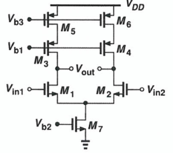

# 기출 2019-1 중간 4 — PMOS 캐스코드 부하 MOS 차동 증폭기의 차동 이득과 A_CM

## 원문
다음 회로에 대해 주어진 조건을 이용하여 질문에 답하시오.

: $V_{DD} = 1.8\ \text{V}$, $I_{D7} = 2\ \text{mA}$, $(W/L)_{1,2} = 100/0.2$, $(W/L)_{3,4} = (W/L)_{5,6} = 200/0.2$, $(W/L)_7 = 200/0.2$, $\mu_n C_{ox} = 100\ \mu\text{A/V}^2$, $\mu_p C_{ox} = 50\ \mu\text{A/V}^2$, $\lambda_n = \lambda_p = 0.1\ \text{V}^{-1}$, $g_m r_o \gg 1$로 가정한다.

(1) 차동 전압 이득을 구하시오.

(2) Common-mode 이득($A_{CM}$)을 구하시오.

## 조건
- 회로: 그림
- $V_{DD} = 1.8\ \text{V}$, $I_{D7} = 2\ \text{mA}$
- $(W/L)_{1,2} = 100/0.2$, $(W/L)_{3,4} = (W/L)_{5,6} = 200/0.2$, $(W/L)_7 = 200/0.2$
- $\mu_n C_{ox} = 100\ \mu\text{A/V}^2$, $\mu_p C_{ox} = 50\ \mu\text{A/V}^2$
- $\lambda_n = \lambda_p = 0.1\ \text{V}^{-1}$
- $g_m r_o \gg 1$로 가정
- 바이어스 전압 $V_{b1}$, $V_{b2}$, $V_{b3}$ 값은 주어지지 않음 (원문에 없음)

## 구할 것
- (1) 차동 전압 이득
- (2) Common-mode 이득 $A_{CM}$

## 회로 — Fig Q4
```spice
M5  n1    Vb3   VDD  pmos
M6  n2    Vb3   VDD  pmos
M3  out1  Vb1   n1   pmos
M4  out2  Vb1   n2   pmos
M1  out1  Vin1  n3   nmos
M2  out2  Vin2  n3   nmos    ; 좌우 반전 (게이트 오른쪽)
M7  n3    Vb2   0    nmos
* out1, out2 = 두 출력 원. 원 사이에 V_out 라벨 하나 (차동 출력)
* n3 = 공통 소스(테일) 노드, 라벨 없음
```
- 단자: VDD = 1.8 V 전원 (가로 레일, 그림에는 값 없음) / Vb3, Vb1, Vb2 = 이상적 DC 바이어스, 값 미지정 (점 단자) / Vin1, Vin2 = 입력 (개방 원) / out1, out2 = 차동 출력 V_out의 두 단자 (개방 원, 각각에는 라벨 없음)
- 표시: 노드 라벨 V_DD (레일 오른쪽 끝), V_b3, V_b1 (각 점 단자 왼쪽), V_out (두 출력 원 사이), V_in1 (왼쪽 입력 원 왼쪽), V_in2 (오른쪽 입력 원 오른쪽), V_b2 (점 단자 왼쪽) / 소자 라벨 M_5 (M5 오른쪽 아래, 드레인 선 오른쪽), M_6 (M6 오른쪽), M_3 (M3 아래 왼쪽, 드레인 선 왼쪽), M_4 (M4 오른쪽), M_1 (M1 오른쪽), M_2 (M2 왼쪽), M_7 (M7 오른쪽) / 부호 없음 / 화살표 없음 / 수치·면적 라벨 없음
- 배치: 맨 위 굵은 가로 레일 V_DD / 왼쪽 세로줄 위→아래 M5, M3, out1 접속점, M1 / 오른쪽 세로줄 위→아래 M6, M4, out2 접속점, M2 / M5, M6, M3, M4 pmos 보통 방향(게이트 왼쪽, 소스 위·화살표가 채널 쪽으로 들어감, 드레인 아래), M5, M6 소스에서 세로선이 위로 레일 / M5 드레인에서 곧은 세로선이 M3 소스로 (n1, 라벨 없음), M6 드레인에서 곧은 세로선이 M4 소스로 (n2, 라벨 없음) / V_b3 점 단자 → 가로선 → M5 게이트, 같은 높이의 가로선이 M5 기호 오른쪽(채널 막대)에서 이어져 오른쪽 M6 게이트까지 감 (M5, M6 게이트 공통선) / V_b1 점 단자 → 가로선 → M3 게이트, 같은 방식으로 M4 게이트까지 (M3, M4 게이트 공통선) / out1 접속점에서 가로선이 오른쪽 출력 원, out2 접속점에서 가로선이 왼쪽 출력 원 (두 원이 가운데에서 마주 보고 그 사이에 V_out) / M1 nmos 보통 방향(게이트 왼쪽, 드레인 위, 소스 아래·화살표 바깥), M2 nmos 좌우 반전(게이트 막대 오른쪽, 드레인 왼쪽 위, 소스 왼쪽 아래·화살표 바깥) / V_in1 원 → 가로선 → M1 게이트, M2 게이트 → 가로선 → V_in2 원 / 두 소스는 아래로 내려가 가로선으로 가운데 n3 점에서 만남 / n3 아래 M7 nmos 보통 방향(게이트 왼쪽), V_b2 점 단자 → 가로선 → M7 게이트, M7 소스 아래 접지 / 접속점 (세 갈래 이상, 3곳): ① out1 = 위 M3 드레인 + 아래 M1 드레인 + 오른쪽 출력선 (점) ② out2 = 위 M4 드레인 + 아래 M2 드레인 + 왼쪽 출력선 (점) ③ n3 = 왼쪽 M1 소스 선 + 오른쪽 M2 소스 선 + 아래 M7 드레인 (점) / 교차: 없음


> 참고: 두 게이트 공통선은 원본에서 M5, M3 기호의 채널 막대를 가로질러 그려져 있음 (넷리스트는 M5, M6 게이트를 Vb3, M3, M4 게이트를 Vb1로 둠)
