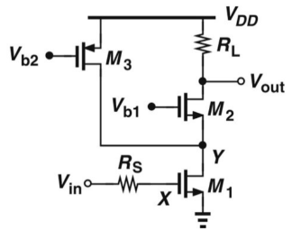

# 기출 2021-1 기말 1 — 전류원 M3가 붙은 캐스코드 증폭기의 노드 X, Y 극점

## 원문
다음 증폭기에 대해 주어진 조건을 이용하여, 노드 X와 노드 Y의 pole 주파수를 $M_1$, $M_2$, $M_3$의 capacitance들에 관한 식으로 각각 구하시오.

: $I_{D1} = 2\ \text{mA}$, $I_{D3} = 1\ \text{mA}$, $(W/L)_1 = 200/0.2$, $(W/L)_2 = 100/0.2$, $(W/L)_3 = 200/0.2$, $R_S = 100\ \Omega$, $R_L = 500\ \Omega$, $\mu_n C_{ox} = 100\ \mu\text{A/V}^2$, $\mu_p C_{ox} = 50\ \mu\text{A/V}^2$, $\lambda_n = \lambda_p = 0$.

## 조건
- 회로: 그림의 증폭기 ($M_1$ 공통 소스 + $M_2$ 캐스코드, $M_3$가 노드 Y에 전류를 공급)
- $I_{D1} = 2\ \text{mA}$, $I_{D3} = 1\ \text{mA}$
- $(W/L)_1 = 200/0.2$, $(W/L)_2 = 100/0.2$, $(W/L)_3 = 200/0.2$
- $R_S = 100\ \Omega$, $R_L = 500\ \Omega$
- $\mu_n C_{ox} = 100\ \mu\text{A/V}^2$, $\mu_p C_{ox} = 50\ \mu\text{A/V}^2$
- $\lambda_n = \lambda_p = 0$
- 바이어스 전압 $V_{b1}$, $V_{b2}$와 $V_{DD}$ 값은 주어지지 않음 (원문에 없음)

## 구할 것
- 노드 X의 극점 주파수와 노드 Y의 극점 주파수를 각각 $M_1$, $M_2$, $M_3$의 커패시턴스로 나타낸 식

## 회로 — Fig Q1
```spice
M3  Y     Vb2  VDD   pmos
RL  VDD   Vout {R_L}
M2  Vout  Vb1  Y     nmos
M1  Y     X    0     nmos
RS  Vin   X    {R_S}
```
- 단자: VDD = 전원, 값 미지정 (가로 레일) / Vb2, Vb1 = 이상적 DC 바이어스, 값 미지정 (점 단자) / Vin = 입력 (개방 원) / Vout = 출력 (개방 원)
- 표시: 노드 라벨 V_DD (레일 오른쪽 끝), V_b2 (점 단자 왼쪽), V_b1 (점 단자 왼쪽), V_out (출력 원 오른쪽), Y (Y 접속점 오른쪽 아래), V_in (입력 원 왼쪽), X (M1 게이트 선 아래, R_S와 M1 게이트 사이) / 소자 라벨 M3 (M3 오른쪽), R_L (저항 오른쪽), M2 (M2 오른쪽), R_S (가로 저항 위), M1 (M1 오른쪽) / 부호 없음 / 화살표 없음 / 수치·면적 라벨 없음
- 배치: 맨 위 가로 레일 V_DD / 왼쪽에 M3 (pmos, 게이트 왼쪽, 소스 위·화살표가 채널 쪽으로 들어감, 드레인 아래), 소스가 레일에 붙음 / 오른쪽 세로줄 위→아래 R_L, Vout 접속점, M2, Y 접속점, M1, 접지 / M2, M1 nmos 보통 방향(게이트 왼쪽, 드레인 위, 소스 아래·화살표 바깥) / M3 드레인에서 세로선이 Y 높이까지 내려가 모서리에서 오른쪽으로 꺾여 Y 접속점에 닿음 / Vout 접속점에서 가로선이 오른쪽 Vout 원 / V_b2, V_b1 점 단자 → 가로선 → 각 게이트 / V_in 원 → 가로 R_S → M1 게이트 (X) / 접속점 (세 갈래 이상, 2곳): Vout = 위 R_L + 아래 M2 드레인 + 오른쪽 Vout 선 (점), Y = 위 M2 소스 + 아래 M1 드레인 + 왼쪽 M3 드레인 선 (점) / 교차: 없음



## 힌트
### $M_3$가 $M_1$ 전류 일부를 대 줌
- $M_3$가 Y에 DC 전류를 넣으므로 $M_1$의 전류 중 일부만 $M_2$로 흐르고, $g_{m2}$는 그 줄어든 전류로 정해진다
- $\lambda = 0$이라 $M_3$는 Y에 저항을 더하지 않고 커패시턴스만 더한다. Y에서 본 저항과 X→Y Miller 이득은 $M_2$만으로 정해진다

## 풀이
### 바이어스 전류와 $g_m$
- $M_3$가 Y에 $I_{D3}$를 대 주므로 $I_{D2} = I_{D1} - I_{D3} = 1.00\ \text{mA}$
- $g_m = \sqrt{2\mu_n C_{ox}(W/L) I_D}$: $g_{m1} = 20.0\ \text{mS}$, $g_{m2} = 10.0\ \text{mS}$ ($1/g_{m2} = 100\ \Omega$)
### $M_3$가 Y에 더하는 것
- $\lambda = 0$이라 $M_3$는 Y에 저항을 더하지 않는다. Y에서 본 저항은 $1/g_{m2}$
- $M_3$ 게이트·소스는 AC 접지라 Y에는 $C_{GD3}$, $C_{DB3}$만 붙는다
- X→Y 이득 $-g_{m1}/g_{m2} = -2.00$ ($M_3$가 $g_{m2}$를 줄여 커짐)
### 노드 X와 Y의 극점
- X: Miller로 $C_{GS1} + (1 + g_{m1}/g_{m2})C_{GD1} = C_{GS1} + 3C_{GD1}$, 저항 $R_S$
- Y: $C_{GD1}$의 계수 $1 + g_{m2}/g_{m1} = 1.5$, $C_Y = C_{DB1} + C_{GS2} + C_{SB2} + 1.5C_{GD1} + C_{GD3} + C_{DB3}$
- $|\omega_{p,X}| = 1/[R_S(C_{GS1} + 3C_{GD1})]$, $|\omega_{p,Y}| = g_{m2}/C_Y$
### 답
- 노드 X: $|\omega_{p,X}| = 1/[100\ \Omega\,(C_{GS1} + 3C_{GD1})]$
- 노드 Y: $|\omega_{p,Y}| = 1/[100\ \Omega\,(C_{DB1} + C_{GS2} + C_{SB2} + 1.5C_{GD1} + C_{GD3} + C_{DB3})]$
