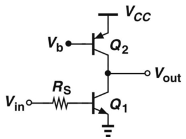

# 기출 2021-1 기말 2 — pnp 전류원 부하 CE 단의 입력·출력 노드 극점

## 원문
다음 회로에 대해 주어진 조건을 이용하여, 입력과 출력 노드의 pole 주파수를 $Q_1$, $Q_2$의 capacitance들에 관한 식으로 각각 구하시오.

: $R_S = 10\ \text{K}\Omega$, $I_{D1} = 0.5\ \text{mA}$, $V_T = 25\ \text{mV}$, $\beta = 200$, $V_{A,n} = V_{A,p} = 5\ \text{V}$.

## 조건
- 회로: 그림 ($Q_1$ 공통 이미터 증폭기, $Q_2$ pnp 전류원 부하)
- $R_S = 10\ \text{k}\Omega$
- $I_{D1} = 0.5\ \text{mA}$
- BJT 회로이므로 $I_{D1}$은 $Q_1$의 컬렉터 바이어스 전류로 보임 (원문에 없음)
- $V_T = 25\ \text{mV}$, $\beta = 200$
- $V_{A,n} = V_{A,p} = 5\ \text{V}$
- 바이어스 전압 $V_b$와 $V_{CC}$ 값은 주어지지 않음 (원문에 없음)

## 구할 것
- 입력 노드의 극점 주파수와 출력 노드의 극점 주파수를 각각 $Q_1$, $Q_2$의 커패시턴스로 나타낸 식

## 회로 — Fig Q2
```spice
Q2  Vout  Vb   VCC  pnp
Q1  Vout  n1   0    npn
RS  Vin   n1   {R_S}
```
- 단자: VCC = 전원, 값 미지정 (T 전원 기호) / Vb = 이상적 DC 바이어스, 값 미지정 (점 단자) / Vin = 입력 (개방 원) / Vout = 출력 (개방 원)
- 표시: 노드 라벨 V_CC (T 기호 오른쪽), V_b (점 단자 왼쪽), V_out (출력 원 오른쪽), V_in (입력 원 왼쪽) / 소자 라벨 Q2 (Q2 오른쪽), R_S (가로 저항 위), Q1 (Q1 오른쪽) / 부호 없음 / 화살표 없음 / 수치·면적 라벨 없음
- 배치: 한 세로줄 위→아래 V_CC T 기호, Q2, Vout 접속점, Q1, 접지 / Q2 pnp (베이스 왼쪽, 이미터 위·화살표가 막대 쪽으로 들어감, 컬렉터 아래) / Q1 npn 보통 방향(베이스 왼쪽, 컬렉터 위, 이미터 아래·화살표 바깥) / Vout 접속점에서 가로선이 오른쪽 Vout 원 / V_b 점 단자 → 가로선 → Q2 베이스 / V_in 원 → 가로 R_S → Q1 베이스 (n1, 라벨 없음) / 접속점 (세 갈래 이상, 1곳): Vout = 위 Q2 컬렉터 + 아래 Q1 컬렉터 + 오른쪽 Vout 선 (점) / 교차: 없음



## 풀이
### 소신호 파라미터
- $I_{D1}$을 $Q_1$ 컬렉터 전류 $I_{C1}$로 본다: $g_{m1} = I_{C1}/V_T = 20.0\ \text{mS}$, $r_{\pi 1} = \beta/g_{m1} = 10.0\ \text{k}\Omega$
- $Q_2$도 같은 전류: $r_{O1} = r_{O2} = V_A/I_{C1} = 10.0\ \text{k}\Omega$
- $Q_2$는 전류원 부하: $R_{out} = r_{O1} \parallel r_{O2} = 5.00\ \text{k}\Omega$, $A_v = -g_{m1}R_{out} = -100$
### 입력 노드의 극점
- 본 저항 $R_S \parallel r_{\pi 1} = 5.00\ \text{k}\Omega$
- Miller: $C_{in} = C_{\pi 1} + (1 + g_{m1}R_{out})C_{\mu 1} = C_{\pi 1} + 101C_{\mu 1}$
### 출력 노드의 극점
- 본 저항 $R_{out} = 5.00\ \text{k}\Omega$. $Q_2$ 베이스·이미터는 AC 접지라 $C_{\mu 2}$, $C_{CS2}$가 붙는다
- $C_{\mu 1}$의 출력쪽 계수 $1 + 1/(g_{m1}R_{out}) = 1.01$: $C_{out} = 1.01C_{\mu 1} + C_{CS1} + C_{\mu 2} + C_{CS2}$
### 답
- 입력: $|\omega_{p,in}| = 1/[5\ \text{k}\Omega\,(C_{\pi 1} + 101C_{\mu 1})]$
- 출력: $|\omega_{p,out}| = 1/[5\ \text{k}\Omega\,(1.01C_{\mu 1} + C_{CS1} + C_{\mu 2} + C_{CS2})]$
