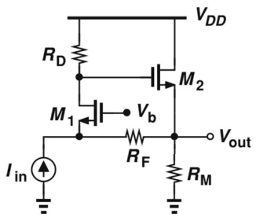

# 기출 2021-1 기말 3 — R_F 귀환이 있는 공통 게이트–소스 팔로워 증폭기의 귀환 해석

## 원문
다음 회로에서 $R_F$는 매우 크지 않다고 가정하며, $\lambda = 0$으로 가정한다.

(1) Feedback factor와 closed-loop gain을 각각 구하시오.

(2) Closed-loop input impedance와 closed-loop output impedance를 각각 구하시오.

## 조건
- 회로: 그림 (입력 전류 $I_{in}$, 출력 전압 $V_{out}$)
- $R_F$는 매우 크지 않다고 가정
- $\lambda = 0$으로 가정
- 소자 값($R_D$, $R_F$, $R_M$, $V_b$, $V_{DD}$, 트랜지스터 크기)은 주어지지 않음 (원문에 없음)

## 구할 것
- (1) Feedback factor와 closed-loop gain을 각각 구함
- (2) Closed-loop input impedance와 closed-loop output impedance를 각각 구함

## 회로 — Fig Q3
```spice
RD   VDD  n1    {R_D}
M1   n1   Vb    n2    nmos    ; 좌우 반전 (게이트 오른쪽)
M2   VDD  n1    Vout  nmos
RF   n2   Vout  {R_F}
RM   Vout 0     {R_M}
Iin  0    n2    {I_in}
```
- 단자: VDD = 전원, 값 미지정 (가로 레일) / Vb = 이상적 DC 바이어스, 값 미지정 (점 단자) / Vout = 출력 (개방 원)
- 표시: 노드 라벨 V_DD (레일 오른쪽 끝), V_b (점 단자 오른쪽), V_out (출력 원 오른쪽) / 소자 라벨 R_D (저항 왼쪽), M2 (M2 오른쪽), M1 (M1 왼쪽, 소스 화살표 높이), R_F (가로 저항 아래), R_M (저항 오른쪽), I_in (전류원 왼쪽) / 부호 없음 / 화살표 없음 / 수치·면적 라벨 없음
- 배치: 맨 위 가로 레일 V_DD / 왼쪽 세로줄 위→아래 R_D, n1 접속점, M1, n2 접속점 / 오른쪽 세로줄 위→아래 M2, Vout 접속점, R_M, 접지 / M1 nmos 좌우 반전 (게이트 오른쪽, 드레인 왼쪽 위, 소스 왼쪽 아래·화살표가 왼쪽 바깥으로) / M2 nmos 보통 방향 (게이트 왼쪽, 드레인 위가 레일로, 소스 아래·화살표 바깥) / n1 접속점에서 가로선이 오른쪽으로 가 M2 게이트 / M1 게이트에서 짧은 가로선이 오른쪽 V_b 점 단자 / n2 접속점에서 가로선이 왼쪽으로 가 모서리에서 아래로 꺾여 I_in 전류원(화살표 위 방향), 그 아래 접지 / n2에서 오른쪽으로 가로 R_F를 지나 Vout 접속점 / Vout 접속점에서 가로선이 오른쪽 Vout 원 / 접속점 (세 갈래 이상, 3곳): n1 = 위 R_D + 아래 M1 드레인 + 오른쪽 M2 게이트 선 (점), n2 = 위 M1 소스 + 왼쪽 I_in 선 + 오른쪽 R_F (점), Vout = 위 M2 소스 + 왼쪽 R_F + 아래 R_M + 오른쪽 Vout 선 (점) / 교차: 없음


> 참고: 원본 PDF에서 R_M과 그 접지 부분은 본 그림 위에 작은 이미지가 덧붙여진 것 (밑 그림은 아래 방향 전류원, 인쇄되지 않음). 넷리스트는 인쇄된 R_M을 따름

## 힌트
### (1) $R_F$ 부하는 반대쪽 끝을 접지
- $R_F$는 출력 전압을 감지해 $M_1$ 소스 노드에 전류로 되돌리므로, 매우 크지 않으면 개루프 이득을 구할 때 부하로 넣어야 한다
- 입력 쪽 부하는 $V_{out}$을 접지하고, 출력 쪽 부하는 $M_1$ 소스 노드를 접지하고 $R_F$를 본다

## 풀이
### (1) 귀환 구조와 개루프 이득
- $R_F$가 $V_{out}$을 감지해 $M_1$ 소스에 전류로 되돌린다(전압 감지·전류 귀환). 양쪽 모두 병렬이라 부하는 반대쪽 끝을 접지한 $R_F$
- $I_{in}$ 중 $g_{m1}R_F/(1 + g_{m1}R_F)$가 $M_1$로 흘러 $R_D$에, $M_2$ 부하는 $R_M \parallel R_F$ (몸체 효과 무시)
- $A_{OL} = \dfrac{g_{m1}R_F R_D}{1 + g_{m1}R_F} \cdot \dfrac{R_M \parallel R_F}{R_M \parallel R_F + 1/g_{m2}}$
### (1) 귀환 계수와 폐루프 이득
- 소스 노드를 접지했을 때 그 노드에서 $R_F$로 빠지는 전류 $-V_{out}/R_F$: $\beta = -1/R_F$
- $A_{CL} = A_{OL}/(1 + \beta A_{OL}) = A_{OL}/(1 - A_{OL}/R_F)$
- 공통 게이트·소스 팔로워가 비반전이라 $\beta A_{OL} < 0$, 그림대로면 양의 귀환이다 ($A_{OL} < R_F$여야 안정)
### (2) 폐루프 입출력 임피던스
- 개루프 $R_{in} = R_F \parallel (1/g_{m1})$, $R_{out} = R_M \parallel R_F \parallel (1/g_{m2})$
- 입력(전류 귀환)·출력(전압 감지) 모두 병렬이라 $1 + \beta A_{OL}$로 나눈다
### 답
- (1) $\beta = -1/R_F$, $A_{CL} = A_{OL}/(1 - A_{OL}/R_F)$ 여기서 $A_{OL} = \dfrac{g_{m1}R_FR_D}{1 + g_{m1}R_F} \cdot \dfrac{R_M \parallel R_F}{R_M \parallel R_F + 1/g_{m2}}$
- (2) $R_{in,CL} = [R_F \parallel (1/g_{m1})]/(1 - A_{OL}/R_F)$, $R_{out,CL} = [R_M \parallel R_F \parallel (1/g_{m2})]/(1 - A_{OL}/R_F)$
