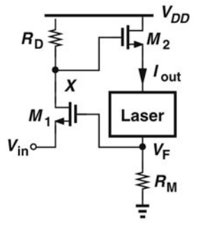

# 기출 2021-1 기말 4 — 레이저 다이오드 구동 귀환 회로의 루프 이득과 입출력 임피던스

## 조건
- 회로: 그림 (입력 전압 $V_{in}$, 레이저 다이오드에 흐르는 출력 전류 $I_{out}$)
- $R_M$은 작지 않다고 가정
- laser diode의 임피던스는 $R_L$
- $\lambda = 0$으로 가정
- 소자 값($R_D$, $R_M$, $R_L$, $V_{DD}$, 트랜지스터 크기)은 주어지지 않음 (원문에 없음)

## 구할 것
- (1) Loop gain과 closed-loop gain을 각각 구함
- (2) Closed-loop input impedance와 closed-loop output impedance를 각각 구함

## 회로 — Fig Q4
```spice
RD  VDD  X    {R_D}
M1  X    VF   Vin   nmos    ; 좌우 반전 (게이트 오른쪽)
M2  VDD  X    n1    nmos
XL  n1   VF   box "Laser"   ; 레이저 다이오드, 임피던스 R_L (조건)
RM  VF   0    {R_M}
```
- 단자: VDD = 전원, 값 미지정 (가로 레일) / Vin = 입력 (개방 원)
- 표시: 노드 라벨 V_DD (레일 오른쪽 끝), X (X 접속점 아래, M1 드레인 선 오른쪽), V_in (입력 원 왼쪽), V_F (V_F 접속점 오른쪽 아래) / 소자 라벨 R_D (저항 왼쪽), M2 (M2 오른쪽), M1 (M1 왼쪽, 소스 화살표 높이), "Laser" (상자 안), R_M (저항 오른쪽) / 부호 없음 / 화살표 "I_out": M2 소스와 Laser 상자 윗변 사이 도선, 아래 방향, 도선 위, 글자는 화살표 오른쪽 / 수치·면적 라벨 없음
- 배치: 맨 위 가로 레일 V_DD / 왼쪽 세로줄 위→아래 R_D, X 접속점, M1, 아래로 내려가 모서리에서 왼쪽으로 꺾여 V_in 원 / 오른쪽 세로줄 위→아래 M2, I_out 화살표, Laser 상자, V_F 접속점, R_M, 접지 / M1 nmos 좌우 반전 (게이트 오른쪽, 드레인 왼쪽 위, 소스 왼쪽 아래·화살표가 왼쪽 바깥으로) / M2 nmos 보통 방향 (게이트 왼쪽, 드레인 위가 레일로, 소스 아래·화살표 바깥) / X 접속점에서 가로선이 오른쪽으로 가다 모서리에서 위로 꺾여 M2 게이트 높이에서 오른쪽으로 꺾여 M2 게이트 / M1 게이트에서 가로선이 오른쪽으로 나가 모서리에서 아래로 꺾여 V_F 높이에서 오른쪽으로 꺾여 V_F 접속점 / 접속점 (세 갈래 이상, 2곳): X = 위 R_D + 아래 M1 드레인 + 오른쪽 M2 게이트 선 (점), V_F = 위 Laser 상자 + 왼쪽 M1 게이트 선 + 아래 R_M (점) / 교차: 없음


