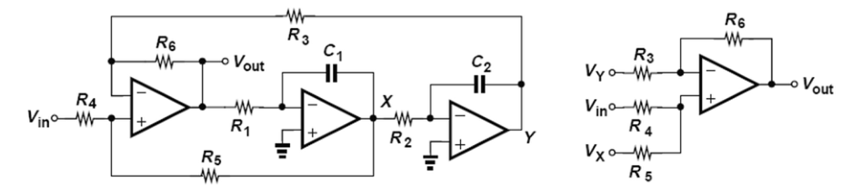

# 기출 2021-1 기말 5 — KHN biquad 대역 통과 필터의 전달 함수와 R5, R6 설계

## 원문
그림과 같은 KHN biquad 회로를 이용한 filter를 설계한다.

(1) 회로에서 $V_{out}$을 $V_{in}$, $V_X$, $V_Y$, $R_3$, $R_4$, $R_5$, $R_6$에 관한 식으로 구하시오. 그리고, KHN biquad band-pass filter의 전달함수를 $R_1$, $R_2$, $R_3$, $R_4$, $R_5$, $R_6$, $C_1$, $C_2$에 관한 식으로 구하시오.

(2) KHN biquad filter의 $\omega_n = 200\ \text{M rad/s}$ ($\approx 2\pi \times 32\ \text{MHz}$), $Q = 4$가 되도록 하는 $R_5$, $R_6$ 값을 각각 구하시오. 단, $C_1 = C_2 = 10\ \text{pF}$, $R_1 = R_2 = 1\ \text{K}\Omega$, $R_3 = R_4 = 1\ \text{K}\Omega$으로 설계한다.

## 조건
- 그림의 KHN biquad 회로를 이용해 filter를 설계
- 그림 오른쪽 회로는 첫 연산증폭기 단을 따로 그린 것으로, 입력 $V_{in}$, $V_X$, $V_Y$가 각각 $R_4$, $R_5$, $R_3$을 거쳐 들어감 (원문에 없음)
- 연산증폭기에 대한 가정은 적혀 있지 않음 (원문에 없음)
- (2) 전용: $C_1 = C_2 = 10\ \text{pF}$, $R_1 = R_2 = 1\ \text{k}\Omega$, $R_3 = R_4 = 1\ \text{k}\Omega$으로 설계
- (2) 전용: 목표 $\omega_n = 200\ \text{M rad/s}$ ($\approx 2\pi \times 32\ \text{MHz}$), $Q = 4$

## 구할 것
- (1) 회로에서 $V_{out}$을 $V_{in}$, $V_X$, $V_Y$, $R_3$, $R_4$, $R_5$, $R_6$으로 나타낸 식. 그리고 KHN biquad band-pass filter의 전달 함수를 $R_1$, $R_2$, $R_3$, $R_4$, $R_5$, $R_6$, $C_1$, $C_2$로 나타낸 식
- (2) KHN biquad filter의 $\omega_n = 200\ \text{M rad/s}$, $Q = 4$가 되도록 하는 $R_5$, $R_6$ 값

## 회로 — Fig Q5
```spice
R4  Vin   n2    {R_4}
X1  n2    n1    Vout  opamp    ; in+ = n2, in- = n1
R6  n1    Vout  {R_6}
R3  n1    Y     {R_3}
R5  n2    X     {R_5}
R1  Vout  n3    {R_1}
X2  0     n3    X     opamp    ; in+ = 접지
C1  n3    X     {C_1}
R2  X     n4    {R_2}
X3  0     n4    Y     opamp    ; in+ = 접지
C2  n4    Y     {C_2}
```
- 단자: Vin = 입력 (개방 원) / Vout = 출력 (개방 원)
- 표시: 노드 라벨 V_in (입력 원 왼쪽), V_out (출력 원 오른쪽), X (X 접속점 위, 둘째 연산증폭기 출력 오른쪽), Y (셋째 연산증폭기 출력 오른쪽 아래) / 소자 라벨 R4 (가로 저항 위), R6 (가로 저항 위), R3 (맨 위 가로 저항 아래), R1 (가로 저항 아래), C1 (커패시터 위), R2 (가로 저항 아래), C2 (커패시터 위), R5 (맨 아래 가로 저항 위), 연산증폭기 셋 (라벨 없음) / 부호 세 연산증폭기 모두 "−" (위 입력, 삼각형 안), "+" (아래 입력, 삼각형 안) / 화살표 없음 / 수치·면적 라벨 없음
- 배치: 왼쪽→오른쪽 V_in 원, 가로 R4, n2 접속점, 첫째 연산증폭기, Vout 아래 접속점, 가로 R1, n3 접속점, 둘째 연산증폭기, X 접속점, 가로 R2, n4 접속점, 셋째 연산증폭기, Y 선 / 세 연산증폭기 모두 오른쪽을 향한 삼각형 / 첫째: n1 접속점(− 입력 왼쪽 위)에서 세로선이 위로 맨 위 R3 선, 아래로 내려가 모서리에서 오른쪽으로 꺾여 − 입력 / n1에서 가로 R6이 오른쪽 Vout 위 접속점으로, 거기서 가로선이 오른쪽 Vout 원, 세로선이 아래로 Vout 아래 접속점(첫째 출력) / n2 접속점에서 오른쪽 + 입력, 아래로 세로선이 그림 맨 아래 높이까지 내려가 오른쪽으로 꺾여 가로 R5를 지나 X 접속점 아래까지 가서 위로 꺾여 X 접속점 / 둘째: + 입력에서 왼쪽으로 짧게 나가 아래로 꺾여 접지, C1은 n3에서 세로선이 위로 올라가 오른쪽으로 꺾여 연산증폭기 위를 지나고, 모서리에서 아래로 꺾여 X 접속점 (귀환 커패시터) / 셋째: + 입력 접지 모양은 둘째와 같음, C2는 n4에서 세로선이 위로 올라가 오른쪽으로 꺾여 연산증폭기 위를 지나 Y 접속점, 출력에서 가로선이 오른쪽으로 가 모서리에서 위로 꺾여 Y 접속점 / Y 접속점에서 세로선이 그림 맨 위 높이까지 올라가 왼쪽으로 꺾여 가로 R3을 지나 n1 위 세로선으로 / 접속점 (세 갈래 이상, 8곳): n1 = 위 R3 선 + 오른쪽 R6 + 아래 − 입력 선 (점), Vout 위 = 왼쪽 R6 + 오른쪽 Vout 원 + 아래 세로선 (점), Vout 아래 = 왼쪽 첫째 출력 + 위 세로선 + 오른쪽 R1 (점), n2 = 왼쪽 R4 + 오른쪽 + 입력 + 아래 R5 선 (점), n3 = 왼쪽 R1 + 오른쪽 − 입력 + 위 C1 (점), X = 왼쪽 둘째 출력 + 위 C1 선 + 아래 R5 선 + 오른쪽 R2 (점), n4 = 왼쪽 R2 + 오른쪽 − 입력 + 위 C2 (점), Y = 왼쪽 C2 + 위 R3 선 + 아래 셋째 출력 선 (점) / 교차: 없음

## 회로 — Fig Q5(eq)
```spice
R3  VY    n1    {R_3}
R4  Vin   n2    {R_4}
R5  VX    n2    {R_5}
X1  n2    n1    Vout  opamp    ; in+ = n2, in- = n1
R6  n1    Vout  {R_6}
```
- 단자: VY, Vin, VX = 입력 (개방 원) / Vout = 출력 (개방 원)
- 표시: 노드 라벨 V_Y, V_in, V_X (각 입력 원 왼쪽), V_out (출력 원 오른쪽) / 소자 라벨 R3 (가로 저항 위), R4 (가로 저항 아래), R5 (가로 저항 아래), R6 (위 가로 저항 위), 연산증폭기 (라벨 없음) / 부호 연산증폭기 "−" (위 입력, 삼각형 안), "+" (아래 입력, 삼각형 안) / 화살표 없음 / 수치·면적 라벨 없음
- 배치: 왼쪽 회로 오른쪽에 따로 그려짐 (⇒나 패널 글자 없음) / 왼쪽에 입력 원 세 개가 위→아래 V_Y, V_in, V_X 순으로 세로로 나란히, 각각 가로 저항 R3, R4, R5 / R3 → n1 접속점 → − 입력, n1에서 세로선이 위로 올라가 오른쪽으로 꺾여 가로 R6을 지나 아래로 꺾여 Vout 접속점 / R4 → n2 접속점, n2에서 세로선이 위로 올라가 오른쪽으로 꺾여 + 입력, 아래로 내려가 R5 오른쪽 끝과 모서리로 이어짐 / 연산증폭기 출력 → Vout 접속점 → Vout 원 / 접속점 (세 갈래 이상, 3곳): n1 = 왼쪽 R3 + 오른쪽 − 입력 + 위 R6 선 (점), n2 = 왼쪽 R4 + 위 + 입력 선 + 아래 R5 선 (점), Vout = 왼쪽 연산증폭기 출력 + 위 R6 선 + 오른쪽 Vout 원 (점) / 교차: 없음


> 참고: 원문 그림에는 패널 글자가 없음. 오른쪽 회로를 (eq)로 적음

## 풀이
### (1) 첫 연산증폭기 단
- 이상적 연산증폭기로 본다. $V_+ = (R_5V_{in} + R_4V_X)/(R_4 + R_5)$
- $V_{out} = (1 + R_6/R_3)V_+ - (R_6/R_3)V_Y$
### (1) 대역 통과 전달 함수
- 적분기: $V_X = -V_{out}/(sR_1C_1)$, $V_Y = -V_X/(sR_2C_2)$. 대역 통과 출력은 $V_X$
- $a = 1 + R_6/R_3$, $b = R_4/(R_4 + R_5)$로 두고 정리한다
- $V_X/V_{in} = -\dfrac{a(1 - b)s/(R_1C_1)}{s^2 + abs/(R_1C_1) + R_6/(R_1R_2R_3C_1C_2)}$
### (2) $R_6$, $R_5$
- $\omega_n^2 = (R_6/R_3)/(R_1R_2C_1C_2)$: $R_6/R_3 = (200\ \text{M rad/s})^2 (10\ \text{ns})^2 = 4.00$ → $R_6 = 4R_3$
- $\omega_n/Q = ab/(R_1C_1)$: $b = (50\ \text{M rad/s})(10\ \text{ns})/5 = 0.100$ → $R_5 = 9R_4$
### 답
- (1) $V_{out} = (1 + R_6/R_3)(R_5V_{in} + R_4V_X)/(R_4 + R_5) - (R_6/R_3)V_Y$, $V_X/V_{in} = -\dfrac{(1 + R_6/R_3)[R_5/(R_4 + R_5)]\,s/(R_1C_1)}{s^2 + (1 + R_6/R_3)[R_4/(R_4 + R_5)]\,s/(R_1C_1) + R_6/(R_1R_2R_3C_1C_2)}$
- (2) $R_5 = 9.00\ \text{k}\Omega$, $R_6 = 4.00\ \text{k}\Omega$
