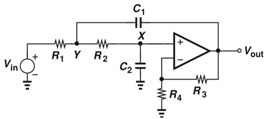

# 기출 2021-1 기말 6 — 연산증폭기 2차 필터의 전달 함수

## 원문
다음 회로를 이용한 2차 filter를 설계한다. 회로의 전달함수($V_{out}/V_{in}$)를 $R_1$, $R_2$, $R_3$, $R_4$, $C_1$, $C_2$에 관한 식으로 구하시오. 단, 이상적인 op amp를 가정한다.

## 조건
- 그림의 회로를 이용한 2차 filter를 설계
- 이상적인 op amp로 가정
- 소자 값은 주어지지 않음 (원문에 없음)

## 구할 것
- 회로의 전달 함수 $V_{out}/V_{in}$을 $R_1$, $R_2$, $R_3$, $R_4$, $C_1$, $C_2$로 나타낸 식

## 회로 — Fig Q6
```spice
VIN  n1   0     {V_in}    ; + 단자 위
R1   n1   Y     {R_1}
R2   Y    X     {R_2}
C1   Y    Vout  {C_1}
C2   X    0     {C_2}
X1   X    n2    Vout  opamp    ; in+ = X, in- = n2
R3   n2   Vout  {R_3}
R4   n2   0     {R_4}
```
- 단자: Vout = 출력 (개방 원)
- 표시: 노드 라벨 Y (Y 접속점 아래), X (X 접속점 위), V_out (출력 원 오른쪽) / 소자 라벨 V_in (전압원 왼쪽), R1 (가로 저항 아래), R2 (가로 저항 아래), C1 (커패시터 위), C2 (커패시터 왼쪽), R3 (가로 저항 아래), R4 (저항 오른쪽), 연산증폭기 (라벨 없음) / 부호 전압원 V_in "+" (원 오른쪽 위), "−" (원 오른쪽 아래); 연산증폭기 "+" (위 입력, 삼각형 안), "−" (아래 입력, 삼각형 안) / 화살표 없음 / 수치·면적 라벨 없음
- 배치: 왼쪽 원형 전압원 V_in (아래 접지), 위 단자에서 세로선이 올라가 오른쪽으로 꺾여 가로 R1, Y 접속점, 가로 R2, X 접속점, 연산증폭기 + 입력이 한 가로선 높이 / Y 접속점에서 세로선이 위로 올라가 오른쪽으로 꺾여 가로 C1을 지나 연산증폭기 위를 넘어 모서리에서 아래로 꺾여 Vout 접속점 / X 접속점에서 아래로 세로 C2, 그 아래 접지 / 연산증폭기는 오른쪽을 향한 삼각형, 출력 → Vout 접속점 → Vout 원 / − 입력에서 왼쪽으로 짧게 나가 모서리에서 아래로 꺾여 n2 접속점, n2에서 아래로 세로 R4, 그 아래 접지 / n2에서 오른쪽으로 가로 R3을 지나 모서리에서 위로 꺾여 Vout 접속점 / 접속점 (세 갈래 이상, 4곳): Y = 왼쪽 R1 + 오른쪽 R2 + 위 C1 선 (점), X = 왼쪽 R2 + 오른쪽 + 입력 + 아래 C2 (점), Vout = 왼쪽 연산증폭기 출력 + 위 C1 선 + 아래 R3 선 + 오른쪽 Vout 원 (점), n2 = 위 − 입력 선 + 아래 R4 + 오른쪽 R3 (점) / 교차: 없음


