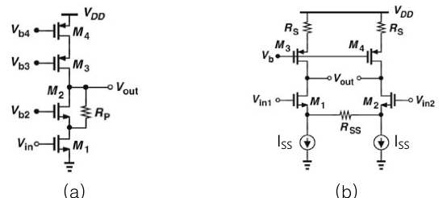

# 기출 2021-1 중간 2 — R_P가 붙은 MOS 캐스코드 증폭기와 소스 축퇴 차동 증폭기의 출력 저항·이득

## 원문
다음 회로에 대해 주어진 조건을 이용하여 질문에 답하시오.

: $\mu_n C_{ox} = 100\ \mu\text{A/V}^2$, $\mu_p C_{ox} = 50\ \mu\text{A/V}^2$, $\lambda_n = \lambda_p = 0.1\ \text{V}^{-1}$, $g_m r_o \gg 1$로 가정한다.

(1) 회로 (a)의 출력 저항과 전압 이득을 각각 구하시오. $I_{D1} = 1\ \text{mA}$, $(W/L)_{1,2} = 100/0.2$, $(W/L)_{3,4} = 50/0.2$, $R_P = 10\ \text{k}\Omega$이다.

(2) 차동 증폭기 (b)의 출력 저항과 전압 이득을 각각 구하시오. $I_{SS} = 1\ \text{mA}$, $(W/L)_{1,2} = 100/0.2$, $(W/L)_{3,4} = 200/0.2$, $R_S = 2\ \text{k}\Omega$, $R_{SS} = 4\ \text{k}\Omega$이다.

## 조건
- 회로: 그림 (a), (b)
- $\mu_n C_{ox} = 100\ \mu\text{A/V}^2$, $\mu_p C_{ox} = 50\ \mu\text{A/V}^2$
- $\lambda_n = \lambda_p = 0.1\ \text{V}^{-1}$
- $g_m r_o \gg 1$로 가정
- (1) 전용 (회로 (a)): $I_{D1} = 1\ \text{mA}$, $(W/L)_{1,2} = 100/0.2$, $(W/L)_{3,4} = 50/0.2$, $R_P = 10\ \text{k}\Omega$
- (2) 전용 (회로 (b)): $I_{SS} = 1\ \text{mA}$, $(W/L)_{1,2} = 100/0.2$, $(W/L)_{3,4} = 200/0.2$, $R_S = 2\ \text{k}\Omega$, $R_{SS} = 4\ \text{k}\Omega$
- 바이어스 전압 $V_{b2}$–$V_{b4}$, $V_b$와 $V_{DD}$ 값은 주어지지 않음 (원문에 없음)
- (1) $R_P$의 DC 전류는 무시($I_{D2} \approx I_{D1}$) (원문에 없음)

## 구할 것
- (1) 회로 (a)의 출력 저항과 전압 이득
- (2) 차동 증폭기 (b)의 출력 저항과 전압 이득

## 회로 — Fig Q2(a)
```spice
M4  n2    Vb4  VDD  pmos
M3  Vout  Vb3  n2   pmos
M2  Vout  Vb2  n1   nmos
M1  n1    Vin  0    nmos
RP  Vout  n1   {R_P}     ; M2 드레인(Vout) ↔ M2 소스(n1)
```
- 단자: VDD = 전원, 값 미지정 (T 전원 기호) / Vb4, Vb3, Vb2 = 이상적 DC 바이어스, 값 미지정 (점 단자) / Vin = 입력 (개방 원) / Vout = 출력 (개방 원)
- 표시: 노드 라벨 V_DD (T 기호 오른쪽), V_b4, V_b3, V_b2 (각 점 단자 왼쪽), V_in (입력 원 왼쪽), V_out (출력 원 오른쪽) / 소자 라벨 M4, M3 (각 트랜지스터 오른쪽), M2 (M2 위, Vout 접속점 높이에서 드레인 세로선 왼쪽), M1 (M1 오른쪽), R_P (세로 저항 오른쪽) / 부호 없음 / 화살표 없음 / 수치·면적 라벨 없음
- 배치: 한 세로줄 위→아래 VDD T 기호, M4, M3, Vout 접속점, M2, n1 접속점, M1, 접지 / M4, M3 pmos (게이트 왼쪽, 소스 위·화살표가 채널 쪽으로 들어감, 드레인 아래) / M2, M1 nmos 보통 방향(게이트 왼쪽, 드레인 위, 소스 아래·화살표 바깥) / M4 드레인에서 곧은 세로선이 M3 소스로 (n2, 라벨 없음) / M3 드레인 → Vout 접속점 → M2 드레인 / Vout 접속점에서 가로선이 오른쪽으로 가다 두 번째 접속점을 지나 Vout 원 / 두 번째 접속점에서 세로선이 아래로 내려가 M2 오른쪽에 세로로 놓인 R_P(M2 높이)를 지나 아래 모서리에서 왼쪽으로 꺾여 M2 소스–M1 드레인 세로선의 n1 접속점 / 각 점 단자와 Vin 원 → 가로선 → 각 게이트 / M1 소스 아래 접지 / 접속점 (세 갈래 이상, 3곳): ① Vout 첫 접속점 = 위 M3 드레인 + 아래 M2 드레인 + 오른쪽 Vout 가로선 (점) ② Vout 가로선 중간 = 왼쪽 Vout 첫 접속점 + 오른쪽 Vout 원 + 아래 R_P (점) ③ n1 = 위 M2 소스 + 아래 M1 드레인 + 오른쪽 R_P (점) / 교차: 없음

## 회로 — Fig Q2(b)
```spice
RS1  VDD   n1    {R_S}    ; 두 저항 모두 R_S로 인쇄
RS2  VDD   n2    {R_S}
M3   out1  Vb    n1   pmos
M4   out2  Vb    n2   pmos
M1   out1  Vin1  n3   nmos
M2   out2  Vin2  n4   nmos    ; 좌우 반전 (게이트 오른쪽)
RSS  n3    n4    {R_SS}
ISS1 n3    0     {I_SS}   ; 두 전류원 모두 I_SS로 인쇄
ISS2 n4    0     {I_SS}
* out1, out2 = 두 출력 원. 원 사이에 V_out 라벨 하나 (차동 출력)
```
- 단자: VDD = 전원, 값 미지정 (가로 레일) / Vb = 이상적 DC 바이어스, 값 미지정 (점 단자) / Vin1, Vin2 = 입력 (개방 원) / out1, out2 = 차동 출력 V_out의 두 단자 (개방 원, 각각에는 라벨 없음)
- 표시: 노드 라벨 V_DD (레일 오른쪽 끝), V_b (점 단자 왼쪽), V_out (두 출력 원 사이), V_in1 (왼쪽 입력 원 왼쪽), V_in2 (오른쪽 입력 원 오른쪽) / 소자 라벨 R_S (왼쪽 저항 왼쪽), R_S (오른쪽 저항 오른쪽), M3 (M3 게이트 위 왼쪽), M4 (M4 게이트 위 왼쪽), M1 (M1 오른쪽), M2 (M2 왼쪽), R_SS (가로 저항 아래), I_SS (왼쪽 전류원 왼쪽), I_SS (오른쪽 전류원 오른쪽) / 부호 없음 / 화살표 없음 / 수치·면적 라벨 없음
- 배치: 맨 위 굵은 가로 레일 V_DD / 왼쪽 세로줄 위→아래 R_S, M3, out1 접속점, M1, n3 접속점, I_SS, 접지 / 오른쪽 세로줄 위→아래 R_S, M4, out2 접속점, M2, n4 접속점, I_SS, 접지 / M3, M4 pmos 보통 방향(게이트 왼쪽, 소스 위·화살표가 채널 쪽으로 들어감) / M1 nmos 보통 방향(게이트 왼쪽), M2 nmos 좌우 반전(게이트 오른쪽, 드레인 왼쪽 위, 소스 왼쪽 아래·화살표 바깥) / V_b 점 단자 → 가로선 → M3 게이트, 같은 높이의 가로선이 M3 기호 오른쪽(채널 막대)에서 이어져 오른쪽 M4 게이트까지 감 (M3, M4 게이트 공통선) / out1 접속점에서 가로선이 오른쪽 출력 원, out2 접속점에서 가로선이 왼쪽 출력 원 (두 원이 가운데에서 마주 보고 그 사이에 V_out) / V_in1 원 → 가로선 → M1 게이트, V_in2 원 → 가로선 → M2 게이트 / n3, n4 사이에 가로로 놓인 R_SS (소스 높이 바로 아래) / 전류원 화살표는 아래 / 접속점 (세 갈래 이상, 4곳): ① out1 = 위 M3 드레인 + 아래 M1 드레인 + 오른쪽 출력선 (점) ② out2 = 위 M4 드레인 + 아래 M2 드레인 + 왼쪽 출력선 (점) ③ n3 = 위 M1 소스 + 아래 I_SS + 오른쪽 R_SS (점) ④ n4 = 위 M2 소스 + 아래 I_SS + 왼쪽 R_SS (점) / 교차: 없음


> 참고: (b)의 게이트 공통선은 원본에서 M3 기호의 채널 막대를 가로질러 그려져 있음 (넷리스트는 M3, M4 게이트를 모두 Vb로 둠). 두 I_SS 라벨은 다른 라벨과 글꼴이 다름(곧은 글꼴)

## 힌트
### (2) $R_{SS}$ 가운데는 가상 접지
- 차동 입력에서는 두 소스 전압이 크기는 같고 방향이 반대로 움직이므로, $R_{SS}$의 가운데 점은 소신호 전압이 0이다
- 그래서 반회로에서 $M_1$ 소스에는 $R_{SS}$의 절반이 축퇴 저항으로 달리고, 이상적인 $I_{SS}$는 개방으로 본다

## 풀이
### (1) 소신호 파라미터
- $g_{m1} = g_{m2} = \sqrt{2 \mu_n C_{ox} (W/L) I_D} = 10.0\ \text{mS}$, $g_{m3} = g_{m4} = 5.00\ \text{mS}$, $r_O = 1/(\lambda I_D) = 10.0\ \text{k}\Omega$
### (1) 출력 저항과 이득
- $R_P$는 $M_2$ 드레인–소스 사이라 $r_{O2}$와 병렬. $g_{m2} r_{O1} = 100 \gg 1$: $V_{out}$에서 아래로 본 저항 $R_{dn} \approx g_{m2} r_{O1} (r_{O2} \parallel R_P) = 500\ \text{k}\Omega$
- 위로 본 저항은 $g_{m3} r_{O3} r_{O4}$: $R_{out} = R_{dn} \parallel g_{m3} r_{O3} r_{O4} = 250\ \text{k}\Omega$
- $G_m \approx g_{m1}$ ($1/g_{m2} \ll r_{O1}$): $A_v = -g_{m1} R_{out} = -2.50 \times 10^3$
### (2) 반회로와 파라미터
- 차동 입력에서 $R_{SS}$ 가운데는 가상 접지 (두 소스가 반대로 움직임) → $M_1$은 $R_{SS}/2$로 축퇴, $I_{SS}$는 개방
- 각 쪽 $1\ \text{mA}$: $g_{m1} = g_{m3} = 10.0\ \text{mS}$, $r_O = 10.0\ \text{k}\Omega$
### (2) 출력 저항과 이득
- $g_{m1} R_{SS}/2 = g_{m3} R_S = 20$이라 1을 남긴다. 출력에서 아래로 본 $R_{dn}$, 위로 본 $R_{up}$: $R_{dn} = (1 + g_{m1} R_{SS}/2) r_{O1} = 210\ \text{k}\Omega$, $R_{up} = (1 + g_{m3} R_S) r_{O3} = 210\ \text{k}\Omega$
- 한쪽 출력 저항 $R_h = R_{dn} \parallel R_{up} = 105\ \text{k}\Omega$, 차동 $R_{out} = 2R_h = 210\ \text{k}\Omega$
- $A_v = V_{out}/(V_{in1} - V_{in2}) = -g_{m1} R_h/(1 + g_{m1} R_{SS}/2) = -50.0$
### 답
- (1) $R_{out} \approx 250\ \text{k}\Omega$, $A_v \approx -2.50 \times 10^3$
- (2) $R_{out} \approx 210\ \text{k}\Omega$ (차동, 한쪽은 $105\ \text{k}\Omega$), $A_v \approx -50.0$
