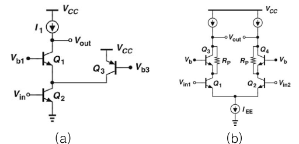

# 기출 2021-1 중간 3 — 전류를 넣는 pnp Q3가 붙은 바이폴라 캐스코드와 R_P 캐스코드 차동 증폭기의 출력 저항·이득

## 원문
다음 회로에 대해 주어진 조건을 이용하여 질문에 답하시오.

: $V_T = 25\ \text{mV}$, $\beta = 200$, $V_{A,n} = V_{A,p} = 5\ \text{V}$, $g_m r_o \gg 1$로 가정한다. 베이스 전류는 무시한다.

(1) 회로 (a)의 출력 저항과 전압 이득을 각각 구하시오. $I_1 = |I_{C3}| = 0.5\ \text{mA}$, $I_{C2} = 1\ \text{mA}$이다.

(2) 차동 증폭기 (b)의 출력 저항과 전압 이득을 각각 구하시오. $I_{EE} = 1\ \text{mA}$, $R_P = 10\ \text{k}\Omega$이다.

## 조건
- 회로: 그림 (a), (b)
- $V_T = 25\ \text{mV}$, $\beta = 200$
- $V_{A,n} = V_{A,p} = 5\ \text{V}$
- $g_m r_o \gg 1$로 가정
- 베이스 전류는 무시
- (1) 전용 (회로 (a)): $I_1 = |I_{C3}| = 0.5\ \text{mA}$, $I_{C2} = 1\ \text{mA}$
- (2) 전용 (회로 (b)): $I_{EE} = 1\ \text{mA}$, $R_P = 10\ \text{k}\Omega$
- 전류원 $I_1$, (b)의 위쪽 두 전류원과 $I_{EE}$는 이상적 전류원으로 봄 (원문에 없음)
- (2) $R_P$의 DC 전류는 무시($I_{C3} \approx I_{EE}/2$) (원문에 없음)

## 구할 것
- (1) 회로 (a)의 출력 저항과 전압 이득
- (2) 차동 증폭기 (b)의 출력 저항과 전압 이득

## 회로 — Fig Q3(a)
```spice
I1  VCC   Vout  {I_1}
Q1  Vout  Vb1   n1   npn
Q2  n1    Vin   0    npn
Q3  n1    Vb3   VCC  pnp    ; 좌우 반전 (베이스 오른쪽), 컬렉터 = n1
* VCC는 T 전원 기호 두 개 (I1 위, Q3 이미터 위)
```
- 단자: VCC = 전원, 값 미지정 (T 전원 기호 2개, 둘 다 V_CC로 인쇄) / Vb1, Vb3 = 이상적 DC 바이어스, 값 미지정 (점 단자) / Vin = 입력 (개방 원) / Vout = 출력 (개방 원)
- 표시: 노드 라벨 V_CC (위 T 기호 오른쪽), V_CC (Q3 위 T 기호 오른쪽), V_out (출력 원 오른쪽), V_b1 (점 단자 왼쪽), V_in (입력 원 왼쪽), V_b3 (점 단자 오른쪽) / 소자 라벨 I_1 (전류원 왼쪽), Q1, Q2 (각 트랜지스터 오른쪽), Q3 (Q3 왼쪽, 컬렉터 옆) / 부호 없음 / 화살표 없음 / 수치·면적 라벨 없음
- 배치: 왼쪽 세로줄 위→아래 VCC T 기호, I_1 전류원(화살표 아래), Vout 접속점, Q1, n1 접속점, Q2, 접지 / Q1, Q2 npn 보통 방향(베이스 왼쪽, 컬렉터 위, 이미터 아래·화살표 바깥) / Vout 접속점에서 가로선이 오른쪽 Vout 원 / Q3은 오른쪽, Q1 높이보다 조금 아래, pnp 좌우 반전(베이스 막대 오른쪽, 이미터 왼쪽 위·화살표가 막대 쪽으로 들어감, 컬렉터 왼쪽 아래) / Q3 이미터에서 세로선이 위로 따로 그린 VCC T 기호 / Q3 베이스 → 가로선 → 오른쪽 V_b3 점 단자 / Q3 컬렉터에서 세로선이 n1 높이까지 내려가 모서리에서 왼쪽으로 꺾여 긴 가로선으로 n1 접속점 / V_b1 점 단자 → 가로선 → Q1 베이스, V_in 원 → 가로선 → Q2 베이스 / Q2 이미터 아래 접지 / 접속점 (세 갈래 이상, 2곳): ① Vout = 위 I_1 + 아래 Q1 컬렉터 + 오른쪽 Vout 가로선 (점) ② n1 = 위 Q1 이미터 + 아래 Q2 컬렉터 + 오른쪽 Q3 컬렉터로 가는 가로선 (점) / 교차: 없음

## 회로 — Fig Q3(b)
```spice
I1   VCC   out1  ; 이상적 전류원 (라벨·값 없음)
I2   VCC   out2  ; 이상적 전류원 (라벨·값 없음)
Q3   out1  Vb    n1   npn
RP1  out1  n1    {R_P}    ; Q3 컬렉터 ↔ Q3 이미터, 두 저항 모두 R_P로 인쇄
Q1   n1    Vin1  n3   npn
Q4   out2  Vb    n2   npn    ; 좌우 반전 (베이스 오른쪽)
RP2  out2  n2    {R_P}    ; Q4 컬렉터 ↔ Q4 이미터
Q2   n2    Vin2  n3   npn    ; 좌우 반전 (베이스 오른쪽)
IEE  n3    0     {I_EE}
* out1, out2 = 두 출력 원. 원 사이에 V_out 라벨 하나 (차동 출력)
* n3 = 공통 이미터(테일) 노드, 라벨 없음
```
- 단자: VCC = 전원, 값 미지정 (가로 레일) / Vb = 이상적 DC 바이어스, 값 미지정 (점 단자 2개, 둘 다 V_b로 인쇄) / Vin1, Vin2 = 입력 (개방 원) / out1, out2 = 차동 출력 V_out의 두 단자 (개방 원, 각각에는 라벨 없음)
- 표시: 노드 라벨 V_CC (레일 오른쪽 끝), V_out (두 출력 원 사이), V_b (Q3 쪽 점 단자 왼쪽), V_b (Q4 쪽 점 단자 오른쪽), V_in1 (왼쪽 입력 원 왼쪽), V_in2 (오른쪽 입력 원 오른쪽) / 소자 라벨 Q3 (Q3 위 왼쪽, 컬렉터 선 왼쪽), Q4 (Q4 위 오른쪽, 컬렉터 선 오른쪽), R_P (왼쪽 세로 저항 오른쪽), R_P (오른쪽 세로 저항 왼쪽), Q1 (Q1 오른쪽), Q2 (Q2 왼쪽), I_EE (테일 전류원 오른쪽), 위쪽 전류원 두 개 (라벨 없음) / 부호 없음 / 화살표 없음 / 수치·면적 라벨 없음
- 배치: 맨 위 굵은 가로 레일 V_CC / 왼쪽 세로줄 위→아래 전류원(화살표 아래), out1 첫 접속점, out1 둘째 접속점, Q3, n1 접속점, Q1 / 오른쪽 세로줄은 좌우 대칭으로 전류원(화살표 아래), out2 첫 접속점, out2 둘째 접속점, Q4, n2 접속점, Q2 / Q3, Q1 npn 보통 방향(베이스 왼쪽) / Q4, Q2 npn 좌우 반전(베이스 막대 오른쪽, 컬렉터 왼쪽 위, 이미터 왼쪽 아래·화살표 바깥) / out1 첫 접속점에서 가로선이 오른쪽 출력 원, out2 첫 접속점에서 가로선이 왼쪽 출력 원 (두 원이 가운데에서 마주 보고 그 사이에 V_out) / out1 둘째 접속점에서 가로선이 오른쪽(안쪽)으로 나가 모서리에서 아래로 꺾여 Q3 오른쪽에 세로로 놓인 R_P(Q3 높이)를 지나 아래 모서리에서 왼쪽으로 꺾여 n1 접속점 / 오른쪽도 대칭으로 out2 둘째 접속점 → 왼쪽(안쪽) → R_P(Q4 왼쪽, Q4 높이) → n2 접속점 / V_b 점 단자 → 가로선 → Q3 베이스 (왼쪽), Q4 베이스 → 가로선 → V_b 점 단자 (오른쪽), 두 점 단자는 서로 선으로 이어져 있지 않음 / V_in1 원 → 가로선 → Q1 베이스, Q2 베이스 → 가로선 → V_in2 원 / 두 이미터는 아래로 내려가 가로선으로 가운데 n3 점에서 만남, n3에서 아래로 I_EE(화살표 아래), 그 아래 접지 / 접속점 (세 갈래 이상, 7곳): ① out1 첫 = 위 전류원 + 아래 세로선 + 오른쪽 출력선 (점) ② out1 둘째 = 위 세로선 + 아래 Q3 컬렉터 + 오른쪽 R_P 가지 (점) ③ n1 = 위 Q3 이미터 + 아래 Q1 컬렉터 + 오른쪽 R_P 가지 (점) ④ out2 첫 = 위 전류원 + 아래 세로선 + 왼쪽 출력선 (점) ⑤ out2 둘째 = 위 세로선 + 아래 Q4 컬렉터 + 왼쪽 R_P 가지 (점) ⑥ n2 = 위 Q4 이미터 + 아래 Q2 컬렉터 + 왼쪽 R_P 가지 (점) ⑦ n3 = 왼쪽 Q1 이미터 선 + 오른쪽 Q2 이미터 선 + 아래 I_EE (점) / 교차: 없음


> 참고: (b)의 두 베이스 바이어스 라벨은 원본에서 모두 V_b로 인쇄됨 (넷리스트는 같은 노드 Vb로 둠)

## 힌트
### (1) $Q_3$는 $Q_1$ 이미터에 $r_{O3}$ 병렬
- $Q_3$의 베이스는 DC 바이어스라서, 소신호에서는 컬렉터와 AC 접지($V_{CC}$) 사이의 $r_{O3}$만 남는다
- 그래서 $Q_1$ 이미터 쪽 저항에는 $r_{O2}$에 $r_{O3}$가 병렬로 더해지고, $Q_1$은 $Q_2$보다 작은 전류($I_1$)로 바이어스된다

## 풀이
### (1) 소신호 파라미터
- $Q_1$ ($0.5\ \text{mA}$): $g_{m1} = I_1/V_T = 20.0\ \text{mS}$, $r_{\pi 1} = \beta/g_{m1} = 10.0\ \text{k}\Omega$, $r_{O1} = V_A/I_1 = 10.0\ \text{k}\Omega$
- $Q_2$ ($1\ \text{mA}$): $g_{m2} = 40.0\ \text{mS}$, $r_{O2} = 5.00\ \text{k}\Omega$. $Q_3$: $r_{O3} = 10.0\ \text{k}\Omega$
### (1) 출력 저항과 이득
- $Q_3$ 베이스는 DC 바이어스라 $r_{O3}$만 남아 $Q_1$ 이미터 저항 $R_E = r_{O2} \parallel r_{O3}$, $R_E \parallel r_{\pi 1} = 2.50\ \text{k}\Omega$
- $g_{m1}(R_E \parallel r_{\pi 1}) = 50 \gg 1$: $R_{out} \approx g_{m1} r_{O1} (R_E \parallel r_{\pi 1}) = 500\ \text{k}\Omega$
- $G_m \approx g_{m2}$ ($1/g_{m1} = 50\ \Omega \ll R_E$): $A_v = -g_{m2} R_{out} = -2.00 \times 10^4$
### (2) 반회로와 파라미터
- 차동 입력에서 두 이미터 전류 변화가 상쇄되어 테일은 가상 접지, 위 전류원은 개방
- $g_m = 20.0\ \text{mS}$, $r_\pi = r_O = 10.0\ \text{k}\Omega$ (모두). 한쪽 출력 저항을 $R_h$라 한다
### (2) 출력 저항과 이득
- $R_P$는 $Q_3$ 컬렉터–이미터 사이라 $r_{O3}$와 병렬. $g_{m3}(r_{O1} \parallel r_{\pi 3}) = 100 \gg 1$: $R_h \approx g_{m3} (r_{O3} \parallel R_P)(r_{O1} \parallel r_{\pi 3}) = 500\ \text{k}\Omega$
- 차동 $R_{out} = 2R_h = 1.00\ \text{M}\Omega$
- $G_m \approx g_{m1}$ ($1/g_{m3} \ll r_{O1}$): $A_v = V_{out}/(V_{in1} - V_{in2}) = -g_{m1} R_h = -1.00 \times 10^4$
### 답
- (1) $R_{out} \approx 500\ \text{k}\Omega$, $A_v \approx -2.00 \times 10^4$
- (2) $R_{out} \approx 1.00\ \text{M}\Omega$ (차동, 한쪽은 $500\ \text{k}\Omega$), $A_v \approx -1.00 \times 10^4$
