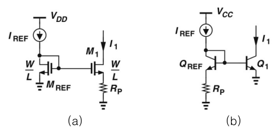

# 기출 2021-1 중간 5 — 축퇴 저항 R_P로 복사 전류비를 정하는 MOS·바이폴라 전류 거울

## 원문
다음 회로에 대해 질문에 답하시오. $V_{TH}$는 동일하고, $\lambda = 0$, $V_A = \infty$로 가정한다.

(1) 회로 (a)에서 $I_1 = I_{REF}/2$가 되는 $R_P$ 값을 식으로 구하시오. 단, $M_{REF} = M_1 = W/L$이다.

(2) 회로 (b)에서 $I_1 = 2I_{REF}$가 되는 $R_P$ 값을 식으로 구하시오. 단, $Q_{REF} = Q_1$이고, 베이스 전류는 무시한다.

## 조건
- 회로: 그림 (a) MOS 전류 거울, (b) 바이폴라 전류 거울 (회로 종류 이름은 원문에 없음, 원문은 "다음 회로"만 적음)
- $V_{TH}$는 모두 같음
- $\lambda = 0$, $V_A = \infty$로 가정
- (1) 전용 (회로 (a)): $M_{REF} = M_1 = W/L$ (두 트랜지스터의 크기가 같음) (괄호 안은 원문에 없음)
- (2) 전용 (회로 (b)): $Q_{REF} = Q_1$ (두 트랜지스터가 같음), 베이스 전류는 무시 (첫 괄호 안은 원문에 없음)
- $I_{REF}$, $V_{DD}$, $V_{CC}$의 값은 주어지지 않음. 답은 기호로 나타냄 (원문에 없음)

## 구할 것
- (1) 회로 (a)에서 $I_1 = I_{REF}/2$가 되는 $R_P$ 값 (식으로)
- (2) 회로 (b)에서 $I_1 = 2 I_{REF}$가 되는 $R_P$ 값 (식으로)

## 회로 — Fig Q5(a)
```spice
IREF  VDD  n1   {I_REF}
MREF  n1   n1   0    nmos  W/L={W/L}    ; 좌우 반전 (게이트 오른쪽), 다이오드 연결
M1    out  n1   n2   nmos  W/L={W/L}
RP    n2   0    {R_P}                   ; M1 소스 ↔ 접지
```
- 단자: VDD = 전원, 값 미지정 (T 전원 기호) / out = M1 드레인, I_1이 들어가는 단자 (선 끝)
- 표시: 노드 라벨 V_DD (T 기호 오른쪽) / 소자 라벨 I_REF (전류원 왼쪽), M_REF (M_REF 아래 오른쪽, 접지 기호 오른쪽), M1 (M1 위 왼쪽, 드레인 선 왼쪽), R_P (세로 저항 오른쪽) / 부호 없음 / 화살표 "I_1": out, 아래 방향(M1 드레인으로 들어감), 도선 위, 글자는 화살표 오른쪽 / 수치·면적 라벨 "W/L" (분수 꼴, M_REF 왼쪽), "W/L" (분수 꼴, M1 오른쪽)
- 배치: 왼쪽 세로줄 위→아래 VDD T 기호, I_REF 전류원(화살표 아래), n1 접속점, M_REF, 접지 / M_REF nmos 좌우 반전(게이트 막대 오른쪽, 드레인 왼쪽 위, 소스 왼쪽 아래·화살표 바깥), 소스 아래 접지 / n1 접속점에서 세로선이 아래로 내려가 모서리에서 오른쪽으로 꺾여 M_REF 드레인 / n1 접속점에서 가로선이 오른쪽으로 나가 M_REF 게이트보다 조금 오른쪽에서 아래로 꺾여 게이트 접속점 / 게이트 접속점에서 게이트 높이의 가로선이 왼쪽 M_REF 게이트, 오른쪽 M1 게이트로 / M1은 오른쪽, nmos 보통 방향(게이트 왼쪽, 드레인 위, 소스 아래·화살표 바깥) / M1 드레인에서 세로선이 위로 올라가 선 끝, 그 선 위에 I_1 화살표 / M1 소스 → 세로 저항 R_P → 접지 / 접속점 (세 갈래 이상, 2곳): ① n1 = 위 I_REF + 아래 M_REF 드레인 + 오른쪽 다이오드 연결선 (점) ② 게이트 접속점 = 위 다이오드 연결선 + 왼쪽 M_REF 게이트 + 오른쪽 M1 게이트 (점) / 교차: 없음

## 회로 — Fig Q5(b)
```spice
IREF  VCC  n1   {I_REF}
QREF  n1   n1   n2   npn    ; 좌우 반전 (베이스 오른쪽), 다이오드 연결
RP    n2   0    {R_P}       ; Q_REF 이미터 ↔ 접지
Q1    out  n1   0    npn
```
- 단자: VCC = 전원, 값 미지정 (T 전원 기호) / out = Q1 컬렉터, I_1이 들어가는 단자 (선 끝)
- 표시: 노드 라벨 V_CC (T 기호 오른쪽) / 소자 라벨 I_REF (전류원 왼쪽), Q_REF (Q_REF 왼쪽, 이미터 높이), Q1 (Q1 오른쪽, 이미터 옆), R_P (세로 저항 오른쪽) / 부호 없음 / 화살표 "I_1": out, 아래 방향(Q1 컬렉터로 들어감), 도선 위, 글자는 화살표 오른쪽 / 수치·면적 라벨 없음
- 배치: 왼쪽 세로줄 위→아래 VCC T 기호, I_REF 전류원(화살표 아래), n1 접속점, Q_REF, R_P, 접지 / Q_REF npn 좌우 반전(베이스 막대 오른쪽, 컬렉터 왼쪽 위, 이미터 왼쪽 아래·화살표 바깥) / n1 접속점에서 세로선이 아래로 Q_REF 컬렉터 / n1 접속점에서 가로선이 오른쪽으로 나가 Q_REF 베이스보다 조금 오른쪽에서 아래로 꺾여 베이스 접속점 / 베이스 접속점에서 베이스 높이의 가로선이 왼쪽 Q_REF 베이스, 오른쪽 Q1 베이스로 / Q_REF 이미터 → 세로 저항 R_P → 접지 / Q1은 오른쪽, npn 보통 방향(베이스 왼쪽, 컬렉터 위, 이미터 아래·화살표 바깥) / Q1 컬렉터에서 세로선이 위로 올라가 선 끝, 그 선 위에 I_1 화살표 / Q1 이미터 아래 접지 / 접속점 (세 갈래 이상, 2곳): ① n1 = 위 I_REF + 아래 Q_REF 컬렉터 + 오른쪽 다이오드 연결선 (점) ② 베이스 접속점 = 위 다이오드 연결선 + 왼쪽 Q_REF 베이스 + 오른쪽 Q1 베이스 (점) / 교차: 없음



## 풀이
### (1) 두 게이트–소스 전압
- 게이트가 공통이므로 $V_{GS,REF} = V_{GS1} + I_1 R_P$
- $V_{GS} = V_{TH} + \sqrt{2 I_D/(\mu_n C_{ox} W/L)}$ ($\lambda = 0$): $V_{GS,REF} = V_{TH} + \sqrt{2 I_{REF}/(\mu_n C_{ox} W/L)}$, $I_1 = I_{REF}/2$이면 $V_{GS1} = V_{TH} + \sqrt{I_{REF}/(\mu_n C_{ox} W/L)}$
### (1) $R_P$
- $V_{TH}$가 같아 지워진다: $I_1 R_P = (\sqrt{2} - 1)\sqrt{I_{REF}/(\mu_n C_{ox} W/L)}$
- $R_P = \dfrac{2(\sqrt{2} - 1)}{\sqrt{\mu_n C_{ox} (W/L) I_{REF}}} \approx \dfrac{0.828}{\sqrt{\mu_n C_{ox} (W/L) I_{REF}}}$
### (2) 두 베이스–이미터 전압
- 베이스가 공통이므로 $V_{BE,REF} + I_{REF} R_P = V_{BE1}$ (베이스 전류 무시, $R_P$에는 $I_{REF}$가 흐름)
- $V_{BE} = V_T \ln(I_C/I_S)$, 같은 소자라 $I_S$가 같다: $V_{BE1} - V_{BE,REF} = V_T \ln(I_1/I_{REF}) = V_T \ln 2$
### (2) $R_P$
- $R_P = V_T \ln 2 / I_{REF} \approx 0.693\, V_T/I_{REF}$
### 답
- (1) $R_P = \dfrac{2(\sqrt{2} - 1)}{\sqrt{\mu_n C_{ox} (W/L) I_{REF}}}$
- (2) $R_P = \dfrac{V_T \ln 2}{I_{REF}}$
