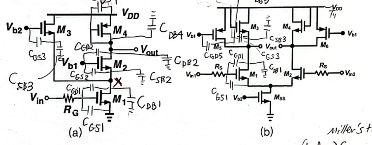

# 기출 2023-1 기말 1 — Miller 정리로 구하는 캐스코드 증폭기와 차동 증폭기의 극점

## 조건
- 회로: 그림 (a), (b)
- Miller's theorem을 사용해 답함
- (1) 전용 (회로 (a)): $\lambda = 0$으로 가정
- (2) 전용 (회로 (b), 차동 증폭기): $\lambda \neq 0$으로 가정
- 소자 값과 커패시턴스 값은 주어지지 않음 (답은 기호로) (원문에 없음)
- (2)의 전달함수는 $V_{out}/V_{in}(s)$로 인쇄돼 있으나, 그림 (b)에는 $V_{in}$이 없고 입력이 $V_{in1}$, $V_{in2}$로 인쇄돼 있음 (원문에 없음)

## 구할 것
- (1) 회로 (a)의 pole 주파수들을 각각 구함
- (2) 차동 증폭기 회로 (b)의 pole 주파수들과 전달함수 $V_{out}/V_{in}(s)$를 각각 구함

## 회로 — Fig Q1(a)
```spice
M4   Vout  Vout  VDD  pmos    ; 다이오드 연결 (게이트 = 드레인)
M2   Vout  Vb1   n1   nmos
M3   VDD   Vb2   n1   nmos    ; 드레인 = VDD, 소스 = n1
M1   n1    n2    0    nmos
RG   Vin   n2    {R_G}
```
- 단자: VDD = 전원, 값 미지정 (가로 레일) / Vb2, Vb1 = 이상적 DC 바이어스, 값 미지정 (점 단자) / Vin = 입력 (개방 원) / Vout = 출력 (개방 원)
- 표시: 노드 라벨 V_DD (레일 오른쪽 끝), V_b2 (점 단자 왼쪽), V_b1 (점 단자 왼쪽), V_out (출력 원 오른쪽), V_in (입력 원 왼쪽) / 소자 라벨 M3, M4, M2, M1 (각 트랜지스터 오른쪽), R_G (가로 저항 아래) / 부호 없음 / 화살표 없음 / 수치·면적 라벨 없음
- 배치: 맨 위 가로 레일 V_DD / 왼쪽 위에 M3 (nmos 보통 방향: 게이트 왼쪽, 드레인 위가 레일로, 소스 아래·화살표 바깥), V_b2 점 단자 → 가로선 → M3 게이트 / M3 소스에서 긴 세로선이 n1 높이까지 내려가 모서리에서 오른쪽으로 꺾여 n1 접속점 / 오른쪽 세로줄 위→아래 레일, M4, 위 Vout 접속점, 아래 Vout 접속점, M2, n1 접속점, M1, 접지 / M4 pmos 보통 방향 (게이트 왼쪽, 소스 위가 레일로·화살표가 막대 쪽으로 들어감, 드레인 아래) / M4 게이트에서 짧은 가로선이 왼쪽으로 나가 모서리에서 아래로 꺾여 드레인보다 조금 아래 높이에서 오른쪽으로 꺾여 위 Vout 접속점 (다이오드 연결) / 아래 Vout 접속점에서 가로선이 오른쪽 V_out 원 / M2, M1 nmos 보통 방향 (게이트 왼쪽, 드레인 위, 소스 아래·화살표 바깥) / V_b1 점 단자 → 가로선 → M2 게이트 / V_in 원 → 가로 R_G → M1 게이트 (n2, 라벨 없음) / 접속점 (세 갈래 이상, 3곳): 위 Vout = 위 M4 드레인 + 왼쪽 M4 게이트 선 + 아래 세로선 (점), 아래 Vout = 위 세로선 + 오른쪽 V_out 선 + 아래 M2 드레인 (점), n1 = 위 M2 소스 + 아래 M1 드레인 + 왼쪽 M3 소스 선 (점) / 교차: 없음

## 회로 — Fig Q1(b)
```spice
M5   out1  Vb1   VDD   pmos
M3   VDD   VDD   out1  nmos    ; 게이트 = VDD (레일에서 내려온 선), 소스 = out1
M4   VDD   VDD   out2  nmos    ; 좌우 반전 (게이트 오른쪽), 게이트 = VDD, 소스 = out2
M6   out2  Vb1   VDD   pmos    ; 좌우 반전 (게이트 오른쪽)
M1   out1  n1    n3    nmos
M2   out2  n2    n3    nmos    ; 좌우 반전 (게이트 오른쪽)
RS1  Vin1  n1    {R_S}         ; 인쇄 라벨 R_S
RS2  Vin2  n2    {R_S}         ; 인쇄 라벨 R_S
MSS  n3    Vb2   0     nmos
* out1, out2 사이에 V_out 라벨이 하나만 인쇄됨 (차동 출력)
```
- 단자: VDD = 전원, 값 미지정 (가로 레일) / Vb1 = 이상적 DC 바이어스, 값 미지정 (점 단자 2개, 둘 다 V_b1로 인쇄) / Vb2 = 이상적 DC 바이어스, 값 미지정 (점 단자) / Vin1, Vin2 = 입력 (개방 원) / out1, out2 = 출력 (개방 원 2개, 차동 출력)
- 표시: 노드 라벨 V_DD (레일 오른쪽 끝 위), V_b1 (왼쪽 점 단자 왼쪽), V_b1 (오른쪽 점 단자 오른쪽), V_out (두 출력 원 사이, 하나만 인쇄), V_in1 (입력 원 왼쪽), V_in2 (입력 원 오른쪽), V_b2 (점 단자 왼쪽) / 소자 라벨 M5 (M5 아래 오른쪽), M3 (M3 오른쪽), M4 (M4 왼쪽), M6 (M6 아래), M1 (M1 오른쪽), M2 (M2 왼쪽), R_S (왼쪽 가로 저항 위), R_S (오른쪽 가로 저항 위), M_SS (M_SS 오른쪽) / 부호 없음 / 화살표 없음 / 수치·면적 라벨 없음
- 배치: 맨 위 가로 레일 V_DD / 왼쪽 위 M5 pmos 보통 방향 (게이트 왼쪽 → V_b1 점 단자, 소스 오른쪽 위가 레일로·화살표가 막대 쪽으로 들어감, 드레인 오른쪽 아래) / M5 드레인에서 세로선이 조금 내려가 모서리에서 오른쪽으로 꺾여 out1 접속점 / M3는 M5 오른쪽, nmos 보통 방향 (드레인 위가 레일로, 소스 아래·화살표 바깥이 out1 접속점으로), M3 게이트에서 짧은 가로선이 왼쪽으로 나가 모서리에서 위로 꺾여 레일 / 오른쪽은 좌우 대칭: M4 nmos 좌우 반전 (게이트 오른쪽, 드레인 왼쪽 위가 레일로, 소스 왼쪽 아래·화살표 바깥이 out2 접속점으로), M4 게이트에서 짧은 가로선이 오른쪽으로 나가 모서리에서 위로 꺾여 레일 / M6 pmos 좌우 반전 (게이트 오른쪽 → V_b1 점 단자, 소스 왼쪽 위가 레일로·화살표가 막대 쪽으로 들어감, 드레인 왼쪽 아래), M6 드레인에서 세로선이 조금 내려가 모서리에서 왼쪽으로 꺾여 out2 접속점 / out1 접속점에서 가로선이 오른쪽 출력 원, out2 접속점에서 가로선이 왼쪽 출력 원 (두 원이 가운데서 마주 봄) / out1 아래 M1 (nmos 보통 방향, 게이트 왼쪽), out2 아래 M2 (nmos 좌우 반전, 게이트 오른쪽) / V_in1 원 → 가로 R_S → M1 게이트, V_in2 원 → 가로 R_S → M2 게이트 / M1 소스, M2 소스에서 각각 세로선이 내려가 꺾여 한 가로선으로 이어지고, 그 가운데 n3 접속점에서 아래로 M_SS 드레인 / M_SS nmos 보통 방향 (게이트 왼쪽 → V_b2 점 단자), 소스 아래 접지 / 접속점 (세 갈래 이상, 3곳): out1 = 위 M3 소스 + 왼쪽 M5 드레인 선 + 아래 M1 드레인 + 오른쪽 출력 원 선 (점), out2 = 위 M4 소스 + 오른쪽 M6 드레인 선 + 아래 M2 드레인 + 왼쪽 출력 원 선 (점), n3 = 왼쪽 M1 소스 선 + 오른쪽 M2 소스 선 + 아래 M_SS 드레인 (점) / 교차: 없음


> 참고: 답안지 손글씨가 겹침 ((a)의 C_GS3, C_SB3, C_GD2, C_GS2, C_SB2, C_DB2, C_GD1, C_GS1, C_DB1, C_GS4, C_DB4 커패시터와 그 연결선, n1 접속점 오른쪽 위의 빨간 "×", M4 게이트 선 왼쪽에서 레일 위까지 이어진 C_GS4 선; (b)의 C_DB5, C_SB3, C_GS3, C_GD5, C_GD1, C_GS1, C_DB1 커패시터와 그 연결선, V_DD 라벨 아래 획; (b) 오른쪽 아래 "Miller's theorem" 글자와 그 아래 "(1−A_v)C" 풀이 일부). (a)의 M4 게이트 선 중 레일에서 게이트 높이까지 내려오는 세로 부분은 손글씨로 봄 (인쇄 선보다 가늘고 손으로 그린 C_GS4 선과 이어짐)
