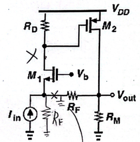

# 기출 2023-1 기말 2 — R_F 귀환이 있는 공통 게이트–PMOS 공통 소스 증폭기의 개방·폐루프 해석

## 원문
다음 회로에서 $R_F$는 매우 크지 않다고 가정하며, $\lambda = 0$으로 가정한다.

(1) Open-loop gain과 open-loop 입력 및 출력 임피던스를 각각 구하시오.

(2) Feedback factor, closed-loop gain, closed-loop 입력 임피던스를 각각 구하시오.

## 조건
- 회로: 그림 (입력 전류 $I_{in}$, 출력 전압 $V_{out}$)
- $R_F$는 매우 크지 않다고 가정
- $\lambda = 0$으로 가정
- 소자 값($R_D$, $R_F$, $R_M$, $V_b$, $V_{DD}$, 트랜지스터 크기)은 주어지지 않음 (원문에 없음)

## 구할 것
- (1) Open-loop gain과 open-loop 입력 임피던스, open-loop 출력 임피던스를 각각 구함
- (2) Feedback factor, closed-loop gain, closed-loop 입력 임피던스를 각각 구함

## 회로 — Fig Q2
```spice
RD   VDD   n1    {R_D}
M2   Vout  n1    VDD   pmos
M1   n1    Vb    n2    nmos    ; 좌우 반전 (게이트 오른쪽)
RF   n2    Vout  {R_F}
RM   Vout  0     {R_M}
Iin  0     n2    {I_in}
```
- 단자: VDD = 전원, 값 미지정 (가로 레일) / Vb = 이상적 DC 바이어스, 값 미지정 (점 단자) / Vout = 출력 (개방 원)
- 표시: 노드 라벨 V_DD (레일 오른쪽 끝), V_b (점 단자 오른쪽), V_out (출력 원 오른쪽) / 소자 라벨 R_D (저항 왼쪽), M2 (M2 오른쪽), M1 (M1 왼쪽, 소스 화살표 높이), R_F (가로 저항 아래), R_M (저항 오른쪽), I_in (전류원 왼쪽) / 부호 없음 / 화살표 없음 / 수치·면적 라벨 없음
- 배치: 맨 위 가로 레일 V_DD / 왼쪽 세로줄 위→아래 R_D, n1 접속점, M1, n2 접속점 / 오른쪽 세로줄 위→아래 M2, Vout 접속점, R_M, 접지 / M2 pmos 보통 방향 (게이트 왼쪽, 소스 오른쪽 위가 레일로·화살표가 막대 쪽으로 들어감, 드레인 오른쪽 아래) / M2 게이트에서 가로선이 왼쪽으로 나가 모서리에서 아래로 꺾여 n1 높이에서 왼쪽으로 꺾여 n1 접속점 / M1 nmos 좌우 반전 (게이트 오른쪽, 드레인 왼쪽 위, 소스 왼쪽 아래·화살표가 왼쪽 바깥으로), 게이트에서 짧은 가로선이 오른쪽 V_b 점 단자 / M2 드레인에서 긴 세로선이 Vout 접속점까지 내려감 / n2 접속점에서 가로선이 왼쪽으로 가 모서리에서 아래로 꺾여 I_in 전류원(화살표 위 방향), 그 아래 접지 / n2에서 오른쪽으로 가로 R_F를 지나 Vout 접속점 / Vout 접속점에서 가로선이 오른쪽 V_out 원 / 접속점 (세 갈래 이상, 3곳): n1 = 위 R_D + 아래 M1 드레인 + 오른쪽 M2 게이트 선 (점), n2 = 위 M1 소스 + 왼쪽 I_in 선 + 오른쪽 R_F (점), Vout = 위 M2 드레인 + 왼쪽 R_F + 아래 R_M + 오른쪽 V_out 선 (점) / 교차: 없음


> 참고: 답안지 손글씨가 겹침 (n1 아래 "×" 표시, n2 오른쪽의 작은 "×"와 접지 기호, n2에서 아래로 그린 저항과 "R_F" 글자·접지, R_F 라벨 아래에서 내려가는 곡선)

## 힌트
### (1) $R_F$ 부하는 반대쪽 끝을 접지
- $R_F$는 출력 전압을 감지해 $M_1$ 소스 노드에 전류로 되돌리므로, 매우 크지 않으면 개루프를 구할 때 입력·출력 양쪽에 부하로 넣어야 한다
- 입력 쪽 부하는 $V_{out}$을 접지하고, 출력 쪽 부하는 $M_1$ 소스 노드를 접지하고 $R_F$를 본다
