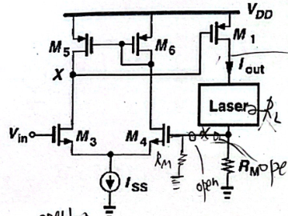

# 기출 2023-1 기말 3 — 차동쌍 앞단과 PMOS 출력 소자로 레이저 다이오드를 구동하는 귀환 회로

## 원문
다음 회로에서 $R_M$은 작지 않다고 가정하며, laser diode의 임피던스는 $R_L$이다. 또한, $\lambda > 0$으로 가정한다.

(1) Open-loop gain과 open-loop 입력 및 출력 임피던스를 각각 구하시오.

(2) Loop gain, closed-loop gain, closed-loop 출력 임피던스를 각각 구하시오.

## 조건
- 회로: 그림 (입력 전압 $V_{in}$, 레이저 다이오드에 흐르는 출력 전류 $I_{out}$)
- $R_M$은 작지 않다고 가정
- laser diode의 임피던스는 $R_L$
- $\lambda > 0$으로 가정
- 소자 값($R_M$, $R_L$, $I_{SS}$, $V_{DD}$, 트랜지스터 크기)은 주어지지 않음 (원문에 없음)

## 구할 것
- (1) Open-loop gain과 open-loop 입력 임피던스, open-loop 출력 임피던스를 각각 구함
- (2) Loop gain, closed-loop gain, closed-loop 출력 임피던스를 각각 구함

## 회로 — Fig Q3
```spice
M5   X    n1   VDD   pmos    ; 좌우 반전 (게이트 오른쪽)
M6   n1   n1   VDD   pmos    ; 다이오드 연결
M1   n2   X    VDD   pmos
XL   n2   n3   box "Laser"   ; 레이저 다이오드, 임피던스 R_L (조건)
RM   n3   0    {R_M}
M3   X    Vin  n4    nmos
M4   n1   n3   n4    nmos    ; 좌우 반전 (게이트 오른쪽)
ISS  n4   0    {I_SS}
```
- 단자: VDD = 전원, 값 미지정 (가로 레일) / Vin = 입력 (개방 원)
- 표시: 노드 라벨 V_DD (레일 오른쪽 끝), X (X 접속점 왼쪽), V_in (입력 원 왼쪽) / 소자 라벨 M5 (M5 왼쪽), M6 (M6 오른쪽), M1 (M1 오른쪽), "Laser" (상자 안), R_M (저항 오른쪽), M3 (M3 오른쪽), M4 (M4 왼쪽), I_SS (전류원 오른쪽) / 부호 없음 / 화살표 "I_out": M1 드레인과 Laser 상자 윗변 사이 도선, 아래 방향, 도선 위, 글자는 화살표 오른쪽 / 수치·면적 라벨 없음
- 배치: 맨 위 가로 레일 V_DD / 왼쪽 위 M5, 가운데 위 M6, 오른쪽 위 M1 / M5 pmos 좌우 반전 (게이트 오른쪽, 소스 왼쪽 위가 레일로·화살표가 막대 쪽으로 들어감, 드레인 왼쪽 아래) / M6 pmos 보통 방향 (게이트 왼쪽, 소스 오른쪽 위가 레일로·화살표가 막대 쪽으로 들어감, 드레인 오른쪽 아래) / M5 게이트와 M6 게이트는 게이트 높이의 가로선으로 이어지고, 그 가운데 접속점에서 세로선이 아래로 내려가 M6 드레인보다 조금 아래 높이에서 오른쪽으로 꺾여 n1 접속점 (다이오드 연결) / M1 pmos 보통 방향 (게이트 왼쪽, 소스 오른쪽 위가 레일로·화살표가 막대 쪽으로 들어감, 드레인 아래) / 왼쪽 세로줄 위→아래 M5 드레인, X 접속점, M3 / 가운데 세로줄 위→아래 M6 드레인, n1 접속점, M4 / X 접속점에서 가로선이 오른쪽으로 길게 가 M1 게이트 x에서 위로 꺾여 M1 게이트 높이에서 오른쪽으로 꺾여 M1 게이트 / 오른쪽 세로줄 위→아래 M1, I_out 화살표, Laser 상자, n3 접속점, R_M, 접지 / M3 nmos 보통 방향 (게이트 왼쪽 → V_in 원, 드레인 위, 소스 아래·화살표 바깥) / M4 nmos 좌우 반전 (게이트 오른쪽, 드레인 왼쪽 위, 소스 왼쪽 아래·화살표가 왼쪽 바깥으로) / M4 게이트에서 가로선이 오른쪽으로 곧게 가 n3 접속점 / M3 소스, M4 소스에서 각각 세로선이 내려가 꺾여 한 가로선으로 이어지고, 그 가운데 n4 접속점에서 아래로 I_SS 전류원(화살표 아래 방향), 그 아래 접지 / 접속점 (세 갈래 이상, 5곳): M5·M6 게이트선 가운데 = 왼쪽 M5 게이트 + 오른쪽 M6 게이트 + 아래 다이오드 연결선 (점), n1 = 위 M6 드레인 + 왼쪽 다이오드 연결선 + 아래 M4 드레인 (점), X = 위 M5 드레인 + 아래 M3 드레인 + 오른쪽 M1 게이트 선 (점), n3 = 위 Laser 상자 + 왼쪽 M4 게이트 선 + 아래 R_M (점), n4 = 왼쪽 M3 소스 선 + 오른쪽 M4 소스 선 + 아래 I_SS (점) / 교차: X에서 M1 게이트로 가는 가로선이 n1과 M4 드레인 사이 세로선과 점 없이 교차 (1곳)


> 참고: 답안지 손글씨가 겹침 (M1 드레인 옆에서 오른쪽으로 나가는 선, Laser 상자 오른쪽 "R_L", M4 게이트 선 위의 작은 원·"×"·"DL" 글자, M4 게이트 선에서 아래로 그린 저항과 "R_M"·접지, "open" 글자 두 곳과 곡선, 크롭 왼쪽 아래 "openloop" 글자 일부). M4 게이트 선은 손글씨 아래에서도 인쇄 선이 끊기지 않고 n3 접속점까지 이어짐

## 힌트
### (1) $M_4$ 게이트를 접지해 루프를 엶
- 차동쌍이 $V_{in}$과 $R_M$ 위 전압을 빼는 오차 증폭기이고, $R_M$은 $I_{out}$을 감지해 $M_4$ 게이트로 되돌린다
- 게이트는 전류를 끌지 않으므로 거기서 끊으면 입력 쪽 부하는 없다. 반면 $R_M$은 작지 않으므로 개루프에서도 레이저와 직렬로 출력 경로에 남긴다

## 풀이
### (1) 귀환 구조
- $R_M$이 $I_{out}$을 $I_{out}R_M$으로 바꿔 $M_4$ 게이트로 되돌리고 차동쌍이 $V_{in}$에서 뺀다(전류 감지·전압 귀환)
- $M_4$ 게이트에서 끊는다. 게이트 전류가 없어 입력 쪽 부하는 없고, $R_M$은 작지 않으므로 출력 경로에 남긴다
### (1) 개루프 이득
- 거울 부하 차동쌍(대칭 차동쌍으로 보아 $g_{m3} = g_{m4}$): $V_X = -g_{m3}(r_{O3} \parallel r_{O5})V_{in}$
- $M_1$ 드레인에 레이저와 $R_M$ 직렬: $I_{out} = -g_{m1}V_X\,r_{O1}/(r_{O1} + R_L + R_M)$
- $A_{OL} = I_{out}/V_{in} = g_{m1}g_{m3}(r_{O3} \parallel r_{O5})\,r_{O1}/(r_{O1} + R_L + R_M)$
### (1) 개루프 입출력 임피던스
- 입력은 $M_3$ 게이트라 $R_{in,OL} \to \infty$. 출력(레이저 자리에서 봄) $R_{out,OL} = r_{O1} + R_M$
### (2) 루프 이득과 폐루프
- $\beta = R_M$ ($M_4$ 게이트 전압/$I_{out}$), $T = \beta A_{OL}$. 게이트가 오르면 $X$가 올라 $I_{out}$이 줄어 음의 귀환
- $I_{out}/V_{in} = A_{OL}/(1 + T)$
- 직렬(전류) 감지라 곱한다. 레이저 자리를 단락한 $T|_{R_L=0}$: $R_{out,CL} = (r_{O1} + R_M)(1 + T|_{R_L=0})$
### 답
- (1) $A_{OL} = \dfrac{g_{m1}g_{m3}(r_{O3} \parallel r_{O5})\,r_{O1}}{r_{O1} + R_L + R_M}$, $R_{in,OL} \to \infty$, $R_{out,OL} = r_{O1} + R_M$
- (2) $T = A_{OL}R_M$, $\dfrac{I_{out}}{V_{in}} = \dfrac{A_{OL}}{1 + A_{OL}R_M}$, $R_{out,CL} = r_{O1} + R_M + g_{m1}g_{m3}(r_{O3} \parallel r_{O5})\,r_{O1}R_M$
